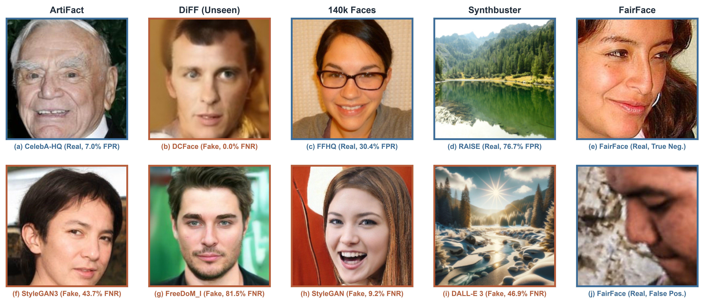
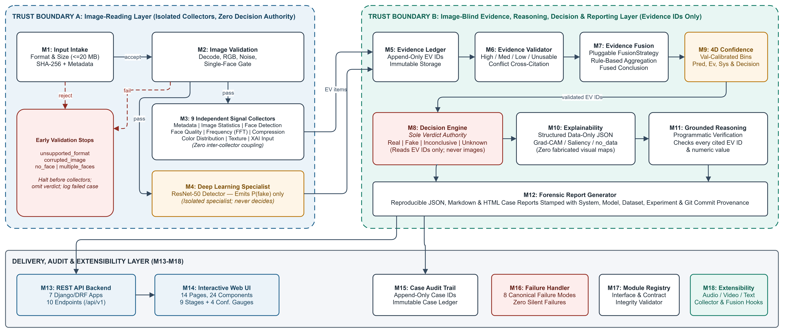
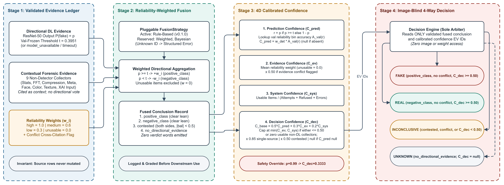
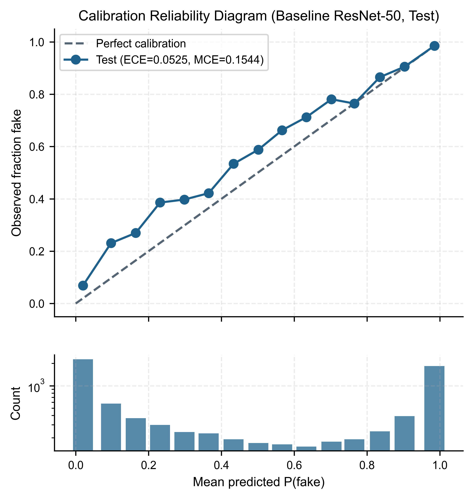
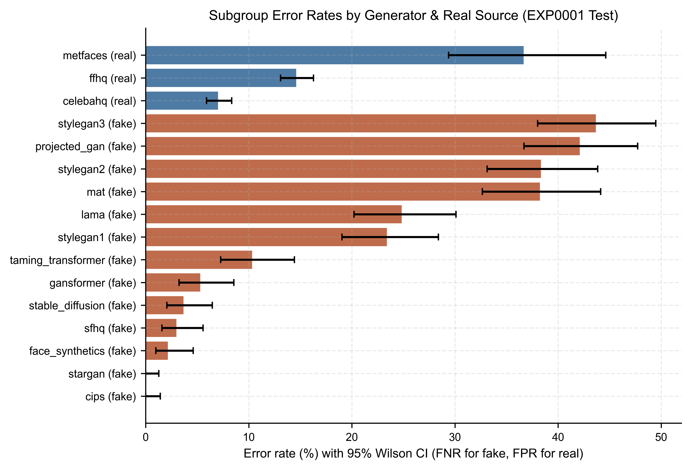
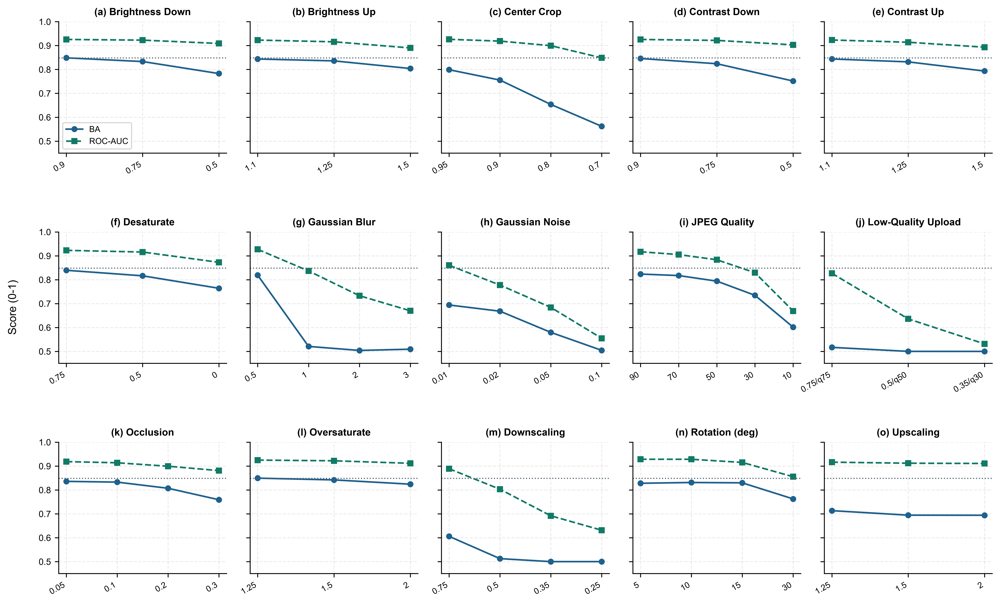
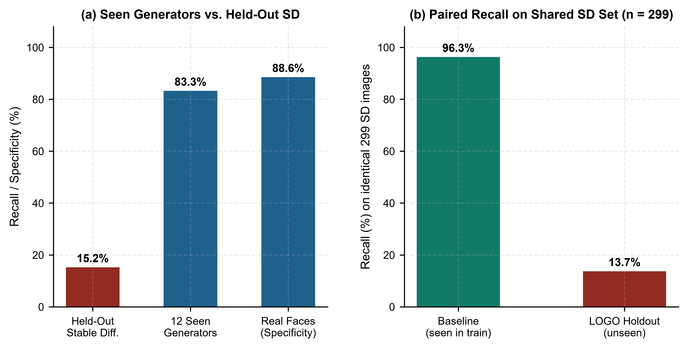
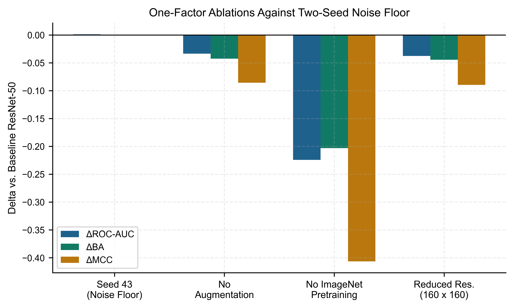
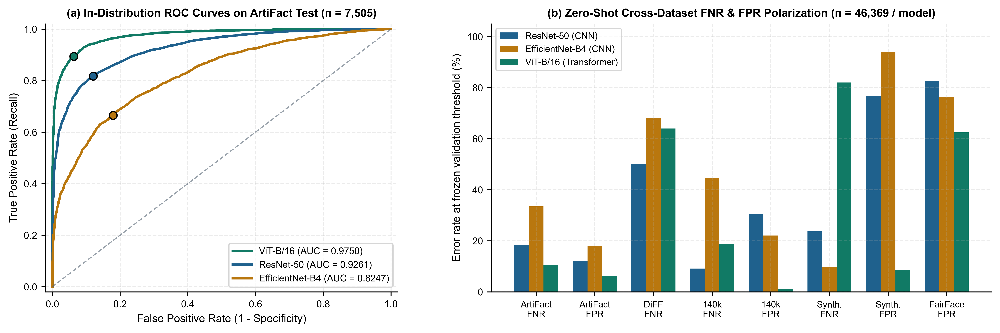
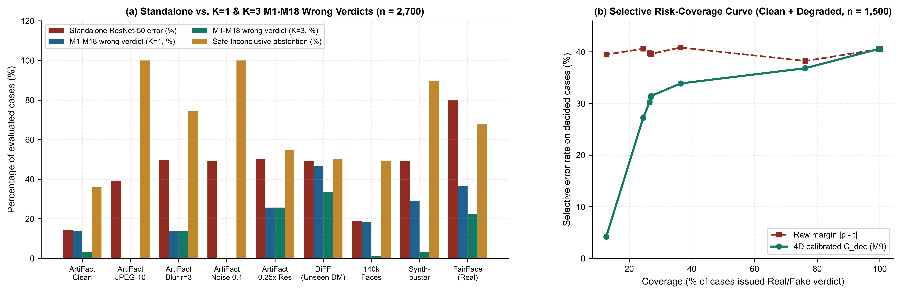

# AI Forensic Analyst: An Evidence-Driven, Calibrated, and Auditable Architecture for Cross-Generator Synthetic Face Forensics

**Target Venue:** *Forensic Science International: Digital Investigation* / *Computers & Security* (Elsevier Q1)  

**Authors:** Md. Assaduzzaman$^1$, Nushamd-A-Shawmeem$^1$, Sourav Saha$^1$, Masud Rana Nayeem$^1$, Tapasy Rabeya$^1$, Md. Mizanur Rahman$^{1,2*}$, Md Ali Hossain$^{1,2}$, Ahmed Moustafa$^{3,4,6*}$, Suman Ahmmed$^5$, Ohidujjaman$^5$

**Affiliations:**  
$^1$ Faculty of Science and Information Technology, Daffodil International University, Dhaka, Bangladesh.  
$^2$ NanoBio Technology Center, Daffodil International University, Dhaka, Bangladesh.  
$^3$ Centre for Data Analytics and School of Psychology, Bond University, Gold Coast, Queensland, Australia.  
$^4$ Department of Human Anatomy and Physiology, Faculty of Health Sciences, University of Johannesburg, Johannesburg, South Africa.  
$^5$ Department of Computer Science & Engineering, United International University, Dhaka, Bangladesh.  
$^6$ Faculty of Psychology, University College of Professional Education, Wrocław, Poland.

$^*$Corresponding authors: `mizanurrahman.cse@diu.edu.bd`; `amoustaf@bond.edu.au`  
Contributing authors: `assaduzzaman23105101233@diu.edu.bd`; `shawmeem2305101823@diu.edu.bd`; `saha2305101978@diu.edu.bd`; `masudrananayeem86@gmail.com`; `tapasyrabeya.cse@diu.edu.bd`; `ali.cse@diu.edu.bd`; `suman@cse.uiu.ac.bd`; `ohidujjaman@cse.uiu.ac.bd`.

---

## Highlights

- Decouples synthetic face classification from an image-blind four-way forensic decision engine.
- Benchmarks ResNet-50, EfficientNet-B4, and ViT-B/16 across five open-license face corpora.
- Shows ViT-B/16 hits 0.9750 AUC in-domain yet misses 64.0% to 82.1% of unseen diffusion faces.
- Fuses cross-paradigm specialists with 4D calibrated confidence to cut silent errors up to 93.9%.
- Enforces append-only evidence provenance and programmatic verification of forensic reasoning.

---

## Abstract

Synthetic human faces produced by generative adversarial networks and denoising diffusion models increasingly challenge digital media authentication, identity verification, and courtroom evidentiary review. Existing detection methods predominantly rely on standalone deep neural networks trained for binary classification. Although such classifiers achieve high accuracy on test splits matched to their training distributions, their predictions degrade sharply under unseen generative architectures, external authentic face distributions, and lossy social-media compression. Returning an uncalibrated binary probability without provenance, uncertainty bounds, or an abstention mechanism exposes forensic examiners to silent false accusations and missed manipulations. This paper proposes the AI Forensic Analyst, a modular, evidence-driven forensic architecture that separates image-reading signal extraction from an image-blind four-way decision engine capable of issuing Real, Fake, Inconclusive, or Unknown outcomes. Using a public, open-license five-dataset benchmark spanning ArtiFact, Diffusion Facial Forgery, 140k Real and Fake Faces, Synthbuster, and FairFace, we train and stress-test three distinct neural architectures under identical fairness invariants: ResNet-50, EfficientNet-B4, and Vision Transformer ViT-B/16. While scaling from ResNet-50 (0.9261 area under the receiver operating characteristic curve) to ViT-B/16 raises in-distribution area under the curve to 0.9750, balanced accuracy to 0.9153, and calibration error down to 0.0211, zero-shot cross-dataset evaluation across 46,369 test images per model reveals that even ViT-B/16 misses 64.0% of unseen diffusion faces, misses 82.1% of Synthbuster syntheses, and falsely accuses 62.5% of FairFace authentic portraits, polarizing in the opposite direction from convolutional baselines. We then formalize reliability-weighted multi-specialist fusion, validation-calibrated four-dimensional confidence estimation, and programmatically verified forensic reasoning across eighteen decoupled modules. Across sixteen fault scenarios and a 2,700-case nine-track governance benchmark, cross-paradigm multi-specialist fusion reduces silent erroneous verdicts to 3.0% on clean ArtiFact, 1.3% on 140k Faces, 3.0% on Synthbuster, 22.3% on FairFace, and 33.3% on unseen diffusion faces, eliminates 48.7% to 100.0% of silent degradation errors, and prevents ungrounded textual claims.

**Keywords:** Synthetic face forensics; Deepfake detection; Cross-generator generalization; Uncertainty calibration; Evidence fusion; Explainable digital forensics; Diffusion models.

---

## 1. Introduction

Recent advances in deep generative modeling have transformed facial synthesis from coarse image editing into photorealistic portrait generation [43]. Early synthesis pipelines relied primarily on Generative Adversarial Networks (GANs), where adversarial training progressively refined spatial fidelity across architectures such as StyleGAN and its successors [25]. More recently, denoising and latent diffusion models have enabled text-conditioned, image-conditioned, and inpainting-based facial generation with substantially fewer geometric or blending flaws [23]. While these tools support creative media and privacy-preserving data workflows, their misuse for impersonation, fabricated journalism, and manipulated legal evidence poses a serious challenge for digital forensic examiners [31].

In current research practice, synthetic face detection is overwhelmingly formulated as standalone binary classification [24]. A convolutional neural network (CNN) or Vision Transformer (ViT) ingests a cropped face image and outputs a single scalar probability indicating whether the sample is authentic or synthetic [28]. On test partitions drawn from the same generator family and camera source as the training set, supervised detectors routinely exceed 95% accuracy [7]. However, controlled cross-domain evaluations demonstrate that these classifiers frequently latch onto generator-specific upsampling traces [5] or superficial dataset shortcuts such as compression history and color statistics [16]. When deployed against unseen diffusion models [23], demographically diverse authentic portraits [38], or heavily re-encoded social-media uploads [41], standalone detectors experience steep spikes in both false negative rates (FNR, missed forgeries) and false positive rates (FPR, authentic faces misclassified as synthetic).

From an operational digital forensics standpoint, this fragility reflects an architectural flaw rather than merely a backbone limitation [40]. Monolithic classifiers conflate four distinct forensic responsibilities inside a single opaque pass: raw signal extraction, evidentiary reliability assessment, probability calibration, and final verdict issuance. When a standalone network outputs a raw softmax score of 0.99 on a degraded or out-of-distribution image, an investigator receives no measure of empirical calibration [30], no corroborating signal audit, and no structured mechanism to abstain [29]. Conversely, enforcing a naive high probability cutoff to suppress false positives can cause severe recall collapse in judicial screening workflows [31].

To address these limitations, this study re-examines synthetic face authentication from both an empirical failure-analysis perspective and a systems-forensics perspective. Specifically, this work makes four main contributions:

1. **Open-License Cross-Paradigm and Multi-Backbone Stress Benchmark:** We assemble and audit a strictly public, open-license five-dataset benchmark (ArtiFact, Diffusion Facial Forgery, 140k Real and Fake Faces, Synthbuster, and FairFace) under deterministic seven-stage preprocessing and leakage-verified grouped and leave-one-generator-out (LOGO) splits. Using this benchmark, we quantify the failure modes of three distinct neural architectures (ResNet-50, EfficientNet-B4, and Vision Transformer ViT-B/16) across calibration, subgroup heterogeneity, 53 synthetic perturbations, four external corpora, controlled Stable Diffusion holdout, and paired statistical ablations.
2. **Trust-Bounded Eighteen-Module Forensic Architecture:** We design and implement the AI Forensic Analyst across eighteen single-responsibility modules (denoted M1 through M18), enforcing an explicit trust boundary between image-reading intake (M1), validation (M2), nine independent contextual collectors (M3), and an isolated deep learning specialist (M4) on one side, and an image-blind downstream core governed by an append-only evidence ledger (M5), non-destructive reliability validator (M6), pluggable fusion engine (M7), and sole four-way Decision Engine (M8: *Real*, *Fake*, *Inconclusive*, *Unknown*) on the other.
3. **Validation-Calibrated Four-Dimensional Confidence and Abstention:** We formulate a transparent calibration framework (M9) that separates raw neural probability from empirical validation-bin accuracy ($C_{\text{pred}}$), collector reliability ($C_{\text{ev}}$), and pipeline execution completeness ($C_{\text{sys}}$), combining them into a conservatively capped decision confidence ($C_{\text{dec}}$) that prevents uncorroborated or contested neural scores from producing overconfident binary verdicts.
4. **Programmatically Grounded Forensic Reasoning and End-to-End Verification:** We introduce an anti-hallucination reasoning engine (M11) that verifies every generated claim against immutable ledger identifiers alongside structured data-only explainability (M10), provenance-stamped reporting (M12), and full-stack web delivery (M13–M14), verifying the complete architecture across 16 end-to-end forensic fault and decision scenarios.

The remainder of this paper is organized as follows. Section 2 reviews 44 peer-reviewed studies across frequency forensics, spatial and foundation-model detectors, biometric and reconstruction cues, fairness and robustness benchmarks, and uncertainty calibration. Section 3 details the five-dataset benchmark, trust-bounded architecture, mathematical fusion and calibration equations, and grounded reporting pipeline. Section 4 describes the experimental setup and statistical evaluation protocols. Section 5 presents and discusses the empirical stress-testing and platform verification results. Section 6 outlines scope limitations, and Section 7 concludes the paper.

---

## 2. Related Work

Research on synthetic face and AI-generated image forensics has expanded substantially across the transition from early GAN architectures to modern diffusion and foundation-model pipelines [43]. To establish a rigorous, traceable foundation without relying on unexamined citation clusters, we review 44 peer-reviewed studies organized across five methodological themes: frequency and convolutional trace analysis, spatial and foundation-model classification, biometric localization and proactive provenance, fairness and perturbation benchmarking, and uncertainty calibration with forensic governance.

### 2.1 Frequency-Domain, Spectral, and Convolutional Trace Forensics

Signal-processing forensic methods inspect deterministic mathematical traces left by upsampling or iterative denoising operators rather than relying exclusively on opaque spatial representations [22]. In early GAN forensics, Guarnera et al. [5] modeled local pixel correlations with an Expectation-Maximization algorithm to extract convolutional fingerprints across five GAN architectures, showing that transposed-convolution layers imprint separable generator traces. Extending spectral inspection, Giudice et al. [10] fitted Laplace beta distributions to $8 \times 8$ Discrete Cosine Transform (DCT) alternating-current coefficients, achieving lightweight, inherently interpretable GAN detection without deep neural training. However, Alkishri et al. [19] demonstrated that targeted GAN fingerprint removal perturbations substantially degrade trace-based detectors, exposing their vulnerability to intentional anti-forensic laundering.

Because denoising diffusion models synthesize imagery through iterative score matching rather than single-pass transposed convolutions, GAN-calibrated spectral rules do not transfer directly to diffusion outputs. Addressing diffusion artifacts directly, Bammey [3] proposed Synthbuster, a training-free pipeline applying cross-difference high-pass filtering and Fast Fourier Transform (FFT) peak analysis across nine diffusion generators, avoiding supervised training-set bias at the cost of sensitivity to heavy post-processing. Within learned architectures, Guo et al. [41] designed Space-Frequency Interactive Convolution (SFIConv) alongside Multichannel Constrained Separable Convolution to couple spatial and high-frequency features inside standard CNN backbones, reaching 96.47% area under the receiver operating characteristic curve (ROC-AUC) on low-quality FaceForensics++ videos yet only 71.0% ROC-AUC on unseen Celeb-DF. More recently, Yan et al. [33] combined four-subband Discrete Wavelet Transform window tiling with phase-only FFT attention across 65 generative models, achieving 92.1% mean accuracy overall while observing sharp degradation to 44.1%–52.1% on face-swapping subsets and 54.6%–60.8% on social-media subsets.

### 2.2 Spatial CNNs, Vision Transformers, and Cross-Domain Generalization

Supervised spatial-domain classifiers represent the dominant paradigm in facial forgery detection [24]. Early comparative studies evaluated standard convolutional architectures on constrained datasets: Taeb and Chi [2] compared VGG19, DenseNet-121, and custom CNNs on a small augmented face dataset without cross-dataset testing, while Safwat et al. [11] paired GAN feature extraction with ResNet classification on only 2,041 images. In social-media contexts, Preeti et al. [17] explored an initial GAN-based social-media detector on a single distribution, which Sharma et al. [13] subsequently extended into a multi-classifier ensemble improving compression resilience on GAN images while leaving diffusion synthesis untested. Competition benchmarks such as the Face Deepfake Detection Challenge organized by Guarnera et al. [14] standardized multi-GAN evaluation and confirmed the strong intra-domain performance of EfficientNet backbones, yet remained restricted to GAN-era distributions.

When evaluated across unseen datasets and generative families, spatial classifiers suffer pronounced generalization drops. Khan and Dang-Nguyen [7] benchmarked eight supervised CNNs and two self-supervised transformers (DINO and CLIP) across four manipulation corpora, reporting that cross-dataset accuracy falls from above 95% in-domain to 60%–70% out-of-domain and that pretraining diversity outweighs backbone complexity. On diffusion-generated faces, Cheng et al. [23] introduced the 500,000-image Diffusion Facial Forgery (DiFF) dataset across 13 diffusion methods and showed that conventional detectors score below 30% accuracy before proposing edge-graph regularization. Exploring transformer patch tokens, Arshed et al. [21] reported 99.90% F1 using a patch-wise ViT on a four-class StyleGAN2 and Stable Diffusion split, although cross-dataset validation was omitted. For structured source attribution, Guarnera et al. [18] arranged ResNet-101 modules into a three-level hierarchy separating authenticity, paradigm (GAN versus diffusion), and specific generator on an 83,000-image proprietary corpus.

Recent cross-domain studies seek invariant forensic representations through feature purification, vision-language alignment, and operator probing. Meng et al. [35] proposed the Artifact Purification Network, combining Hermitian-symmetric DFT band proposals, orthogonal spatial decomposition, and mutual-information minimization to reach 80.4% cross-generator accuracy on GenImage, though without compression stress testing or face-specific evaluation. Wu et al. [34] introduced LASTED, pairing main authenticity labels with ClipCap domain-caption supervision under bidirectional contrastive learning to attain 0.913–0.974 average precision across four cross-domain benchmarks, while recording its lowest subset precision (0.873) on facial deepfakes. Complementing heavy foundation backbones, Shen and Tian [36] developed PORI-Gate, an 11.77M-parameter ResNet-18 architecture that dynamically gates color-quantization, low-bit-plane, and JPEG-residual probes to achieve 92.86% mean accuracy across 38 subsets, while transparently documenting severe accuracy drops on Improved-Diffusion (60.38%) and threshold-shifted DDPM samples (76.37% accuracy despite 90.16% ROC-AUC).

### 2.3 Biometric Localization, Reconstruction Dynamics, and Proactive Provenance

Alternative forensic strategies target anatomical consistency, generative manifold reconstruction, spatial localization, or proactive source authentication. Pasquini et al. [8] combined GAN inversion with biometric trait analysis to expose identity-level anomalies on synthetic portraits. Focusing on ocular physiology, Xue et al. [15] proposed GLFNet, fusing local iris and pupil features with global ResNeSt residuals on CelebA-HQ. For pixel-level localization, Huang et al. [42] designed FakeLocator using a DeepLabv3-ResNet101 encoder-decoder and face-parsing attention to regress full-resolution gray-scale fakeness maps across seven GANs, achieving 0.9846 ROC-AUC on FaceForensics++ while remaining tied to GAN upsampling textures. As Melnik et al. [25] documented in their survey of StyleGAN architectures, and as Abbas and Taeihagh [9] illustrated through hybrid latent-diffusion IC-DGAN facial expression synthesis, modern generators increasingly eliminate overt biometric and blending defects.

Reconstruction-error methods instead test whether an input lies near a generative manifold. Zeng et al. [6] extracted latent diffusion reconstruction residuals for synthetic face identification, demonstrating feasibility while noting that multi-step denoising reconstruction introduces substantial inference latency. Outside facial forensics, Cho et al. [1] applied context-aware diffusion inpainting to industrial defect synthesis, illustrating how localized diffusion masks blend seamlessly into surrounding textures. In contrast, proactive provenance frameworks alter media prior to release: Nadimpalli and Rattani [20] embedded GAN-based visible watermarks for proactive deepfake detection, while Ghani et al. [4] and Ul Ghani et al. [12] integrated GAN synthesis with distributed blockchain ledgers to secure facial recognition templates. Although effective within closed ecosystems, proactive watermarking and blockchain registration cannot authenticate unwatermarked images encountered in reactive forensic investigations.

### 2.4 Demographic Fairness, Compression Robustness, and Evaluation Benchmarks

Fairness audits and uniform benchmarks reveal that dataset bias and post-processing sensitivity systematically inflate published metrics. Altamimi et al. [16] audited ResNet-101, EfficientNet-B4, and Xception across GAN and diffusion faces, discovering that a zero-learning statistical audit achieved 85% accuracy due to low-level dataset bias while EfficientNet-B4 dropped to 86.75% on diffusion faces. At massive scale, Xu et al. [38] transferred 65.3 million facial attribute annotations across five deepfake databases and proved via imbalance-corrected metrics that both demographic and non-demographic attributes induce pronounced detector bias. Evaluating 22 pretrained checkpoints of six diffusion detectors on 40,000 DiffSynFace images paired with FairFace, CelebA-HQ, and Adience, Panda et al. [37] observed strong average precision alongside severe fixed-threshold miscalibration (such as 50% accuracy despite 81.5% average precision). Targeting South Asian representation, Reza et al. [39] introduced ARC-Net (EfficientNet-B0 with residual and attention blocks), reducing real-face FPR on Bangladeshi portraits from 22.0% to 10.0% and validating Grad-CAM overlap quantitatively (0.8396 mean intersection-over-union), though without diffusion or compression testing.

Broader surveys and uniform benchmarks reinforce these structural concerns. Malik et al. [28] and Dang and Nguyen [27] cataloged pre-diffusion image and video manipulation detectors, while Edwards et al. [26] reviewed generation and detection datasets through early diffusion models. Under uniform retraining of 11 detectors across seven datasets (644 training runs), Deng et al. [44] demonstrated that every evaluated detector falls to 51.2%–60.5% average ROC-AUC on an independent human-vetted test set and degrades sharply under Gaussian noise and compression. Extending this benchmark lens to modern generative AI, Croitoru et al. [43] showed that seven state-of-the-art detectors lose more than 30% ROC-AUC on unseen diffusion and 3D talking-face generators, highlighting uncertainty calibration and modular late fusion as urgent open priorities.

### 2.5 Uncertainty Calibration, Out-of-Distribution Detection, and Forensic Governance

Despite high legal stakes, very few studies address predictive uncertainty, out-of-distribution (OOD) rejection, or human-auditable forensic governance. Silva et al. [40] proposed an explainable hierarchical ensemble combining Xception and EfficientNet-B3 with weakly supervised attention cropping/dropping, Grad-CAM region extraction, and secondary 2D DFT and DCT beta inspection; notably, while attaining 92.20% accuracy on DFDC, their ensemble dropped to 72.73% on unconstrained WildDeepfake videos and revealed that 60% of misclassifications occurred within a narrow probability margin below 0.5. In a judicial prototype pairing Django with a pretrained ViT, Hydara et al. [31] found that raising the confidence threshold to 80%–85% to protect courtroom precision caused detection recall to collapse to 18%.

Three recent studies directly investigate OOD detection, calibration, and selective abstention. Maiano et al. [29] cascaded U-Net and Tiny DeiT classifiers with reconstruction- and attention-residual Abnormality modules on an 82,000-image continual deepfake benchmark, reaching 91.6%–93.77% OOD AUROC on content shifts while observing unsupervised OOD drops to 60.14%–63.35% and transformer attention collapse on cross-generator splits. Jin et al. [30] introduced PE-DD, embedding four Packed-Ensembles estimators with Steganalysis-Rich Model (SRM) filters to lower expected calibration error (ECE) to 0.005–0.020 in-domain and achieve the lowest Brier score across four unseen benchmarks, although ECE still degraded six- to ten-fold under heavy compression without an explicit abstention state. Fatima et al. [32] combined a semantic-plus-SRM two-stream network with worst-of-$K$ counter-forensic red-teaming and test-time defense on DeepFakeFace ($\text{ECE} \le 0.0196$), yet evaluated only 240 held-out test pairs without cross-dataset or GAN baselines. Table 1 summarizes 21 representative detection and forensic frameworks across the reviewed literature.

**Table 1:** Summary of representative synthetic face and AI-generated image detection methods in the reviewed literature.

| Study | Year | Core Method / Backbone | Domain | GAN / Diffusion Scope | Cross-Dataset | Calibration / Abstain | Explainability | Key Reported Limitation |
|---|---:|---|---|---|---|---|---|---|
| Guarnera et al. [5] | 2020 | EM convolutional trace extractor | Trace | 5 GANs / None | No | No / No | Inherent traces | Fails on diffusion synthesis |
| Giudice et al. [10] | 2021 | $8 \times 8$ DCT Laplace beta statistics | Frequency | Multi-GAN / None | No | No / No | Inherent DCT | Degrades under heavy JPEG |
| Huang et al. [42] | 2022 | FakeLocator (DeepLabv3 + parsing) | Spatial/Trace | 7 GANs, FF++ / None | Partial | No / No | Fakeness map | Requires paired masks; no DMs |
| Silva et al. [40] | 2022 | Hierarchical CNN + WS-DAN + DFT/DCT | Hybrid | DFDC, Celeb-DF / None | Yes | Margin note / No | Grad-CAM + DFT | Drops to 72.73% on WildDeepfake |
| Xue et al. [15] | 2023 | GLFNet (iris/pupil + ResNeSt) | Biometric+S | CelebA-HQ GAN / None | No | No / No | Physiological | Needs clear ocular landmarks |
| Bammey [3] | 2024 | Synthbuster residual FFT peaks | Frequency | None / 9 DMs | No | No / No | Spectral peaks | Sensitive to compression; no GANs |
| Khan & Dang-Nguyen [7] | 2024 | 8 CNNs + DINO/CLIP transformers | Spatial | 4 benchmarks / None | Yes | No / No | None | Cross-dataset drop to 60%–70% |
| Guarnera et al. [18] | 2024 | 3-level hierarchical ResNet-101 | Hierarchical | 9 GANs / 4 DMs | No | No / No | Paradigm tree | Proprietary 83k dataset |
| Cheng et al. [23] | 2024 | Edge-graph regularization (DiFF) | Spatial/Graph | None / 13 DMs | No | No / No | Edge focus | Baselines <30% acc.; no GANs |
| Hydara et al. [31] | 2024 | Judicial ViT + Django prototype | Spatial | Pooled video / None | No | Threshold / No | OpenCV heatmap | 18% recall at 80%–85% cutoff |
| Meng et al. [35] | 2024 | APN (DFT bands + orthogonal + MI) | Hybrid | BigGAN / 8 DMs | Yes | No / No | Layer-CAM | No compression or face audit |
| Guo et al. [41] | 2024 | SFIConv + MCSConv CNN backbones | Space-Freq | HFF, FF++, DFDC / None | Yes | No / No | AFAM maps | 71.0% Celeb-DF AUC; no DMs |
| Zeng et al. [6] | 2025 | Latent diffusion reconstruction error | Reconstruct. | None / DMs | No | No / No | Residual map | High multi-step latency |
| Jin et al. [30] | 2025 | PE-DD (Packed-Ensembles + SRM) | Space-Freq | FF++, WDF / GenImage | Yes | ECE, Brier / No | Eigen-CAM | CNN-only; no OOD abstention |
| Altamimi et al. [16] | 2026 | ResNet-101, EffNet-B4, Xception | Spatial | GAN / DM faces | No | No / No | Grad-CAM | 85% zero-learning dataset bias |
| Maiano et al. [29] | 2026 | U-Net / Tiny DeiT + Abnormality OOD | Hybrid+OOD | CDDB GAN / non-GAN | Yes | No / OOD score | Attention map | ViT OOD fails on generator shift |
| Fatima et al. [32] | 2026 | Two-stream + worst-of-$K$ + TTD | Space-Freq | None / 4 DFF tasks | No | ECE / AURC | Weak FPN map | Small single dataset ($n=240$) |
| Yan et al. [33] | 2026 | DWT window tiling + FFT phase | Dual-Freq | GANGen / 65 models | Yes | No / No | Branch visuals | 44.1%–52.1% on face-swapping |
| Wu et al. [34] | 2026 | LASTED CLIP contrastive + probe | Vision-Lang | ForenSynths / DMs | Yes | No / No | None | AP-only; weakest on Deepfake |
| Shen & Tian [36] | 2026 | PORI-Gate 3-operator fusion | Trace/Gate | 9 GANs / CrossGen-38 | Yes | Diagnostics / No | Gate weights | DDPM threshold shift (76.4% acc.) |
| Reza et al. [39] | 2026 | ARC-Net (EffNet-B0 + attention) | Spatial | 140k + BD / None | Yes | Brier / No | IoU-checked CAM | No diffusion or JPEG tests |

Synthesizing Table 1 across all 44 studies reveals four interlocking gaps that motivate our methodology: (1) severe cross-paradigm failure between GAN and diffusion distributions, (2) pervasive real-image domain and demographic shortcut bias, (3) uncalibrated neural probabilities that suffer threshold-shift collapse without safe abstention, and (4) the absence of an auditable, trust-bounded forensic architecture that decouples neural perception from evidence validation, multi-dimensional confidence, and programmatically verified reporting.

---

## 3. Proposed Forensic Methodology

To overcome the fragility of standalone binary classifiers in evidentiary settings, our methodology couples rigorous empirical failure characterization with a trust-bounded, multi-module forensic decision architecture. Rather than treating a convolutional neural network as an autonomous arbiter, we treat neural inference as one fallible specialist signal that must be logged in an immutable ledger, graded for reliability alongside independent image-integrity collectors, calibrated against empirical validation accuracy, and evaluated by an image-blind four-way Decision Engine.

The proposed methodology is structured in four parts. Subsection 3.1 establishes our strictly public five-dataset benchmark, visual sample diversity, deterministic seven-stage preprocessing pipeline, and leakage-verified evaluation splits. Subsection 3.2 defines all eighteen modules (denoted M1 through M18) and formalizes the architectural trust boundaries separating raw image access from verdict authority. Subsection 3.3 derives the mathematical formulations governing reliability-weighted evidence fusion, validation-calibrated four-dimensional confidence estimation, and four-way abstention. Subsection 3.4 details structured explainability, anti-hallucination sentence verification, and reproducible web delivery.

### 3.1 Public Multi-Dataset Benchmark, Visual Samples, and Leakage-Free Splitting

To eliminate license ambiguity and single-dataset shortcut blindness, we curate five strictly public, open-license corpora totaling more than 250,000 processed images. Each corpus fulfills a distinct forensic stress-testing role, as summarized in Table 2.

**Table 2:** Composition and evaluation roles of the five public benchmark datasets.

| Benchmark Corpus | Primary Forensic Role | Processed Images | Class and Generator Composition | License |
|---|---|---:|---|---|
| ArtiFact (face subset) | In-distribution train/val/test and LOGO | 50,000 | 25,000 real (FFHQ, CelebA-HQ, MetFaces) / 25,000 fake (13 GAN + DM generators) | MIT |
| DiFF (official test) [23] | Cross-dataset unseen diffusion stress | 51,452 | Fake-only faces across 13 diffusion generators (4 synthesis conditions) | Research Open |
| 140k Real and Fake Faces | Cross-dataset GAN and FFHQ benchmark | 140,000 | 70,000 FFHQ real / 70,000 StyleGAN fake portraits | Public Open |
| Synthbuster [3] | Cross-dataset diffusion and natural scenes | 9,999 | 9,000 synthetic images (9 diffusion models) / 999 RAISE real photographs | CC BY 4.0 |
| FairFace | Demographic authentic-face FPR audit | 97,698 | Real-only portraits balanced across 7 race/ethnicity groups | CC BY 4.0 |

To illustrate the visual realism, synthesis heterogeneity, and demographic breadth across all five benchmarks without selective omission, Figure 1 presents forty-nine deterministic preprocessed samples ($224 \times 224$ pixels) spanning every evaluated authentic source, synthetic generator, and demographic race subgroup across all five corpora (a companion ten-panel diagnostic contrast pairing lowest-error and highest-error cases per corpus is provided in Supplementary Material Figure S1). Block Figure 1(a) displays all sixteen subgroups of ArtiFact, combining three authentic portrait corpora (CelebA-HQ, FFHQ, and MetFaces paintings) with thirteen seen GAN, transformer, inpainting, and diffusion generators (CIPS, FaceSynthetics, GANSformer, LaMa, MAT, Projected GAN, SFHQ, Stable Diffusion, StarGAN, StyleGAN1, StyleGAN2, StyleGAN3, and Taming Transformer). Block Figure 1(b) presents authentic FFHQ and synthetic StyleGAN portrait pairs from 140k Real and Fake Faces, whereas Block Figure 1(c) covers all twelve unseen diffusion face generators in the processed DiFF test suite across face editing (CoDiff, CycleDiff, Imagic), face swapping (DCFace, DiffFace), image-to-image (DreamBooth, FreeDoM-I, LoRA), and text-to-image synthesis (FreeDoM-T, HPS, Midjourney, SDXL). Finally, Block Figure 1(d) depicts verified adult portraits across all seven FairFace demographic subgroups (Black, East Asian, Indian, Latino/Hispanic, Middle Eastern, Southeast Asian, and White), and Block Figure 1(e) spans authentic RAISE camera photography alongside all nine commercial and open-weights diffusion models in Synthbuster (DALL-E 2, DALL-E 3, Firefly, GLIDE, Midjourney v5, Stable Diffusion v1.3, v1.4, v2, and SDXL).

*Figure 1: Preprocessed authentic and synthetic samples ($224 \times 224$ px) covering every generator, source, and demographic subgroup across (a)–(e).*

Every raw image passes through a deterministic seven-stage preprocessing pipeline (fixed random seed 42): (1) file integrity verification, (2) pre-modification metadata capture, (3) EXIF stripping, (4) minimum resolution filtering requiring side length at least 64 pixels, (5) lossless three-channel RGB PNG conversion, (6) bilinear resizing to $224 \times 224$ pixels, and (7) runtime-only ImageNet channel normalization. Specifically, spatial denoising, sharpening, and histogram equalization are strictly forbidden so subtle high-frequency generative residuals remain intact. On ArtiFact, two leakage-verified splits are constructed: a grouped random partition stratified by identity and generator (34,993 train, 7,502 validation, and 7,505 test images), and a controlled leave-one-generator-out (LOGO) partition holding out all 1,923 Stable Diffusion images exclusively for testing while training and validating on the remaining 12 seen generators plus real faces. Automated SHA-256 content-hash and identity-stem audits verify zero cross-split leakage across all partitions (exploratory distributions in Supplementary Material S2).

### 3.2 Trust-Bounded Eighteen-Module Forensic Architecture (M1–M18)

To prevent any single neural classifier from silently issuing unverified verdicts, the AI Forensic Analyst decomposes digital image authentication into eighteen single-responsibility modules, denoted concisely as M1 through M18. For complete notation clarity throughout this paper, Table 3 defines every module identifier, its canonical name, its assigned architectural layer, and whether it is permitted to read raw image bytes or issue a forensic verdict.

**Table 3:** Module definitions and trust-boundary permissions across the eighteen-module AI Forensic Analyst (M1–M18).

| Module Notation | Module Name | Architectural Layer | Reads Image Bytes | Verdict Authority |
|---|---|---|---|---|
| M1 | Input Intake Manager | Trust Boundary A | Yes | No |
| M2 | Image Validation Gate | Trust Boundary A | Yes | No |
| M3 | Contextual Signal Collectors (9 units) | Trust Boundary A | Yes (isolated) | No |
| M4 | Deep Learning Specialist | Trust Boundary A | Yes (isolated) | No |
| M5 | Append-Only Evidence Ledger | Trust Boundary B | No | No |
| M6 | Evidence Reliability Validator | Trust Boundary B | No | No |
| M7 | Pluggable Evidence Fusion Engine | Trust Boundary B | No | No |
| M8 | Four-Way Forensic Decision Engine | Trust Boundary B | No | Sole Authority |
| M9 | Four-Dimensional Confidence Estimator | Trust Boundary B | No | No |
| M10 | Data-Only Explainability Engine | Trust Boundary B | No | No |
| M11 | Grounded Forensic Reasoning Engine | Trust Boundary B | No | No |
| M12 | Provenance Case Report Generator | Trust Boundary B | No | No |
| M13 | REST API Service Wrapper | Delivery & Governance | No | No |
| M14 | Interactive Investigation Web UI | Delivery & Governance | No | No |
| M15 | Immutable Case Audit Trail | Delivery & Governance | No | No |
| M16 | Structured Eight-Mode Failure Handler | Delivery & Governance | No | No |
| M17 | Module Contract & Schema Validator | Delivery & Governance | No | No |
| M18 | Multimodal Extensibility Registry | Delivery & Governance | No | No |

As detailed in Table 3, the module permissions enforce two strict structural invariants across the platform. First, raw pixel and container access is confined exclusively to M1 through M4 inside Trust Boundary A, yet none of those four modules is permitted to emit a forensic verdict word. Second, sole verdict authority is vested in M8 inside Trust Boundary B, which has zero programmatic access to image bytes or model weights, while M13 through M18 handle web delivery, immutable case auditing, structured failure handling, and multimodal extensibility without duplicating decision rules. Figure 2 illustrates the end-to-end dataflow and isolation barriers connecting Trust Boundary A, Trust Boundary B, and the Delivery and Governance Layer.

*Figure 2: Trust-bounded architecture of the eighteen-module AI Forensic Analyst separating image-reading collectors from image-blind decisioning.*

Within Trust Boundary A (the image-reading perception layer), M1 enforces file-extension allowlists and a 20 MB upload cap while recording cryptographic SHA-256 file digests and rejecting malformed payloads without disk persistence. M2 then verifies image decodability, RGB channel integrity, spatial resolution, noise bounds, and single-face presence; inputs violating these preconditions trigger immediate structured halts via M16 (`unsupported_format`, `corrupted_image`, `no_face`, or `multiple_faces`) prior to collector execution, omitting any verdict while recording an auditable failed case row in M15. Validated portraits proceed in parallel to nine decoupled non-detector collectors under M3 (covering EXIF/container metadata, pixel statistics, face detection geometry, face quality, 2D FFT spectral energy, compression blockiness, color-channel distribution, local texture, and explainability tensor intake) and to the isolated Deep Learning Specialist M4. Collectors are prohibited from importing one another, and M4 emits only raw fake-class probability $p$, inference latency, and model provenance without applying any decision threshold or verdict label.

Crossing into Trust Boundary B (the image-blind evidentiary and decision core), M5 assigns sequential immutable identifiers (`EVxxxxxx`) in an append-only ledger. M6 appends separate validation records grading each item's reliability tier as `high`, `medium`, `low`, or `unusable` and cross-referencing inter-collector conflicts without overwriting source records or imputing `null` values. All downstream reasoning, confidence, decision, and reporting modules (M7–M12) operate exclusively on validated `EV` ledger records and possess zero programmatic access to raw image bytes or neural weights.

### 3.3 Reliability-Weighted Fusion, Calibrated 4D Confidence, and 4-Way Decisioning

The mathematical core of Trust Boundary B converts heterogeneous ledger records into a calibrated four-way forensic verdict through four sequential stages, depicted in Figure 3.

*Figure 3: Four-stage mathematical workflow from validated ledger records through reliability-weighted fusion, four-dimensional confidence, and four-way decisioning.*

In Stage 1 and Stage 2 (M6–M7), each validated collector item $i$ is mapped from its discrete M6 reliability grade (`high`, `medium`, `low`, `unusable`) to a deterministic reliability weight $w_i \in \{1.0, 0.6, 0.3, 0.0\}$. Under the active interpretable `rule_based` fusion strategy (with `weighted` and `bayesian` strategies reserved under the `FusionStrategy` contract), only calibrated directional specialists cast class-polarity votes, whereas the nine contextual M3 collectors provide reliability-graded corroborating context without fabricating directional votes. For $K$ usable directional specialists ($w_k > 0$), each specialist $k$ with fake-class probability $p_k$ and validation-frozen operating threshold $t_k$ (for the baseline ResNet-50, $t_1 = 0.3951$) yields polarity sign $s_k = +1$ if $p_k \ge t_k$ and $s_k = -1$ if $p_k < t_k$. The normalized directional polarity balance $B \in [-1, 1]$ is computed as:

$$B = \frac{\sum_{k=1}^{K} s_k \, w_k}{\sum_{k=1}^{K} w_k}$$

In this equation, $K$ denotes the count of directional specialist items with positive reliability weight ($w_k > 0$), $s_k \in \{-1, +1\}$ denotes the thresholded directional polarity of specialist $k$, and $w_k \in \{0.3, 0.6, 1.0\}$ is the M6 reliability weight assigned to specialist $k$. When $K = 0$, no division is performed and M7 emits a `fused_conclusion` lean of `no_directional_evidence`. When $K \ge 1$ and opposing specialists yield $|B| < 0.5$, M7 emits `contested`; otherwise, $B \ge 0.5$ yields `positive_class` and $B \le -0.5$ yields `negative_class`. Importantly, the fused conclusion record contains zero verdict labels (*Real* or *Fake*) and is itself logged in M5 and validated by M6.

In Stage 3 (M9), to prevent raw neural softmax scores from masquerading as calibrated forensic certainty [30], M9 computes four distinct confidence dimensions. First, validation-calibrated prediction confidence $C_{\text{pred}} \in [0, 1]$ maps raw specialist output onto empirical validation accuracy:

$$C_{\text{pred}} = w_{\text{det}} \cdot A_{\text{val}}(r), \quad \text{where } r = \begin{cases} p & \text{if } p \ge t \\ 1 - p & \text{if } p < t \end{cases}$$

Here, $p \in [0, 1]$ is the raw fake-class probability emitted by M4, $t \in (0, 1)$ is the frozen validation threshold ($t = 0.3951$), $r \in [0, 1]$ is the directional raw confidence aligned with the predicted side of $t$, $A_{\text{val}}(r) \in [0, 1]$ is the empirical accuracy looked up from the corresponding 15-bin validation reliability table, and $w_{\text{det}} \in \{0.3, 0.6, 1.0\}$ is the M6 reliability weight of the usable detector item (if no usable detector item exists, $C_{\text{pred}}$ is recorded as `null`). For instance, a raw baseline output of $p = 0.99$ with `high` reliability ($w_{\text{det}} = 1.0$) maps to $C_{\text{pred}} = 0.9717$ rather than $0.99$.

Second, evidentiary corroboration confidence $C_{\text{ev}} \in [0, 1]$ aggregates collector quality across all $N$ registered collector items:

$$C_{\text{ev}} = \left(\frac{1}{N} \sum_{i=1}^{N} w_i\right) \cdot (1 - 0.5\,\delta_{\text{conf}})$$

In this expression, $N \ge 1$ is the total number of registered collector items (including `unusable` items with $w_i = 0.0$), $w_i \in \{0.0, 0.3, 0.6, 1.0\}$ is the M6 reliability weight of collector item $i$, and $\delta_{\text{conf}} \in \{0, 1\}$ is a binary conflict indicator equal to $1$ if M6 flagged any inter-evidence contradiction and $0$ otherwise.

Third, system execution completeness $C_{\text{sys}} \in [0, 1]$ quantifies operational pipeline health:

$$C_{\text{sys}} = \frac{N_{\text{usable}}}{N_{\text{attempted}} + N_{\text{refused}} + N_{\text{errors}}}$$

where $N_{\text{usable}}$ is the count of collector executions yielding usable (`high`, `medium`, or `low`) evidence, $N_{\text{attempted}}$ is the count of invoked collectors, $N_{\text{refused}}$ is the count of collectors refusing out-of-contract inputs, and $N_{\text{errors}}$ is the count of structured M16 execution failures.

Fourth, base composite confidence $C_{\text{base}} \in [0, 1]$ and conservative capped decision confidence $C_{\text{dec}} \in [0, 1]$ are computed when $C_{\text{pred}}$ is non-null ($C_{\text{dec}} = \text{null}$ whenever $C_{\text{pred}} = \text{null}$):

$$C_{\text{base}} = 0.5\,C_{\text{pred}} + 0.3\,C_{\text{ev}} + 0.2\,C_{\text{sys}}$$

$$C_{\text{dec}} = \gamma_{\text{src}} \cdot \gamma_{\text{lean}} \cdot \tilde{C}, \quad \text{where } \tilde{C} = \begin{cases} \min(C_{\text{base}},\, C_{\text{ev}},\, C_{\text{sys}}) & \text{if } C_{\text{ev}} \le 0.50 \text{ or } C_{\text{sys}} \le 0.50 \text{ or } N_{\text{ctx}} = 0 \\ C_{\text{base}} & \text{otherwise} \end{cases}$$

In these two equations, the convex weights $(0.5, 0.3, 0.2)$ prioritize calibrated specialist accuracy while reserving half of total weight for evidentiary reliability and pipeline health; $N_{\text{ctx}}$ denotes the count of usable non-detector contextual collectors (M3); $\tilde{C}$ enforces a strict safety ceiling at $\min(C_{\text{ev}}, C_{\text{sys}})$ whenever supporting evidence or execution health falls at or below $0.50$ (or when zero contextual collectors are usable); $\gamma_{\text{src}} \in \{0.85, 1.0\}$ applies a $0.85$ single-source discount when directional polarity rests on a single specialist ($K = 1$, otherwise $1.0$); and $\gamma_{\text{lean}} \in \{0.50, 1.0\}$ applies a $0.50$ contested-evidence discount when the fused lean is `contested` (otherwise $1.0$).

In Stage 4 (M8), reading exclusively the validated `fused_conclusion` and `confidence` `EV` identifiers, the image-blind Decision Engine issues exactly one of four forensic outcomes: *Unknown* if the lean is `no_directional_evidence` or $C_{\text{dec}}$ is `null`; *Inconclusive* if the lean is `contested`, $\delta_{\text{conf}} = 1$, or $C_{\text{dec}} < 0.50$; *Fake* if the lean is `positive_class`, $\delta_{\text{conf}} = 0$, and $C_{\text{dec}} \ge 0.50$; and *Real* if the lean is `negative_class`, $\delta_{\text{conf}} = 0$, and $C_{\text{dec}} \ge 0.50$.

### 3.4 Data-Only Explainability, Anti-Hallucination Reasoning, and Delivery

Downstream transparency is enforced by M10, M11, and M12. Explainability module M10 emits structured JSON (`explanation.json`) across Grad-CAM, attention maps, saliency, and integrated gradients (reserving SHAP, LIME, and counterfactual slots), explicitly marking uncomputed visual tensors as `"no_data"` (`data: null`) rather than fabricating synthetic heatmaps [16]. Grounded Reasoning module M11 generates human-readable case narratives (`reasoning.json`) strictly from validated ledger entries and runs a programmatic `verify_sentence()` check confirming that every sentence cites valid `EV` identifiers whose exact numeric values match the ledger; any ungrounded statement immediately raises a structured M16 error. Report Generator M12 compiles deterministic JSON, Markdown, and HTML forensic reports stamped with model, dataset, threshold, and Git commit provenance. For interactive investigative workflows, M13 wraps the forensic pipeline behind a thread-safe Django REST Framework API exposing ten canonical endpoints with zero duplicated decision logic, and M14 provides an accessible React interface displaying live stage progression, four-way verdicts, all four confidence dimensions, and explicit evidentiary limitations (Supplementary Material S3).

---

## 4. Experimental Setup

All model training and perturbation evaluations were executed on NVIDIA Tesla T4 GPUs under a locked software environment (Python 3.12, PyTorch 2.10.0+cu128, and FastAI 2.8.7) governed by immutable YAML experiment configurations and SHA-256-verified atomic checkpoints (Supplementary Material S3). For the primary baseline ResNet-50, an ImageNet-1k pretrained ResNet-50 architecture was trained on the ArtiFact grouped random split (34,993 training, 7,502 validation, and 7,505 test images at $224 \times 224$ pixels) using cross-entropy loss, the Adam optimizer with decoupled weight decay $0.01$, FP16 mixed precision, batch size 64, and FastAI's two-stage transfer schedule comprising 1 frozen-head epoch followed by 10 unfrozen one-cycle epochs (base learning rate $3.3113 \times 10^{-4}$, early-stopping patience 3 on validation loss). Train-only geometric and photometric augmentations included horizontal flipping, rotation up to 10 degrees, zoom up to $1.05$, and brightness/contrast jitter up to $0.10$. Following strict validation-only threshold selection, the primary operating threshold maximizing validation balanced accuracy was frozen at $t = 0.3951$ (exact $0.395057$), supplemented by validation-selected screening ($t = 0.089$, targeting validation $\text{FNR} \le 0.05$) and flag-for-review ($t = 0.629$, targeting validation $\text{FPR} \le 0.05$) reference points.

To isolate pure unseen-generator failure from cross-dataset acquisition shifts, a controlled leave-one-generator-out (LOGO) experiment trained an identical ResNet-50 configuration on the ArtiFact LOGO partition, where all Stable Diffusion images were excluded from training (40,873 images across 12 seen generators plus real faces) and validation (7,204 images), and evaluated recall both on all 1,923 held-out Stable Diffusion images and in a paired comparison against the baseline ResNet-50 on the exact 299 Stable Diffusion images common to both test sets. Furthermore, four controlled one-factor ablations were trained on the grouped random split by mutating exactly one factor of the baseline per run: the Seed-43 Replicate changed the random seed from 42 to 43 to measure run-to-run repeatability; the No-Augmentation Ablation disabled training data augmentation; the No-Pretraining Ablation disabled ImageNet-1k pretraining under the fixed 11-epoch training budget; and the Reduced-Resolution Ablation reduced spatial input resolution from $224 \times 224$ to $160 \times 160$ pixels. To test whether compound-scaled convolutional or self-attention backbones resolve cross-domain brittleness under identical grouped-split ($224 \times 224$, seed 42, 1 frozen + 10 unfrozen epochs, Adam weight decay $0.01$, validation-only threshold freezing) fairness invariants, two additional architectures were trained on Tesla T4 GPUs: an ImageNet-1k pretrained EfficientNet-B4 (base learning rate $3.0 \times 10^{-4}$, frozen threshold $t_3 = 0.5161$) and an ImageNet-21k-ft-1k pretrained Vision Transformer ViT-B/16 (base learning rate $2.0 \times 10^{-4}$, frozen threshold $t_4 = 0.4906$).

Comprehensive stress testing evaluated each trained specialist at its frozen ArtiFact validation threshold without target-domain retuning across five axes: 15-bin probability calibration (ECE, MCE, and Brier score), per-generator FNR and per-real-source FPR with 95% Wilson confidence intervals, 53 synthetic image degradations spanning 15 perturbation families across all 7,505 test images, and zero-shot cross-dataset evaluation (46,369 total test images per backbone) on DiFF (7,364 stratified official test images; 51,452 full processed pool audited), 140k Real and Fake Faces (20,000 held-out validation images), Synthbuster (1,500 stratified test images), and FairFace (10,000 stratified demographic portraits). Paired statistical comparisons on the 7,505 grouped test predictions used 10,000 percentile bootstrap resamples (seed 49) for ROC-AUC differences (reporting 95% confidence intervals for the Seed-43 Replicate and cross-backbone comparators alongside Bonferroni-adjusted 98.3% intervals across the three factor ablations) and exact two-sided McNemar tests on binary decisions. Because each ablation and comparator used a single random seed (yielding $n = 2 < 6$ baseline seeds, below the minimum sample size for a two-sided Wilcoxon signed-rank test at $\alpha = 0.05$), all comparisons report saved-run differences with no cross-seed superiority claim. Finally, whole-platform verification tested the complete eighteen-module AI Forensic Analyst across 16 deterministic fault-injection scenarios and a 2,700-case nine-track governance benchmark comparing single-specialist ($K = 1$) and cross-paradigm multi-specialist ($K = 3$: ResNet-50, EfficientNet-B4, and ViT-B/16) fusion, reinforced by 85 automated unit, API, and frontend tests plus six live User Acceptance Tests.

---

## 5. Results and Discussion

To provide a unified view of how empirical neural fragility motivates and validates our system architecture, we first summarize the quantitative outcomes across all experimental and verification tracks in Table 4 before examining each evaluation dimension in detail in Subsections 5.1 through 5.6.

**Table 4:** Summary of empirical outcomes across all baseline, stress-testing, ablation, multi-backbone, and platform verification tracks.

| Evaluation Track | Dataset / Scope | Sample Size | Primary Quantitative Outcome | Secondary / Error Metrics | Forensic Implication |
|---|---|---:|---|---|---|
| In-Distribution Baseline | ArtiFact grouped test | 7,505 | ROC-AUC 0.9261, PR-AUC 0.9348, Bal. Acc. 0.8483 | MCC 0.6978, FNR 18.29%, FPR 12.05%, ECE 0.0525 | Strong aggregate score masks subgroup & bin errors |
| Subgroup Heterogeneity | ArtiFact seen gens & real sources | 7,505 | 0.0% FNR on StarGAN/CIPS vs. 43.7% on StyleGAN3 | Projected GAN 42.1% FNR; MetFaces 36.7% FPR | High-realism GANs & artistic reals break global cutoff |
| Perturbation Stress | 53 conditions (15 families) | $7,505 \times 53$ | Photometric shifts cost $<0.10$ Bal. Acc. | Blur, noise, downscale & JPEG-10 push Bal. Acc. $\approx 0.50$ | Fine-detail loss drives authentic-image FPR $\rightarrow 1.0$ |
| Cross-Dataset Shift | 4 external corpora | 38,864+ | 48.1% unseen-gen FNR (50.2% on DiFF) | Authentic FPR: 30.4% FFHQ, 76.7% RAISE, 82.6% FairFace | Severe false accusations on external real faces |
| Controlled Unseen Holdout | ArtiFact LOGO (SD held out) | 1,923 / 299 | Seen-gen recall 83.3% vs. held-out SD 15.2% | Paired 299-image SD recall drops $96.3\% \rightarrow 13.7\%$ | Pure generator shift collapses recall without domain shift |
| Controlled Ablations | ArtiFact grouped test (paired) | 7,505 | Seed floor $+0.0011$ AUC ($p=0.964$, $\kappa=0.8662$) | No-pretrain $-0.2243$, 160 px $-0.0376$, no-aug $-0.0336$ AUC | Pretraining, 224 px detail, and aug are all essential |
| Multi-Backbone Comparators | 5 corpora across 3 backbones | $46,369 \times 3$ | ViT-B/16 hits 0.9750 ID AUC (0.9893 on 140k) | ViT still misses 64.0% DiFF, 82.1% Synth., 62.5% FairFace FPR | Backbone scaling alone cannot cure silent OOD failure |
| Whole-Platform Audit | 16 faults + 2,700 cases ($K=1$ & $K=3$) | 2,716 | 16/16 faults passed; $K=3$ cuts clean error to 3.0% | Cuts 140k error to 1.3%, Synth. 3.0%, FairFace 22.3%, JPEG 100% | Cross-paradigm fusion & 4D caps stop silent errors |

As Table 4 demonstrates, even scaling from a convolutional ResNet-50 (0.9261 ROC-AUC) to a Vision Transformer (0.9750 ROC-AUC, 0.0211 ECE) leaves standalone classifiers vulnerable to severe unseen-diffusion misses and external demographic false alarms, directly validating the multi-specialist fusion and abstention architecture enforced by M1–M18.

### 5.1 In-Distribution Discrimination, Calibration, and Subgroup Failure Profile

On the held-out ArtiFact test partition ($n = 7,505$: 3,779 synthetic and 3,726 authentic faces), the baseline ResNet-50 achieves ROC-AUC 0.9261, area under the precision-recall curve (PR-AUC) 0.9348, balanced accuracy 0.8483, Matthews correlation coefficient (MCC) 0.6978, Brier score 0.1131, ECE 0.0525, and maximum calibration error (MCE) 0.1544. At the validation-frozen threshold $t = 0.3951$, the classifier misses 691 synthetic faces ($\text{FNR} = 18.29\%$) and falsely flags 449 authentic faces ($\text{FPR} = 12.05\%$). Figure 4 illustrates the 15-bin calibration profile on this test split.

*Figure 4: Calibration reliability curve (a) and bin sample count histogram (b) on the ArtiFact test split.*

Examining Figure 4(a) alongside the bimodal probability histogram in Figure 4(b) reveals an important forensic nuance: although overall ECE (0.0525) is low because most predictions concentrate in the extreme 0.0 and 1.0 bins (Figure 4(b)), intermediate bins exhibit substantial miscalibration ($\text{MCE} = 0.1544$), where observed fake proportions diverge noticeably from raw predicted probabilities. This empirical discrepancy directly justifies M9, which replaces raw $p$ with empirical validation-bin lookup $A_{\text{val}}(r)$ before computing decision confidence. Even more revealing is the subgroup error decomposition across individual seen generators and authentic sources shown in Figure 5.

*Figure 5: In-distribution false negative rates by synthetic generator and false positive rates by authentic source with 95% Wilson intervals.*

As Figure 5 demonstrates, an aggregate 18.29% FNR conceals extreme intra-dataset heterogeneity. Legacy and lower-fidelity generators such as StarGAN and CIPS incur 0.0% FNR, whereas modern alias-free and perceptual GANs suffer severe miss rates even though their generator families were present during training: 43.7% FNR on StyleGAN3, 42.1% on Projected GAN, 38.3% on StyleGAN2, and 38.2% on Mask-Aware Transformer (MAT). Simultaneously, authentic portraits from CelebA-HQ (7.0% FPR) and FFHQ (14.6% FPR) incur moderate error rates, whereas scanned artistic portraits from MetFaces trigger a 36.7% FPR because non-photographic brush and scan textures deviate from studio camera statistics [34].

### 5.2 Perturbation Robustness Across Fifty-Three Image Degradations

In operational investigations, facial images rarely arrive as uncompressed studio crops; they routinely undergo resizing, filtering, and lossy re-encoding across messaging and social platforms [41]. Figure 6 plots balanced accuracy and ROC-AUC trajectories across all 53 synthetic degradation conditions spanning 15 perturbation families ($n = 7,505$ test images per condition).

*Figure 6: Balanced accuracy and ROC-AUC trajectories across fifteen perturbation families (a) through (o) on the ArtiFact test split.*

Inspecting the fifteen panels Figure 6(a) through Figure 6(o) separates detector sensitivity into two distinct regimes. First, moderate photometric and geometric adjustments, including brightness reduction and elevation (Figure 6(a), 6(b)), contrast reduction and elevation (Figure 6(d), 6(e)), desaturation and oversaturation (Figure 6(f), 6(l)), mild occlusion (Figure 6(k)), and small in-plane rotations (Figure 6(n)), reduce balanced accuracy by less than 0.10 while preserving ROC-AUC near 0.90. Second, fine-detail and high-frequency degradations induce catastrophic failure: Gaussian blur (Figure 6(g)), additive Gaussian noise (Figure 6(h)), heavy JPEG compression down to quality factor 10 (Figure 6(i)), compound low-quality social-media uploads (Figure 6(j)), and aggressive spatial downscaling (Figure 6(m)) drive balanced accuracy down toward the 0.50 chance floor. Importantly, comparing threshold-free ROC-AUC against fixed-threshold balanced accuracy in Figure 6(c) (center crop), Figure 6(i) (moderate JPEG), and Figure 6(o) (upscaling) reveals substantial operating-point drift: even when ranking separability partially survives, distortion shifts raw $P(\text{fake})$ upward on authentic faces until nearly every degraded real image is falsely accused as synthetic ($\text{FPR} \rightarrow 1.0$). Within our forensic architecture, M2 quality checks and M3 compression/noise/FFT reliability grading directly intercept degraded inputs so M6 and M9 cap decision confidence rather than trusting shifted neural logits [36].

### 5.3 Cross-Dataset Generalization and Controlled Unseen-Generator Holdout

Evaluating the baseline ResNet-50 zero-shot at its frozen threshold ($t = 0.3951$) across the four external benchmarks exposes both directions of cross-domain failure, plotted in Figure 7.

*Figure 7: Cross-dataset false negative and false positive rates of the baseline ResNet-50 across ArtiFact and four external benchmarks.*

On the synthetic-detection axis in Figure 7, familiar StyleGAN portraits in 140k Real and Fake Faces incur only 9.2% FNR because StyleGAN spectral footprints closely resemble ArtiFact training fakes. By contrast, across 17 unseen generator families, overall FNR jumps from 18.3% in-distribution to 48.1%, reaching 50.2% FNR on unseen diffusion faces in DiFF (and climbing to 81.5% FNR on the FreeDoM_I subset [23]). Even more alarming from a judicial standpoint is the authentic-image false-alarm rate: external real faces suffer 30.4% FPR on 140k FFHQ JPEGs, 76.7% FPR on Synthbuster RAISE photographs (yielding near-chance overall Synthbuster ROC-AUC of 0.5172 alongside 23.7% diffusion FNR), and 82.6% FPR on FairFace across all seven demographic subgroups. Consistent with the attribute-shortcut findings of Xu et al. [38], because ArtiFact authentic images are dominated by high-resolution aligned portraits, the standalone CNN misinterprets legitimate in-the-wild lighting, skin-tone diversity, and native JPEG histories in FairFace as synthetic anomalies.

Because external benchmarks simultaneously vary generator architecture and camera acquisition pipeline, Figure 8 isolates pure unseen-generator shift on the identical ArtiFact acquisition pipeline via controlled Stable Diffusion holdout.

*Figure 8: Controlled leave-one-generator-out evaluation comparing (a) seen-generator versus held-out Stable Diffusion recall and (b) paired recall on 299 shared test images.*

As Figure 8(a) shows, the LOGO ResNet-50 maintains 83.3% recall across its 12 seen generators and 88.6% specificity on real faces (validation ROC-AUC 0.937), proving that the model learned seen distributions effectively. Yet when presented with the 1,923 held-out Stable Diffusion faces from the exact same ArtiFact preprocessing pipeline, recall plunges to 15.2% (293 / 1,923). Figure 8(b) sharpens this comparison on the exact 299 Stable Diffusion test images shared by both splits: the baseline ResNet-50 (which saw Stable Diffusion during training) detects 96.3%, whereas the LOGO model (unseen) detects only 13.7%. This 82.6-percentage-point paired collapse confirms that supervised spatial features learned from GANs and other generators do not automatically generalize to an unseen latent diffusion family [33], justifying why the standalone ResNet-50 is unsuitable for autonomous deployment.

### 5.4 Controlled One-Factor Ablations and Multi-Backbone Cross-Paradigm Comparison

To verify which training design choices govern baseline discrimination and calibration, Table 5 reports the fairness-compatible ranked comparison across the baseline ResNet-50 and the four single-factor ablations on the identical ArtiFact grouped test partition (paired ROC and PR curves in Supplementary Material S3).

**Table 5:** Fairness-compatible performance comparison across baseline and one-factor ablation runs on the ArtiFact test split ($n = 7,505$).

| Rank | Run Variant | Single Mutated Factor | ROC-AUC | PR-AUC | Balanced Acc. | MCC | FNR | FPR | ECE |
|---:|---|---|---:|---:|---:|---:|---:|---:|---:|
| 1 | Seed-43 Replicate | Random seed ($42 \rightarrow 43$) | 0.9272 | 0.9363 | 0.8481 | 0.6978 | 0.1881 | 0.1157 | 0.0545 |
| 2 | Baseline ResNet-50 | Baseline configuration ($\text{seed} = 42$) | 0.9261 | 0.9348 | 0.8483 | 0.6978 | 0.1829 | 0.1205 | 0.0525 |
| 3 | No-Augmentation Ablation | Training augmentation disabled | 0.8925 | 0.9042 | 0.8059 | 0.6120 | 0.2056 | 0.1825 | 0.0378 |
| 4 | Reduced-Resolution Ablation | Input resolution ($160 \times 160$ px) | 0.8885 | 0.9053 | 0.8039 | 0.6082 | 0.2170 | 0.1753 | 0.0944 |
| 5 | No-Pretraining Ablation | ImageNet-1k pretraining disabled (11 epochs) | 0.7017 | 0.7092 | 0.6452 | 0.2912 | 0.3162 | 0.3935 | 0.0230 |

Inspecting the ranked point estimates in Table 5 shows that the baseline ResNet-50 (ROC-AUC 0.9261, balanced accuracy 0.8483) and its independent Seed-43 Replicate (ROC-AUC 0.9272, balanced accuracy 0.8481) achieve identical MCC (0.6978) and nearly identical calibration (0.0525 vs. 0.0545 ECE). By contrast, every single-factor removal substantially degrades discrimination: omitting training augmentation lowers balanced accuracy by 4.24 percentage points and elevates FPR from 12.05% to 18.25%, downscaling inputs to $160 \times 160$ pixels increases both FNR (21.70%) and calibration error (0.0944 ECE), and training from random initialization reduces balanced accuracy to 0.6452. To verify that these drops exceed stochastic run-to-run variance on the same test items, Table 6 presents paired 10,000-resample bootstrap ROC-AUC differences and exact two-sided McNemar disagreement tests against the baseline ResNet-50 across all 7,505 paired test predictions.

**Table 6:** Paired bootstrap ROC-AUC differences (10,000 resamples, seed 49) and exact McNemar tests relative to the baseline ResNet-50 ($n = 7,505$).

| Challenger vs. Baseline | $\Delta$ROC-AUC | CI Level | Paired Bootstrap CI | Exact McNemar Adj. $p$ | Disagreements ($b / c$) | Saved-Run Assessment |
|---|---:|---:|---|---:|---|---|
| Seed-43 Replicate vs. Baseline | $+0.0011$ | 95.0% | $[-0.0012, +0.0035]$ | 0.964 | 251 / 249 | Indistinguishable noise floor |
| No-Augmentation vs. Baseline | $-0.0336$ | 98.3% | $[-0.0396, -0.0279]$ | $8.34 \times 10^{-23}$ | 977 / 573 | Statistically lower on split |
| No-Pretraining vs. Baseline | $-0.2243$ | 98.3% | $[-0.2383, -0.2101]$ | $7.10 \times 10^{-217}$ | 2,012 / 491 | Statistically lower on split |
| Reduced-Resolution (160 px) vs. Baseline | $-0.0376$ | 98.3% | $[-0.0447, -0.0307]$ | $1.36 \times 10^{-21}$ | 991 / 596 | Statistically lower on split |

The paired discordant counts ($b / c$, representing test samples correct under the baseline but wrong under the challenger versus the reverse) in Table 6 confirm a sharp statistical separation between seed noise and genuine factor degradation. Whereas the Seed-43 Replicate produces virtually symmetric disagreements (251 / 249, adjusted McNemar $p = 0.964$) with its 95% bootstrap interval straddling zero, all three factor ablations exhibit heavily lopsided error increases (977 / 573, 2,012 / 491, and 991 / 596, all adjusted $p \le 1.36 \times 10^{-21}$) whose Bonferroni-adjusted 98.3% intervals lie strictly below zero. Figure 9 visualizes these multi-metric deltas ($\Delta$ROC-AUC, $\Delta$Balanced Accuracy, and $\Delta$MCC) directly against the two-seed repeatability floor.

*Figure 9: One-factor ablation metric differences relative to the baseline ResNet-50 and the Seed-43 repeatability floor.*

Comparing Tables 5 and 6 with Figure 9 yields three clear methodological conclusions: the Seed-43 Replicate confirms tight deterministic stability ($+0.0011$ ROC-AUC, Cohen's $\kappa = 0.8662$), removing ImageNet-1k initialization reduces ROC-AUC by $-0.2243$ [7], and reducing spatial resolution or omitting augmentation degrades both discrimination and calibration [42]. To test whether replacing the residual CNN with compound-scaled convolutional or global self-attention backbones eliminates cross-domain failure under the exact same $224 \times 224$ grouped-split fairness contract, Table 7 compares ResNet-50, EfficientNet-B4, and Vision Transformer ViT-B/16 across 46,369 evaluated test images per model.

**Table 7:** Multi-backbone in-distribution discrimination, paired statistical differences against ResNet-50, and zero-shot cross-dataset error rates ($n = 46,369$ test images per model).

| Architecture | ID ROC-AUC | ID Bal. Acc. | ID ECE | $\Delta$ROC-AUC vs. ResNet-50 (95% CI) | McNemar $p$ ($b / c$) | DiFF FNR (%) | 140k AUC / FPR (%) | Synth. FNR / FPR (%) | FairFace FPR (%) |
|---|---:|---:|---:|---|---|---:|---|---|---:|
| ViT-B/16 | 0.9750 | 0.9153 | 0.0211 | $+0.0489$ $[+0.0439, +0.0541]$ | $5.20 \times 10^{-53}$ (285 / 788) | 64.03 | 0.9893 / 0.99 | 82.07 / 8.67 | 62.52 |
| ResNet-50 | 0.9261 | 0.8483 | 0.0525 | $+0.0000$ (Reference) | N/A | 50.24 | 0.9012 / 30.37 | 23.70 / 76.67 | 82.59 |
| EfficientNet-B4 | 0.8247 | 0.7429 | 0.0272 | $-0.1014$ $[-0.1100, -0.0930]$ | $7.43 \times 10^{-81}$ (1,264 / 470) | 68.20 | 0.7414 / 22.09 | 9.78 / 94.00 | 76.53 |

Table 7 provides decisive empirical evidence that cross-domain fragility is not an artifact of an underpowered baseline. On in-distribution ArtiFact test images, Vision Transformer ViT-B/16 achieves 0.9750 ROC-AUC ($+0.0489$ above ResNet-50, $p = 5.20 \times 10^{-53}$), 0.9153 balanced accuracy, and 0.0211 ECE, while lowering external 140k FFHQ false positives from 30.37% to 0.99% (0.9893 ROC-AUC); conversely, forcing EfficientNet-B4 (pretraining resolution 320–380 px) onto the fixed $224 \times 224$ input grid compresses its MBConv receptive fields to 0.8247 ROC-AUC [16]. Yet on truly unseen generative families and camera pipelines, ViT-B/16 still misses 64.03% of DiFF diffusion portraits, misses 82.07% of Synthbuster diffusion syntheses ($\text{ECE} = 0.6806$), and falsely accuses 62.52% of FairFace portraits. Figure 10 visualizes both the in-distribution ROC separation and this cross-paradigm OOD polarization.

*Figure 10: Multi-backbone comparison across ResNet-50, EfficientNet-B4, and ViT-B/16 showing (a) in-distribution ROC curves and (b) cross-dataset error polarization.*

Examining Figure 10(a) alongside Figure 10(b) uncovers a complementary architectural phenomenon that directly powers multi-specialist fusion in M7. While Figure 10(a) confirms smooth Pareto dominance of ViT-B/16 over both CNNs across all operating thresholds on ArtiFact, Figure 10(b) reveals diametrically opposite OOD failure biases on Synthbuster: both CNNs (ResNet-50 and EfficientNet-B4) over-predict the synthetic class (76.67% and 94.00% FPR), whereas ViT-B/16 over-predicts the authentic class (82.07% FNR, 8.67% FPR). Because patch self-attention and local spatial convolutions latch onto different shortcut statistics [29], combining them inside M7 converts silent single-backbone errors into explicit inter-specialist disagreement.

### 5.5 Whole-Platform Forensic Verification and Multi-Specialist Abstention Benchmark

Evaluating the complete eighteen-module AI Forensic Analyst first across all 16 deterministic fault and governance scenarios (full scenario matrix in Supplementary Material S4) confirms 16/16 scenario passes across all nine quality dimensions, generating 135 programmatically ledger-verified reasoning sentences with zero ungrounded claims, zero silent failures, and a mean unloaded orchestration latency of 60.02 ms across M1–M18. Specifically, when M4 emits $p = 0.99$ ($C_{\text{pred}} = 0.9717$) while supporting collectors are unusable ($C_{\text{ev}} = 0.3333$), M9 caps $C_{\text{dec}}$ at 0.3333 and M8 issues *Inconclusive*; missing weights or specialist timeouts degrade cleanly to *Unknown* with `null` confidences; malformed, corrupted, zero-face, or multi-face uploads halt inside Trust Boundary A; and injected ungrounded sentences are deterministically rejected by M11 via M16 (85 automated unit/API/UI tests and six live User Acceptance Tests passing).

To quantify end-to-end error suppression across both physical degradations and cross-dataset shifts, we executed 2,700 M1–M18 investigations across nine tracks (300 stratified cases per track) using M6 reliability bounds calibrated strictly on ArtiFact validation quantiles with zero test or external tuning. Table 8 compares standalone ResNet-50 and ViT-B/16 error rates against single-specialist ($K = 1$) and cross-paradigm multi-specialist ($K = 3$: ResNet-50, EfficientNet-B4, and ViT-B/16 on clean tracks; $K = 1$ on perturbed tracks) post-governance erroneous verdict rates.

**Table 8:** Quantitative comparison of standalone neural errors versus single-specialist ($K = 1$) and multi-specialist ($K = 3$) M1–M18 governance across 2,700 benchmark cases.

| Benchmark Track | Cases ($n$) | ResNet-50 Err. (%) | ViT-B/16 Err. (%) | $K = 1$ Wrong Verdict (%) | $K = 3$ Coverage (%) | $K = 3$ Abstain (%) | $K = 3$ Wrong Verdict (%) | Error Red. vs. ResNet / ViT (%) |
|---|---:|---:|---:|---:|---:|---:|---:|---|
| ArtiFact Clean | 300 | 14.33 | 8.00 | 14.00 | 64.00 | 36.00 | 3.00 | 79.07 / 62.50 |
| ArtiFact Severe JPEG ($Q = 10$) | 300 | 39.33 | N/A | 0.00 | 0.00 | 100.00 | 0.00 | 100.00 / N/A |
| ArtiFact Gaussian Blur ($r = 3.0$) | 300 | 49.67 | N/A | 13.67 | 25.67 | 74.33 | 13.67 | 72.48 / N/A |
| ArtiFact Gaussian Noise ($\sigma = 0.10$) | 300 | 49.33 | N/A | 0.00 | 0.00 | 100.00 | 0.00 | 100.00 / N/A |
| ArtiFact Downscaling ($0.25\times$) | 300 | 50.00 | N/A | 25.67 | 45.00 | 55.00 | 25.67 | 48.67 / N/A |
| DiFF Unseen Diffusion | 300 | 49.33 | 59.33 | 46.67 | 50.00 | 50.00 | 33.33 | 32.43 / 43.82 |
| 140k Real and Fake Faces | 300 | 18.67 | 12.00 | 18.33 | 50.67 | 49.33 | 1.33 | 92.86 / 88.89 |
| Synthbuster Commercial DM | 300 | 49.33 | 43.33 | 29.00 | 10.33 | 89.67 | 3.00 | 93.92 / 93.08 |
| FairFace Demographic Real | 300 | 80.00 | 60.33 | 36.67 | 32.33 | 67.67 | 22.33 | 72.08 / 62.98 |

Table 8 demonstrates the synergistic power of combining physical integrity collectors (M3/M6) with cross-paradigm specialist fusion (M4/M7). On severely degraded inputs, physical quality bounds alone ($K = 1$) eliminate 100.00% of silent errors under JPEG $Q = 10$ and Gaussian noise $\sigma = 0.10$, 72.48% under Gaussian blur $r = 3.0$, and 48.67% under $0.25\times$ downscaling. On clean and cross-dataset tracks, upgrading from $K = 1$ to $K = 3$ (ResNet-50, EfficientNet-B4, and ViT-B/16) yields dramatic gains: silent wrong verdicts drop from 14.00% to 3.00% on ArtiFact Clean (95.31% selective accuracy on decided cases), from 18.33% to 1.33% on 140k Faces (97.37% selective accuracy), from 29.00% to 3.00% on Synthbuster (93.92% reduction vs. ResNet-50 and 93.08% vs. ViT-B/16), from 36.67% to 22.33% on FairFace (72.08% reduction), and from 46.67% down to 33.33% on visually crisp unseen diffusion faces in DiFF (a six-fold improvement in error suppression over $K = 1$'s 5.41%, cutting ViT-B/16 misses by 43.82%). Figure 11 illustrates both this nine-track error suppression and the selective risk-coverage curve.

*Figure 11: End-to-end M1–M18 governance across 2,700 cases comparing (a) standalone, $K = 1$, and $K = 3$ erroneous verdict rates and (b) selective risk-coverage trajectories.*

Inspecting Figure 11(a) alongside Figure 11(b) across the 1,500 pooled clean and degraded ArtiFact cases explains why raw neural probability fails as an abstention criterion. While Figure 11(a) highlights the consistent step-down in wrong verdicts from standalone ResNet-50 to $K = 1$ physical gating and $K = 3$ cross-paradigm consensus, Figure 11(b) shows that because blur, noise, and downscaling push raw $P(\text{fake})$ toward 0.999 on authentic faces ($|p - t| \rightarrow 0.60$), ranking cases by raw margin $|p - t|$ leaves selective error flat near 39.47%–40.84% across all coverage levels. By contrast, filtering on M9 four-dimensional calibrated confidence $C_{\text{dec}}$ drives selective error monotonically down from 40.53% at full coverage to 4.21% (95.79% selective accuracy) at high-certainty multi-specialist consensus ($C_{\text{dec}} \ge 0.80$).

### 5.6 Comparative Forensic Synthesis and Operational Implications

Situating our empirical and architectural results alongside the recent literature highlights why calibration and system governance must complement backbone research. Prior uncertainty-focused detectors such as PE-DD [30] reduce Brier score and ECE inside CNN ensembles yet still emit binary outputs that degrade under severe compression, while OOD abnormality modules [29] struggle when transformer attention maps flatten across generator groups. Similarly, reliability-gated operator fusion in PORI-Gate [36] and fairness audits on DiffSynFace [37] both reveal that strong ranking AUC/AP frequently coexists with severe fixed-threshold accuracy collapse under score shift, mirroring the exact phenomenon we observed across all three backbones (Figure 6(c), 6(i); Figure 10(b)). Whereas raising a single probability threshold to 80%–85% in judicial screening collapses recall to 18% [31], decoupling M4 perception from M6 reliability grading, M7 cross-paradigm consensus, M9 four-dimensional calibrated confidence, and M8 four-way abstention (*Real*, *Fake*, *Inconclusive*, *Unknown*) routes ambiguous, degraded, or contested cases to human forensic review [40] without sacrificing verified provenance.

---

## 6. Limitations

In accordance with transparent forensic reporting, six scope boundaries of this study warrant explicit discussion. First, while our GPU comparator matrix spans three distinct neural paradigms (ResNet-50, EfficientNet-B4, and ViT-B/16), all three were evaluated under a fixed $224 \times 224$ input contract to preserve strict grouped-split fairness; evaluating higher native resolutions (299 px Xception [16], 380 px EfficientNet-B4 [40]), space-frequency networks [41], and vision-language encoders [34] remains scheduled for Version 2, and no multi-seed superiority is claimed. Second, two baseline seeds established run-to-run repeatability, whereas each ablation and backbone comparator ran for one seed, precluding multi-seed Wilcoxon signed-rank claims, and the from-scratch run reflects a fixed 11-epoch single-factor budget rather than an extended convergence schedule.

Third, within Version 1 of the forensic core, the nine M3 signal collectors supply reliability-graded contextual corroboration while M4 specialists ($K = 1$ or $K = 3$) cast directional votes under interpretable `rule_based` fusion; training calibrated directional spectral [33], operator-probe [36], and biometric [15] specialists alongside learned `weighted` and `bayesian` fusion requires multi-collector ground-truth corpora in Version 2. Fourth, controlled LOGO evaluation held out Stable Diffusion only, and synthetic perturbations were applied to $224 \times 224$ preprocessed crops rather than raw pre-crop camera uploads. Fifth, M10 currently enforces the structured explainability schema and honestly records `"no_data"` when live Grad-CAM, LIME [39], or pixel-fakeness tensors [42] are uncomputed at runtime. Finally, Version 1 targets single-face static images in a local deployment profile; temporal video, audio, and multimodal extensions registered via M18 [43], production authentication hardening, and certified forensic-examiner usability trials [31] represent direct avenues for future work.

---

## 7. Conclusion

This study demonstrated that reliable synthetic face authentication requires moving beyond standalone binary neural classification toward calibrated, auditable, and abstention-capable multi-specialist forensic systems. Across a strictly public five-dataset benchmark and eight controlled GPU experiments spanning ResNet-50, EfficientNet-B4, and Vision Transformer ViT-B/16, we proved that even scaling in-distribution performance from 0.9261 ROC-AUC (ResNet-50) to 0.9750 ROC-AUC and 0.0211 ECE (ViT-B/16) fails to prevent 64.0% unseen DiFF diffusion misses, 82.1% Synthbuster misses, and 62.5% external FairFace false accusations. By designing and verifying the eighteen-module AI Forensic Analyst (M1–M18) across 16 fault scenarios (135 ledger-verified sentences, zero ungrounded claims) and a 2,700-case nine-track governance benchmark, we showed that combining physical integrity validation (M3/M6), cross-paradigm multi-specialist fusion (M7), validation-calibrated four-dimensional confidence (M9), and image-blind four-way decisioning (M8) reduces silent erroneous verdicts to 1.3%–3.0% on ArtiFact, 140k Faces, and Synthbuster, cuts FairFace false accusations by 72.1%, reduces unseen DiFF wrong verdicts by 32.4%–43.8%, and eliminates 48.7%–100.0% of silent degradation errors. Future work will integrate foundation-model and dual-frequency directional specialists, learned Bayesian fusion, runtime localization maps, and multimodal verification via M18.

---

## Statements and Declarations

- **Reproducibility Statement:** All dataset preprocessing pipelines, split generators, training configurations, paired bootstrap and exact McNemar statistical scripts, figure renderers, and consistency verifiers are deterministically scripted with fixed random seeds, SHA-256 checksum manifests, and locked dependencies (Supplementary Material S5).
- **Code Availability:** Complete source code for the eighteen-module AI Forensic Analyst, Django/DRF backend, React frontend, evaluation/verification scripts, and figure sources will be made publicly available under the MIT License upon acceptance (and is available to editors and reviewers upon request).
- **Data Availability:** This study uses strictly public, open-license benchmark datasets: ArtiFact faces (MIT), DiFF official test [23] (Research Open), 140k Real and Fake Faces (Public Open), Synthbuster [3] (CC BY 4.0), and FairFace (CC BY 4.0). All split manifests, preprocessing logs, and exclusion lists are distributed in the companion repository.
- **Ethics and Privacy Statement:** No private photographs or human-subjects experiments were conducted. All analyses rely on publicly licensed academic corpora with EXIF metadata stripped during deterministic preprocessing.
- **Declaration of Competing Interest:** The authors declare that they have no known competing financial interests or personal relationships that could have appeared to influence the work reported in this paper.

---

## References

[1] J. Cho, D. Kong, J. Nam, and H. Cho, "A Synthetic Defect Image Generation Method for Enhanced Industrial Defect Detection Based on Inpainting Diffusion and Context-aware Mask Generation," *Journal of Intelligent Manufacturing*, 2026. DOI: `10.1007/s10845-026-02915-2`.  
[2] M. Taeb and H. Chi, "Comparison of Deepfake Detection Techniques through Deep Learning," *Journal of Cybersecurity and Privacy*, 2022. DOI: `10.3390/jcp2010007`.  
[3] Q. Bammey, "Synthbuster: Towards Detection of Diffusion Model Generated Images," *IEEE Open Journal of Signal Processing*, 2024. DOI: `10.1109/OJSP.2023.3337714`.  
[4] M. A. N. Ul Ghani, K. She, M. A. Rauf, S. Khan, J. A. Khan, E. A. Aldakheel, and D. S. Khafaga, "Enhancing Security and Privacy in Distributed Face Recognition Systems Through Blockchain and GAN Technologies," *Computers, Materials & Continua*, 2024. DOI: `10.32604/cmc.2024.049611`.  
[5] L. Guarnera, O. Giudice, and S. Battiato, "Fighting Deepfake by Exposing the Convolutional Traces on Images," *IEEE Access*, 2020. DOI: `10.1109/ACCESS.2020.3023037`.  
[6] W. Zeng, T. Xie, Y. Liu, and Y. Peng, "Diffusion-generated face image identification technique based on diffusion reconstruction error feature," *International Journal of Information and Communication Technology*, 2025. DOI: `10.1504/IJICT.2025.10071014`.  
[7] S. A. Khan and D.-T. Dang-Nguyen, "Deepfake Detection: Analyzing Model Generalization Across Architectures, Datasets, and Pre-Training Paradigms," *IEEE Access*, 2024. DOI: `10.1109/ACCESS.2023.3348450`.  
[8] C. Pasquini, F. Laiti, D. Lobba, G. Ambrosi, G. Boato, and F. De Natale, "Identifying Synthetic Faces through GAN Inversion and Biometric Traits Analysis," *Applied Sciences*, 2023. DOI: `10.3390/app13020816`.  
[9] F. Abbas and A. Taeihagh, "Improved latent diffusion-based IC-DGAN framework for high-resolution multi-feature and expression manipulation," *Neural Networks*, 2026. DOI: `10.1016/j.neunet.2025.108199`.  
[10] O. Giudice, L. Guarnera, and S. Battiato, "Fighting Deepfakes by Detecting GAN DCT Anomalies," *Journal of Imaging*, 2021. DOI: `10.3390/jimaging7080128`.  
[11] S. Safwat, A. Mahmoud, I. E. Fattoh, and F. Ali, "Hybrid Deep Learning Model Based on GAN and RESNET for Detecting Fake Faces," *IEEE Access*, 2024. DOI: `10.1109/ACCESS.2024.3416910`.  
[12] M. A. N. Ul Ghani, K. She, M. A. Rauf, M. Alajmi, Y. Y. Ghadi, and A. Algarni, "Securing Synthetic Faces: A GAN-blockchain Approach to Privacy-Enhanced Facial Recognition," *Journal of King Saud University - Computer and Information Sciences*, 2024. DOI: `10.1016/j.jksuci.2024.102036`.  
[13] P. Sharma, M. Kumar, and H. K. Sharma, "A robust ensemble model for Deepfake detection of GAN-generated images on social media," *Discover Computing*, 2025. DOI: `10.1007/s10791-025-09538-w`.  
[14] L. Guarnera et al., "The Face Deepfake Detection Challenge," *Journal of Imaging*, 2022. DOI: `10.3390/jimaging8100263`.  
[15] Z. Xue, X. Jiang, Q. Liu, and Z. Wei, "Global-Local Facial Fusion Based GAN Generated Fake Face Detection," *Sensors*, 2023. DOI: `10.3390/s23020616`.  
[16] O. Altamimi, M. Al-Nashash, and M. Abdullah, "Comparative Detection of GAN and Diffusion Model Generated Faces: Bias, Robustness, and Explainability," *Proc. 17th International Conference on Information and Communication Systems (ICICS)*, ACM, 2026. DOI: `10.1145/3812734.3813716`.  
[17] Preeti, M. Kumar, and H. K. Sharma, "A GAN-Based Model of Deepfake Detection in Social Media," *Procedia Computer Science*, 2023. DOI: `10.1016/j.procs.2023.01.191`.  
[18] L. Guarnera, O. Giudice, and S. Battiato, "Mastering Deepfake Detection: A Cutting-Edge Approach to Distinguish GAN and Diffusion-Model Images," *ACM Transactions on Multimedia Computing, Communications, and Applications*, 2024. DOI: `10.1145/3652027`.  
[19] W. Alkishri, S. Widyarto, and J. H. Yousif, "Evaluating the Effectiveness of a Gan Fingerprint Removal Approach in Fooling Deepfake Face Detection," *Journal of Internet Services and Information Security*, 2024. DOI: `10.58346/JISIS.2024.I1.006`.  
[20] A. V. Nadimpalli and A. Rattani, "ProActive DeepFake Detection Using GAN-based Visible Watermarking," *ACM Transactions on Multimedia Computing, Communications, and Applications*, 2024. DOI: `10.1145/3625547`.  
[21] M. A. Arshed, S. Mumtaz, M. Ibrahim, C. Dewi, M. Tanveer, and S. Ahmed, "Multiclass AI-Generated Deepfake Face Detection Using Patch-Wise Deep Learning Model," *Computers*, 2024. DOI: `10.3390/computers13010031`.  
[22] D. Gragnaniello, F. Marra, and L. Verdoliva, "Detection of AI-Generated Synthetic Faces," *Advances in Computer Vision and Pattern Recognition*, Springer, 2022. DOI: `10.1007/978-3-030-87664-7_9`.  
[23] H. Cheng, Y. Guo, T. Wang, L. Nie, and M. Kankanhalli, "Diffusion Facial Forgery Detection," *Proc. 32nd ACM International Conference on Multimedia (ACM MM)*, 2024. DOI: `10.1145/3664647.3680797`.  
[24] A. Heidari, N. Jafari Navimipour, H. Dag, and M. Unal, "Deepfake detection using deep learning methods: A systematic and comprehensive review," *WIREs Data Mining and Knowledge Discovery*, 2023. DOI: `10.1002/widm.1520`.  
[25] A. Melnik et al., "Face Generation and Editing With StyleGAN: A Survey," *IEEE Transactions on Pattern Analysis and Machine Intelligence*, 2024. DOI: `10.1109/TPAMI.2024.3350004`.  
[26] P. Edwards, J.-C. Nebel, D. Greenhill, and X. Liang, "A Review of Deepfake Techniques: Architecture, Detection, and Datasets," *IEEE Access*, 2024. DOI: `10.1109/ACCESS.2024.3477257`.  
[27] M. Dang and T. N. Nguyen, "Digital Face Manipulation Creation and Detection: A Systematic Review," *Electronics*, 2023. DOI: `10.3390/electronics12163407`.  
[28] A. Malik, M. Kuribayashi, S. M. Abdullahi, and A. N. Khan, "DeepFake Detection for Human Face Images and Videos: A Survey," *IEEE Access*, 2022. DOI: `10.1109/ACCESS.2022.3151186`.  
[29] L. Maiano, F. Casadei, and I. Amerini, "Enhancing abnormality identification: Robust out-of-distribution strategies for deepfake detection," *Forensic Science International: Digital Investigation*, vol. 56, p. 302062, 2026. DOI: `10.1016/j.fsidi.2026.302062`.  
[30] X. Jin, W. Guan, W. Wang, and J. Dong, "Towards reliable deepfake detection from uncertainty calibration perspective," *Visual Intelligence*, vol. 3, no. 1, 2025. DOI: `10.1007/s44267-025-00100-2`.  
[31] E. Hydara, M. Kikuchi, and T. Ozono, "Empirical Assessment of Deepfake Detection: Advancing Judicial Evidence Verification Through Artificial Intelligence," *IEEE Access*, vol. 12, pp. 151188–151203, 2024. DOI: `10.1109/access.2024.3480320`.  
[32] N. Fatima, H. F. Khan, and M. Behzad, "Attack-Aware Deepfake Detection Under Counter-Forensic Manipulations," *IEEE Access*, vol. 14, pp. 144420–144433, 2026. DOI: `10.1109/access.2026.3734573`.  
[33] J. Yan, Z. Li, F. Wang, Z. He, and Z. Fu, "Dual Frequency Branch Framework With Reconstructed Sliding Windows Attention for AI-Generated Image Detection," *IEEE Transactions on Information Forensics and Security*, vol. 21, pp. 2313–2325, 2026. DOI: `10.1109/tifs.2026.3664000`.  
[34] H. Wu, J. Zhou, and S. Zhang, "Generalizable Synthetic Image Detection via Language-Guided Contrastive Learning," *IEEE Transactions on Artificial Intelligence*, vol. 7, no. 6, pp. 3485–3496, 2026. DOI: `10.1109/tai.2025.3641104`.  
[35] Z. Meng, B. Peng, J. Dong, T. Tan, and H. Cheng, "Artifact feature purification for cross-domain detection of AI-generated images," *Computer Vision and Image Understanding*, vol. 247, p. 104078, 2024. DOI: `10.1016/j.cviu.2024.104078`.  
[36] H. Shen and J. Tian, "PORI-Gate: Reliability-Guided Operator-Response Fusion for Generalizable AI-Generated Image Detection," *IEEE Access*, vol. 14, pp. 168102–168122, 2026. DOI: `10.1109/access.2026.3747330`.  
[37] A. Panda, T. Ghosh, T. Choudhary, and R. Naskar, "Bias-Free? An Empirical Study on Ethnicity, Gender, and Age Fairness in Deepfake Detection," *ACM Computing Surveys*, vol. 58, no. 10, pp. 1–29, 2026. DOI: `10.1145/3796544`.  
[38] Y. Xu, P. Terhörst, M. Pedersen, and K. Raja, "Analyzing Fairness in Deepfake Detection With Massively Annotated Databases," *IEEE Transactions on Technology and Society*, vol. 5, no. 1, pp. 93–106, 2024. DOI: `10.1109/tts.2024.3365421`.  
[39] M. S. Reza, F. Elias, M. I. Mahmud, and N. Ahmed, "Attention and residual mechanism-based CNN architecture (ARC-Net) with enhanced fairness generalization for deepfake facial image detection," *PLoS ONE*, vol. 21, no. 4, p. e0340099, 2026. DOI: `10.1371/journal.pone.0340099`.  
[40] S. H. Silva, M. Bethany, A. M. Votto, I. H. Scarff, N. Beebe, and P. Najafirad, "Deepfake forensics analysis: An explainable hierarchical ensemble of weakly supervised models," *Forensic Science International: Synergy*, vol. 4, p. 100217, 2022. DOI: `10.1016/j.fsisyn.2022.100217`.  
[41] Z. Guo, Z. Jia, L. Wang, D. Wang, G. Yang, and N. Kasabov, "Constructing New Backbone Networks via Space-Frequency Interactive Convolution for Deepfake Detection," *IEEE Transactions on Information Forensics and Security*, vol. 19, pp. 401–413, 2024. DOI: `10.1109/tifs.2023.3324739`.  
[42] Y. Huang, F. Juefei-Xu, Q. Guo, Y. Liu, and G. Pu, "FakeLocator: Robust Localization of GAN-Based Face Manipulations," *IEEE Transactions on Information Forensics and Security*, vol. 17, pp. 2657–2672, 2022. DOI: `10.1109/tifs.2022.3141262`.  
[43] F. A. Croitoru et al., "Deepfake Media Generation and Detection in the Generative AI Era: A Survey and Outlook," *ACM Computing Surveys*, vol. 58, no. 15, pp. 1–35, 2026. DOI: `10.1145/3833867`.  
[44] J. Deng, C. Lin, P. Hu, C. Shen, Q. Wang, Q. Li, and Q. Li, "Towards Benchmarking and Evaluating Deepfake Detection," *IEEE Transactions on Dependable and Secure Computing*, vol. 21, no. 6, pp. 5112–5127, 2024. DOI: `10.1109/tdsc.2024.3369711`.
