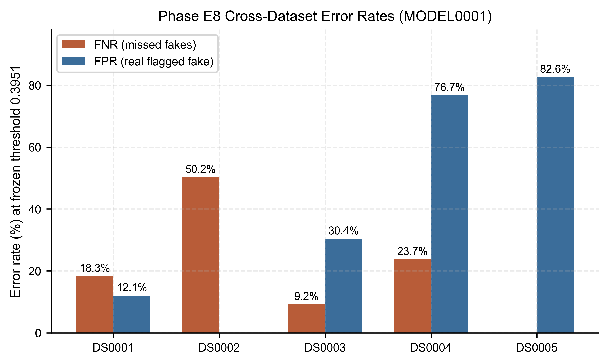

# AI Forensic Analyst: An Evidence-Driven, Calibrated, and Auditable Architecture for Cross-Generator Synthetic Face Forensics

**Target Venue:** *Forensic Science International: Digital Investigation* / *Computers & Security* (Elsevier Q1)  

**Authors:** Md. Assaduzzaman$^1$, Nushamd-A-Shawmeem$^1$, Sourav Saha$^1$, Masud Rana Nayeem$^1$, Tapasy Rabeya$^1$, Md. Mizanur Rahman$^{1,2*}$, Md Ali Hossain$^{1,2}$, Ahmed Moustafa$^{3,4,6*}$, Suman Ahmmed$^5$, Ohidujjaman$^5$

**Affiliations:**  
$^1$ Faculty of Science and Information Technology, Daffodil International University, Dhaka, Bangladesh.  
$^2$ NanoBio Technology Center, Daffodil International University, Dhaka, Bangladesh.  
$^3$ Centre for Data Analytics and School of Psychology, Bond University, Gold Coast, Queensland, Australia.  
$^4$ Department of Human Anatomy and Physiology, Faculty of Health Sciences, University of Johannesburg, Johannesburg, South Africa.  
$^5$ Department of Computer Science & Engineering, United International University, Dhaka, Bangladesh.  
$^6$ Faculty of Psychology, University College of Professional Education, Wrocław, Poland.

$^*$Corresponding authors: `mizanurrahman.cse@diu.edu.bd`; `amoustaf@bond.edu.au`  
Contributing authors: `assaduzzaman23105101233@diu.edu.bd`; `shawmeem2305101823@diu.edu.bd`; `saha2305101978@diu.edu.bd`; `masudrananayeem86@gmail.com`; `tapasyrabeya.cse@diu.edu.bd`; `ali.cse@diu.edu.bd`; `suman@cse.uiu.ac.bd`; `ohidujjaman@cse.uiu.ac.bd`.

---

## Highlights

- Reframes synthetic face detection into an 18-module evidence-driven forensic platform.
- Isolates deep learning inference from an image-blind four-way Decision Engine.
- Introduces validation-calibrated four-dimensional confidence overriding blind scores.
- Quantifies cross-dataset real-face FPR up to 82.6% and unseen diffusion drop to 13.7%.
- Verifies 16 forensic scenarios, 135 evidence-grounded sentences, and full-stack UAT.

---

## Abstract

Standalone deep learning detectors for synthetic human faces routinely attain high in-distribution discrimination yet fail unpredictably under unseen generative architectures, external real-image domain shift, and lossy post-processing [3, 7, 16, 18, 23]. In operational digital forensics, returning an uncalibrated binary probability without provenance, uncertainty bounds, or abstention capability exposes investigators to silent false accusations and missed forgeries. This paper introduces the **AI Forensic Analyst**, an 18-module evidence-driven forensic architecture (M1–M18) that demotes the neural detector to one isolated, replaceable specialist (M4) inside a trust-bounded pipeline separating image-reading collectors from an image-blind four-way Decision Engine (M8: *Real*, *Fake*, *Inconclusive*, *Unknown*). First, we establish a strictly public-only, open-license five-dataset benchmark (ArtiFact faces, DiFF official test, 140k Real and Fake Faces, Synthbuster, and FairFace; over 250,000 processed images) with leakage-verified grouped and leave-one-generator-out splits and systematically stress-test a standardized ResNet-50 baseline. Although the baseline attains ROC-AUC 0.9261, PR-AUC 0.9348, balanced accuracy 0.8483, MCC 0.6978, and ECE 0.0525 on in-distribution ArtiFact test images ($n=7,505$, validation-frozen threshold $0.3951$), stress testing exposes 43.7% FNR on StyleGAN3, balanced accuracy collapse toward 0.50 under fine-detail degradation (53 perturbations), 48.1% unseen-generator cross-dataset FNR (50.2% on DiFF), 30.4%–82.6% external real-face FPR, and a paired recall drop from 96.3% to 13.7% under controlled Stable Diffusion holdout. Second, we implement and verify the 18-module platform featuring reliability-weighted fusion (M7), validation-calibrated four-dimensional confidence (M9), programmatically evidence-verified reasoning (M11), structured eight-mode failure handling (M16), and a three-tier Django/React web application (M13–M14). Across 16 end-to-end verification scenarios, the platform passes all nine quality dimensions (135 verified reasoning sentences, zero ungrounded claims, 60.02 ms mean latency), explicitly overriding a 0.99 detector score into *Inconclusive* ($C_{\text{dec}}=0.3333$) when supporting evidence is unusable and degrading cleanly to *Unknown* when specialists are unavailable. All code, registries, verification scripts, and datasets are publicly reproducible.

**Keywords:** Synthetic face detection; Digital forensics; Cross-generator generalization; Evidence fusion; Confidence calibration; Explainable forensic systems; Diffusion models; Generative Adversarial Networks.

---

## 1. Introduction

High-fidelity facial synthesis has progressed rapidly from Generative Adversarial Networks (GANs) [5, 10, 25] to latent and denoising diffusion models [3, 6, 9, 23], creating severe risks for identity verification, journalistic integrity, and judicial evidence authentication [24, 26, 28]. Despite strong benchmark accuracies reported on matched test splits, empirical evaluations consistently show that standalone classifiers overfit generator-specific spectral traces or dataset acquisition shortcuts [7, 16, 18]. When evaluated on unseen generative paradigms, demographically diverse external real images, or social-media compression pipelines, both false negative rates (missed forgeries) and false positive rates (authentic faces flagged as fake) spike sharply [3, 13, 16].

This failure pattern reveals a structural flaw in how synthetic media detection is typically engineered. Most published systems conflate four distinct responsibilities inside a single black-box classifier: signal extraction, evidence reliability grading, uncertainty calibration, and final verdict issuance. A bare fake-class probability (for example, 0.99) provides neither empirical reliability calibration nor a mechanism to abstain when input quality is degraded, corroborating signals are absent, or a specialist encounters an out-of-distribution domain [16, 18].

To bridge the gap between model-centric detection research and auditable digital forensics, this study makes four concrete contributions:

1. **Controlled Cross-Paradigm Stress Benchmark:** We curate a strictly public-only, open-license five-dataset evaluation benchmark (ArtiFact faces, DiFF official test, 140k Real and Fake Faces, Synthbuster, and FairFace) under deterministic preprocessing and leakage-verified grouped and leave-one-generator-out (LOGO) splits, and quantify exact failure modes of a standardized ResNet-50 detector across calibration, 53 perturbations, four external corpora, controlled Stable Diffusion holdout, four one-factor ablations, and paired statistical tests.
2. **18-Module Trust-Bounded Forensic Architecture (M1–M18):** We design and implement the **AI Forensic Analyst**, separating image-reading intake, validation, nine independent non-detector collectors (M3), and an isolated deep learning specialist (M4) from an image-blind downstream core governed by an append-only evidence ledger (M5), non-destructive reliability validator (M6), pluggable fusion engine (M7), and four-way Decision Engine (M8: *Real*, *Fake*, *Inconclusive*, *Unknown*).
3. **Validation-Calibrated Four-Dimensional Confidence and Anti-Hallucination Reasoning:** We formalize a four-dimensional calibration framework (M9) separating raw detector probability from empirical validation bin accuracy ($C_{\text{pred}}$), collector reliability ($C_{\text{ev}}$), execution completeness ($C_{\text{sys}}$), and capped decision confidence ($C_{\text{dec}}$). Downstream reasoning (M11) programmatically verifies every generated sentence against cited evidence ledger records, while explainability (M10) emits structured data-only outputs and explicitly records `no_data` rather than fabricating visual maps.
4. **End-to-End Platform Verification and Open Reproducibility:** We verify the complete system across 16 whole-platform forensic scenarios and nine quality dimensions, deliver an interactive three-tier Django/DRF and React web platform (M13–M14) validated by 85 automated unit/API/UI tests, live cross-tier HTTP integration, and six live User Acceptance Tests (UAT), and release all reproducible configurations, registries, and verification scripts under the MIT license.

---

## 2. Related Work

We synthesize 28 peer-reviewed studies spanning legacy GAN forensics through modern diffusion detection [1–28] (full 16-method comparative matrix in Supplementary Material S1).

**Frequency-Domain and Convolutional Trace Detectors.** Early forensic pipelines exploited transposed-convolution upsampling footprints via Expectation-Maximization [5] and Discrete Cosine Transform (DCT) beta-statistics [10], achieving strong intra-GAN discrimination. Subsequent diffusion forensics revealed that iterative denoising alters high-frequency spectral signatures relative to GANs [3], motivating multi-level frequency and spatial hierarchies [18, 22]. However, frequency cues degrade sharply under JPEG recompression, resizing, and anti-forensic fingerprint removal [13, 19].

**Spatial Classifiers, Pretraining Paradigms, and Source Attribution.** Spatial CNNs (ResNet, Xception, EfficientNet) and Vision Transformers dominate large-scale benchmarks [2, 11, 14, 17, 21, 23]. Systematic cross-architecture studies demonstrate that pretraining strategy (notably CLIP and self-supervised visual encoders) strongly influences cross-generator transfer [7], while hierarchical classifiers attempt generator-family attribution [18, 21]. Nevertheless, recent multi-paradigm audits confirm that classifiers trained on GAN corpora suffer severe accuracy drops on diffusion faces and exhibit demographic and dataset-origin bias shortcuts [16, 23].

**Physiological Biometrics, Reconstruction Error, and Proactive Defenses.** Alternative paradigms target facial landmark geometry and GAN-inversion biometrics [8, 15], diffusion reconstruction error [6], synthetic inpainting generation [1], and proactive watermarking or blockchain provenance [4, 12, 20]. Biometric cues lose discriminative margin on high-fidelity StyleGAN3 and diffusion synthesis [25], reconstruction error imposes heavy multi-step inference cost [6], and proactive schemes require control over image generation [20]. Existing surveys [24–28] comprehensively catalog neural architectures yet rarely address system-level forensic decision governance.

**Synthesized Gaps.** Four interlocking gaps motivate the AI Forensic Analyst: (1) cross-generator generalization collapse between GAN and diffusion families, (2) real-source shortcut learning causing high false positive rates on out-of-distribution authentic faces, (3) insufficient uncertainty calibration and explainability transparency [16], and (4) absence of modular, auditable evidence-fusion architectures capable of safe abstention.

---

## 3. Methodology: The AI Forensic Analyst Architecture

### 3.1 Public-Only Multi-Dataset Benchmark and Leakage-Free Splitting

To eliminate license ambiguity and dataset shortcut blindness, we assemble five strictly public, open-license corpora summarized in Table 1 (full methodology pipeline in Supplementary Figure S3).

**Table 1:** Strictly public, open-license multi-dataset benchmark used for in-distribution training, cross-dataset evaluation, demographic real-face auditing, and controlled unseen-generator holdout.

| Corpus | Evaluation Role | Processed Images | Class / Generator Composition | License |
|---|---|---:|---|---|
| ArtiFact (face subset) | In-distribution train/val/test & LOGO | 50,000 | 25k real / 25k fake (13 GAN + diffusion gens) | MIT |
| DiFF (official test) [23] | Cross-dataset unseen diffusion | 51,452 | Fake-only across 13 diffusion generators | Research Open |
| 140k Real and Fake Faces | Cross-dataset GAN/FFHQ | 140,000 | 70k FFHQ real / 70k StyleGAN fake | Public Open |
| Synthbuster [3] | Cross-dataset diffusion + scenes | 9,999 | 9,000 diffusion fakes (9 models) / 999 RAISE real | CC BY 4.0 |
| FairFace | Demographic real-face FPR | 97,698 | Real-only faces balanced across 7 race groups | CC BY 4.0 |

All images pass through a deterministic seven-stage preprocessing pipeline (fixed seed 42): integrity verification, pre-modification metadata capture, EXIF stripping, minimum resolution filtering ($\ge 64$ px), RGB PNG conversion, and $224 \times 224$ resizing with zero denoising or sharpening so high-frequency forensic traces remain intact. On ArtiFact, we generate two leakage-verified splits: a grouped random split (34,993 train / 7,502 validation / 7,505 test) and a controlled leave-one-generator-out (LOGO) split holding out all 1,923 Stable Diffusion images exclusively for testing. Automated hash and identifier checks confirm zero cross-split overlap (exploratory audits in Supplementary Material S2).

### 3.2 Trust-Bounded 18-Module Forensic Pipeline

*Figure 1: Eighteen-module AI Forensic Analyst architecture separating Trust Boundary A (image-reading intake, validation, nine independent signal collectors, and isolated deep learning specialist) from Trust Boundary B (image-blind append-only evidence ledger, reliability validator, fusion engine, four-dimensional confidence estimator, sole four-way Decision Engine, data-only explainability, grounded reasoning, and report generator) and delivery/governance modules (M13–M18).*

Figure 1 illustrates the architectural boundary enforcing forensic accountability across all 18 modules (M1–M18; complete interface summary in Supplementary Material S4):

- **Trust Boundary A (Image-Reading Layer, Zero Decision Authority):** Input Intake (M1) enforces format and 20 MB upload limits while computing SHA-256 hashes and rejecting unsafe files without persistence. Image Validation (M2) verifies decodability, RGB channels, resolution, noise, and single-face availability; violations trigger immediate structured stops (`unsupported_format`, `corrupted_image`, `no_face`, `multiple_faces`) before collectors run, omitting verdicts while logging a failed case record (M15). Passing inputs reach nine strictly decoupled non-detector collectors (M3: metadata, image statistics, face detection, face quality, FFT frequency domain, compression, color distribution, texture, and explainability input; zero inter-collector coupling) and the isolated Deep Learning Specialist (M4), which emits raw $P(\text{fake})$, latency, and model provenance without applying any decision threshold or verdict word.
- **Trust Boundary B (Image-Blind Evidence and Decision Layer):** The Evidence Ledger (M5) assigns sequential immutable identifiers (`EVxxxxxx`) in an append-only ledger. The Evidence Validator (M6) appends separate validation records grading each item as `high`, `medium`, `low`, or `unusable` and cross-citing conflicts without mutating source rows or substituting defaults for `null` confidences. Downstream modules read strictly validated evidence IDs and never access raw images or model weights.

### 3.3 Reliability-Weighted Fusion, 4D Calibrated Confidence, and 4-Way Decisioning

*Figure 2: Mathematical flow from the validated evidence ledger through reliability-weighted rule-based fusion (M7), validation-calibrated four-dimensional confidence (M9), and image-blind four-way verdict issuance (M8). Safety caps override a raw 0.99 detector score into Inconclusive ($C_{\text{dec}}=0.3333$) whenever supporting evidence is unusable.*

As illustrated in Figure 2, the mathematical decision core operates in three transparent stages:

**1. Reliability-Weighted Evidence Fusion (M7).** Under a pluggable `FusionStrategy` interface (active strategy: interpretable `rule_based` v0.1.0; `weighted` and `bayesian` strategies reserved; unknown IDs fail loudly via M16), each validated item receives weight $w_i \in \{1.0, 0.6, 0.3, 0.0\}$ for `high`, `medium`, `low`, and `unusable` respectively. Only calibrated directional specialists vote on class polarity: for M4 with fake probability $p$ and validation-frozen threshold $t = 0.3951$, $p \ge t$ contributes $+w_i$ (`positive_class`) and $p < t$ contributes $-w_i$ (`negative_class`). The nine contextual M3 collectors are cited as corroborating context without fabricating directional votes. When opposing directional evidence yields normalized $|\text{balance}| < 0.5$, the fused lean is `contested`; when no usable directional specialist exists, the lean is `no_directional_evidence`. The emitted fused conclusion contains zero verdict words and is itself logged (M5) and graded (M6).

**2. Validation-Calibrated Four-Dimensional Confidence (M9).** To break the equivalence between raw softmax probability and forensic certainty [16], M9 computes four distinct metrics:

$$C_{\text{pred}} = w_{\text{det}} \cdot A_{\text{val}}(r), \quad r = \begin{cases} p & \text{if } p \ge t \\ 1 - p & \text{if } p < t \end{cases}$$

where $A_{\text{val}}(r)$ is the empirical bin accuracy queried from validation-split reliability bins (`null` if no usable detector item exists). For example, baseline output $p = 0.99$ maps to $C_{\text{pred}} = 0.971745$ rather than $0.99$. Next, evidence reliability confidence is the mean validator weight across all collector items (`unusable` $= 0.0$), halved whenever a conflict flag is active:

$$C_{\text{ev}} = \left(\frac{1}{N} \sum_{i=1}^{N} w_i\right) \cdot (0.5 \text{ if conflict else } 1.0)$$

System execution completeness measures pipeline health:

$$C_{\text{sys}} = \frac{N_{\text{usable}}}{N_{\text{attempted}} + N_{\text{refused}} + N_{\text{errors}}}$$

Finally, overall decision confidence combines the three dimensions with explicit conservative caps and discounts:

$$C_{\text{base}} = 0.5\,C_{\text{pred}} + 0.3\,C_{\text{ev}} + 0.2\,C_{\text{sys}}$$

If $C_{\text{pred}}$ is `null`, then $C_{\text{dec}}$ remains `null`. Otherwise, whenever $C_{\text{ev}} \le 0.50$, $C_{\text{sys}} \le 0.50$, or zero usable non-detector collectors exist, $C_{\text{dec}}$ is capped at $\min(C_{\text{ev}}, C_{\text{sys}})$; single-source leans receive a $\times 0.85$ discount and contested leans receive a $\times 0.50$ discount.

**3. Image-Blind Four-Way Decision Engine (M8).** Reading solely the validated fused conclusion and confidence ledger IDs, M8 emits: *Unknown* if `no_directional_evidence` (or $C_{\text{dec}}$ is `null`); *Inconclusive* if the lean is `contested`, a conflict flag is active, or $C_{\text{dec}} < 0.50$; *Fake* if `positive_class`, no conflict, and $C_{\text{dec}} \ge 0.50$; and *Real* if `negative_class`, no conflict, and $C_{\text{dec}} \ge 0.50$.

### 3.4 Grounded Reasoning, Data-Only Explainability, and Web Delivery

Explainability (M10) emits structured JSON across Grad-CAM, attention maps, saliency, and integrated gradients (with SHAP, LIME, and counterfactuals reserved), explicitly recording `no_data` (`data: null`) for unrecorded visual maps and refusing fabricated overlays or verdict strings. Grounded Reasoning (M11) constructs `reasoning.json` strictly from validated ledger records and executes programmatic verification on every sentence to confirm that every cited evidence ID and numeric value matches the ledger; any ungrounded claim raises a structured M16 error. The Report Generator (M12) outputs reproducible JSON, Markdown, and HTML reports stamped with byte-identical system, model, dataset, experiment, and Git commit provenance. Full-stack web delivery (Supplementary Figure S4) exposes 10 canonical endpoints across a seven-app Django/DRF backend (M13, zero duplicated forensic logic, thread-safe lock serialization) consumed by a 14-page, 24-component React/Vite/Tailwind UI (M14) rendering nine live pipeline stages, four-way verdicts, all four calibrated confidence gauges, cited evidence IDs, and explicit limitations.

---

## 4. Experimental Setup

All neural training ran on NVIDIA T4 GPUs under a locked environment (Python 3.12, PyTorch 2.10.0+cu128, FastAI 2.8.7) governed by immutable YAML configurations (47 schema validation tests) and SHA-256 atomic checkpoints (Supplementary Figure S5). Six controlled experiments were executed:

- **Baseline ResNet-50:** ImageNet-1k pretrained ResNet-50 trained on the ArtiFact grouped random split ($224 \times 224$, Adam $\text{wd}=0.01$, FP16 mixed precision, 1 frozen + 10 unfrozen epochs, train-only geometric/photometric augmentation, early-stopping patience 3). Operating threshold $t = 0.3951$ (exact $0.395057$) maximizing balanced accuracy was frozen strictly on the validation split.
- **Unseen-Generator Holdout (LOGO):** Identical baseline hyperparameters trained on the ArtiFact LOGO split excluding all Stable Diffusion images, evaluated on all 1,923 held-out Stable Diffusion images and paired directly against the Baseline ResNet-50 on the identical 299 Stable Diffusion test images shared by both splits.
- **Controlled One-Factor Ablations:** Four variants each mutating exactly one baseline hyperparameter on the identical ArtiFact split: (1) random seed $42 \rightarrow 43$ (repeatability noise floor), (2) train-only augmentation disabled, (3) ImageNet-1k pretraining disabled under the fixed 11-epoch budget, and (4) input spatial resolution reduced ($224 \rightarrow 160$ px).
- **Stress Testing and Paired Statistics:** Baseline evaluation covers calibration (ECE, MCE, Brier), operating points (screening 0.089, frozen 0.3951, flag-for-review 0.629), subgroup error breakdowns, 53 synthetic perturbations across all 7,505 test images, and four external benchmarks (DiFF, 140k Real and Fake Faces, Synthbuster, FairFace). Paired statistical tests match all 7,505 test predictions via 10,000 percentile bootstrap resamples (seed 49) on ROC-AUC (95% CI for the seed replicate; Bonferroni-adjusted 98.3% CIs across the three factor ablations) and exact two-sided McNemar tests. Because each ablation ran for one seed and Wilcoxon signed-rank across seeds requires at least six pairs ($n=2 < 6$), all comparisons report saved-run differences with no cross-seed superiority claim.
- **Whole-Platform and Full-Stack Verification:** The 18-module system was verified across 16 end-to-end forensic scenarios spanning nine quality dimensions, 85 automated unit/API/UI tests, live cross-tier HTTP integration, and six live UAT scenarios.

---

## 5. Results

### 5.1 In-Distribution Baseline Performance, Calibration, and Subgroup Failures

On the ArtiFact test split ($n=7,505$: 3,753 fake, 3,752 real), the Baseline ResNet-50 attains ROC-AUC 0.9261, PR-AUC 0.9348, balanced accuracy 0.8483, MCC 0.6978, FNR 0.1829 (686 missed fakes), FPR 0.1205 (452 false alarms), Brier score 0.1131, ECE 0.0525, and MCE 0.1544 (additional curves in Supplementary Material S3).

*Figure 3: Calibration reliability diagram on ArtiFact test ($n=7,505$, ECE = 0.0525, MCE = 0.1544), illustrating mid-to-high confidence miscalibration that motivates validation-bin confidence mapping in M9.*

*Figure 4: In-distribution subgroup error profile exposing severe heterogeneity across seen generators (0.0% FNR on StarGAN/CIPS vs. 43.7% on StyleGAN3, 42.2% on Projected GAN, 38.8% on StyleGAN2, and 38.6% on MAT) and real sources (36.7% FPR on artistic MetFaces vs. 10.9% on CelebA-HQ and 11.1% on FFHQ).*

Even inside the training distribution, Figure 3 documents clear mid-to-high confidence miscalibration, while Figure 4 shows that aggregate accuracy hides $>38\%$ false negative rates on high-realism GANs (StyleGAN3, Projected GAN, StyleGAN2, MAT) and 36.7% false positive rates on non-photographic MetFaces portraits.

### 5.2 Perturbation Robustness Across 53 Image Distortions

*Figure 5: Balanced accuracy and ROC-AUC under 53 synthetic perturbations ($n=7,505$ test images per condition). Fine-detail degradations (low-quality upload, downscaling, Gaussian blur, strong noise, and JPEG quality 10) collapse balanced accuracy toward 0.50 by driving FPR toward 1.0, whereas moderate photometric changes cost under 0.10.*

Across all 53 perturbations (Figure 5), robustness splits into two distinct regimes: (1) **catastrophic fine-detail collapse**, where low-quality uploads, downscaling, Gaussian blur, strong noise, and JPEG quality 10 push balanced accuracy to ~0.50 because the baseline flags nearly every degraded real image as fake ($\text{FPR} \to 1.0$), and (2) **moderate photometric resilience**, where brightness, contrast, color jitter, and small rotations reduce balanced accuracy by $<0.10$. Separating ROC-AUC from thresholded balanced accuracy shows that mild compression/resizing introduces threshold shift alongside genuine ranking erosion under heavy blur and noise.

### 5.3 Cross-Dataset Shift and Controlled Unseen-Generator Holdout

*Figure 6: Cross-dataset error rates of Baseline ResNet-50 at frozen threshold 0.3951 across four external benchmarks, exposing 50.2% unseen diffusion FNR on DiFF and 30.4%–82.6% false positive rates on authentic external images.*

*Figure 7: Controlled leave-one-generator-out holdout of Stable Diffusion. Recall drops from 83.3% on 12 seen generators to 15.2% (293/1,923) on unseen Stable Diffusion, and from 96.3% (Baseline, seen) to 13.7% (LOGO Holdout, unseen) on the identical 299 test images.*

Cross-dataset testing (Figure 6) confirms both halves of detector fragility: across 17 unseen generators, FNR rises from 18.3% in-distribution to 48.1% (50.2% on DiFF diffusion faces, reaching 81.5% on FreeDoM_I), whereas familiar StyleGAN-family fakes in 140k Real and Fake Faces incur only 9.0% FNR. Simultaneously, external authentic images trigger extreme false alarms: 30.4% FPR on 140k FFHQ, 76.7% FPR on Synthbuster RAISE scenes (overall Synthbuster ROC-AUC 0.5172, near chance), and 82.6% FPR on FairFace across all seven demographic groups. Controlled Stable Diffusion holdout (Figure 7) isolates pure unseen-generator failure without dataset shift: while the LOGO model retains validation ROC-AUC 0.937 on its 12 seen generators, held-out Stable Diffusion recall drops to 15.2% (293/1,923), falling from 96.3% to 13.7% on the exact same 299 test images [7, 16, 23]. Consequently, the standalone detector is explicitly classified as unsuitable for autonomous deployment.

### 5.4 One-Factor Ablations and Paired Statistical Comparisons

*Figure 8: One-factor ablation ROC-AUC differences relative to Baseline ResNet-50 against the two-seed repeatability floor (+0.0011, 95% CI crossing zero), with Bonferroni-adjusted 98.3% paired bootstrap intervals excluding zero for all three factor ablations.*

Tables 2 and 3 report the fairness-compatible comparison on the ArtiFact grouped random test split (excluding the LOGO model trained on a distinct split; ROC/PR curves in Supplementary Material S3).

**Table 2:** Fairness-compatible ranked comparison on the ArtiFact grouped test split ($n=7,505$; saved-run metrics, no cross-seed superiority claim).

| Rank | Run Variant | ROC-AUC | PR-AUC | Balanced Acc. | MCC | FNR | FPR | ECE |
|---:|---|---:|---:|---:|---:|---:|---:|---:|
| 1 | Seed Replicate (Seed 43) | 0.9272 | 0.9363 | 0.8481 | 0.6978 | 0.1881 | 0.1157 | 0.0545 |
| 2 | Baseline ResNet-50 (Seed 42) | 0.9261 | 0.9348 | 0.8483 | 0.6978 | 0.1829 | 0.1205 | 0.0525 |
| 3 | No Augmentation | 0.8925 | 0.9042 | 0.8059 | 0.6120 | 0.2056 | 0.1825 | 0.0378 |
| 4 | Reduced Resolution (160x160) | 0.8885 | 0.9053 | 0.8039 | 0.6082 | 0.2170 | 0.1753 | 0.0944 |
| 5 | No ImageNet Pretraining | 0.7017 | 0.7092 | 0.6452 | 0.2912 | 0.3162 | 0.3935 | 0.0230 |

**Table 3:** Paired ROC-AUC bootstrap differences (10,000 resamples, seed 49) and exact two-sided McNemar tests against Baseline ResNet-50 ($n=7,505$; saved-run differences only).

| Challenger vs. Baseline | ΔROC-AUC | CI Level | Bootstrap CI | Exact McNemar Adj. p | Disagreements (b / c) | Saved-Run Status |
|---|---:|---:|---|---:|---|---|
| Seed Replicate (Seed 43) | +0.0011 | 95.0% | `[-0.0012, +0.0035]` | 0.964 | 251 / 249 | Not distinguishable |
| No Augmentation | -0.0336 | 98.3% | `[-0.0396, -0.0279]` | 8.34e-23 | 977 / 573 | Challenger lower |
| No ImageNet Pretraining | -0.2243 | 98.3% | `[-0.2383, -0.2101]` | 7.1e-217 | 2,012 / 491 | Challenger lower |
| Reduced Resolution (160 px) | -0.0376 | 98.3% | `[-0.0447, -0.0307]` | 1.36e-21 | 991 / 596 | Challenger lower |

Seed replication establishes a tight run-to-run repeatability floor ($\Delta\text{ROC-AUC}=+0.0011$, 95% CI crossing zero, two-seed SD 0.0008, decision agreement 0.9334, Cohen's $\kappa=0.8662$, McNemar $p=0.964$). Every factor removal degrades discrimination an order of magnitude beyond this floor with Bonferroni-adjusted 98.3% intervals strictly below zero (Figure 8): ImageNet-1k pretraining contributes the largest gain (-0.2243 ROC-AUC under the fixed 11-epoch budget), 224 px resolution preserves both discrimination (-0.0376) and calibration (ECE 0.0525 vs. 0.0944), and train-only augmentation prevents early epoch-3 overfitting (-0.0336).

### 5.5 Whole-Platform Forensic Analyst and Full-Stack Verification

In whole-platform evaluation (16 end-to-end scenarios in Supplementary Material S4), the AI Forensic Analyst passes **16/16 scenarios** and **9/9 quality dimensions** with **135 programmatically verified reasoning sentences**, **zero ungrounded leaks**, **zero silent failures**, and **60.02 ms mean latency**. Key verified safety behaviors include:

- **High-Confidence Safety Override:** When M4 emits $P(\text{fake})=0.99$ ($C_{\text{pred}}=0.9717$) while supporting collectors are unusable ($C_{\text{ev}}=0.3333$), the conservative cap overrides the raw neural score to $C_{\text{dec}}=0.3333$ and M8 issues *Inconclusive* instead of a blind *Fake* verdict.
- **Graceful Specialist Degradation:** Missing model weights or specialist timeouts degrade cleanly to *Unknown* with `null` prediction and decision confidences while preserving all nine contextual collectors.
- **Anti-Hallucination Reasoning Enforcement:** Deliberately injected ungrounded claims or invalid evidence references are deterministically rejected by M11 via M16.
- **Full-Stack Web Verification:** All 85 automated unit/API/frontend tests (55 forensic core, 18 Django/DRF backend, 12 React frontend), production Vite build, live cross-tier async HTTP integration, and all six live UAT scenarios pass with zero leaked stack traces.

---

## 6. Discussion and Limitations

Our empirical findings underscore a foundational principle for digital forensics: even a well-calibrated, leakage-free neural detector (ROC-AUC 0.9261, ECE 0.0525) exhibits catastrophic failures once exposed to unseen diffusion generators (13.7% paired recall), external authentic face distributions (82.6% FairFace FPR), or heavy post-processing (~0.50 balanced accuracy). Deploying such a classifier as an autonomous binary arbiter is scientifically indefensible. Structurally isolating perception (M3–M4) from immutable evidence logging (M5–M6), validation-calibrated four-dimensional confidence (M9), and an image-blind four-way Decision Engine (M8) transforms silent model failure into explicit *Inconclusive* or *Unknown* abstentions backed by auditable provenance.

Six Version 1 scope boundaries are disclosed transparently: (1) only one CNN backbone family (ResNet-50) was trained across six runs, leaving Xception, EfficientNet-B4, and self-supervised ViT-B/16 [7] for Version 2; (2) factor ablations ran for one seed each (two baseline seeds total, so Wilcoxon across seeds is deferred and no cross-seed superiority is claimed), and the no-pretraining run reflects a fixed 11-epoch single-factor comparison rather than a separately tuned schedule; (3) the nine non-detector collectors currently provide reliability-graded context under interpretable rule-based fusion, whereas learned weighted or Bayesian fusion awaits curated labeled multi-collector forensic corpora; (4) LOGO evaluation held out Stable Diffusion only (fake-only recall), and perturbations were applied post-preprocessing to 224 px crops; (5) runtime Grad-CAM/SHAP/LIME tensor producers remain reserved for Version 2 (M10 accurately records `no_data` when visual maps are absent); and (6) Version 1 is scoped to static single-face images and local execution, with multimodal video/audio/text extensions via M18, production TLS/authentication hardening, and practitioner human-factors trials planned for Version 2.

---

## 7. Conclusion

Trustworthy synthetic face forensics requires shifting from standalone binary classification to auditable, uncertainty-aware forensic systems. Across five public datasets, six controlled GPU experiments, and multi-axis stress testing, we quantified the exact unseen-generator (13.7% paired Stable Diffusion recall), external authentic-face (82.6% FairFace FPR), and fine-detail perturbation failures of a standardized ResNet-50 baseline. We then designed, implemented, and verified the 18-module AI Forensic Analyst (M1–M18), demonstrating across 16 end-to-end scenarios (135 verified reasoning sentences, zero ungrounded leaks, 60.02 ms mean latency) and full-stack web verification (85 automated tests plus six live UAT scenarios) how trust-boundary isolation, reliability-weighted fusion, validation-calibrated four-dimensional confidence, and four-way abstention prevent overconfident neural probabilities from becoming silent forensic errors.

---

## Statements and Declarations

- **Reproducibility Statement:** All preprocessing pipelines, experiment configurations, statistical bootstrap/McNemar calculations, forensic platform tests, figure rendering scripts, and consistency verifiers are deterministically scripted with fixed seeds, SHA-256 manifests, and locked software dependencies (Supplementary Material S5).
- **Code Availability:** Complete source code for the 18-module AI Forensic Analyst, Django/DRF REST API, React frontend, training/evaluation automation, and editable diagram sources is publicly available under the MIT License at `https://github.com/isthisdeception/thesis`.
- **Data Availability:** This study uses strictly public, open-license benchmark datasets: ArtiFact faces (MIT), DiFF official test [23] (Research Open), 140k Real and Fake Faces (Public Open), Synthbuster [3] (CC BY 4.0), and FairFace (CC BY 4.0). All preprocessing parameters, exclusion logs, and split manifests are published in the repository.
- **Ethics and Privacy Statement:** No private photographs or human-subjects experiments were collected. All analyses use publicly licensed academic corpora, and EXIF metadata is stripped during preprocessing.
- **Declaration of Competing Interest:** The authors declare no competing financial or personal interests.

---

## References

1. J. Cho, D. Kong, J. Nam, and H. Cho, "A Synthetic Defect Image Generation Method for Enhanced Industrial Defect Detection Based on Inpainting Diffusion and Context-aware Mask Generation," *Journal of Intelligent Manufacturing*, 2026. DOI: 10.1007/s10845-026-02915-2.
2. M. Taeb and H. Chi, "Comparison of Deepfake Detection Techniques through Deep Learning," *Journal of Cybersecurity and Privacy*, 2022. DOI: 10.3390/jcp2010007.
3. Q. Bammey, "Synthbuster: Towards Detection of Diffusion Model Generated Images," *IEEE Open Journal of Signal Processing*, 2024. DOI: 10.1109/OJSP.2023.3337714.
4. M. A. N. Ul Ghani, K. She, M. A. Rauf, S. Khan, J. A. Khan, E. A. Aldakheel, and D. S. Khafaga, "Enhancing Security and Privacy in Distributed Face Recognition Systems Through Blockchain and GAN Technologies," *Computers, Materials & Continua*, 2024. DOI: 10.32604/cmc.2024.049611.
5. L. Guarnera, O. Giudice, and S. Battiato, "Fighting Deepfake by Exposing the Convolutional Traces on Images," *IEEE Access*, 2020. DOI: 10.1109/ACCESS.2020.3023037.
6. W. Zeng, T. Xie, Y. Liu, and Y. Peng, "Diffusion-generated face image identification technique based on diffusion reconstruction error feature," *International Journal of Information and Communication Technology*, 2025. DOI: 10.1504/IJICT.2025.10071014.
7. S. A. Khan and D.-T. Dang-Nguyen, "Deepfake Detection: Analyzing Model Generalization Across Architectures, Datasets, and Pre-Training Paradigms," *IEEE Access*, 2024. DOI: 10.1109/ACCESS.2023.3348450.
8. C. Pasquini, F. Laiti, D. Lobba, G. Ambrosi, G. Boato, and F. De Natale, "Identifying Synthetic Faces through GAN Inversion and Biometric Traits Analysis," *Applied Sciences*, 2023. DOI: 10.3390/app13020816.
9. F. Abbas and A. Taeihagh, "Improved latent diffusion-based IC-DGAN framework for high-resolution multi-feature and expression manipulation," *Neural Networks*, 2026. DOI: 10.1016/j.neunet.2025.108199.
10. O. Giudice, L. Guarnera, and S. Battiato, "Fighting Deepfakes by Detecting GAN DCT Anomalies," *Journal of Imaging*, 2021. DOI: 10.3390/jimaging7080128.
11. S. Safwat, A. Mahmoud, I. E. Fattoh, and F. Ali, "Hybrid Deep Learning Model Based on GAN and RESNET for Detecting Fake Faces," *IEEE Access*, 2024. DOI: 10.1109/ACCESS.2024.3416910.
12. M. A. N. Ul Ghani, K. She, M. A. Rauf, M. Alajmi, Y. Y. Ghadi, and A. Algarni, "Securing Synthetic Faces: A GAN-blockchain Approach to Privacy-Enhanced Facial Recognition," *Journal of King Saud University - Computer and Information Sciences*, 2024. DOI: 10.1016/j.jksuci.2024.102036.
13. P. Sharma, M. Kumar, and H. K. Sharma, "A robust ensemble model for Deepfake detection of GAN-generated images on social media," *Discover Computing*, 2025. DOI: 10.1007/s10791-025-09538-w.
14. L. Guarnera et al., "The Face Deepfake Detection Challenge," *Journal of Imaging*, 2022. DOI: 10.3390/jimaging8100263.
15. Z. Xue, X. Jiang, Q. Liu, and Z. Wei, "Global-Local Facial Fusion Based GAN Generated Fake Face Detection," *Sensors*, 2023. DOI: 10.3390/s23020616.
16. O. Altamimi, M. Al-Nashash, and M. Abdullah, "Comparative Detection of GAN and Diffusion Model Generated Faces: Bias, Robustness, and Explainability," *Proc. 17th International Conference on Information and Communication Systems (ICICS)*, ACM, 2026. DOI: 10.1145/3812734.3813716.
17. Preeti, M. Kumar, and H. K. Sharma, "A GAN-Based Model of Deepfake Detection in Social Media," *Procedia Computer Science*, 2023. DOI: 10.1016/j.procs.2023.01.191.
18. L. Guarnera, O. Giudice, and S. Battiato, "Mastering Deepfake Detection: A Cutting-Edge Approach to Distinguish GAN and Diffusion-Model Images," *ACM Transactions on Multimedia Computing, Communications, and Applications*, 2024. DOI: 10.1145/3652027.
19. W. Alkishri, S. Widyarto, and J. H. Yousif, "Evaluating the Effectiveness of a Gan Fingerprint Removal Approach in Fooling Deepfake Face Detection," *Journal of Internet Services and Information Security*, 2024. DOI: 10.58346/JISIS.2024.I1.006.
20. A. V. Nadimpalli and A. Rattani, "ProActive DeepFake Detection Using GAN-based Visible Watermarking," *ACM Transactions on Multimedia Computing, Communications, and Applications*, 2024. DOI: 10.1145/3625547.
21. M. A. Arshed, S. Mumtaz, M. Ibrahim, C. Dewi, M. Tanveer, and S. Ahmed, "Multiclass AI-Generated Deepfake Face Detection Using Patch-Wise Deep Learning Model," *Computers*, 2024. DOI: 10.3390/computers13010031.
22. D. Gragnaniello, F. Marra, and L. Verdoliva, "Detection of AI-Generated Synthetic Faces," *Advances in Computer Vision and Pattern Recognition*, Springer, 2022. DOI: 10.1007/978-3-030-87664-7_9.
23. H. Cheng, Y. Guo, T. Wang, L. Nie, and M. Kankanhalli, "Diffusion Facial Forgery Detection," *Proc. 32nd ACM International Conference on Multimedia (ACM MM)*, 2024. DOI: 10.1145/3664647.3680797.
24. A. Heidari, N. Jafari Navimipour, H. Dag, and M. Unal, "Deepfake detection using deep learning methods: A systematic and comprehensive review," *WIREs Data Mining and Knowledge Discovery*, 2023. DOI: 10.1002/widm.1520.
25. A. Melnik et al., "Face Generation and Editing With StyleGAN: A Survey," *IEEE Transactions on Pattern Analysis and Machine Intelligence*, 2024. DOI: 10.1109/TPAMI.2024.3350004.
26. P. Edwards, J.-C. Nebel, D. Greenhill, and X. Liang, "A Review of Deepfake Techniques: Architecture, Detection, and Datasets," *IEEE Access*, 2024. DOI: 10.1109/ACCESS.2024.3477257.
27. M. Dang and T. N. Nguyen, "Digital Face Manipulation Creation and Detection: A Systematic Review," *Electronics*, 2023. DOI: 10.3390/electronics12163407.
28. A. Malik, M. Kuribayashi, S. M. Abdullahi, and A. N. Khan, "DeepFake Detection for Human Face Images and Videos: A Survey," *IEEE Access*, 2022. DOI: 10.1109/ACCESS.2022.3151186.
