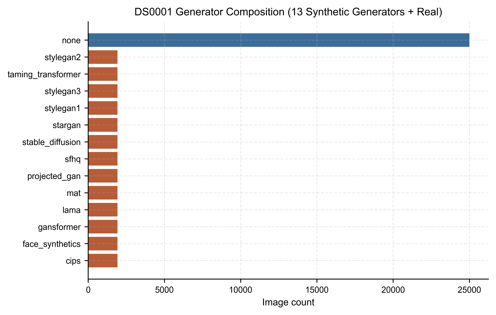
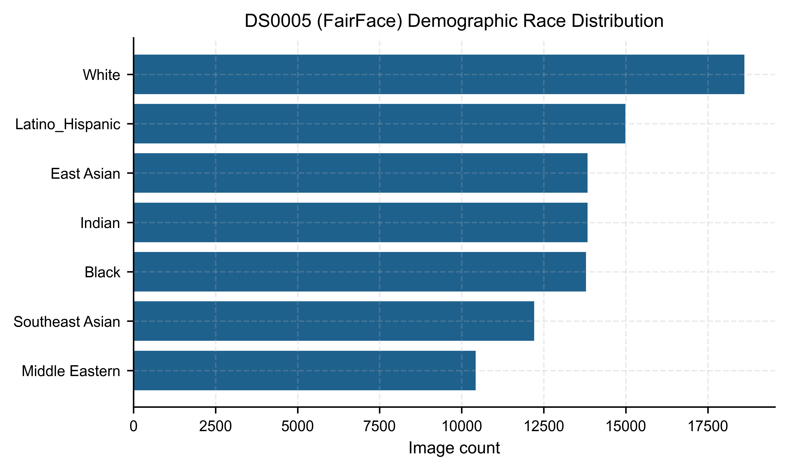
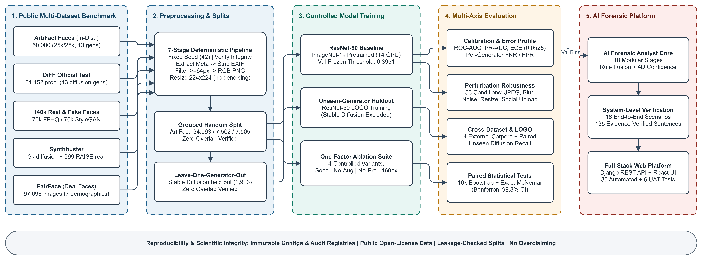
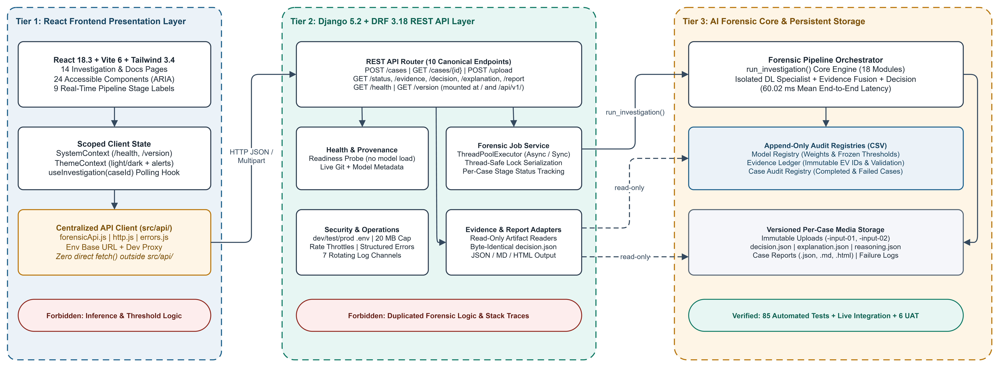
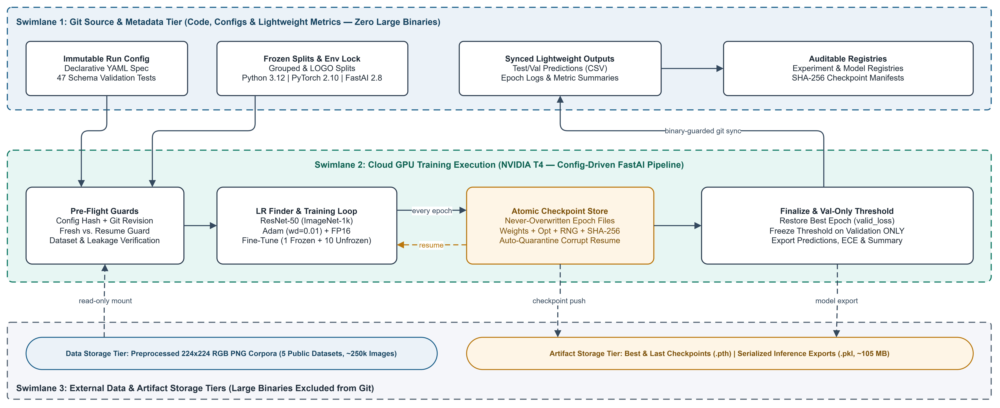

# Supplementary Material: AI Forensic Analyst

**Companion Document to:** *AI Forensic Analyst: An Evidence-Driven, Calibrated, and Auditable Architecture for Cross-Generator Synthetic Face Forensics*

---

## S1. Systematic Literature Comparison Matrix

The complete 16-method comparative literature matrix covering detection families, generator coverage, datasets, reported metrics, cross-generator evaluation, robustness testing, explainability, and primary limitations across references [2, 3, 5–8, 10, 11, 13–21, 23] is distributed as machine-readable CSV and Markdown tables in the public repository (`10_Tables/data/TAB0001.csv`).

---

## S2. Multi-Dataset Exploratory Data Analysis and Preprocessing

All five public corpora (ArtiFact faces, DiFF official test, 140k Real and Fake Faces, Synthbuster, and FairFace) were audited prior to modeling under deterministic preprocessing (seed 42, EXIF stripped, minimum resolution 64 px, RGB PNG conversion, 224x224 resizing without denoising).



*Figure S1: Generator distribution across the 50,000-image ArtiFact face benchmark (13 GAN and diffusion models).*



*Figure S2: Balanced seven-group demographic composition of FairFace (97,698 authentic faces) used to audit real-face false positive bias.*

---

## S3. Extended System Architecture, Training Infrastructure, and Evaluation Curves



*Figure S3: End-to-end public benchmark curation, preprocessing, controlled training, multi-axis evaluation, and AI Forensic Analyst verification pipeline.*



*Figure S4: Three-tier architectural separation connecting the React frontend (M14), seven-app Django/DRF REST API (M13), and 18-module AI Forensic Core with append-only audit registries.*



*Figure S5: Config-driven FastAI training pipeline with SHA-256 atomic checkpointing, validation-only threshold freezing, and binary-guarded synchronization.*


*Figure S6: Paired ROC curves across the Baseline ResNet-50 and all four one-factor ablations on the ArtiFact grouped test split ($n=7,505$).*

---

## S4. Complete 18-Module Interface Summary and 16-Scenario Verification Matrix

### S4.1 Module Summary (M1–M18)

| Module | Name | Primary Responsibility |
|---|---|---|
| M1 | Input Intake | Format and 20 MB upload validation, SHA-256 hashing, rejection without persistence |
| M2 | Image Validation | Decode, RGB, resolution, noise, and single-face gate before collectors execute |
| M3 | Nine Signal Collectors | Independent metadata, stats, face detection/quality, FFT, compression, color, texture, XAI input |
| M4 | Deep Learning Specialist | Isolated ResNet-50 inference emitting raw $P(\text{fake})$ and provenance only (zero verdict authority) |
| M5 | Evidence Ledger | Sequential immutable `EVxxxxxx` record storage (append-only) |
| M6 | Evidence Validator | Non-destructive reliability grading (`high`, `medium`, `low`, `unusable`) and conflict cross-citation |
| M7 | Evidence Fusion | Pluggable `FusionStrategy` (active rule-based v0.1.0; weighted and Bayesian reserved) |
| M8 | Decision Engine | Image-blind sole verdict authority (`Real`, `Fake`, `Inconclusive`, `Unknown`) |
| M9 | 4D Confidence Estimator | Validation-calibrated $C_{\text{pred}}$, $C_{\text{ev}}$, $C_{\text{sys}}$, and capped $C_{\text{dec}}$ |
| M10 | Explainability Engine | Structured data-only attribution JSON (`no_data` when unrecorded; zero fabricated maps) |
| M11 | Grounded Reasoning | Programmatic sentence verification checking every cited evidence ID and numeric value |
| M12 | Report Generator | Reproducible JSON, Markdown, and HTML case reports with full Git and model provenance |
| M13 | REST API Backend | Seven-app Django/DRF API exposing 10 canonical endpoints with zero duplicated forensic logic |
| M14 | Interactive Web UI | 14-page, 24-component React/Vite/Tailwind UI with nine live stages and four confidence gauges |
| M15 | Case Audit Trail | Append-only case audit ledger recording both completed and early-stopped investigations |
| M16 | Failure Handler | Structured handling across eight canonical failure modes with zero silent failures |
| M17 | Module Registry | Interface contract and specification integrity validation across M1–M18 |
| M18 | Extensibility Registry | Modality onboarding hooks for future audio, video, and text forensic specialists |

### S4.2 Whole-Platform 16-Scenario Verification Summary

All 16 end-to-end scenarios passed across nine quality dimensions (135 programmatically verified reasoning sentences, zero ungrounded leaks, 60.02 ms mean latency): (1) clean Fake (`0.95` -> `Fake`), (2) clean Real (`0.05` -> `Real`), (3) unsupported format stop, (4) corrupted bytes stop, (5) zero-face image stop, (6) multi-face image stop, (7) missing model export (`Unknown`), (8) specialist timeout (`Unknown`), (9) borderline low confidence (`Inconclusive`), (10) `0.99` score with unusable collectors overridden to `Inconclusive` ($C_{\text{dec}}=0.3333$), (11) contested opposing evidence (`Inconclusive`), (12) injected ungrounded sentence rejection, (13) conflict cross-citation preservation, (14) missing visual explainability recorded as `no_data`, (15) audit ledger completeness across completed and failed cases, and (16) deterministic byte-identical report reproducibility.

---

## S5. Reproducibility Commands and Locked Software Environment

- **Locked ML Environment:** Python 3.12, PyTorch 2.10.0+cu128, FastAI 2.8.7 (NVIDIA T4 GPU).
- **Web Tier:** Django 5.2.19, Django REST Framework 3.18.3, React 18.3, Vite 6, Tailwind CSS 3.4.
- **Full Verification Commands (from repository root):**
  ```powershell
  python 17_Automation/run_all_tests.py
  python 17_Automation/verify_writing_consistency.py
  python 17_Automation/compute_publication_readiness.py
  ```
