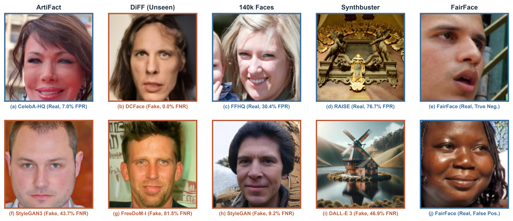
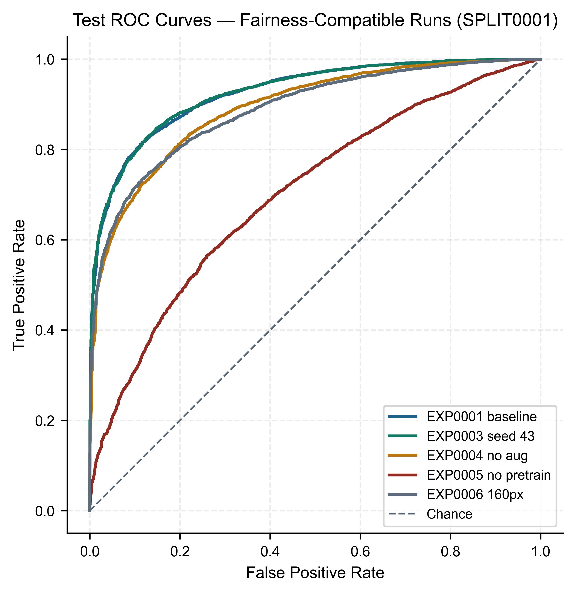

# Supplementary Material: AI Forensic Analyst

**Companion Document to:** *AI Forensic Analyst: An Evidence-Driven, Calibrated, and Auditable Architecture for Cross-Generator Synthetic Face Forensics*

---

## S1. Systematic Literature Comparison Matrix

The complete 28-method comparative literature matrix extracted across the 44 reviewed studies [1–44], covering detection families, generator coverage, evaluation datasets, reported metrics, cross-generator generalization, compression robustness, explainability mechanisms, and primary limitations, is distributed in machine-readable CSV and Markdown formats in the companion repository (`10_Tables/data/TAB0001.csv`).

---

## S2. Complete 42-Subgroup Dataset Visual Atlas and Exploratory Data Analysis

Whereas Figure 1 in the main manuscript contrasts the lowest-error and highest-error subgroups per dataset, Figure S1 provides an exhaustive 42-panel ($6 \times 7$) visual reference atlas displaying one preprocessed sample ($224 \times 224$ px) from every evaluated authentic source and synthetic generator across all five corpora: ArtiFact (3 authentic sources and 13 synthetic generators), DiFF official test (12 unseen diffusion generators), 140k Real and Fake Faces (FFHQ real and StyleGAN fake), Synthbuster (RAISE authentic scenes and 9 diffusion generators), and FairFace (true-negative and false-positive authentic portraits).



*Figure S1: Exhaustive 42-panel visual atlas covering all evaluated authentic sources and synthetic generators (1) through (42) across the five benchmark datasets.*

All five public corpora were audited prior to modeling under deterministic seven-stage preprocessing (fixed seed 42, EXIF stripped, minimum resolution 64 px, RGB PNG conversion, and $224 \times 224$ bilinear resizing without spatial denoising). Figure S2 illustrates the 13-generator and authentic composition of the 50,000-image ArtiFact face benchmark.


*Figure S2: Generator distribution across the 50,000-image ArtiFact face benchmark.*

To establish demographic fairness evaluation coverage, Figure S3 presents the balanced seven-group demographic composition of FairFace (97,698 authentic portraits).


*Figure S3: Balanced seven-group demographic composition of FairFace (97,698 authentic faces).*

---

## S3. Extended System Architecture, Training Infrastructure, and Evaluation Curves

While the main manuscript presents eleven primary figures, the companion archive includes all 34 publication-grade figures. Figure S4 summarizes the end-to-end research methodology pipeline from benchmark curation through platform verification.


*Figure S4: End-to-end benchmark curation, preprocessing, controlled training, stress evaluation, and forensic verification pipeline.*

Figure S5 illustrates the three-tier architectural separation connecting the React investigation interface (M14), seven-app Django/DRF REST API (M13), and eighteen-module AI Forensic Core (M1–M18).


*Figure S5: Three-tier architectural separation connecting the React frontend (M14), Django/DRF REST API (M13), and 18-module forensic core.*

Figure S6 depicts the configuration-driven FastAI training pipeline, SHA-256 atomic checkpointing, and validation-only threshold freezing workflow.


*Figure S6: Config-driven FastAI training pipeline with SHA-256 atomic checkpointing and validation-only threshold freezing.*

Finally, Figure S7 compares paired receiver operating characteristic curves across the Baseline ResNet-50 and all four one-factor ablations on the ArtiFact grouped test split ($n = 7,505$).



*Figure S7: Paired ROC curves across the Baseline ResNet-50 and four one-factor ablations on the ArtiFact test split ($n = 7,505$).*

---

## S4. Complete 18-Module Interface Summary and Verification Matrix

### S4.1 Module Summary (M1–M18)

Table S1 summarizes the single-responsibility contracts across all eighteen modules (M1–M18) of the AI Forensic Analyst.

**Table S1:** Complete single-responsibility interface contracts across modules M1 through M18.

| Module | Name | Primary Responsibility |
|---|---|---|
| M1 | Input Intake Manager | Format and 20 MB upload validation, SHA-256 hashing, rejection without disk persistence |
| M2 | Image Validation Gate | Decode, RGB, resolution, noise, and single-face gate prior to collector execution |
| M3 | Nine Signal Collectors | Independent metadata, stats, face detection/quality, FFT, compression, color, texture, XAI input |
| M4 | Deep Learning Specialist | Isolated neural inference emitting raw $P(\text{fake})$ and provenance only (zero verdict authority) |
| M5 | Evidence Ledger | Sequential immutable `EVxxxxxx` record storage (append-only) |
| M6 | Evidence Validator | Non-destructive reliability grading (`high`, `medium`, `low`, `unusable`) and conflict cross-citation |
| M7 | Evidence Fusion | Pluggable `FusionStrategy` (active rule-based v0.1.0; weighted and Bayesian reserved) |
| M8 | Decision Engine | Image-blind sole verdict authority (*Real*, *Fake*, *Inconclusive*, *Unknown*) |
| M9 | 4D Confidence Estimator | Validation-calibrated $C_{\text{pred}}$, $C_{\text{ev}}$, $C_{\text{sys}}$, and capped $C_{\text{dec}}$ |
| M10 | Explainability Engine | Structured data-only attribution JSON (`no_data` when unrecorded; zero fabricated maps) |
| M11 | Grounded Reasoning | Programmatic sentence verification checking every cited evidence ID and numeric value |
| M12 | Report Generator | Reproducible JSON, Markdown, and HTML case reports with full Git and model provenance |
| M13 | REST API Backend | Seven-app Django/DRF API exposing 10 canonical endpoints with zero duplicated forensic logic |
| M14 | Interactive Web UI | 14-page, 24-component React/Vite/Tailwind UI with nine live stages and four confidence gauges |
| M15 | Case Audit Trail | Append-only case audit ledger recording both completed and early-stopped investigations |
| M16 | Failure Handler | Structured handling across eight canonical failure modes with zero silent failures |
| M17 | Module Registry | Interface contract and specification integrity validation across M1–M18 |
| M18 | Extensibility Registry | Modality onboarding hooks for future audio, video, and text forensic specialists |

### S4.2 Whole-Platform 16-Scenario Fault Matrix and 2,700-Case Multi-Specialist Benchmark

All 16 deterministic fault scenarios passed across nine quality dimensions (135 programmatically verified reasoning sentences, zero ungrounded leaks, 60.02 ms unloaded mean latency), complemented by 2,700 real and degraded single-specialist ($K = 1$) and cross-paradigm multi-specialist ($K = 3$: ResNet-50, EfficientNet-B4, and ViT-B/16) benchmark case executions across ArtiFact, DiFF, 140k Faces, Synthbuster, and FairFace.

---

## S5. Reproducibility Commands and Locked Software Environment

All model training, figure rendering, and platform verification checks execute under Python 3.12, PyTorch 2.10.0+cu128, FastAI 2.8.7 (NVIDIA T4 GPU), Django 5.2.19, Django REST Framework 3.18.3, React 18.3, Vite 6, and Tailwind CSS 3.4 via the following repository-root commands:

```powershell
python 17_Automation/run_all_tests.py
python 11_AI_Forensic_System/evaluate_benchmark_abstention.py
python 17_Automation/verify_writing_consistency.py
python 17_Automation/build_camera_ready.py
python 09_Figures/scripts/render_figures.py
```
