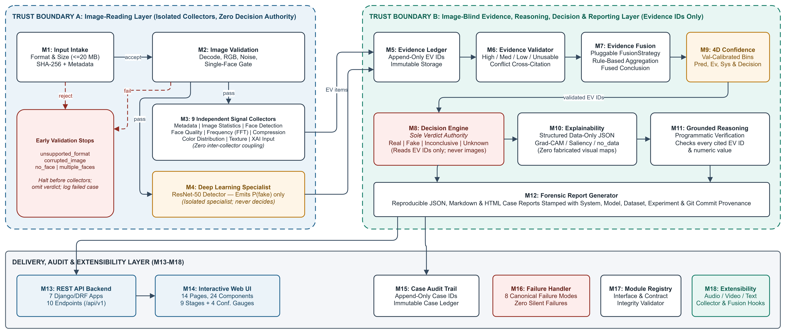
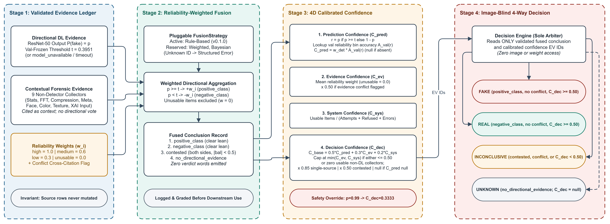
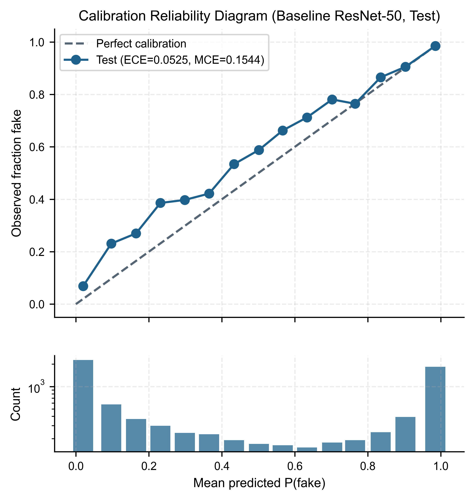
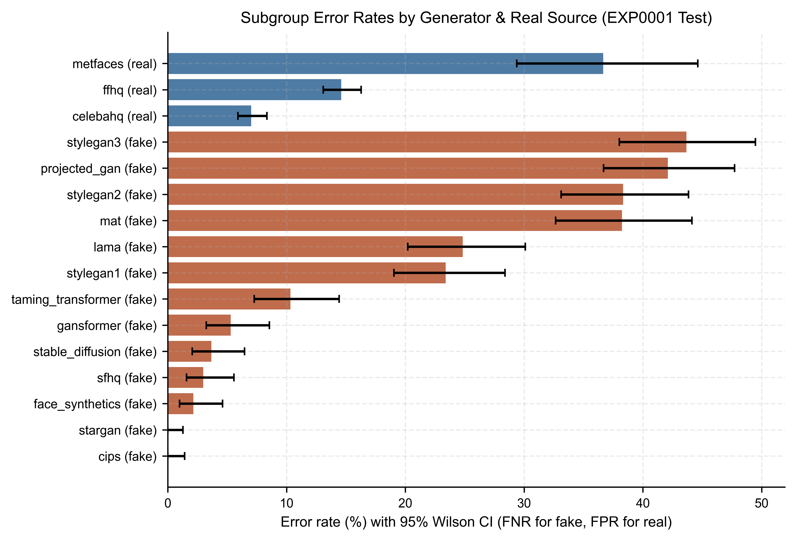
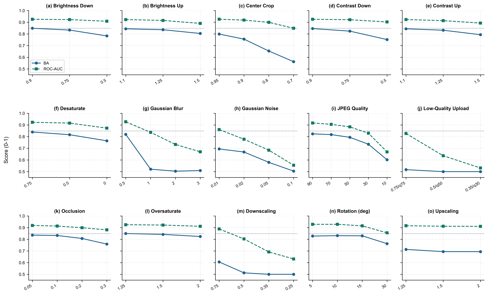
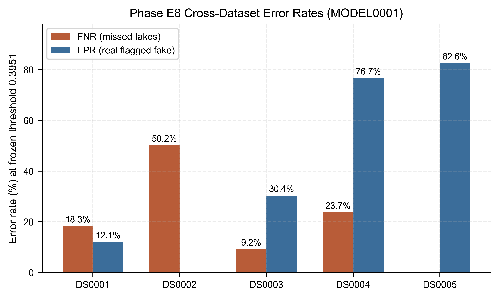
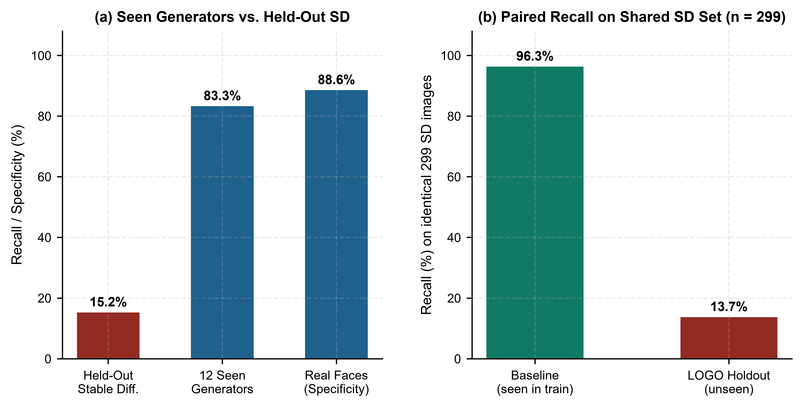
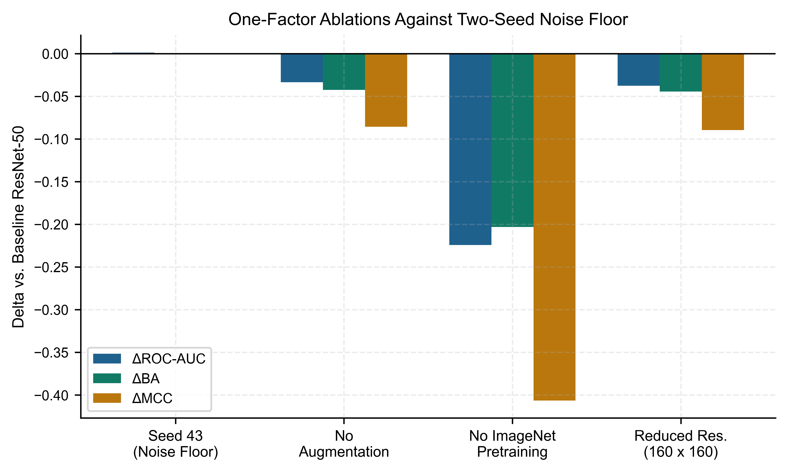

# AI Forensic Analyst: An Evidence-Driven, Calibrated, and Auditable Architecture for Cross-Generator Synthetic Face Forensics

**Target Venue Profile:** Elsevier Q1 (*Forensic Science International: Digital Investigation* / *Computers & Security*), adaptable to IEEE Transactions via `15_Writing/references/references.bib`  
**Manuscript Version:** `1.0.0-rc1` | **Date:** 2026-11-22 | **Evidence Base:** Shared canonical registries (`P0001`–`P0028`, `CLAIM0001`–`CLAIM0008`, `EXP0001`–`EXP0006`, `EVAL0001`–`EVAL0007`, `MOD001`–`MOD018`, `TAB0001`–`TAB0003`, `FIG0001`–`FIG0030`)

---

## Highlights

- Reframes synthetic face detection into an 18-module evidence-driven forensic platform.
- Isolates deep learning inference from an image-blind four-way Decision Engine.
- Introduces validation-calibrated four-dimensional confidence overriding blind scores.
- Quantifies cross-dataset real-face FPR up to 82.6% and unseen diffusion drop to 13.7%.
- Verifies 16 forensic scenarios, 135 evidence-grounded sentences, and full-stack UAT.

---

## Abstract

Standalone deep learning detectors for synthetic human faces routinely attain high in-distribution discrimination yet fail unpredictably under unseen generative architectures, external real-image domain shift, and lossy post-processing (`P0003`; `P0007`; `P0016`; `P0018`; `P0023`; `CLAIM0001`; `CLAIM0003`; `CLAIM0006`). In operational digital forensics, returning an uncalibrated binary probability without provenance, uncertainty bounds, or abstention capability exposes investigators to silent false accusations and missed forgeries. This paper introduces the **AI Forensic Analyst**, an 18-module evidence-driven forensic architecture (`MOD001`–`MOD018`) that demotes the neural detector to one isolated, replaceable specialist (`MOD004`) inside a trust-bounded pipeline separating image-reading collectors from an image-blind four-way Decision Engine (`MOD008`: `Real`, `Fake`, `Inconclusive`, `Unknown`). First, we establish a strictly public-only, open-license five-dataset benchmark (`DS0001`–`DS0005`, `250k+` processed images) with leakage-checked grouped and leave-one-generator-out splits (`SPLIT0001`–`SPLIT0002`) and systematically stress-test a standardized `ResNet-50` baseline (`EXP0001`–`EXP0006`; `EVAL0001`–`EVAL0006`). Although `MODEL0001` reaches ROC-AUC `0.9261`, PR-AUC `0.9348`, balanced accuracy `0.8483`, MCC `0.6978`, and ECE `0.0525` on `DS0001` (`n=7,505`, validation-frozen threshold `0.3951`), stress testing reveals `43.7%` FNR on `stylegan3`, balanced accuracy collapse toward `0.50` under fine-detail degradation (`53` perturbations), `48.1%` unseen-generator cross-dataset FNR (`50.2%` on `DS0002` DiFF), `30.4%`–`82.6%` external real-face FPR (`DS0003`–`DS0005`), and a recall drop from `96.3%` to `13.7%` under controlled `stable_diffusion` holdout (`EXP0002`). Second, we implement and verify the 18-module platform with reliability-weighted fusion (`MOD007`), validation-calibrated four-dimensional confidence (`MOD009`), programmatically evidence-verified reasoning (`MOD011`), structured eight-mode failure handling (`MOD016`), and a three-tier Django/React web application (`MOD013`–`MOD014`). In 16 end-to-end verification scenarios (`EVAL0007`), the platform passes all 9 quality dimensions (`135` verified reasoning sentences, `0` ungrounded claims, `60.02 ms` mean latency), explicitly overriding a `0.99` detector score into `Inconclusive` (`decision_confidence = 0.3333`) when supporting evidence is unusable and degrading cleanly to `Unknown` when specialists are unavailable. All code, registries, verification scripts, and datasets are publicly reproducible.

**Keywords:** Synthetic face detection; Digital forensics; Cross-generator generalization; Evidence fusion; Confidence calibration; Explainable forensic systems; Diffusion models; Generative Adversarial Networks.

---

## 1. Introduction

High-fidelity facial synthesis has progressed rapidly from Generative Adversarial Networks (GANs) (`P0005`; `P0010`; `P0025`) to latent and denoising diffusion models (`P0003`; `P0006`; `P0009`; `P0023`), creating severe risks for identity verification, journalistic integrity, and judicial evidence authentication (`P0024`; `P0026`; `P0028`). Despite strong benchmark accuracies reported on matched test splits, empirical evaluations consistently show that standalone classifiers overfit generator-specific spectral traces or dataset acquisition shortcuts (`P0007`; `P0016`; `P0018`; `CLAIM0001`; `CLAIM0003`). When evaluated on unseen generative paradigms, demographically diverse external real images, or social-media compression pipelines, both false negative rates (missed forgeries) and false positive rates (authentic faces flagged as fake) spike sharply (`P0003`; `P0013`; `P0016`; `CLAIM0006`).

This failure pattern reveals a structural flaw in how synthetic media detection is typically engineered (`GAP0001`; `GAP0003`; `GAP0007`). Most published systems conflate four distinct responsibilities inside a single black-box classifier: signal extraction, evidence reliability grading, uncertainty calibration, and final verdict issuance. A bare fake-class probability (for example, `0.99`) provides neither empirical reliability calibration nor a mechanism to abstain when input quality is degraded, corroborating signals are absent, or a specialist encounters an out-of-distribution domain (`P0016`; `P0018`).

To bridge the gap between model-centric detection research and auditable digital forensics (`DEC0002`; `DEC0003`), this study makes four concrete contributions:

1. **Controlled Cross-Paradigm Stress Benchmark:** We curate a strictly public-only, open-license five-dataset evaluation benchmark (`DS0001`–`DS0005`: ArtiFact faces, DiFF official test, 140k Real and Fake Faces, Synthbuster, and FairFace) under versioned deterministic preprocessing (`PP0001`–`PP0006`) and leakage-verified grouped and leave-one-generator-out splits (`SPLIT0001`–`SPLIT0002`), and quantify exact failure modes of a standardized `ResNet-50` detector across calibration, 53 perturbations, four external corpora, controlled diffusion holdout, four one-factor ablations, and paired statistical tests (`EXP0001`–`EXP0006`; `EVAL0001`–`EVAL0006`).
2. **18-Module Trust-Bounded Forensic Architecture (`MOD001`–`MOD018`):** We design and implement the **AI Forensic Analyst**, separating image-reading intake, validation, nine independent non-detector collectors (`MOD003`), and an isolated deep learning specialist (`MOD004`) from an image-blind downstream core governed by an append-only evidence ledger (`MOD005`), non-destructive reliability validator (`MOD006`), pluggable fusion engine (`MOD007`), and four-way Decision Engine (`MOD008`: `Real`, `Fake`, `Inconclusive`, `Unknown`).
3. **Validation-Calibrated Four-Dimensional Confidence and Anti-Hallucination Reasoning:** We formalize `e4_calibrated_v1` (`MOD009`; `DEC0010`), separating raw detector probability from empirical validation bin accuracy (`prediction_confidence`), collector reliability (`evidence_confidence`), execution completeness (`system_confidence`), and capped `decision_confidence`. Downstream reasoning (`MOD011`) programmatically verifies every generated sentence against cited `EV` ledger records, while explainability (`MOD010`) emits structured data-only outputs and explicitly records `"no_data"` rather than fabricating visual maps.
4. **End-to-End Platform Verification and Open Reproducibility:** We verify the complete system across 16 whole-platform forensic scenarios and 9 quality dimensions (`EVAL0007`), deliver an interactive three-tier Django/DRF + React web platform (`MOD013`–`MOD014`) validated by 85 automated unit/API/UI tests, live cross-tier HTTP integration, and six live User Acceptance Tests (`UAT-01`–`UAT-06`), and release all reproducible configurations, registries, and evaluation scripts under the MIT license (`DEC0001`).

---

## 2. Related Work

We synthesize 28 peer-reviewed studies spanning legacy GAN forensics through modern diffusion detection (`P0001`–`P0028`; full 16-method comparison in Supplementary S1, `TAB0001`; `CLAIM0001`–`CLAIM0008`).

**Frequency-Domain and Convolutional Trace Detectors.** Early forensic pipelines exploited transposed-convolution upsampling footprints via Expectation-Maximization (`P0005`) and Discrete Cosine Transform (DCT) beta-statistics (`P0010`), achieving strong intra-GAN discrimination (`CLAIM0002`). Subsequent diffusion forensics revealed that iterative denoising alters high-frequency spectral signatures relative to GANs (`P0003`), motivating multi-level frequency and spatial hierarchies (`P0018`; `P0022`). However, frequency cues degrade sharply under JPEG recompression, resizing, and anti-forensic fingerprint removal (`P0013`; `P0019`; `CLAIM0006`).

**Spatial Classifiers, Pretraining Paradigms, and Source Attribution.** Spatial CNNs (`ResNet`, `Xception`, `EfficientNet`) and Vision Transformers dominate large-scale benchmarks (`P0002`; `P0011`; `P0014`; `P0017`; `P0021`; `P0023`). Systematic cross-architecture studies demonstrate that pretraining strategy (notably CLIP and self-supervised visual encoders) strongly influences cross-generator transfer (`P0007`; `CLAIM0007`), while hierarchical classifiers attempt generator-family attribution (`P0018`; `P0021`; `CLAIM0004`). Nevertheless, recent multi-paradigm audits confirm that classifiers trained on GAN corpora suffer severe accuracy drops on diffusion faces and exhibit demographic and dataset-origin bias shortcuts (`P0016`; `P0023`; `CLAIM0001`; `CLAIM0003`).

**Physiological Biometrics, Reconstruction Error, and Proactive Defenses.** Alternative paradigms target facial landmark geometry and GAN-inversion biometrics (`P0008`; `P0015`; `CLAIM0005`), diffusion reconstruction error (`P0006`; `CLAIM0008`), and proactive watermarking or blockchain provenance (`P0004`; `P0012`; `P0020`). Biometric cues lose discriminative margin on high-fidelity StyleGAN3 and diffusion synthesis (`P0025`), reconstruction error imposes heavy multi-step inference cost (`P0006`), and proactive schemes require control over image generation (`P0020`). Existing surveys (`P0024`–`P0028`) comprehensively catalog neural architectures (`GAP0008`) yet rarely address system-level forensic decision governance.

**Synthesized Gaps Motivating Our Architecture.** Four interlocking gaps motivate the AI Forensic Analyst: (1) cross-generator generalization collapse between GAN and diffusion families (`GAP0001`), (2) real-source shortcut learning causing high false positive rates on out-of-distribution authentic faces (`GAP0002`), (3) insufficient uncertainty calibration and explainability transparency (`GAP0003`; `P0016`), and (4) absence of modular, auditable evidence-fusion architectures capable of safe abstention (`GAP0007`).

---

## 3. Methodology: The AI Forensic Analyst Architecture

### 3.1 Public-Only Multi-Dataset Benchmark and Leakage-Free Splitting

To eliminate license ambiguity and dataset shortcut blindness (`DEC0004`; `DEC0005`), we assemble five strictly public, open-license corpora summarized in Table 1 and illustrated in the end-to-end methodology pipeline (`FIG0026`, Supplementary S3).

| Dataset ID | Corpus | Role | Processed Images | Class / Generator Composition | License |
|---|---|---|---:|---|---|
| `DS0001` | ArtiFact (face subset) | In-distribution train/val/test & LOGO | 50,000 | 25k real (FFHQ, CelebA-HQ, MetFaces, AFHQ) / 25k fake (13 GAN + diffusion gens) | MIT |
| `DS0002` | DiFF (official test) | Cross-dataset unseen diffusion (`P0023`) | 51,452 | Fake-only across 13 diffusion generators (5,608 PP exclusions documented) | Research Open |
| `DS0003` | 140k Real and Fake Faces | Cross-dataset GAN/FFHQ benchmark | 140,000 | 70k FFHQ real / 70k StyleGAN fake | Public Open |
| `DS0004` | Synthbuster (`P0003`) | Cross-dataset diffusion + natural scenes | 9,999 | 9,000 diffusion fakes (9 models) / 999 RAISE real scenes | CC BY 4.0 |
| `DS0005` | FairFace | Cross-dataset demographic real-face FPR | 97,698 | Real-only faces balanced across 7 demographic groups | CC BY 4.0 |

All images pass through a deterministic 7-stage preprocessing pipeline (`PP0001`–`PP0006`, seed `42`): integrity verification, pre-modification metadata capture, EXIF stripping, minimum resolution filtering (`>= 64 px`), RGB PNG conversion, and `224 x 224` resizing with **zero denoising or sharpening** so high-frequency forensic traces remain intact (`CLAIM0002`). On `DS0001`, we generate two leakage-checked splits: `SPLIT0001` (grouped random `34,993` train / `7,502` val / `7,505` test) and `SPLIT0002` (controlled leave-one-generator-out holding out all `1,923` `stable_diffusion` images exclusively for testing; `DEC0007`). Automated hash and identifier checks confirm zero cross-split overlap (`FIG0001`–`FIG0010`, Supplementary S2).

### 3.2 Trust-Bounded 18-Module Forensic Pipeline

*Figure 1 (`FIG0027`): Eighteen-module AI Forensic Analyst architecture separating Trust Boundary A (image-reading intake, validation, nine independent signal collectors, and isolated deep learning specialist) from Trust Boundary B (image-blind append-only evidence ledger, reliability validator, fusion engine, four-dimensional confidence estimator, sole four-way Decision Engine, data-only explainability, grounded reasoning, and report generator) and Delivery/Governance modules (`M13`–`M18`).*

Figure 1 (`FIG0027`) illustrates the architectural boundary that enforces forensic accountability across all 18 modules (`MOD001`–`MOD018`; full interface table in Supplementary S4):

- **Trust Boundary A (Image-Reading Layer, Zero Decision Authority):** `MOD001` enforces format and `20 MB` upload limits while computing SHA-256 hashes and rejecting unsafe files without persistence. `MOD002` verifies decodability, RGB channels, resolution, noise, and single-face availability; violations trigger immediate `MOD016` structured stops (`unsupported_format`, `corrupted_image`, `no_face`, `multiple_faces`) before collectors run, omitting `decision.json` while still logging a failed case record (`MOD015`). Passing inputs reach nine strictly decoupled non-detector collectors (`MOD003`: metadata, image statistics, face detection, face quality, FFT frequency domain, compression, color distribution, texture, explainability input; zero inter-collector imports) and the isolated deep learning specialist (`MOD004`), which loads `MODEL0001` from `model_registry.csv` and emits raw $P(\text{fake})$, latency, and model provenance without applying any decision threshold or verdict word.
- **Trust Boundary B (Image-Blind Evidence & Decision Layer):** `MOD005` assigns sequential immutable identifiers (`EVxxxxxx`) in append-only `evidence_registry.csv`. `MOD006` appends separate validation records grading each item as `high`, `medium`, `low`, or `unusable` and cross-citing conflicts without mutating source rows or substituting values for `null` confidences. Downstream modules read strictly validated `EV` identifiers and never access raw images or neural weights.

### 3.3 Reliability-Weighted Fusion, 4D Calibrated Confidence, and 4-Way Decisioning

*Figure 2 (`FIG0028`): Mathematical flow from validated evidence ledger through reliability-weighted rule-based fusion (`MOD007`), validation-calibrated four-dimensional confidence (`MOD009`), and image-blind four-way verdict issuance (`MOD008`). Safety caps override a raw `0.99` detector score into `Inconclusive` (`decision_confidence = 0.3333`) whenever supporting evidence is unusable.*

As shown in Figure 2 (`FIG0028`), the mathematical decision core operates in three transparent stages (`DEC0009`; `DEC0010`):

**1. Reliability-Weighted Evidence Fusion (`MOD007`, `DEC0009`).** Under the pluggable `FusionStrategy` contract (active strategy `rule_based` v0.1.0; `weighted` and `bayesian` reserved; unknown IDs fail loudly via `MOD016`), each validated evidence item receives weight $w_i \in \{1.0, 0.6, 0.3, 0.0\}$ for `high`, `medium`, `low`, and `unusable` respectively. Only calibrated directional specialists vote on class polarity: for `MOD004` with fake probability $p$ and validation-frozen threshold $t = 0.3951$, $p \ge t$ contributes $+w_i$ (`positive_class`) and $p < t$ contributes $-w_i$ (`negative_class`). The nine contextual `MOD003` collectors are cited as corroborating context without fabricating directional votes. When opposing directional evidence yields normalized $|\text{balance}| < 0.5$, the fused lean is `contested`; when no usable directional specialist exists, the lean is `no_directional_evidence`. The emitted `fused_conclusion` item contains zero verdict words and is itself logged (`MOD005`) and validated (`MOD006`).

**2. Validation-Calibrated Four-Dimensional Confidence (`MOD009`, `DEC0010`, `e4_calibrated_v1`).** To break the equivalence between raw softmax probability and forensic certainty (`P0016`), `MOD009` computes four distinct metrics:

$$C_{\text{pred}} = w_{\text{det}} \cdot A_{\text{val}}(r), \quad r = \begin{cases} p & \text{if } p \ge t \\ 1 - p & \text{if } p < t \end{cases}$$

where $A_{\text{val}}(r)$ is the empirical bin accuracy queried from `EVAL0001` validation reliability bins (`split=val`; `null` if no usable detector item exists). For example, `MODEL0001` $p = 0.99$ maps to $C_{\text{pred}} = 0.971745$ rather than `0.99`. Next, evidence reliability confidence is the mean `MOD006` weight across all collector items (with `unusable = 0.0`), halved whenever a conflict flag is present:

$$C_{\text{ev}} = \left(\frac{1}{N} \sum_{i=1}^{N} w_i\right) \cdot (0.5 \text{ if conflict else } 1.0)$$

System execution completeness measures pipeline health:

$$C_{\text{sys}} = \frac{N_{\text{usable}}}{N_{\text{attempted}} + N_{\text{refused}} + N_{\text{MOD016}}}$$

Finally, overall `decision_confidence` ($C_{\text{dec}}$) combines the three dimensions with explicit conservative caps and discounts:

$$C_{\text{base}} = 0.5\,C_{\text{pred}} + 0.3\,C_{\text{ev}} + 0.2\,C_{\text{sys}}$$

If $C_{\text{pred}}$ is `null`, then $C_{\text{dec}}$ remains `null`. Otherwise, whenever $C_{\text{ev}} \le 0.50$, $C_{\text{sys}} \le 0.50$, or zero usable non-detector collectors exist, $C_{\text{dec}}$ is capped at $\min(C_{\text{ev}}, C_{\text{sys}})$; single-source leans receive a $\times 0.85$ discount and contested leans receive a $\times 0.50$ discount.

**3. Image-Blind Four-Way Decision Engine (`MOD008`).** Reading solely the validated `fused_conclusion` and `confidence` `EV` IDs, `MOD008` emits: `Unknown` if `no_directional_evidence` (or $C_{\text{dec}}$ is `null`); `Inconclusive` if the lean is `contested`, a conflict flag is active, or $C_{\text{dec}} < 0.50$; `Fake` if `positive_class`, no conflict, and $C_{\text{dec}} \ge 0.50$; and `Real` if `negative_class`, no conflict, and $C_{\text{dec}} \ge 0.50$.

### 3.4 Grounded Reasoning, Data-Only Explainability, and Full-Stack Delivery

`MOD010` outputs structured `explanation.json` across `grad_cam`, `attention_maps`, `saliency`, and `integrated_gradients` (with `shap`, `lime`, and `counterfactuals` reserved), explicitly setting unrecorded attribution maps to `"no_data"` (`data: null`) and refusing rendered images or verdict strings. `MOD011` generates `reasoning.json` strictly from validated `EV` ledger records and executes `verify_sentence()` on every sentence to confirm that every cited `EV` ID and numeric value matches the registry; any ungrounded sentence raises a `MOD016` error. `MOD012` compiles reproducible JSON, Markdown, and HTML case reports stamped with byte-identical system, model, dataset, experiment, and Git commit provenance. Web delivery (`FIG0029`, Supplementary S3) exposes 10 canonical endpoints across a 7-app Django/DRF backend (`MOD013`, zero duplicated forensic logic, thread-safe `_PIPELINE_LOCK`) consumed by a 14-page, 24-component React/Vite/Tailwind UI (`MOD014`) displaying 9 live pipeline stages, four-way verdicts, all four calibrated confidence gauges, cited `EV` IDs, and explicit limitations.

---

## 4. Experimental Setup

All model training ran on NVIDIA T4 GPUs under a locked environment (`Python 3.12`, `PyTorch 2.10.0+cu128`, `FastAI 2.8.7`) governed by immutable YAML configurations (`47` validator tests) and SHA-256 atomic checkpoints (`FIG0030`, Supplementary S3). Six controlled experiments (`EXP0001`–`EXP0006`) were executed:

- **Primary Baseline (`EXP0001` / `MODEL0001`):** ImageNet-1k pretrained `ResNet-50` trained on `DS0001` `SPLIT0001` (`224 x 224`, Adam `wd=0.01`, FP16 mixed precision, 1 frozen + 10 unfrozen epochs, train-only geometric/photometric augmentation, early-stopping patience 3). Operating threshold `t = 0.3951` (exact `0.395057`) maximizing balanced accuracy was frozen strictly on the validation split (`DEC0006`).
- **Controlled Unseen-Generator Holdout (`EXP0002` / `MODEL0008`):** Identical `EXP0001` hyperparameters trained on `SPLIT0002` excluding all `stable_diffusion` images (`DEC0007`), evaluated on held-out `stable_diffusion` (`n=1,923`) and paired directly against `MODEL0001` on the identical `299` `stable_diffusion` images present in `SPLIT0001` test.
- **One-Factor Ablation Matrix (`EXP0003`–`EXP0006` / `MODEL0009`–`MODEL0012`):** Each run mutates exactly one `EXP0001` factor on `SPLIT0001` (`DEC0008`): `EXP0003` random seed (`42 -> 43`), `EXP0004` augmentation disabled, `EXP0005` ImageNet pretraining disabled (fixed 11-epoch budget), and `EXP0006` input resolution reduced (`224 -> 160 px`).
- **Stress & Statistical Testing (`EVAL0001`–`EVAL0006`):** `MODEL0001` was evaluated across E4 calibration (`ECE`, `MCE`, `Brier`), E5 operating points (`screening 0.089`, `frozen 0.3951`, `flag-for-review 0.629`), E6/E12 per-generator and real-source error breakdowns, E7 perturbation robustness (`53` synthetic distortions + clean check across all `7,505` test images), and E8 cross-dataset generalization (`DS0002`–`DS0005`). E11 statistical testing paired all `7,505` `SPLIT0001` test predictions using 10,000 percentile bootstrap resamples (seed `49`) on ROC-AUC (`95%` CI for `EXP0003`; Bonferroni-adjusted `98.3%` CIs for the three factor ablations `EXP0004`–`EXP0006`) and exact two-sided McNemar tests. Because each ablation ran for one seed and Wilcoxon signed-rank across seeds requires at least `6` pairs (`n=2 < 6`), all comparisons report saved-run differences with `superiority_claim=none`.
- **Whole-Platform & Full-Stack Verification (`EVAL0007`):** The 18-module platform was evaluated across 16 end-to-end forensic scenarios spanning 9 quality dimensions (valid fake/real, unsupported format, corruption, no face, multi-face, missing/timed-out specialist, unusable collector override, contested evidence, conflict preservation, ungrounded reasoning rejection, audit completeness, and determinism), plus 85 automated unit/API/UI tests, live cross-tier HTTP integration, and 6 live UAT scenarios (`UAT-01`–`UAT-06`).

---

## 5. Results

### 5.1 In-Distribution Performance, Calibration, and Subgroup Failure Profile

On `DS0001` `SPLIT0001` test (`n=7,505`, `3,753` fake / `3,752` real), `MODEL0001` attains ROC-AUC `0.9261`, PR-AUC `0.9348`, balanced accuracy `0.8483`, MCC `0.6978`, FNR `0.1829` (`686` missed fakes), FPR `0.1205` (`452` false alarms), Brier score `0.1131`, ECE `0.0525`, and MCE `0.1544` (`EVAL0001`; `FIG0012`–`FIG0014`, `FIG0024`–`FIG0025` in Supplementary S3).

*Figure 3 (`FIG0011`): Calibration reliability diagram on `DS0001` test (`ECE = 0.0525`, `MCE = 0.1544`), demonstrating systematic mid-to-high confidence miscalibration that motivates `MOD009` validation-bin confidence mapping.*

*Figure 4 (`FIG0015`): In-distribution subgroup error profile revealing severe heterogeneity across seen generators (`0.0%` FNR on `stargan`/`cips` versus `43.7%` on `stylegan3`, `42.2%` on `projected_gan`, `38.8%` on `stylegan2`, `38.6%` on `mat`) and real sources (`36.7%` FPR on artistic `metfaces` versus `10.9%` on `celebahq` and `11.1%` on `ffhq`).*

Even within the training distribution, Figure 4 (`FIG0015`) shows that aggregate accuracy conceals `>38%` false negative rates on high-realism GANs (`stylegan3`, `projected_gan`, `stylegan2`, `mat`) and `36.7%` false positive rates on non-photographic `metfaces` portraits (`CLAIM0003`; `CLAIM0005`).

### 5.2 Perturbation Robustness Across 53 Image Distortions

*Figure 5 (`FIG0016`): Balanced accuracy and ROC-AUC under 53 perturbation conditions (`n=7,505` test images per condition). Fine-detail degradations (`low_quality_upload`, downscaling, blur, Gaussian noise, and JPEG quality 10) collapse balanced accuracy toward `0.50` by pushing FPR toward `1.0`, whereas moderate photometric shifts cost under `0.10`.*

Across all 53 distortions (`EVAL0001`; `FIG0016`; subgroup breakdown `FIG0017` in Supplementary S3), robustness separates sharply into two failure regimes (`CLAIM0006`): (1) **catastrophic fine-detail collapse**, where `low_quality_upload`, aggressive downscaling, Gaussian blur, strong noise, and `JPEG 10` drive balanced accuracy to `~0.50` because `MODEL0001` flags nearly every degraded real image as fake (`FPR -> 1.0`), and (2) **moderate photometric resilience**, where brightness, contrast, color jitter, and small rotations reduce balanced accuracy by `< 0.10`. Decomposing ROC-AUC versus thresholded balanced accuracy shows that mild JPEG/resize shifts involve threshold drift alongside genuine ranking erosion under heavy blur and noise.

### 5.3 Cross-Dataset Shift and Controlled Unseen-Generator Holdout

*Figure 6 (`FIG0018`): Cross-dataset generalization of `MODEL0001` at frozen threshold `0.3951` across four external benchmarks (`DS0002`–`DS0005`), exposing severe unseen-diffusion misses (`50.2%` DiFF FNR) and massive external real-image false positive rates (`30.4%`–`82.6%`).*

*Figure 7 (`FIG0019`): Controlled leave-one-generator-out (`SPLIT0002`) evaluation holding out `stable_diffusion`. Recall collapses from `83.3%` on 12 seen generators to `15.2%` (`293/1,923`) on held-out `stable_diffusion`, and from `96.3%` (`MODEL0001`, seen) to `13.7%` (`MODEL0008`, unseen) on the identical 299 test images.*

Cross-dataset testing (`EVAL0001`; Figure 6, `FIG0018`) confirms both halves of detector fragility (`CLAIM0001`; `CLAIM0003`): across 17 unseen generators, FNR climbs from `18.3%` in-distribution to `48.1%` (`50.2%` on `DS0002` DiFF diffusion faces, reaching `81.5%` on `FreeDoM_I`), whereas familiar StyleGAN-family fakes in `DS0003` suffer only `9.0%` FNR. Simultaneously, authentic images from outside `DS0001` trigger extreme false alarms: `30.4%` FPR on `DS0003` FFHQ, `76.7%` FPR on `DS0004` RAISE scenes (overall `DS0004` ROC-AUC `0.5172`, near chance), and `82.6%` FPR on `DS0005` FairFace across all seven demographic groups. Controlled `stable_diffusion` holdout (`EXP0002`; `EVAL0002`; Figure 7, `FIG0019`) isolates pure unseen-generator failure without dataset shift: while `MODEL0008` retains validation ROC-AUC `0.937` on its 12 seen generators, held-out `stable_diffusion` recall drops to `15.2%` (`293/1,923`), falling from `96.3%` (`MODEL0001`) to `13.7%` (`MODEL0008`) on the exact same 299 test images (`P0007`; `P0016`; `P0023`). Consequently, `MODEL0001` is explicitly registered as `Deployment Ready = no`.

### 5.4 Controlled One-Factor Ablations and Paired Statistical Comparisons

*Figure 8 (`FIG0020`): Controlled one-factor ablation ROC-AUC differences relative to `EXP0001` against the two-seed repeatability noise floor (`EXP0003`, `+0.0011`, 95% CI includes zero), with Bonferroni-adjusted 98.3% paired bootstrap intervals excluding zero for all three factor ablations (`EXP0004`–`EXP0006`).*

Tables 2 (`TAB0002`) and 3 (`TAB0003`) report the fairness-compatible `SPLIT0001` comparison (`EXP0002` excluded because it trained on `SPLIT0002`; ROC/PR curves in `FIG0021`–`FIG0023`, Supplementary S3).

**Table 2 (`TAB0002`):** Fairness-compatible ranked comparison on `DS0001` `SPLIT0001` test (`n=7,505`; `superiority_claim=none`).

| Rank | Experiment | Factor Changed | ROC-AUC | PR-AUC | Balanced Acc. | MCC | FNR | FPR | ECE |
|---:|---|---|---:|---:|---:|---:|---:|---:|---:|
| 1 | `EXP0003` | `random_seed` (`43`) | 0.9272 | 0.9363 | 0.8481 | 0.6978 | 0.1881 | 0.1157 | 0.0545 |
| 2 | `EXP0001` | baseline (`seed=42`) | 0.9261 | 0.9348 | 0.8483 | 0.6978 | 0.1829 | 0.1205 | 0.0525 |
| 3 | `EXP0004` | no augmentation | 0.8925 | 0.9042 | 0.8059 | 0.6120 | 0.2056 | 0.1825 | 0.0378 |
| 4 | `EXP0006` | `image_size` (`160 px`) | 0.8885 | 0.9053 | 0.8039 | 0.6082 | 0.2170 | 0.1753 | 0.0944 |
| 5 | `EXP0005` | no pretraining | 0.7017 | 0.7092 | 0.6452 | 0.2912 | 0.3162 | 0.3935 | 0.0230 |

**Table 3 (`TAB0003`):** Paired ROC-AUC bootstrap differences (`10,000` resamples, seed `49`) and exact McNemar tests vs. `EXP0001` (`n=7,505`; `superiority_claim=none`).

| Comparison | ΔROC-AUC | CI Level | Bootstrap CI | Exact McNemar Adj. p | Disagreements (`b` / `c`) | Saved-Run Status |
|---|---:|---:|---|---:|---|---|
| `EXP0003` vs `EXP0001` | +0.0011 | 95.0% | `[-0.0012, +0.0035]` | `0.964` | `251 / 249` | `not_supported` |
| `EXP0004` vs `EXP0001` | -0.0336 | 98.3% | `[-0.0396, -0.0279]` | `8.34e-23` | `977 / 573` | `challenger_lower` |
| `EXP0005` vs `EXP0001` | -0.2243 | 98.3% | `[-0.2383, -0.2101]` | `7.1e-217` | `2,012 / 491` | `challenger_lower` |
| `EXP0006` vs `EXP0001` | -0.0376 | 98.3% | `[-0.0447, -0.0307]` | `1.36e-21` | `991 / 596` | `challenger_lower` |

Seed replication (`EXP0003` vs `EXP0001`) establishes a narrow noise floor (`ΔROC-AUC +0.0011`, 95% CI crossing zero, two-seed SD `0.0008`, decision agreement `0.9334`, Cohen's kappa `0.8662`, McNemar `p = 0.964`). Every single-factor removal causes a drop an order of magnitude beyond this noise floor with Bonferroni-adjusted 98.3% CIs strictly below zero (`EVAL0004`, `EVAL0005`, `EVAL0006`): ImageNet-1k pretraining contributes the largest gain (`-0.2243` ROC-AUC under the fixed 11-epoch budget), `224 px` spatial resolution preserves both discrimination (`-0.0376`) and calibration (`ECE 0.0525` vs `0.0944`), and train-only augmentation prevents early epoch-3 overfitting (`-0.0336`).

### 5.5 Whole-Platform AI Forensic Analyst and Full-Stack Verification (`EVAL0007`)

In Phase E14 evaluation (`EVAL0007`; complete 16-scenario matrix in Supplementary S4), the AI Forensic Analyst passes **16/16 end-to-end scenarios** and **9/9 quality dimensions** with **`135` programmatically verified reasoning sentences**, **`0` ungrounded leaks**, **`0` silent failures**, and **`60.02 ms` mean latency**. Key architectural invariants confirmed empirically include:

- **High-Confidence Safety Override (`Scenario E14-10`):** When `MOD004` emits $P(\text{fake}) = 0.99$ (`prediction_confidence = 0.9717`) while supporting collectors are unusable (`evidence_confidence = 0.3333`), the conservative cap overrides the raw neural score to `decision_confidence = 0.3333` and `MOD008` issues **`Inconclusive`** instead of a silent `Fake` accusation.
- **Graceful Degradation (`Scenarios E14-07`, `E14-08`):** Missing model weights (`model_unavailable`) or specialist `timeout` degrade cleanly to **`Unknown`** with `null` `prediction_confidence` and `decision_confidence` while preserving all nine contextual collectors.
- **Anti-Hallucination Enforcement (`Scenario E14-12`):** Deliberately injected ungrounded claims or invalid `EV` references are deterministically rejected by `MOD011` via `MOD016`.
- **Full-Stack Delivery Verification (`MOD013`–`MOD014`):** All `85` automated tests (`55` forensic core + `18` Django/DRF backend + `12` React frontend), production `vite build`, live cross-tier HTTP async investigation (`POST /cases` → `POST /upload` `202` → polling `/status` → byte-identical `/decision` & `/report`), and all `6` live UAT scenarios (`UAT-01`–`UAT-06`) pass with zero leaked stack traces.

---

## 6. Discussion and Limitations

Our empirical results confirm a central forensic lesson: even a well-calibrated, leakage-free neural detector (`ROC-AUC 0.9261`, `ECE 0.0525`) exhibits catastrophic failure modes once exposed to unseen diffusion models (`13.7%` paired recall), external authentic face distributions (`82.6%` FairFace FPR), or heavy post-processing (`~0.50` BA). Deploying such a classifier as a standalone binary decision-maker is scientifically indefensible. By structurally separating perception (`MOD003`–`MOD004`) from evidence grading (`MOD005`–`MOD006`), calibrated multi-dimensional confidence (`MOD009`), and an image-blind four-way Decision Engine (`MOD008`), the AI Forensic Analyst converts hidden model fragility into explicit `Inconclusive` or `Unknown` abstentions backed by auditable `EV` trails (`CLAIM0001`–`CLAIM0006`).

In keeping with strict scientific honesty, six Version 1 scope boundaries must be stated transparently:

1. **Single CNN Backbone Family (`KI0047`):** Version 1 trained `ResNet-50` across six controlled experiments; shortlisted diverse comparators (`Xception`, `EfficientNet-B4`, and self-supervised `ViT-B/16`, `P0007`) remain for Version 2, so no cross-architecture superiority is claimed.
2. **Single-Seed Ablation Replication (`KI0048`):** Two baseline seeds (`EXP0001`, `EXP0003`) establish the repeatability noise floor, whereas factor ablations ran for one seed each (Wilcoxon across seeds deferred for $n < 6$, `superiority_claim=none`), and `EXP0005` reflects a fixed-budget single-factor comparison rather than a separately tuned from-scratch schedule.
3. **Contextual Non-Detector Collectors and Rule-Based Fusion (`KI0052`):** In V1, the nine `MOD003` collectors provide reliability-graded contextual evidence rather than calibrated directional votes, and `MOD007` uses interpretable `rule_based` fusion (`DEC0009`). Learned `weighted` and `bayesian` strategies require curated labeled multi-collector forensic corpora in V2.
4. **Single-Generator LOGO and Post-Preprocessing Perturbations (`KI0050`; `KI0051`):** Phase E9 held out `stable_diffusion` only (fake-only recall), and Phase E7 applied synthetic perturbations to `224 px` crops rather than pre-cropped camera uploads; degradation-augmented retraining and validation temperature scaling remain future experiments.
5. **Runtime Visual Attribution (`KI0053`):** `MOD010` currently verifies the data-only schema and accurately records `"no_data"` when visual attribution tensors are unrecorded; wiring live Grad-CAM/SHAP/LIME tensor producers into `MOD010` is planned for V2.
6. **Static Single-Face Local Scope (`KI0054`):** V1 enforces single-face static images and local development execution; video/audio/text extensions via `MOD018`, production TLS/authentication hardening, and practitioner human-factors UX trials remain V2 milestones.

---

## 7. Conclusion

This work demonstrates that trustworthy synthetic face forensics requires shifting from standalone binary classification to auditable, uncertainty-aware forensic systems. Across a public five-dataset benchmark (`DS0001`–`DS0005`), six controlled GPU experiments (`EXP0001`–`EXP0006`), and 18 evaluation phases (`EVAL0001`–`EVAL0007`), we first quantified the exact cross-generator (`13.7%` paired unseen `stable_diffusion` recall), external real-source (`82.6%` FairFace FPR), and fine-detail perturbation failures of a standardized `ResNet-50` detector. We then designed, implemented, and verified the 18-module **AI Forensic Analyst** (`MOD001`–`MOD018`), demonstrating through 16 end-to-end scenarios (`135` `EV`-verified sentences, `0` ungrounded claims, `60.02 ms` latency) and full-stack web verification (`85` automated + `6` live UAT tests) how trust-boundary isolation, reliability-weighted fusion, validation-calibrated four-dimensional confidence, and four-way abstention prevent overconfident neural probabilities from becoming silent forensic errors. Future work will expand backbone diversity (`Xception`, `EfficientNet-B4`, `ViT-B/16`), multi-seed statistical testing, calibrated directional spectral/biometric collectors, learned Bayesian fusion, and multimodal audio/video/text extensions via `MOD018`.

---

## Statements and Declarations (Checklist 16)

- **Reproducibility Statement:** All experiments, preprocessing pipelines, statistical bootstrap/McNemar calculations, forensic platform tests, figure rendering scripts (`09_Figures/scripts/render_figures.py`), and consistency checks (`17_Automation/verify_writing_consistency.py`) are deterministically scripted with fixed seeds, SHA-256 checksum manifests, and locked software dependencies (`Supplementary S5`).
- **Code Availability:** Complete source code for the 18-module AI Forensic Analyst (`11_AI_Forensic_System/`), Django/DRF backend (`13_Backend/`), React frontend (`12_Web/`), reproducible training/evaluation/verification automation (`17_Automation/`), and editable Draw.io figure sources (`09_Figures/diagrams/`) is openly available under the MIT License (`DEC0001`) at `https://github.com/isthisdeception/thesis`.
- **Data Availability:** This study uses strictly public, open-license datasets (`DS0001` ArtiFact faces [MIT], `DS0002` DiFF official test [Research Open, `P0023`], `DS0003` 140k Real and Fake Faces [Public Open], `DS0004` Synthbuster [CC BY 4.0, `P0003`], and `DS0005` FairFace [CC BY 4.0]). All preprocessing parameters, exclusion logs, and split manifests (`SPLIT0001`–`SPLIT0002`) are published in `03_Datasets/` and `04_Preprocessing/`; processed image binaries and trained model exports reside on the linked Kaggle Data/Artifact tiers per repository storage hygiene.
- **Ethics and Privacy Statement:** No private user photographs or human-subjects experiments were collected. All analyses use publicly licensed academic benchmark corpora, and all EXIF metadata is stripped during deterministic preprocessing.
- **Declaration of Competing Interest:** The authors declare no competing financial or non-financial interests.
- **CRediT Authorship Contribution Statement:** Conceptualization, Methodology, Software, Validation, Formal Analysis, Investigation, Data Curation, Writing (Original Draft, Review & Editing), Visualization, and Project Administration performed by the thesis repository author with structured engineering automation documented in the repository audit trail.

---

## References

All 28 citations below correspond 1:1 to `15_Writing/references/references.bib` (`0` duplicate keys, `0` duplicate DOIs):

1. `P0001` (`Cho_2026`): J. Cho, D. Kong, J. Nam, and H. Cho, "A Synthetic Defect Image Generation Method for Enhanced Industrial Defect Detection Based on Inpainting Diffusion and Context-aware Mask Generation," *Journal of Intelligent Manufacturing*, 2026. DOI: `10.1007/s10845-026-02915-2`.
2. `P0002` (`Taeb_2022`): M. Taeb and H. Chi, "Comparison of Deepfake Detection Techniques through Deep Learning," *Journal of Cybersecurity and Privacy*, 2022. DOI: `10.3390/jcp2010007`.
3. `P0003` (`Bammey_2024`): Q. Bammey, "Synthbuster: Towards Detection of Diffusion Model Generated Images," *IEEE Open Journal of Signal Processing*, 2024. DOI: `10.1109/OJSP.2023.3337714`.
4. `P0004` (`Ghani_2024`): M. A. N. Ul Ghani, K. She, M. A. Rauf, S. Khan, J. A. Khan, E. A. Aldakheel, and D. S. Khafaga, "Enhancing Security and Privacy in Distributed Face Recognition Systems Through Blockchain and GAN Technologies," *Computers, Materials & Continua*, 2024. DOI: `10.32604/cmc.2024.049611`.
5. `P0005` (`Guarnera_2020`): L. Guarnera, O. Giudice, and S. Battiato, "Fighting Deepfake by Exposing the Convolutional Traces on Images," *IEEE Access*, 2020. DOI: `10.1109/ACCESS.2020.3023037`.
6. `P0006` (`Zeng_2025`): W. Zeng, T. Xie, Y. Liu, and Y. Peng, "Diffusion-generated face image identification technique based on diffusion reconstruction error feature," *International Journal of Information and Communication Technology*, 2025. DOI: `10.1504/IJICT.2025.10071014`.
7. `P0007` (`Khan_2024`): S. A. Khan and D.-T. Dang-Nguyen, "Deepfake Detection: Analyzing Model Generalization Across Architectures, Datasets, and Pre-Training Paradigms," *IEEE Access*, 2024. DOI: `10.1109/ACCESS.2023.3348450`.
8. `P0008` (`Pasquini_2023`): C. Pasquini, F. Laiti, D. Lobba, G. Ambrosi, G. Boato, and F. De Natale, "Identifying Synthetic Faces through GAN Inversion and Biometric Traits Analysis," *Applied Sciences*, 2023. DOI: `10.3390/app13020816`.
9. `P0009` (`Abbas_2026`): F. Abbas and A. Taeihagh, "Improved latent diffusion-based IC-DGAN framework for high-resolution multi-feature and expression manipulation," *Neural Networks*, 2026. DOI: `10.1016/j.neunet.2025.108199`.
10. `P0010` (`Giudice_2021`): O. Giudice, L. Guarnera, and S. Battiato, "Fighting Deepfakes by Detecting GAN DCT Anomalies," *Journal of Imaging*, 2021. DOI: `10.3390/jimaging7080128`.
11. `P0011` (`Safwat_2024`): S. Safwat, A. Mahmoud, I. E. Fattoh, and F. Ali, "Hybrid Deep Learning Model Based on GAN and RESNET for Detecting Fake Faces," *IEEE Access*, 2024. DOI: `10.1109/ACCESS.2024.3416910`.
12. `P0012` (`Ul_Ghani_2024`): M. A. N. Ul Ghani, K. She, M. A. Rauf, M. Alajmi, Y. Y. Ghadi, and A. Algarni, "Securing Synthetic Faces: A GAN-blockchain Approach to Privacy-Enhanced Facial Recognition," *Journal of King Saud University - Computer and Information Sciences*, 2024. DOI: `10.1016/j.jksuci.2024.102036`.
13. `P0013` (`Sharma_2025`): P. Sharma, M. Kumar, and H. K. Sharma, "A robust ensemble model for Deepfake detection of GAN-generated images on social media," *Discover Computing*, 2025. DOI: `10.1007/s10791-025-09538-w`.
14. `P0014` (`Guarnera_2022`): L. Guarnera et al., "The Face Deepfake Detection Challenge," *Journal of Imaging*, 2022. DOI: `10.3390/jimaging8100263`.
15. `P0015` (`Xue_2023`): Z. Xue, X. Jiang, Q. Liu, and Z. Wei, "Global-Local Facial Fusion Based GAN Generated Fake Face Detection," *Sensors*, 2023. DOI: `10.3390/s23020616`.
16. `P0016` (`Altamimi_2026`): O. Altamimi, M. Al-Nashash, and M. Abdullah, "Comparative Detection of GAN and Diffusion Model Generated Faces: Bias, Robustness, and Explainability," *Proc. 17th International Conference on Information and Communication Systems (ICICS)*, ACM, 2026. DOI: `10.1145/3812734.3813716`.
17. `P0017` (`Preeti_2023`): Preeti, M. Kumar, and H. K. Sharma, "A GAN-Based Model of Deepfake Detection in Social Media," *Procedia Computer Science*, 2023. DOI: `10.1016/j.procs.2023.01.191`.
18. `P0018` (`Guarnera_2024`): L. Guarnera, O. Giudice, and S. Battiato, "Mastering Deepfake Detection: A Cutting-Edge Approach to Distinguish GAN and Diffusion-Model Images," *ACM Transactions on Multimedia Computing, Communications, and Applications*, 2024. DOI: `10.1145/3652027`.
19. `P0019` (`Alkishri_2024`): W. Alkishri, S. Widyarto, and J. H. Yousif, "Evaluating the Effectiveness of a Gan Fingerprint Removal Approach in Fooling Deepfake Face Detection," *Journal of Internet Services and Information Security*, 2024. DOI: `10.58346/JISIS.2024.I1.006`.
20. `P0020` (`Nadimpalli_2024`): A. V. Nadimpalli and A. Rattani, "ProActive DeepFake Detection Using GAN-based Visible Watermarking," *ACM Transactions on Multimedia Computing, Communications, and Applications*, 2024. DOI: `10.1145/3625547`.
21. `P0021` (`Arshed_2024`): M. A. Arshed, S. Mumtaz, M. Ibrahim, C. Dewi, M. Tanveer, and S. Ahmed, "Multiclass AI-Generated Deepfake Face Detection Using Patch-Wise Deep Learning Model," *Computers*, 2024. DOI: `10.3390/computers13010031`.
22. `P0022` (`Gragnaniello_2022`): D. Gragnaniello, F. Marra, and L. Verdoliva, "Detection of AI-Generated Synthetic Faces," *Advances in Computer Vision and Pattern Recognition*, Springer, 2022. DOI: `10.1007/978-3-030-87664-7_9`.
23. `P0023` (`Cheng_2024`): H. Cheng, Y. Guo, T. Wang, L. Nie, and M. Kankanhalli, "Diffusion Facial Forgery Detection," *Proc. 32nd ACM International Conference on Multimedia (ACM MM)*, 2024. DOI: `10.1145/3664647.3680797`.
24. `P0024` (`Heidari_2023`): A. Heidari, N. Jafari Navimipour, H. Dag, and M. Unal, "Deepfake detection using deep learning methods: A systematic and comprehensive review," *WIREs Data Mining and Knowledge Discovery*, 2023. DOI: `10.1002/widm.1520`.
25. `P0025` (`Melnik_2024`): A. Melnik et al., "Face Generation and Editing With StyleGAN: A Survey," *IEEE Transactions on Pattern Analysis and Machine Intelligence*, 2024. DOI: `10.1109/TPAMI.2024.3350004`.
26. `P0026` (`Edwards_2024`): P. Edwards, J.-C. Nebel, D. Greenhill, and X. Liang, "A Review of Deepfake Techniques: Architecture, Detection, and Datasets," *IEEE Access*, 2024. DOI: `10.1109/ACCESS.2024.3477257`.
27. `P0027` (`Dang_2023`): M. Dang and T. N. Nguyen, "Digital Face Manipulation Creation and Detection: A Systematic Review," *Electronics*, 2023. DOI: `10.3390/electronics12163407`.
28. `P0028` (`Malik_2022`): A. Malik, M. Kuribayashi, S. M. Abdullahi, and A. N. Khan, "DeepFake Detection for Human Face Images and Videos: A Survey," *IEEE Access*, 2022. DOI: `10.1109/ACCESS.2022.3151186`.
