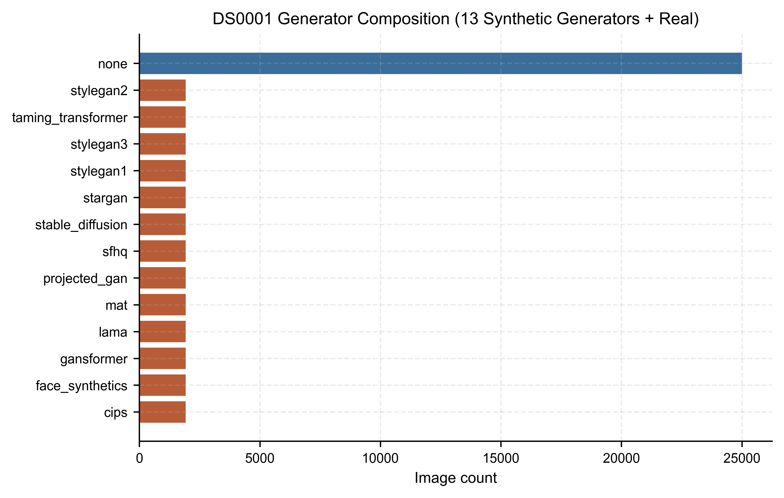
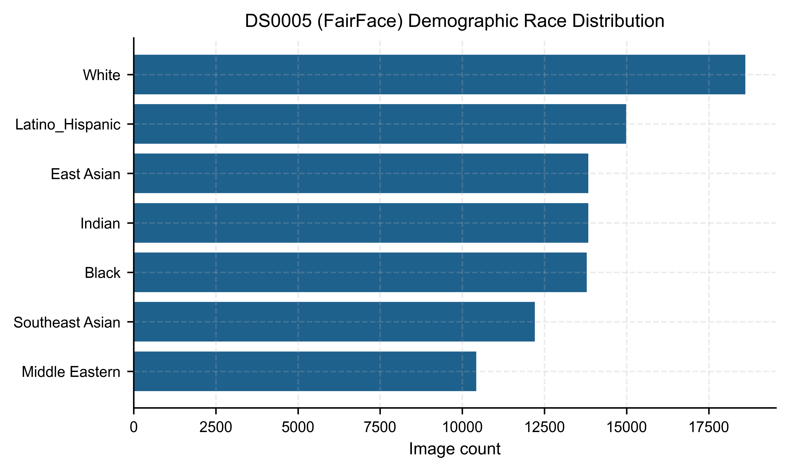
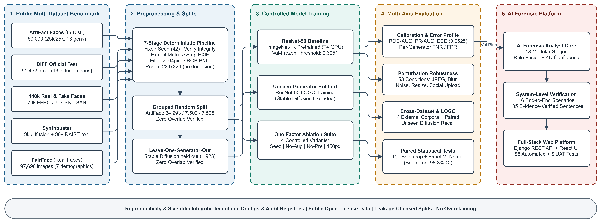
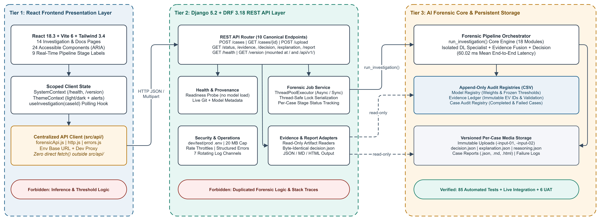
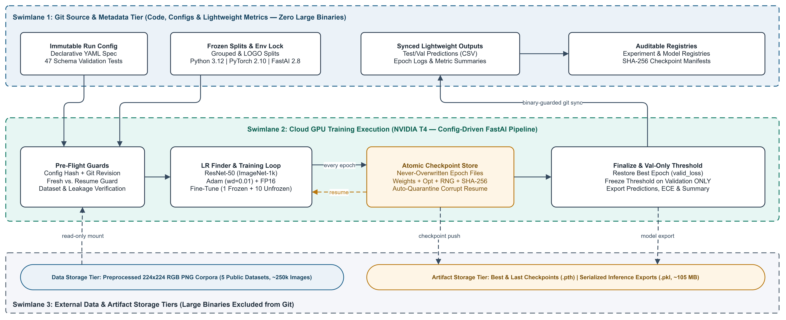
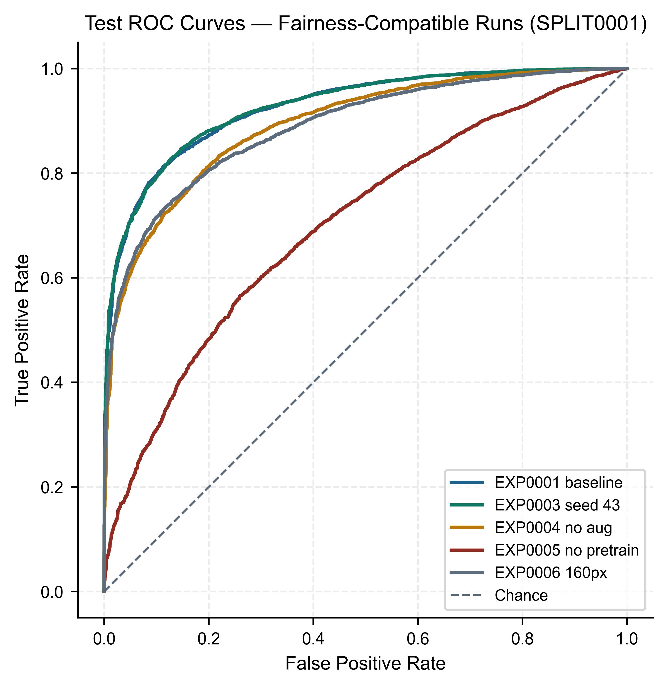

# Supplementary Material: AI Forensic Analyst Journal Manuscript

**Companion Document to:** `15_Writing/journal/manuscript.md`  
**Version:** `1.0.0-rc1` | **Date:** 2026-11-22  
**Shared Evidence Base:** `10_Tables/rendered/TAB0001.md`–`TAB0003.md`, `09_Figures/assets/FIG0001_v1`–`FIG0030_v1`, `11_AI_Forensic_System/module_registry.csv`, and `08_Evaluation/forensic_analyst_eval/e14_case_results.csv`.

---

## S1. Systematic Literature Comparison Matrix (`TAB0001`)

The full 16-method comparative table covering detection families, generator coverage, datasets, metrics, cross-generator testing, robustness, explainability, and primary limitations is maintained in `10_Tables/data/TAB0001.csv` and rendered in `10_Tables/rendered/TAB0001.md` (`P0002`, `P0003`, `P0005`–`P0008`, `P0010`, `P0011`, `P0013`–`P0021`, `P0023`; supporting `CLAIM0001`–`CLAIM0008` and `GAP0001`–`GAP0008`).

---

## S2. Multi-Dataset Exploratory Data Analysis & Preprocessing (`FIG0001`–`FIG0010`)

All five public corpora (`DS0001`–`DS0005`) were audited prior to modeling under versioned deterministic preprocessing (`PP0001`–`PP0006`, seed `42`, EXIF stripped, `>= 64 px`, RGB PNG, `224 x 224` without denoising) (`DEC0004`; `DEC0005`):

- **Class & Generator Distributions:** `FIG0001` (`DS0001` class balance), `FIG0002` (`DS0001` 13-generator mix), `FIG0003` (`DS0002` DiFF generator by condition), `FIG0004` (`DS0003` 140k class balance), `FIG0005` (`DS0004` Synthbuster generator mix), and `FIG0006` (`DS0005` FairFace demographic distribution).
- **Image Quality & Format Audits:** `FIG0007` (resolution comparison), `FIG0008` (brightness comparison), `FIG0009` (contrast comparison), and `FIG0010` (compression and file-format distributions).



*Figure S1 (`FIG0002`): Generator distribution inside the 50,000-image `DS0001` ArtiFact face benchmark.*



*Figure S2 (`FIG0006`): Balanced 7-group demographic composition of `DS0005` FairFace (`97,698` authentic faces) used to audit real-face false positive bias.*

---

## S3. Extended Architecture, Training, Calibration, ROC/PR & Robustness Figures

The main manuscript presents the eight highest-impact figures (`FIG0027`, `FIG0028`, `FIG0011`, `FIG0015`, `FIG0016`, `FIG0018`, `FIG0019`, `FIG0020`). All remaining publication-grade figures (600 DPI PNG and vector PDF) are provided in `09_Figures/assets/`:

- **Methodology, Web Architecture & Training Infrastructure:** `FIG0026` (end-to-end research methodology pipeline), `FIG0029` (three-tier React/Django/Forensic Core architecture), and `FIG0030` (config-driven FastAI training, SHA-256 atomic checkpointing, and three-tier storage sync).
- **Calibration, Operating Points & Confusion Matrix:** `FIG0012` (confidence distribution vs. accuracy), `FIG0013` (threshold trade-off curve with screening `0.089`, frozen `0.3951`, and flag-for-review `0.629` operating points), and `FIG0014` (`EVAL0001` test confusion matrix).
- **Subgroup Robustness, ROC/PR Curves & Training Dynamics:** `FIG0017` (delta error rate by subgroup at worst perturbation level), `FIG0021` (ROC curves across `EXP0001`, `EXP0003`–`EXP0006`), `FIG0022` (PR curves across same fair runs), `FIG0023` (multi-metric comparison chart), `FIG0024` (`EXP0001` validation ROC-AUC curve), and `FIG0025` (`EXP0001` train/validation loss curves).



*Figure S3 (`FIG0026`): End-to-end public benchmark, preprocessing, controlled training, multi-axis evaluation, and AI Forensic Analyst verification pipeline.*



*Figure S4 (`FIG0029`): Three-tier separation across React frontend (`MOD014`), 7-app Django/DRF REST API (`MOD013`), and 18-module AI Forensic Core.*



*Figure S5 (`FIG0030`): Config-driven FastAI training pipeline with SHA-256 atomic checkpointing, validation-only threshold freezing, and Git/External binary storage separation.*



*Figure S6 (`FIG0021`): Paired ROC curves across `EXP0001` and one-factor ablations `EXP0003`–`EXP0006` on `DS0001` `SPLIT0001` test (`n=7,505`).*

---

## S4. Complete 18-Module Contract, REST API Surface, and 16-Scenario Verification (`EVAL0007`)

### S4.1 AI Forensic Analyst Module Registry (`MOD001`–`MOD018`)

All 18 modules are implemented and verified in `11_AI_Forensic_System/module_registry.csv`: `MOD001` Input Management, `MOD002` Image Validation, `MOD003` Nine Independent Non-Detector Collectors, `MOD004` Isolated Deep Learning Specialist, `MOD005` Append-Only Evidence Registry (`EVxxxxxx`), `MOD006` Non-Destructive Evidence Validator, `MOD007` Pluggable Evidence Fusion (`rule_based`, `DEC0009`), `MOD008` Image-Blind Four-Way Decision Engine, `MOD009` Validation-Calibrated 4D Confidence Estimator (`DEC0010`), `MOD010` Data-Only Explainability Engine, `MOD011` Programmatically `EV`-Verified Reasoning Engine, `MOD012` Provenance-Stamped Report Generator (JSON/MD/HTML), `MOD013` 7-App Django/DRF REST API (`POST /cases`, `GET /cases/{id}`, `POST /cases/{id}/upload`, `GET /cases/{id}/{status,evidence,decision,explanation,report}`, `GET /health`, `GET /version`), `MOD014` 14-Page / 24-Component React UI, `MOD015` Append-Only Case Audit Trail (`CASExxxxxx`), `MOD016` Eight-Mode Failure Handler, `MOD017` Module Contract Validator, and `MOD018` Multimodal Extensibility Registry (`audio`/`video`/`text`).

### S4.2 Phase E14 Whole-Platform Verification Summary (`EVAL0007`)

Sixteen end-to-end scenarios (`08_Evaluation/forensic_analyst_eval/e14_case_results.csv`) passed all 9 dimensions (`135` verified reasoning sentences, `0` ungrounded leaks, mean latency `60.02 ms`): clean Fake (`0.95` → `Fake`), clean Real (`0.05` → `Real`), unsupported extension (`MOD016` stop), corrupted bytes (`MOD016` stop), zero-face image (`MOD016` stop), multi-face image (`MOD016` stop), missing model export (`model_unavailable` → `Unknown`), specialist timeout (`timeout` → `Unknown`), low-confidence borderline (`Inconclusive`), `0.99` score with unusable collectors (`C_dec=0.3333` → `Inconclusive`), contested opposing signals (`Inconclusive`), ungrounded reasoning injection (`MOD016` rejection), conflict cross-citation preservation (`MOD006`), missing visual explainability (`"no_data"`), audit completeness across completed/failed cases (`MOD015`), and deterministic byte-identical report reproducibility (`MOD012`).

---

## S5. Reproducibility Commands and Locked Environment

- **Locked ML Environment:** `Python 3.12`, `PyTorch 2.10.0+cu128`, `FastAI 2.8.7` (Kaggle T4 GPU); Web tier: `Django 5.2.19`, `DRF 3.18.3`, `React 18.3`, `Vite 6`, `Tailwind CSS 3.4`.
- **Verification Suite Commands (from repository root):**
  ```powershell
  python 17_Automation/run_all_tests.py
  python 17_Automation/verify_writing_consistency.py
  python 17_Automation/compute_publication_readiness.py
  ```
- **Deterministic Figure Regeneration (`FIG0001`–`FIG0025`):**
  ```powershell
  python 09_Figures/scripts/render_figures.py
  ```
