# AI Forensic Analyst: Evidence-Driven Cross-Generator Synthetic Face Forensics

## Assembled Complete Thesis Manuscript (`v1.0.0-rc1`)

| Metadata Field | Value |
|---|---|
| **Manuscript Version** | `1.0.0-rc1` (Assembled from Approved Chapters) |
| **Assembly Date** | `2026-11-22` |
| **Source Git Revision** | `9143198` |
| **Research Direction** | Direction 1 : System-Level AI Forensic Analyst + Generalization Focus |
| **Quality Gates Passed** | (Human-Confirmed) |
| **Bibliography Source** | `15_Writing/references/references.bib` (`28` verified entries, [1]–[28]) |
| **Rendered Tables Included** | Table 1–Table 3 (`10_Tables/rendered/`, PASS) |
| **Figure Catalog Status ** | `30` specified (Figure 1–Figure 30), `30` exported in `09_Figures/assets/` |
| **Assembler Script** | `17_Automation/assemble_thesis.py` (deterministic rebuild) |
| **License** | MIT (strictly public-only datasets ArtiFact–FairFace) |

---

## Declaration of Originality and Reproducibility Statement

This thesis manuscript is compiled deterministically from the ten approved section files in `15_Writing/thesis/`, grounded exclusively in verified repository registries (`papers.csv`, `claim_database.csv`, `research_gap.csv`, `datasets.csv`, `preprocessing_registry.csv`, `split_registry.csv`, `model_registry.csv`, `experiment_registry.csv`, `evaluation_registry.csv`, `module_registry.csv`, `decision_log/, `knowledge_index.csv`, and `writing_database.csv`). All statistical comparisons enforce `superiority_claim=none` where single-seed constraints apply (Table 3), baseline detector Baseline ResNet-50 is honestly disclosed as `Deployment Ready=no`, and all 30 publication figures (Figure 1–Figure 30) adhere strictly to (`09_Figures/FIGURE_RENDERING_RUNBOOK.md`).

---

## Table of Contents

1. Front Matter: Declaration, List of Figures (Figure 1–Figure 30), List of Tables (Table 1–Table 3), List of Abbreviations
2. Abstract 
3. Chapter 1: Introduction 
4. Chapter 2: Literature Review 
5. Chapter 3: Methodology 
6. Chapter 4: Implementation 
7. Chapter 5: Evaluation 
8. Chapter 6: Results 
9. Chapter 7: Discussion 
10. Chapter 8: Conclusion 
11. Appendices and Verified References 
12. Appendix C: Compiled Publication Tables (Table 1–Table 3)
13. Appendix D: Master Publication Figure Catalog & Placement Index (Figure 1–Figure 30)

### Assembled Source Chapter Versions

| Section ID | Section | Approved SemVer |
|---|---|---|
| Section 0 | Front Matter - Abstract | `0.2.0` |
| Section 1 | Chapter 1 - Introduction | `0.2.0` |
| Section 2 | Chapter 2 - Literature Review | `0.2.0` |
| Section 3 | Chapter 3 - Methodology | `0.3.0` |
| Section 4 | Chapter 4 - Implementation | `0.3.0` |
| Section 5 | Chapter 5 - Evaluation | `0.2.0` |
| Section 6 | Chapter 6 - Results | `0.2.0` |
| Section 7 | Chapter 7 - Discussion | `0.2.0` |
| Section 8 | Chapter 8 - Conclusion | `0.2.0` |
| Section 9 | Appendices & References | `0.2.0` |

---

## List of Tables (Table 1–Table 3)

| Table ID | Title | CSV Source | Rendered Markdown |
|---|---|---|---|
| Table 1 | Table Table 1: Comparison of AI-Generated Face Detection Methods | `10_Tables/data/TAB0001.csv` | `10_Tables/rendered/TAB0001.md` |
| Table 2 | Table Table 2: Fairness-Compatible Comparison on ArtiFact / v1.0 / preprocessing pipeline / grouped random split | `10_Tables/data/TAB0002.csv` | `10_Tables/rendered/TAB0002.md` |
| Table 3 | Table Table 3: Paired ROC-AUC Differences Against Baseline ResNet-50 | `10_Tables/data/TAB0003.csv` | `10_Tables/rendered/TAB0003.md` |

---

## List of Figures (Figure 1–Figure 30)

| Figure ID | Caption Summary | Source Spec / Script | Asset Status |
|---|---|---|---|
| Figure 1 | Class distribution of ArtiFact (ArtiFact 50k face subset): balanced real/fake split used for primary training. | `09_Figures/specs/FIG0001_spec.md` | Exported (PNG + PDF) |
| Figure 2 | Generator distribution in ArtiFact: real images labeled `none`; synthetic faces span 13 generators at near-equal counts. | `09_Figures/specs/FIG0002_spec.md` | Exported (PNG + PDF) |
| Figure 3 | DiFF DiFF official TEST composition across 13 generators and four synthesis conditions (all synthetic; pristine excluded). | `09_Figures/specs/FIG0003_spec.md` | Exported (PNG + PDF) |
| Figure 4 | 140k Real and Fake Faces class distribution (StyleGAN fakes vs real faces) used for rapid baseline training on Kaggle. | `09_Figures/specs/FIG0004_spec.md` | Exported (PNG + PDF) |
| Figure 5 | Synthbuster Synthbuster composition: ~1k RAISE JPEG reals and 1k images per synthetic generator. | `09_Figures/specs/FIG0005_spec.md` | Exported (PNG + PDF) |
| Figure 6 | FairFace FairFace race distribution (padding 0.25) used for demographic fairness checks of the forensic analyst. | `09_Figures/specs/FIG0006_spec.md` | Exported (PNG + PDF) |
| Figure 7 | Image resolution distributions from EDA pixel samples; ArtiFact/140k Real and Fake Faces/FairFace are fixed-size while DiFF/Synthbuster vary. | `09_Figures/specs/FIG0007_spec.md` | Exported (PNG + PDF) |
| Figure 8 | Per-dataset brightness summary from stratified EDA pixel samples (thumbnail ≤256 px). | `09_Figures/specs/FIG0008_spec.md` | Exported (PNG + PDF) |
| Figure 9 | Per-dataset contrast summary from stratified EDA pixel samples. | `09_Figures/specs/FIG0009_spec.md` | Exported (PNG + PDF) |
| Figure 10 | Compression and container formats observed in EDA pixel samples. | `09_Figures/specs/FIG0010_spec.md` | Exported (PNG + PDF) |
| Figure 11 | Reliability of Baseline ResNet-50 P(fake) on the Baseline ResNet-50 test split, 15 equal-width bins. ECE and MCE in the caption come from `calibration_summary.c... | `09_Figures/specs/FIG0011_spec.md` | Exported (PNG + PDF) |
| Figure 12 | Confidence is max(p, 1 − p) for the predicted class at threshold 0.395. Where accuracy sits below mean confidence, the model is overconfiden... | `09_Figures/specs/FIG0012_spec.md` | Exported (PNG + PDF) |
| Figure 13 | Error rates and scores on the Baseline ResNet-50 test split across thresholds. Markers are thresholds chosen on val and applied to test unchanged. | `09_Figures/specs/FIG0013_spec.md` | Exported (PNG + PDF) |
| Figure 14 | Confusion matrix of Baseline ResNet-50 on the Baseline ResNet-50 test split (n = 7505) at threshold 0.395, chosen on val. Cells show count and share of the true... | `09_Figures/specs/FIG0014_spec.md` | Exported (PNG + PDF) |
| Figure 15 | Error rates by generator (false negatives) and real source (false positives) on the Baseline ResNet-50 test split at threshold 0.395. Intervals are per... | `09_Figures/specs/FIG0015_spec.md` | Exported (PNG + PDF) |
| Figure 16 | Balanced accuracy (frozen threshold 0.395) and ROC-AUC of Baseline ResNet-50 under graded perturbations of the Baseline ResNet-50 test split (n = 7505 per condi... | `09_Figures/specs/FIG0016_spec.md` | Exported (PNG + PDF) |
| Figure 17 | Change in error rate per generator and real source at each perturbation's worst level, Baseline ResNet-50 test split, threshold 0.395. Clean rates are... | `09_Figures/specs/FIG0017_spec.md` | Exported (PNG + PDF) |
| Figure 18 | Baseline ResNet-50 (trained on ArtiFact) at its frozen threshold 0.395 on ArtiFact test and four other datasets. Fake-only datasets have no FPR; real-onl... | `09_Figures/specs/FIG0018_spec.md` | Exported (PNG + PDF) |
| Figure 19 | LOGO Holdout ResNet-50 (LOGO Holdout) was trained without Stable Diffusion; recall on Stable Diffusion test images at its val-chosen threshold, against seen g... | `09_Figures/specs/FIG0019_spec.md` | Exported (PNG + PDF) |
| Figure 20 | One-factor ablations of the Baseline ResNet-50 ResNet-50 baseline on the grouped random split test split, each at its own val-chosen threshold. The band shows the... | `09_Figures/specs/FIG0020_spec.md` | Exported (PNG + PDF) |
| Figure 21 | Test ROC curves for Baseline ResNet-50 and the one-factor runs on the same split. Intervals and the decision to make no superiority claim are in the ST... | `09_Figures/specs/FIG0021_spec.md` | Exported (PNG + PDF) |
| Figure 22 | Test precision-recall curves for Baseline ResNet-50 and the one-factor runs. Chance is the fake share of the grouped random split test split, not 0.5. | `09_Figures/specs/FIG0022_spec.md` | Exported (PNG + PDF) |
| Figure 23 | grouped random split test metrics for experiments that share ArtiFact / v1.0 / preprocessing pipeline / grouped random split. No bar is marked as a winner. Statistical intervals ar... | `09_Figures/specs/FIG0023_spec.md` | Exported (PNG + PDF) |
| Figure 24 | Validation ROC-AUC during the completed Baseline ResNet-50 session. Earlier sessions in the same log file are abandoned runs and are not plotted. | `09_Figures/specs/FIG0024_spec.md` | Exported (PNG + PDF) |
| Figure 25 | Train and validation loss for the completed Baseline ResNet-50 session. The best epoch is chosen by validation ROC-AUC, not by the lowest validation lo... | `09_Figures/specs/FIG0025_spec.md` | Exported (PNG + PDF) |
| Figure 26 | End-to-end reproducible research and evaluation pipeline spanning public dataset curation (ArtiFact–FairFace), seven-stage preprocessing (`P... | `09_Figures/specs/FIG0026_spec.md` | Exported (PNG + PDF) |
| Figure 27 | Architecture and trust boundaries of the 18-module AI Forensic Analyst (M1–M18). Raw image bytes are accessible only to intake (`... | `09_Figures/specs/FIG0027_spec.md` | Exported (PNG + PDF) |
| Figure 28 | Reliability-weighted evidence fusion (M7), four-dimensional validation-calibrated confidence estimation (M9,... | `09_Figures/specs/FIG0028_spec.md` | Exported (PNG + PDF) |
| Figure 29 | Three-tier system architecture connecting the React 18 frontend (`12_Web`, M14, 14 pages, 24 accessible components), the seven-app Djan... | `09_Figures/specs/FIG0029_spec.md` | Exported (PNG + PDF) |
| Figure 30 | Config-driven FastAI training and fault-tolerant checkpoint architecture (`17_Automation/training/`). Every run validates immutable YAML con... | `09_Figures/specs/FIG0030_spec.md` | Exported (PNG + PDF) |

---

## List of Abbreviations

| Abbreviation | Expansion |
|---|---|
| `API` | Application Programming Interface |
| `BA` | Balanced Accuracy |
| `CI` | Confidence Interval |
| `CNN` | Convolutional Neural Network |
| `CORS` | Cross-Origin Resource Sharing |
| `CSV` | Comma-Separated Values |
| `DCT` | Discrete Cosine Transform |
| `DL` | Deep Learning |
| `DOI` | Digital Object Identifier |
| `DRF` | Django REST Framework |
| `ECE` | Expected Calibration Error |
| `EDA` | Exploratory Data Analysis |
| `EM` | Expectation-Maximization |
| `EV` | Canonical Forensic Evidence Identifier (`EVxxxxxx`) |
| `EXIF` | Exchangeable Image File Format |
| `FFT` | Fast Fourier Transform |
| `FNR` | False Negative Rate |
| `FPR` | False Positive Rate |
| `GAN` | Generative Adversarial Network |
| `Grad-CAM` | Gradient-weighted Class Activation Mapping |
| `JSON` | JavaScript Object Notation |
| `LOGO` | Leave-One-Generator-Out |
| `MCC` | Matthews Correlation Coefficient |
| `MCE` | Maximum Calibration Error |
| `PR-AUC` | Area Under the Precision-Recall Curve |
| `REST` | Representational State Transfer |
| `RNG` | Random Number Generator |
| `ROC-AUC` | Area Under the Receiver Operating Characteristic Curve |
| `SemVer` | Semantic Versioning (`MAJOR.MINOR.PATCH`) |
| `SHA-256` | Secure Hash Algorithm 256-bit |
| `UAT` | User Acceptance Testing |
| `UI` | User Interface |
| `ViT` | Vision Transformer |
| `XAI` | Explainable Artificial Intelligence |

---

# Abstract

Synthetic human face generation across Generative Adversarial Networks (GANs) and diffusion models has outpaced standalone black-box detectors, which routinely achieve high in-distribution accuracy yet degrade severely under unseen generators, dataset shift, and lossy post-processing (; [3]; [7]; [16]; [18]; [23];). To address both cross-generator brittleness and the lack of auditable forensic workflows, this thesis reframes synthetic face detection around a system-level primary contribution: the **AI Forensic Analyst**, an 18-module evidence-driven forensic platform (M1–M18) in which the deep learning detector operates as one isolated, replaceable specialist rather than an autonomous arbiter.

First, we establish a strictly public-only, open-license benchmark spanning five validated datasets (ArtiFact–FairFace: ArtiFact face subset, DiFF official test, 140k Real and Fake Faces, Synthbuster, and FairFace), six versioned preprocessing pipelines (deterministic preprocessing pipeline), and ten leakage-checked grouped and leave-one-generator-out splits (grouped random split–leave-one-generator-out split). Second, we train and rigorously evaluate a standardized ResNet-50 baseline across six controlled GPU experiments (Baseline ResNet-50–160px Resolution Ablation; evaluation suite). On ArtiFact grouped random split test (`n=7,505`) at its validation-frozen threshold (`0.3951`), Baseline ResNet-50 attains ROC-AUC `0.9261`, PR-AUC `0.9348`, balanced accuracy `0.8483`, MCC `0.6978`, and ECE `0.0525`. However, stress testing quantifies severe standalone fragility: in-distribution false negative rates reach `43.7%` on `stylegan3`; fine-detail perturbations (`low_quality_upload`, downscaling, blur, noise, JPEG quality 10) collapse balanced accuracy toward `0.50` by driving false positive rates toward `1.0`; cross-dataset unseen-generator FNR rises to `48.1%` (`50.2%` on DiFF DiFF) while external real-face FPR reaches `30.4%` (140k Real and Fake Faces), `76.7%` (Synthbuster, ROC-AUC `0.5172`), and `82.6%` (FairFace FairFace); and controlled `stable_diffusion` holdout (LOGO Holdout; evaluation suite) drops recall from `96.3%` (Baseline ResNet-50, seen) to `13.7%` (LOGO Holdout ResNet-50, unseen) on the identical 299 test images (`15.2%` across all 1,923 held-out images). One-factor ablations (Seed-43 Replicate–160px Resolution Ablation) confirm that ImageNet pretraining (`-0.2243` ROC-AUC), 224-pixel resolution (`-0.0376`), and augmentation (`-0.0336`) all exceed the seed-repeatability noise floor (`+0.0011`), reported strictly as saved-run differences with `superiority_claim=none`.

Third, we implement and validate the 18-module AI Forensic Analyst (`11_AI_Forensic_System/`), separating upload intake (M1), image validation (M2), nine independent non-detector collectors (M3), isolated deep learning inference (M4), an append-only `EV` registry (M5), non-destructive reliability grading (M6), replaceable rule-based fusion (M7), four-dimensional validation-calibrated confidence estimation (M9), an image-blind four-way Decision Engine (M8: `Real`, `Fake`, `Inconclusive`, `Unknown`), data-only explainability (M10), programmatically `EV`-verified reasoning (M11), provenance-stamped reporting (M12), audit logging (M15), structured failure handling across eight canonical modes (M16), and full-stack web delivery via a seven-app Django REST API (M13) and a 14-page, 24-component React application (M14). In Phase E14 whole-platform evaluation (whole-platform verification), the system passes all 9 quality dimensions and all 16 end-to-end scenarios (`135` verified reasoning sentences, `0` ungrounded leaks, mean latency `60.02 ms`), demonstrating that unusable supporting evidence overrides a `0.99` detector score into an explicit `Inconclusive` verdict while missing or timed-out specialists degrade cleanly to `Unknown` with `null` confidences. All 85 automated unit/API/frontend tests, live cross-tier integration tests, six automated UAT scenarios, and ten quality gates pass, establishing an honest, reproducible, and modality-extensible foundation for image-based digital forensics.

**Keywords:** AI-generated face detection, digital forensics, cross-generator generalization, evidence fusion, confidence calibration, explainable forensic reporting, GANs, diffusion models.

---

# Chapter 1: Introduction

## 1.1 Background and Motivation

Generative artificial intelligence systems can now synthesize photorealistic human faces at scale, creating a practical forensic challenge for verifying the authenticity of digital imagery (; [22]; [24]; [28]). Across the modern literature, two generative paradigms account for most synthetic facial media: Generative Adversarial Networks (GANs), which synthesize images through adversarial optimization between a generator and a discriminator ([5]; [10]; [25]), and diffusion models, which construct images through iterative denoising from Gaussian noise ([3]; [23]). As generation quality has advanced across successive architectures such as the StyleGAN family ([25]) and latent diffusion models ([3]; [23]), visual inspection by human observers has become unreliable, motivating automated digital forensic analysis ([22]; [24]).

Early synthetic face detection research focused primarily on GAN-generated imagery, exploiting architecture-specific generation footprints such as transposed convolution traces ([5]) and anomalous discrete cosine transform (DCT) coefficient distributions ([10]). The rapid adoption of diffusion models has disrupted those assumptions because iterative denoising leaves spectral and spatial signatures that differ structurally from GAN upsampling artifacts (; [3]; [23]). In controlled benchmarks spanning 13 diffusion generation methods, Cheng et al. reported that existing detectors achieved binary accuracy below 30% on diffusion-generated faces ([23]). This shift across generative paradigms exposes cross-generator generalization as the central unsolved problem in image-based synthetic face forensics (supported by 11 of 28 reviewed papers in `02_Literature/metadata/papers.csv`).

## 1.2 Problem Statement

Current synthetic face detection research remains dominated by standalone black-box binary classifiers trained and evaluated on closed-world splits ([7]; [16]; [18]). While such classifiers frequently exceed 95% accuracy within their training distribution ([7]), four compounding failure modes prevent a single detector probability from serving as a trustworthy forensic verdict.

First, standalone classifiers experience severe degradation when evaluated on unseen generators or across generative paradigms. Khan and Dang-Nguyen showed that cross-dataset accuracy across major face manipulation benchmarks drops from over 95% to 60–70% ([7]), and Altamimi et al. observed EfficientNet-B4 dropping to 86.75% on diffusion-generated faces without bias-aware training ([16]). Empirical baseline evaluation in this thesis confirms the severity of this gap: in a controlled leave-one-generator-out experiment (LOGO Holdout; evaluation suite), a ResNet-50 detector (LOGO Holdout ResNet-50) trained on 12 generators without `stable_diffusion` achieved 83.3% recall on seen generators but dropped to 15.2% recall (293 of 1,923 images) on held-out `stable_diffusion` faces. On the exact same 299 test images, Baseline ResNet-50 (Baseline ResNet-50, which saw `stable_diffusion` during training) achieved 96.3% recall compared to 13.7% for LOGO Holdout ResNet-50. Across external datasets (evaluation suite), Baseline ResNet-50 missed 48.1% of unseen-generator fakes overall and 50.2% of diffusion-generated faces in DiFF (DiFF), compared to an 18.3% in-distribution false negative rate.

Second, benchmark datasets frequently contain low-level statistical shortcuts, such as background noise patterns, color distributions, and compression mismatches, that inflate in-distribution performance without teaching transferable forensic features. Altamimi et al. demonstrated that a zero-learning statistical audit using simple photometric features achieved 85% accuracy on a synthetic face benchmark ([16]). Consistent with this finding, our cross-dataset evaluation (Baseline ResNet-50; evaluation suite) showed that Baseline ResNet-50 flags a large share of authentic images from external sources as synthetic, yielding false positive rates of 30.4% on 140k Real and Fake Faces (FFHQ), 76.7% on Synthbuster (RAISE scenes, ROC-AUC 0.5172), and 82.6% on FairFace (FairFace real faces).

Third, real-world post-processing operations such as lossy JPEG compression, downscaling, blurring, and social media re-encoding suppress high-frequency forensic traces (; [3]; [10]; [18]). In our 53-perturbation robustness evaluation (Baseline ResNet-50; evaluation suite), fine-detail degradation including simulated low-quality upload (`low_quality_upload@0.35_30`), downscaling (`resolution@0.35`), Gaussian blur, strong noise, and JPEG quality 10 reduced Baseline ResNet-50 balanced accuracy from 0.8483 toward 0.50 by driving the false positive rate toward 1.0.

Fourth, existing detection pipelines lack an integrated, explainable forensic architecture (supported by 9 reviewed papers). Most CNN and Vision Transformer detectors provide no intrinsic explanation ([7]; [16]), and post-hoc Grad-CAM visualizations can reveal reliance on irrelevant background shortcuts rather than genuine facial artifacts ([16]). Even hierarchical attribution pipelines such as Guarnera et al. ([18]) rely on proprietary datasets and propagate Level-1 classification errors without assembling independent evidence records. Moreover, raw softmax probabilities are poorly suited as statements of forensic certainty: Baseline ResNet-50 exhibits a test Expected Calibration Error (ECE) of 0.0525 and Maximum Calibration Error (MCE) of 0.1544, with predicted confidence exceeding empirical accuracy by more than 0.02 in six of ten confidence bins (evaluation suite). A binary classifier also has no mechanism to abstain when supporting evidence is corrupted, conflicting, or absent, forcing a `Real` or `Fake` label where an honest forensic analyst would report `Inconclusive` or `Unknown`.

## 1.3 Research Questions and Scope

To address these challenges systematically, this thesis adopts the Generalization Focus ratified in (selected over standalone explainability-only and adversarial-only scopes) and investigates the following primary research question (; `02_Literature/research_question.md`):

> **Primary Research Question:** *How can we improve the cross-generator generalization of image-based AI face detection models to maintain high accuracy on unseen generative architectures?*

This primary question is decomposed into three operational sub-questions (`02_Literature/research_question.md`):

1. **Sub-question 1 (Shared Artifacts):** What are the common forensic artifacts shared across different generative architectures, including GANs and diffusion models, in facial images (; [3]; [5]; [10])?
2. **Sub-question 2 (Novel-Generator Degradation):** How do current detection models degrade when tested on novel generative architectures and out-of-distribution real sources ([7]; [16]; [18]; [23])?
3. **Sub-question 3 (Mitigation Strategies):** Which regularization, preprocessing, augmentation, and architectural strategies most effectively mitigate overfitting to specific generators (; [7]; [16])?

The scope of Version 1 of this research is explicitly bounded to reactive forensic analysis of static, single-face RGB images. Proactive authentication schemes such as creator-embedded visible watermarking ([20]), video temporal deepfake detection (such as FaceForensics++ face-swapping benchmarks excluded in), audio forensics, text forensics, and multi-face scene parsing are outside Version 1 experimental execution. However, the system architecture explicitly defines modality-extension contracts (M18) so that future audio, video, and text specialists can be integrated without redesigning the core evidence registry or decision pipeline.

## 1.4 Chosen Research Direction and Scientific Contributions

Following a systematic synthesis of 28 peer-reviewed papers ([1]–[28]), 8 evidence-backed claims, and 8 research gaps, five candidate research directions were evaluated in `02_Literature/research_directions.md`: (1) an evidence-driven forensic analysis system, (2) a dual-branch hybrid spatial-frequency detector, (3) bias-aware cross-generator auditing, (4) hierarchical source attribution, and (5) compression-robust social media detection. As recorded in, Direction 1 was selected because it directly delivers the project's primary scientific contribution: **the AI Forensic Analyst**, an evidence-driven forensic system rather than a single detector. Directions 2 through 5 are subsumed as modular components or evaluation protocols within this system (for example, bias auditing enters through FairFace FairFace evaluation, robustness enters through Phase E7 testing, and deep learning classification becomes one replaceable specialist module M4).

Within this ratified direction, the thesis makes five verifiable contributions :

1. **Public-Only Multi-Dataset Benchmark and Leakage-Free Pipeline :** Selection, validation, EDA, and versioned preprocessing (deterministic preprocessing pipeline) of five strictly open-license datasets (ArtiFact ArtiFact face subset, DiFF DiFF official test, 140k Real and Fake Faces 140k Real and Fake Faces, Synthbuster Synthbuster, and FairFace FairFace;) with 10 leakage-checked grouped and leave-one-generator-out splits (grouped random split–leave-one-generator-out split).
2. **Empirical Characterization of Baseline Detector Failure Modes :** A complete multi-phase evaluation (Baseline ResNet-50–160px Resolution Ablation; evaluation suite) of a standardized ResNet-50 baseline (Baseline ResNet-50, LOGO Holdout ResNet-50–160px ResNet-50) spanning calibration (E4), validation-only operating points (E5), per-generator and real-source error analysis (E6/E12), 53 image perturbations (E7), four external datasets (E8), controlled `stable_diffusion` holdout (E9), one-factor ablations (E10), and paired bootstrap plus exact McNemar statistical tests (E11) with explicit non-superiority reporting.
3. **Architecture and Verification of the 18-Module AI Forensic Analyst :** Design, implementation, and Phase E14 whole-platform evaluation (whole-platform verification) of M1–M18, separating upload intake, image validation, nine independent non-detector collectors (M3), an isolated deep learning specialist (M4), an append-only immutable `EV` evidence registry (M5), non-destructive reliability validation (M6), replaceable rule-based fusion (M7), an image-blind four-way Decision Engine (M8: `Real`, `Fake`, `Inconclusive`, `Unknown`), four-dimensional E4-calibrated confidence estimation (M9), data-only explainability (M10), programmatically `EV`-verified reasoning (M11), reproducible reporting (M12), audit logging (M15), and structured handling of eight canonical failure modes (M16).
4. **Full-Stack Forensic Web Platform and Cross-Tier Verification :** A seven-app Django and Django REST Framework backend (M13, 10 canonical endpoints) and a 14-page, 24-component React web application (M14) displaying four-way decisions, four calibrated confidence gauges, cited `EV` identifiers, and explicit limitations, verified by 85 automated unit/API/frontend tests, live cross-tier integration tests, and six automated User Acceptance Testing (UAT) scenarios.
5. **Diffusion-Era Systematic Literature Synthesis :** A structured review of 28 peer-reviewed publications ([1]–[28]) bridging legacy GAN detection and diffusion-era face forensics, distilled into eight claims, eight ranked gaps, and a 16-method comparative specification (Table 1).

In accordance with binding scientific honesty principles, this thesis does not claim that Baseline ResNet-50 is a deployment-ready standalone classifier (`Deployment Ready=no` in `05_Models/model_registry.csv`), nor does it assert statistical superiority across single-seed configurations. Instead, the empirical failure modes of Baseline ResNet-50 provide the concrete motivation for the AI Forensic Analyst architecture, which demonstrates in whole-platform verification that isolating detector probabilities from calibrated, reliability-checked decision logic prevents blind propagation of unverified high-confidence scores.

## 1.5 Thesis Organization and Reproducibility Governance

The remainder of this thesis is organized into seven chapters and two appendices :

- **Chapter 2 (Literature Review)** presents the systematic search protocol, corpus taxonomy across [1]–[28], technical analysis of frequency, spatial, hierarchical, biometric, and reconstruction-error paradigms, and the eight research gaps supporting Direction 1.
- **Chapter 3 (Methodology)** details the public-only multi-dataset curation (ArtiFact–FairFace), versioned preprocessing (deterministic preprocessing pipeline), leakage-free split design, candidate backbone selection (Baseline ResNet-50–Swin Transformer), multi-phase evaluation methodology (Phases E1–E18), and mathematical formulation of the 18-module AI Forensic Analyst.
- **Chapter 4 (Implementation)** documents the reproducible training and checkpointing pipeline, the forensic core modules (M1–M12, M15–M18), the Django REST API (M13), the React web application (M14), and the consolidated cross-tier testing and UAT harness.
- **Chapter 5 (Evaluation)** specifies the experimental configurations, pre-training sanity thresholds, validation-only threshold selection policy, robustness and cross-dataset protocols, controlled one-factor ablations, paired statistical test design, and Phase E14 whole-platform evaluation design.
- **Chapter 6 (Results)** reports all observed outcomes from Baseline ResNet-50–160px Resolution Ablation and evaluation suite–whole-platform verification, including in-distribution performance, calibration, per-generator failures, 53-perturbation robustness, cross-dataset and unseen-generator degradation, ablations, statistical intervals, and whole-platform forensic verification.
- **Chapter 7 (Discussion)** synthesizes how detector brittleness under domain and generator shift justifies the evidence-driven forensic architecture and explicitly catalogs methodological, empirical, and system limitations.
- **Chapter 8 (Conclusion)** provides direct answers to the research questions, summarizes validated contributions, and outlines a concrete future work roadmap.
- **Appendices A and B** provide the dataset cards, preprocessing and split records, decision log index, forensic module registry (M1–M18), REST API contract, and verified bibliography ([1]–[28]).

Every research artifact in this thesis is governed by a reproducible operating system (`MASTER_RESEARCH_OPERATING_SYSTEM.md`) under an MIT open-source license. To eliminate data-access barriers that hindered prior studies ([18]; [23]), only publicly accessible, permissively licensed datasets were accepted, and EULA-restricted AI-Face-FairnessBench was replaced with CC BY 4.0 FairFace. Source code, immutable YAML experiment configurations, canonical CSV registries, decision logs, audit reports, and data-only figure/table specifications are version-controlled in GitHub as the single source of truth, while large processed image datasets and trained model exports reside on Kaggle under locked GPU runtime specifications (`environment/versions.lock.md`), with phase transitions gated by human-confirmed checklists (through 12).

---

# Chapter 2: Literature Review

## 2.1 Systematic Literature Search Protocol, Corpus Taxonomy, and Survey Gap

To establish a reproducible foundation for this thesis, a systematic literature search was executed in accordance with Phases L1 through L12 of the research operating system (; `02_Literature/literature_audit.md`). Guided by the Generalization Focus ratified in, the protocol defined 20 seed keywords spanning synthetic face generation, frequency and spatial forensic artifacts, cross-generator generalization, explainability, robustness, and biometric spoofing (`02_Literature/keywords.csv`). Primary search execution queried Google Scholar using the Boolean string `("deepfake" OR "AI-generated" OR "synthetic") AND ("face" OR "facial") AND ("detection" OR "forensics" OR "generalization") AND ("GAN" OR "diffusion")` with a publication year filter of 2020 or later, reviewing results through page 17 (`02_Literature/search_history/2026-07-31_scholar_generalization.md`). Six explicit exclusion criteria bounded the scope to reactive image-based human face forensics by filtering out video-only temporal deepfakes, audio voice cloning, text generation, non-face imagery, novel generator design as an end goal, and multimodal deepfake pipelines (`02_Literature/exclusion_list.csv`).

The intake and registration pipeline yielded a deduplicated corpus of 28 peer-reviewed papers published between 2020 and 2026 ([1]–[28]), verified by unique Digital Object Identifiers (DOIs), stored under canonical identifiers, and accompanied by structured summaries and BibTeX records (`02_Literature/metadata/papers.csv`). Quality scores across the corpus range from 8 to 36, and research relevance is distributed across four tiers: 4 critical ([7], [16], [18], [23]), 8 high ([3], [5], [10], [14], [21], [22], [24], [28]), 10 medium ([2], [6], [8], [11], [13], [15], [19], [25], [26], [27]), and 6 low ([1], [4], [9], [12], [17], [20]). From these 28 summaries, 233 weakness, research gap, and future work items were extracted into `02_Literature/research_gap/future_work.csv`, consolidated into eight ranked research gaps and eight evidence-backed claims, and audited against all 48 items of the Literature Review Quality Gate (: PASS in `02_Literature/literature_audit.md`).

The 28-paper corpus separates into three functional groups (Table 1): 16 primary detection-method studies ([2], [3], [5], [6], [7], [8], [10], [11], [13], [14], [15], [16], [18], [19], [21], [23]), five field surveys ([22], [24], [26], [27], [28]), and seven contextual or adjacent works covering adversarial generation ([9] IC-DGAN; [25] StyleGAN survey), non-face diffusion methodology ([1] industrial defect inpainting), GAN-blockchain privacy frameworks ([4], [12]), proactive watermarking ([20]), and an earlier conference precursor ([17], superseded by [13]). A structured cross-study matrix comparing the 16 primary detection methods across architecture, feature domain, GAN and diffusion coverage, cross-generator and cross-dataset testing, attribution, explainability, and robustness is specified in Table 1 (`10_Tables/specs/TAB0001_spec.md`).

Existing survey literature provides broad historical framing but leaves a clear synthesis gap across the transition from GANs to diffusion models. Heidari et al. ([24], 285 citations) and Malik et al. ([28], 254 citations) compiled comprehensive systematic reviews across CNN, RNN, GAN, Transformer, and hybrid detectors for both image and video modalities, yet both predate widespread diffusion-generated facial benchmarks. Gragnaniello et al. ([22]) established a focused taxonomy of spatial-domain, frequency-domain, and CNN-based synthetic face detectors, though its 2022 scope remains GAN-centric. More recent reviews by Dang and Nguyen ([27]) and Edwards et al. ([26]) broaden face manipulation coverage but still overlap heavily with earlier GAN-era taxonomies without unifying diffusion-specific forensic benchmarks ([3], [16], [23]). Consequently, five survey works collectively motivate an updated, evidence-traced synthesis bridging GAN and diffusion face forensics.

## 2.2 Frequency-Domain and Convolutional Trace Forensic Methods

Frequency-domain and signal-level forensic methods inspect mathematical artifacts left by image synthesis operators rather than relying solely on opaque end-to-end neural representations (; [22]). Because their features correspond directly to signal processing statistics, these approaches form the primary foundation for inherently interpretable forensic evidence ([3]; [5]; [10]).

Within the GAN paradigm, Guarnera et al. ([5]) introduced an Expectation-Maximization (EM) algorithm that extracts convolutional traces generated by transposed convolution upsampling layers. Evaluated across CelebA real images, five GAN architectures (GDWCT, StarGAN, AttGAN, StyleGAN, and StyleGAN2), and FaceForensics++, the method demonstrated that GAN upsampling operations embed generator-specific fingerprints supporting both authenticity detection and source attribution ([5]). Building on that line of work, Giudice et al. ([10]) analyzed discrete cosine transform (DCT) coefficient distributions using lightweight beta statistics without deep learning, achieving interpretable detection across multiple GAN generators ([10]). However, neither method transfers directly to diffusion models: diffusion synthesis does not depend on GAN transposed convolutions ([5]), and GAN-calibrated DCT anomalies have not been established on iterative denoising outputs ([10]).

For diffusion-generated imagery, Bammey ([3]) proposed Synthbuster, a training-free spectral method applying high-pass residual filtering followed by Fourier analysis to expose periodic high-frequency artifacts. Evaluated across 9,000 synthetic images from nine diffusion models (DALL-E 2, DALL-E 3, Stable Diffusion 1.3, 1.4, 2, and XL, GLIDE, Midjourney v5, and Adobe Firefly) alongside 1,000 RAISE real images, Synthbuster achieves multi-generator detection while avoiding supervised dataset shortcuts ([3]). Despite its interpretability, Synthbuster operates on general imagery rather than face-specific cues, performs binary detection without generator attribution, and was not evaluated on GAN-generated faces ([3]).

Synthesizing these studies highlights two structural findings. First, frequency and convolutional trace methods capture complementary paradigm-specific artifacts (FFT denoising periodicity in [3], DCT beta anomalies in [10], and EM upsampling traces in [5]), yet unified spatial-frequency feature fusion covering both GANs and diffusion models remains under-explored (supported by [3], [5], [10], [15], [22]). Second, all pure spectral and trace approaches degrade markedly under aggressive JPEG compression, resizing, and social media re-encoding ([3], [10], [18]), demonstrating that frequency analysis is strongest as one validated evidence stream within a multi-evidence forensic system rather than a standalone detector (Table 1).

## 2.3 Spatial-Domain CNNs, Vision Transformers, Self-Supervised Pretraining, and Hierarchical Attribution

Supervised spatial-domain deep learning accounts for the majority of published synthetic face detectors (; [24]; Table 1). Early comparative studies evaluated standard convolutional backbones on limited datasets: Taeb and Chi ([2]) compared custom CNNs, VGG19, DenseNet-121, and PCA/SVM on the Augmented Real and Fake Face Detection dataset, reporting roughly 95% accuracy for VGG19 without cross-dataset evaluation, while Safwat et al. ([11]) combined GAN feature learning with ResNet classification on only 2,041 images (1,081 real and 960 fake). Competition-style evaluations such as the Face Deepfake Detection Challenge ([14]) standardized multi-method benchmarking across GAN generators, but remained confined to GAN-era synthetic distributions without cross-dataset generalization protocols ([14]).

To measure generalization systematically, Khan and Dang-Nguyen ([7]) benchmarked eight supervised CNN architectures alongside two transformer models using DINO and CLIP self-supervised pretraining across four major benchmarks (FaceForensics++, CelebDF-V2, DFDC, and FakeAVCeleb). While intra-dataset accuracy routinely exceeded 95%, cross-dataset accuracy fell to 60–70% ([7]). Their results indicated that training dataset diversity governs generalization more strongly than backbone selection alone, and that transformer representations initialized with self-supervised DINO or CLIP pretraining transfer more effectively than purely supervised CNNs ([7]). Nevertheless, that study relied on video-derived face crops and excluded diffusion-generated faces ([7]).

Recent work has explicitly confronted diffusion-era face detection ([16]; [21]; [23]). Altamimi et al. ([16]) compared ResNet-101, EfficientNet-B4, and Xception across GAN and diffusion faces on AI-Face-FairnessBench, observing that EfficientNet-B4 accuracy dropped to 86.75% on diffusion faces without bias-aware training. Cheng et al. ([23]) introduced the DiFF benchmark exceeding 500,000 synthetic images across 13 diffusion methods and four generation conditions (text-to-image, image-to-image, inpainting, and face swap), paired with 23,661 real faces from VoxCeleb2 and CelebA. On DiFF, existing binary detectors scored below 30% accuracy; Cheng et al.'s edge graph regularization improved over baselines but still left substantial headroom under difficult conditions and omitted GAN evaluation, attribution, and post-processing tests ([23]). In the transformer family, Arshed et al. ([21]) trained a patch-wise Vision Transformer on a custom 36,000-image multiclass split (real, GAN fake, Stable&GAN fake, and diffusion fake), reporting 99.9% F1. However, the dataset covered only StyleGAN2 and Stable Diffusion, contained a semantically ambiguous mixed label, and lacked cross-dataset validation or attention-based explainability ([21]).

Addressing both cross-paradigm detection and source attribution, Guarnera et al. ([18]) proposed a three-level hierarchical ResNet-101 pipeline progressing from binary authenticity (Level 1) to generative paradigm classification (GAN versus diffusion, Level 2) and specific generator attribution (Level 3). Evaluated on a custom 83,000-image dataset spanning nine GAN architectures and four diffusion models, the hierarchy exceeded 97% accuracy and outperformed flat multiclass classification by roughly 2% ([18]). Despite its strong conceptual alignment with structured forensic analysis, three limitations constrain reproducibility and forensic deployment: the 83,000-image dataset is proprietary, no cross-dataset evaluation was reported, and hierarchical cascades propagate Level-1 errors downstream without pixel-level or multi-evidence justification ([18]; Table 1).

## 2.4 Physiological Biometrics, Diffusion Reconstruction Error, and Proactive Watermarking

Beyond conventional spatial and spectral classification, the literature explores three alternative paradigms that inform the design and scope boundaries of a multi-evidence forensic platform (; Table 1).

First, physiological and biometric forensic approaches seek anatomical inconsistencies that should theoretically persist across generator architectures. Xue et al. ([15]) designed GLFNet, a dual-branch network combining local iris color and pupil shape analysis with global ResNeSt residual extraction on CelebA-HQ (50,000 training and 5,000 testing images). Similarly, Pasquini et al. ([8]) combined GAN inversion with biometric trait analysis to expose synthetic face anomalies. Both studies provide intuitive physiological explanations, yet both were validated exclusively on GAN-generated faces, require reliable facial landmark and eye-region alignment, and face diminishing returns as newer generators such as StyleGAN3 ([25]) and latent diffusion-GAN hybrids ([9]) synthesize increasingly accurate ocular and anatomical geometry.

Second, reconstruction-based methods leverage generative model behavior directly. Zeng et al. ([6]) extracted diffusion reconstruction error features based on the premise that diffusion models reconstruct images from their own generative manifold with lower error than real photographs ([6]; [23]). While reconstruction error offers partial interpretability through residual magnitude, it incurs substantial inference latency that impedes interactive deployment and currently lacks broad cross-architecture validation ([6]).

Third, proactive authentication and privacy-oriented synthetic face frameworks occupy adjacent problem spaces. Nadimpalli and Rattani ([20]) proposed proactive deepfake detection via GAN-based visible watermarking, which provides clear authentication signals when present but depends on creator cooperation and cannot authenticate legacy or unwatermarked media encountered in reactive forensic investigations ([20]). Likewise, GAN-blockchain frameworks ([4], [12]) use synthetic faces to protect identity privacy in distributed recognition systems rather than to detect unauthorized synthetic media. Within this thesis, reactive forensic analysis of unwatermarked images remains the primary operational setting, while biometric and signal cues inform contextual collectors inside the AI Forensic Analyst.

## 2.5 Cross-Generator Generalization, Dataset Bias, and Post-Processing / Anti-Forensic Robustness

Across the 28-paper corpus, three interrelated failure axes repeatedly undermine real-world detector reliability: cross-generator shift, benchmark bias, and post-processing or adversarial degradation (; Table 1).

Cross-generator generalization (supported by 11 papers: [3], [5], [6], [7], [10], [16], [18], [21], [23], [24], [28]) exhibits both intra-paradigm and cross-paradigm failure. Intra-paradigm transfer already drops sharply between distinct GAN or manipulation datasets ([7]), while cross-paradigm transfer from GANs to diffusion models collapses because transposed-convolution and DCT signatures do not match iterative denoising statistics ([3], [5], [10], [23]). Even within diffusion benchmarks, accuracy varies widely across text-to-image, image-to-image, inpainting, and face-swap generation protocols ([23]).

Benchmark dataset integrity (supported by 6 papers: [2], [7], [11], [16], [21], [23]) compounds this problem by disguising shortcut learning as genuine forensic capability. Altamimi et al. ([16]) demonstrated that a zero-learning statistical audit based solely on low-level photometric features achieved 85% classification accuracy on AI-Face-FairnessBench, proving that simple color, resolution, or compression discrepancies separate real and fake splits without capturing true synthesis artifacts. Comparable risks appear in small or single-source datasets ([2], [11], [21]), proprietary closed benchmarks ([18]), and heavily imbalanced real-to-synthetic benchmarks such as DiFF (23,661 real versus over 500,000 synthetic images in [23]).

Real-world distribution channels further degrade performance through lossy JPEG re-compression, downscaling, and social media filtering (supported by 6 papers: [3], [5], [10], [13], [16], [18]). Spectral and trace-based methods ([3], [5], [10]) lose discriminative power rapidly as high-frequency bands are quantized away, whereas spatial gradient models ([18]) and social-media ensembles ([13], superseding [17]) show somewhat higher compression tolerance but remain untested across diffusion generators. Beyond benign degradation, intentional anti-forensic evasion represents an emerging threat (supported by [8] and [19]): Alkishri et al. ([19]) showed that targeted GAN fingerprint removal can defeat deepfake detectors, while corresponding anti-forensic analyses and defenses for diffusion signatures remain largely unexplored ([19]). Together, these findings show that any detector relying on a single fragile feature channel is vulnerable to both benign re-encoding and deliberate evasion.

## 2.6 Explainability Limitations and Synthesis of Research Gaps Motivating Direction 1

Despite strong practical demand for auditable verdicts in digital forensics, explainability across the reviewed literature remains fragmented (;, supported by 9 papers: [3], [5], [8], [10], [15], [16], [19], [20], [22]). Published studies fall into three explainability tiers: (1) inherently interpretable signal-level methods such as Synthbuster Fourier peaks ([3]), DCT beta statistics ([10]), and EM convolutional traces ([5]), whose artifacts are physically meaningful but paradigm-restricted; (2) partially interpretable methods offering structural paradigm labels ([18]), physiological eye cues ([8], [15]), or reconstruction residuals ([6]); and (3) black-box neural classifiers ([2], [7], [11], [21]) supplemented at best by post-hoc visualizations such as Grad-CAM ([16]), which can expose background shortcut attention without guaranteeing decision faithfulness ([16]). Critically, no reviewed study combines independent forensic evidence streams with reliability validation, explicit conflict preservation, calibrated multi-dimensional confidence, and reproducible case reporting.

Synthesizing all 28 papers yields eight ranked research gaps (`02_Literature/research_gap/research_gap.csv`) and eight evidence-backed claims (`02_Literature/claims/claim_database.csv`), five of which explicitly document contradicting or qualifying evidence (, ; note 5 of 8 recorded in `02_Literature/literature_audit.md` and 6 entries populated in `claim_database.csv`) :

| Gap ID | Category | Importance | Frequency | Supporting Papers | Alignment with Chosen Direction |
|---|---|---|---|---|---|
| | Cross-Generator Generalization | Critical | 11 | [3], [5], [6], [7], [10], [16], [18], [21], [23], [24], [28] | Primary empirical target (E8 cross-dataset & E9 LOGO) |
| | Explainability & Forensic Analysis | Critical | 9 | [3], [5], [8], [10], [15], [16], [19], [20], [22] | Primary system target (18-module AI Forensic Analyst) |
| | Benchmark & Dataset Integrity | High | 6 | [2], [7], [11], [16], [21], [23] | Addressed via public-only multi-dataset & FairFace audits |
| | Robustness & Anti-Forensics | High | 6 | [3], [5], [10], [13], [16], [18] | Addressed via 53-condition Phase E7 robustness protocol |
| | Architecture & Feature Fusion | High | 5 | [3], [5], [10], [15], [22] | Addressed via modular `EvidenceCollector` & `FusionStrategy` |
| | Literature Synthesis | Medium | 5 | [22], [24], [26], [27], [28] | Addressed by this diffusion-era review and Table 1 |
| | Source Attribution & Fine-Grained Forensics | High | 3 | [18], [21], [23] | Architectural extension via specialist collectors |
| | Adversarial Robustness & Anti-Forensics | Medium | 2 | [8], [19] | Documented threat model & future work roadmap |

These converging findings directly justify the selection of **Direction 1 (Evidence-Driven Forensic Analysis System for Cross-Generator Synthetic Face Detection)** in. Because single-domain classifiers fail unpredictably across generators, exploit dataset shortcuts, degrade under compression, and lack auditable explanations, improving practical forensic reliability requires moving beyond a monolithic classifier. Treating deep learning classification ([7], [16], [18]), signal and frequency inspection ([3], [10]), and contextual image-integrity checks ([8], [15]) as independent, reliability-graded evidence streams feeding a calibrated four-way decision engine provides a principled, extensible methodology that is detailed in Chapter 3 (Table 1).

---

# Chapter 3: Methodology

## 3.1 Public-Only Multi-Dataset Curation, Quality Audits, and Exploratory Data Analysis

To prevent the reproducibility bottlenecks and benchmark biases documented in the literature ([3]; [16]; [23]), dataset selection was governed by a strict public-only policy ratified in. Seventeen candidate corpora were scored across 16 Phase D2 dimensions in `03_Datasets/metadata/dataset_evaluation.csv` covering license permissiveness, open availability, generator diversity, resolution, and alignment with Version 1 static face forensics. Restricted or non-functional academic hosts (including Guarnera MFD), gated video face-swap benchmarks (FaceForensics++, Celeb-DF v2, DFDC, FakeAVCeleb), redundant subsets (Augmented Real and Fake), and low-resolution 32x32 corpora (CIFAKE) were explicitly excluded. During raw-lock verification, source inspection revealed that AI-Face-FairnessBench required a signed EULA under a CC BY-NC-ND 4.0 license forbidding derivative preprocessing; therefore replaced it with FairFace (CC BY 4.0, 97,698 real faces across seven demographic groups) to preserve open reproducibility while retaining demographic bias auditing.

The resulting five-dataset portfolio (ArtiFact–FairFace, version `v1.0`) assigns a distinct scientific role to each corpus (; `03_Datasets/metadata/datasets.csv`; `03_Datasets/reports/dataset_report.md`):

| Dataset ID | Source Corpus | Role | Images (Validated / Processed) | Real / Fake | License | Generators & Structure | Figure Specs |
|---|---|---|---|---|---|---|---|
| ArtiFact | ArtiFact face subset | Primary training | 50,000 / 50,000 | 25,000 / 25,000 | MIT | 13 generators (GANs + diffusion) + real; ~49,786 ids | Figure 1, Figure 2 |
| DiFF | DiFF official TEST ([23]) | Primary cross-generator eval | 57,060 usable / 51,452 processed | 0 / 57,060 | CC BY-NC 4.0 | 13 diffusion methods x FE/FS/I2I/T2I; 143 ids | Figure 3 |
| 140k Real and Fake Faces | 140k Real & Fake Faces | Quick baseline & external ref | 140,000 / 140,000 | 70,000 / 70,000 | CC BY-NC-SA 4.0 | StyleGAN fake vs FFHQ real; 256x256 JPEG | Figure 4 |
| Synthbuster | Synthbuster ([3]) | Frequency / OOD scene eval | 9,999 / 9,999 | 999 / 9,000 | CC BY 4.0 | 9 diffusion models + RAISE JPEG real scenes | Figure 5 |
| FairFace | FairFace | Demographic bias eval | 97,698 / 97,698 | 97,698 / 0 | CC BY 4.0 | 7 race groups, gender, age; 224x224 JPEG | Figure 6 |

Before preprocessing, all five raw datasets underwent automated integrity validation and exploratory data analysis (EDA) (`03_Datasets/reports/dataset_report.md`). Validation confirmed zero corrupt files in ArtiFact, 140k Real and Fake Faces, Synthbuster, and FairFace (with 161 duplicate hash warnings logged in FairFace). In DiFF, scanning identified 1,593 corrupt images (2.79% corrupt rate) and 461 duplicate hashes alongside macOS metadata archive entries; rather than mutating raw files, these defective paths were recorded in `04_Preprocessing/exclude_lists/exclude_list_DiFF.csv` for deterministic filtering during preprocessing. Pixel-level EDA across 3,000-image stratified samples characterized resolution diversity (Figure 7), luminance brightness (Figure 8), contrast (Figure 9), and file-format compression footprints (Figure 10), confirming substantial format and resolution heterogeneity across corpora. All five datasets passed the Dataset Readiness Gate, with raw and processed image bytes maintained exclusively in the Kaggle data tier (Baseline ResNet-50; LOGO Holdout).

## 3.2 Versioned Preprocessing Pipelines and Leakage-Free Splitting

To eliminate accidental format shortcuts while preserving subtle generative artifacts, all five datasets were standardized through a versioned seven-stage preprocessing architecture (`PPMOD01 > PPMOD10 > PPMOD08 > PPMOD07 > PPMOD09 > PPMOD05 > PPMOD06`) registered in `04_Preprocessing/preprocessing_registry.csv`. Each image passes through (1) file verification (`PPMOD01`), (2) metadata extraction (`PPMOD10`), (3) EXIF stripping with generative denoising explicitly forbidden (`PPMOD08`, `strip_exif=true`, `forbid_generative_denoising=true`), (4) quality filtering requiring minimum side length of 64 pixels (`PPMOD07`), (5) RGB PNG lossless conversion (`PPMOD09`, `force_rgb=true`, `output_format=PNG`), (6) deterministic bilinear resizing to 224x224 pixels (`PPMOD05`, `keep_aspect=false`), and (7) runtime ImageNet normalization deferred to data loading (`PPMOD06`, `apply_on_disk=false`) so saved images remain visually inspectable and free of float quantization loss (Figure 7–Figure 10). Face-cropping modules (`PPMOD02`–`PPMOD04`) were disabled (`assume_single_face_crop=true`) because the registered face corpora already provide aligned or cropped portraits.

Six pipeline versions (deterministic preprocessing pipeline) were registered with random seed 42 (`04_Preprocessing/preprocessing_registry.csv`): preprocessing pipeline (ArtiFact), preprocessing pipeline (DiFF, applying `exclude_list_DiFF.csv` to filter `CORRUPT_IMAGE` records and enforcing identity and generator metadata completeness), preprocessing pipeline (140k Real and Fake Faces), preprocessing pipeline (FairFace), and preprocessing pipeline (Synthbuster). Pipeline preprocessing pipeline was formally superseded by preprocessing pipeline after discovering that high-resolution RAISE photographs in Synthbuster required raising `max_side` to 8,192 pixels. Thirty-four unit tests verified pipeline determinism and invariants, passing the Preprocessing Gate.

Preventing data leakage across training, validation, and test partitions is critical because repeated identities or near-duplicate stems artificially inflate accuracy ([7]; [16]; [23]). Two canonical splits were generated for each of the five processed outputs (10 splits total in `03_Datasets/metadata/split_registry.csv` and `03_Datasets/reports/split_report.md`), all with seed 42 and automated zero-overlap leakage checks (`Leakage=PASS`):

- **grouped random split (In-Distribution / Official Holdout Track):** On ArtiFact_preprocessing pipeline, grouped random splitting by identity and generator produced 34,993 training (17,502 fake / 17,491 real), 7,502 validation (3,719 fake / 3,783 real), and 7,505 test (3,779 fake / 3,726 real) images (Baseline ResNet-50). On 140k Real and Fake Faces_preprocessing pipeline and FairFace_preprocessing pipeline, native official validation partitions were preserved as held-out test sets (`20,000` and `21,962` images, respectively), while DiFF_preprocessing pipeline (7,364 test) and Synthbuster_preprocessing pipeline (1,500 test) grouped strictly by identity or RAISE stem.
- **leave-one-generator-out split (Leave-One-Generator-Out Track):** To evaluate true unseen-generator generalization, ArtiFact_preprocessing pipeline_leave-one-generator-out split holds out all `stable_diffusion` images exclusively for testing (40,873 train across 12 generators + real, 7,204 validation across the same 12 seen generators + real, and 1,923 unseen `stable_diffusion` test images) (LOGO Holdout). Parallel LOGO splits were also generated for DiFF (Midjourney held out), 140k Real and Fake Faces (StyleGAN held out), and Synthbuster (DALL-E 3 held out).

## 3.3 Candidate Model Discovery, Baseline Fairness Invariants, and FastAI Training Standard

Following Phase M1, seven candidate architectures drawn from the literature were systematically evaluated across parameter footprint, pretraining availability, FastAI compatibility, compute cost, explainability support, and cross-generator evidence (; `05_Models/candidate_models.csv`): Baseline ResNet-50 ResNet-50 (25.6M parameters, [7]), Xception Xception (22.9M, [16]), EfficientNet-B4 EfficientNet-B4 (19.3M, [16]), ViT-B/16 ViT-B/16 (86.6M, [21]), ResNet-101 ResNet-101 (44.5M, [18]), ConvNeXt DenseNet-121 (8.0M, [2]), and Swin Transformer GLFNet dual-branch ResNeSt ([15]). From this assessment, ResNet-50 (Baseline ResNet-50), Xception (Xception), and EfficientNet-B4 (EfficientNet-B4) were shortlisted, and Baseline ResNet-50 (ResNet-50) was designated as the canonical first baseline (Baseline ResNet-50) owing to its low Kaggle training cost, native torchvision/FastAI integration, and clear residual-block interpretability (`05_Models/baseline_plan.md`).

To protect downstream comparisons from invalid apples-to-oranges claims, `05_Models/baseline_plan.md` establishes three frozen fairness invariant classes : (1) **data invariants** locking ArtiFact/v1.0/preprocessing pipeline/grouped random split with identical train/validation/test assignments and zero post-split resampling; (2) **training-policy invariants** locking binary `real` vs `fake` classification, seed 42 for reference runs, leakage PASS status, and consistent optimizer/augmentation/budget policies unless a single factor is explicitly ablated (Seed-43 Replicate–160px Resolution Ablation); and (3) **evaluation invariants** enforcing identical metric suites and validation-only threshold selection. Four study tracks are kept strictly segregated so that cross-track experiments (such as LOGO Holdout on leave-one-generator-out split) are never merged into the primary ranked comparison table (Baseline ResNet-50, Seed-43 Replicate–160px Resolution Ablation).

All training runs adhere to an immutable YAML configuration schema validated by 47 automated checks prior to launch (; `06_Experiments/Baseline ResNet-50/config.yaml`). In Baseline ResNet-50, ImageNet-1k pretrained ResNet-50 is trained via FastAI `vision_learner` with `CrossEntropyLossFlat` (`label_smoothing=0.0`), Adam with decoupled weight decay (`weight_decay=0.01`, `betas=[0.9, 0.99]`), FP16 mixed precision, batch size 64 (evaluation batch size 128), and input resolution 224x224 normalized with ImageNet statistics (`mean=[0.485, 0.456, 0.406]`, `std=[0.229, 0.224, 0.225]`). Learning rate selection uses FastAI's LR Finder (`valley` heuristic over 100 iterations, yielding `3.3113e-4` for Baseline ResNet-50), followed by a `fine_tune` transfer-learning schedule consisting of 1 frozen-head epoch and up to 10 unfrozen one-cycle epochs (`lr_mult=100`, `pct_start=0.3`, `div=5.0`) with early stopping monitoring `valid_loss` (patience 3). Train-only geometric and photometric augmentations (`aug_transforms`) apply horizontal flipping, rotation up to 10 degrees, zoom up to 1.05, and lighting jitter up to 0.1 without warping. Prior to training launch, locked pre-training sanity expectations for Baseline ResNet-50 (`ROC-AUC >= 0.95` and balanced accuracy `>= 0.90` on in-distribution test, with `< 0.90` triggering pipeline investigation), recorded as diagnostic benchmarks rather than tuning targets.

## 3.4 Multi-Phase Evaluation and Statistical Testing Methodology

Model and platform evaluation follows an 18-phase protocol (evaluation suite–whole-platform verification) designed to characterize performance honestly across discrimination, calibration, failure modes, robustness, generalization, ablations, statistics, and end-to-end forensic execution, summarized visually in Figure 26 (; `08_Evaluation/evaluation_registry.csv`):

1. **Prediction Validation and Canonical Metrics (Phases E1–E3):** Saved probability tables are verified for exact row counts, identifier alignment, label integrity, and valid probability bounds before computing ten primary metrics (`ROC-AUC`, `PR-AUC`, `F1`, `Balanced Accuracy`, `MCC`, `Precision`, `Recall`, `Specificity`, `FPR`, `FNR`) alongside secondary metrics (`Accuracy` never reported alone, `ECE`, `Brier score`) ([14]; `05_Models/baseline_plan.md`).
2. **Calibration and Validation-Only Thresholding (Phases E4–E5):** Calibration uses 15 equal-width bins to compute Expected Calibration Error (ECE), Maximum Calibration Error (MCE), Brier score (against constant-prevalence reference), and log loss (evaluation suite). All operating thresholds are selected exclusively on the validation partition and frozen prior to test evaluation: the primary reporting point (`frozen`) maximizes validation balanced accuracy, supplemented by a high-sensitivity screening point (`FNR <= 0.05` on validation) and a high-specificity review point (`FPR <= 0.05` on validation).
3. **Subgroup Confusion and Failure Taxonomy (Phases E6 and E12):** Error rates (FNR per fake generator and FPR per real source) are computed with Wilson 95% confidence intervals, accompanied by explicit separation between observed subgroup statistics and untested causal hypotheses (evaluation suite).
4. **Perturbation Robustness Suite (Phase E7):** Fifty-three synthetic perturbations across 15 distortion families (JPEG compression 90 to 10, Gaussian noise, Gaussian blur, brightness/contrast/saturation shifts, downscaling, upscaling, center crop, rotation, occlusion, and compound low-quality social-media uploads) are evaluated on the full grouped random split test set (`n=7,505`) at the frozen threshold ([3]; [10]; [18]). Each family is categorized as `robust` (worst balanced accuracy drop within 0.02), `threshold_shift` (balanced accuracy drops while ROC-AUC stays within 0.02, indicating recoverable score shift), or `ranking_loss` (ROC-AUC degrades by more than 0.02).
5. **Cross-Dataset and Unseen-Generator Generalization (Phases E8–E9):** Baseline ResNet-50 is evaluated at its frozen ArtiFact threshold with zero target-domain retuning across DiFF (7,364 DiFF test images), 140k Real and Fake Faces (20,000 test images), Synthbuster (1,500 test images), and a deterministic 10,000-image FairFace FairFace sample ([7]; [16]; [23];). To isolate unseen-generator generalization without dataset-format confounds, Phase E9 trains LOGO Holdout (LOGO Holdout ResNet-50) on leave-one-generator-out split with `stable_diffusion` completely absent from training and validation and compares recall directly against Baseline ResNet-50 on the identical 299 overlapping test images.
6. **One-Factor Ablations and Paired Statistical Testing (Phases E10–E11):** Following, four single-factor ablations of Baseline ResNet-50 isolate training seed repeatability (Seed-43 Replicate, seed 43), training augmentation (No-Augmentation Ablation, disabled), ImageNet pretraining (No-Pretraining Ablation, disabled), and input resolution (160px Resolution Ablation, 160x160). Paired percentile bootstrap resampling (10,000 resamples, seed 49) on the 7,505 grouped random split test images estimates confidence intervals for primary-metric (`ROC-AUC`) differences, applying Bonferroni correction across the three factor comparisons (family-wise alpha 0.05, yielding 98.3% adjusted intervals), alongside exact McNemar tests on paired binary decisions (evaluation suite; evaluation suite). Because each configuration uses one seed (two seeds total for baseline repeatability, below the six-pair minimum required for a two-sided Wilcoxon signed-rank test at alpha 0.05), the methodology enforces strict non-superiority reporting (`superiority_claim=none`).
7. **Whole-Platform Forensic Evaluation (Phase E14):** The complete 18-module AI Forensic Analyst is evaluated in whole-platform verification across 16 end-to-end scenarios (eight canonical Baseline ResNet-50 cases plus eight fault, conflict, missing-model, timeout, and intake-rejection cases) spanning nine platform quality dimensions.

## 3.5 AI Forensic Analyst Conceptual Architecture and 18-Module Separation of Concerns

To resolve the system-level explainability and trust gap identified in Chapter 2, the AI Forensic Analyst (`11_AI_Forensic_System/`) replaces the monolithic classifier paradigm with a staged, evidence-driven investigation pipeline illustrated with its trust boundaries in Figure 27 (; `11_AI_Forensic_System/architecture.md`):

> `Image Upload (M1-M2) -> Evidence Collection (M3-M4) -> Evidence Validation (M5-M6) -> Evidence Fusion (M7) -> Reasoning (M11) -> Decision (M8-M9) -> Explanation (M10) -> Forensic Report (M12) -> API Response (M13) -> Frontend Visualization (M14)`

Five non-negotiable architectural invariants govern the entire system (`11_AI_Forensic_System/architecture.md`): (1) the deep learning detector (M4) never emits a forensic verdict, outputting only a fake-class probability, optional embedding, execution time, and model provenance; (2) the Decision Engine (M8) is strictly image-blind and model-blind, consuming only validated evidence identifiers; (3) uncertainty is never concealed, keeping missing confidence values `null` and retaining low-quality or conflicting items in the ledger with explicit flags; (4) explanations are never fabricated, restricting M11 prose to values recorded in cited `EV` entries; and (5) future modalities (audio, video, text) plug into the pipeline by registering new `EvidenceCollector` and `FusionStrategy` implementations (M18) without modifying core stages.

Access to raw image bytes and decision authority is strictly partitioned across all 18 canonical modules (M1–M18; `11_AI_Forensic_System/module_registry.csv`):

| Layer | Modules | Core Responsibility | Reads Image Bytes | May Decide |
|---|---|---|---|---|
| Intake & Validation | M1, M2 | Upload persistence (`input_metadata.json`); format, corruption, channel, resolution, compression, noise, missing-pixel, and single-face checks | Yes | No |
| Evidence Acquisition | M3, M4 | Nine independent non-DL collectors (statistical, spectral, compression, biometric/quality, metadata; motivated by [3], [5], [8], [10], [15];) plus isolated registered DL specialist (M4) | Yes (isolated per collector) | No |
| Ledger & Validation | M5, M6 | Append-only immutable `EVxxxxxx` registration (`evidence_registry.csv`); non-destructive reliability grading (`high`, `medium`, `low`, `unusable`) and conflict tagging | No | No |
| Fusion, Decision & Confidence | M7, M8, M9 | Swappable `FusionStrategy` (`fused_conclusion`); image-blind 4-way Decision Engine (`decision.json`); 4-dimensional E4-calibrated confidence (`confidence`) | No | M8 only |
| Explainability, Reasoning & Reporting | M10, M11, M12 | Data-only `explanation.json` ([16]); programmatically `EV`-verified `reasoning.json`; reproducible JSON/Markdown/HTML reports | No | No |
| Application & Governance | M13, M14, M15, M16, M17, M18 | Django REST API (M13); React web UI (M14); append-only `case_registry.csv` audit (M15); 8 structured failure modes (M16); module & modality registries (M17–M18) | No (transport/audit only) | No |

Collectors under M3 and M4 are forbidden from importing or calling one another (`11_AI_Forensic_System/architecture.md`). If a single specialist fails or its model export is unavailable, M16 logs a structured failure while all remaining collectors continue executing normally (Baseline ResNet-50).

## 3.6 Reliability-Weighted Evidence Fusion, E4-Calibrated Confidence, and Four-Way Decision Formulation

The mathematical core of the AI Forensic Analyst links M5–M9 through two human-ratified specifications (and) grounded in evaluation suite calibration artifacts and diagrammed in Figure 28 (; Figure 11–Figure 13).

First, **Evidence Fusion (M7)** resolves deferred decision by implementing an interpretable `rule_based` strategy (`table_version 0.1.0`) under the swappable `FusionStrategy` contract, while reserving `weighted` and `bayesian` identifiers for future phases once labeled multi-collector corpora become available ([18]). Each validated evidence item receives a non-uniform reliability weight $w_i$ assigned by M6: $w_i = 1.0$ (`high`), $w_i = 0.6$ (`medium`), $w_i = 0.3$ (`low`), and $w_i = 0.0$ (`unusable`, excluded from directional weighting). Directional voting applies strictly to calibrated directional specialists: for `deep_learning_prediction` (M4), a fake probability $p \ge t$ (where $t = 0.3951$ is the validation-frozen threshold recorded for Baseline ResNet-50, rather than an arbitrary 0.5 cutoff) contributes weight $w_i$ to `positive_class`, whereas $p < t$ contributes $w_i$ to `negative_class`. Non-directional measurement collectors (M3) are cited as supporting context without fabricating directional votes. When both directional sides are present, a normalized directional balance with $|\text{balance}| < 0.5$ classifies the fused lean as `contested`; if no usable directional item exists, the lean is `no_directional_evidence`. The resulting `fused_conclusion` item cites all contributing `EV` IDs, uses zero verdict terminology, and is itself registered by M5 and graded by M6 (which grades single-source leans as `medium`).

Second, **Four-Dimensional Confidence Estimation (M9, `e4_calibrated_v1`)** enforces a strict distinction between raw classifier probability and forensic certainty ([16]; Figure 11–Figure 13):

1. **`prediction_confidence` ($C_{\text{pred}}$):** Given detector probability $p$ and frozen threshold $t$, predicted-class raw confidence $r = p$ if $p \ge t$ else $1 - p$ is mapped into the validation-split reliability table (`08_Evaluation/evaluation suite/confidence_distribution.csv`, `split=val`) to retrieve empirical bin accuracy $A_{\text{val}}(r)$, scaled by the detector item's M6 reliability weight $w_{\text{det}}$: $C_{\text{pred}} = w_{\text{det}} \cdot A_{\text{val}}(r)$. For example, when Baseline ResNet-50 outputs $p = 0.99$, $C_{\text{pred}}$ resolves to `0.971745` rather than `0.99`. If no usable detector item exists, $C_{\text{pred}}$ stays `null`.
2. **`evidence_confidence` ($C_{\text{ev}}$):** Computed as the mean M6 reliability weight across all validated collector items (with `unusable = 0.0`), multiplied by $0.5$ whenever M6 flags conflicting evidence.
3. **`system_confidence` ($C_{\text{sys}}$):** Computed as the ratio of usable validated collector items to total collector attempts plus refused identifiers plus prior M16 case failures, preventing silent masking of degraded system health.
4. **`decision_confidence` ($C_{\text{dec}}$):** When $C_{\text{pred}}$ is non-null, computed as the base convex combination:
 $$C_{\text{base}} = 0.5 \, C_{\text{pred}} + 0.3 \, C_{\text{ev}} + 0.2 \, C_{\text{sys}}$$
 To guarantee that weak supporting evidence or system faults cannot be masked by an overconfident detector, $C_{\text{dec}}$ is capped by $\min(C_{\text{ev}}, C_{\text{sys}})$ whenever $C_{\text{ev}} \le 0.5$, $C_{\text{sys}} \le 0.5$, or zero non-detector collectors are usable, and multiplied by $0.85$ for single-source leans and $0.50$ for contested leans. Whenever $C_{\text{pred}}$ is `null`, $C_{\text{dec}}$ remains `null`.

Third, **Image-Blind Four-Way Decision Mapping (M8)** consumes exclusively the validated `fused_conclusion` and `confidence` `EV` identifiers and maps them onto four mutually exclusive forensic outcomes written to `decision.json` :

- **`Unknown`:** Emitted whenever the fused lean is `no_directional_evidence` (for example, when M4 fails with `model_unavailable` or `timeout`).
- **`Inconclusive`:** Emitted whenever the fused lean is `contested`, M6 flags conflicting evidence, or $C_{\text{dec}} < 0.50$ (appending a structured `low_confidence` warning record).
- **`Fake`:** Emitted only when the fused lean is `positive_class`, no conflict is present, and $C_{\text{dec}} \ge 0.50$.
- **`Real`:** Emitted only when the fused lean is `negative_class`, no conflict is present, and $C_{\text{dec}} \ge 0.50$.

By tying every threshold, reliability weight, empirical calibration bin, and abstention rule to versioned configuration files (`fusion_config.json`, `confidence_config.json`, `decision_config.json`) and validation-only evaluation suite evidence, this methodology ensures that every forensic decision is reproducible, auditable, and honest about uncertainty (; Baseline ResNet-50).

---

# Chapter 4: Implementation

## 4.1 Reproducible Training Pipeline, SHA-256 Checkpointing, Live Logging, and Kaggle/GitHub Sync

To guarantee that every model training run can be reproduced or safely resumed across bounded Kaggle GPU sessions ([7]; [14]), all deep learning training logic was consolidated into a config-driven Python package under `17_Automation/training/` (; Baseline ResNet-50–160px Resolution Ablation). Notebook files such as `06_Experiments/Baseline ResNet-50/notebook/Baseline ResNet-50_train.ipynb` contain zero hyperparameter or training logic; each notebook simply imports `find_lr` and `run_experiment` and passes the experiment's immutable `config.yaml`. The package separates responsibilities across nine modules: `settings.py` (schema loading and path resolution), `data.py` (split validation and FastAI `DataBlock` construction), `learner.py` (torchvision/timm backbone, loss, and optimizer wiring), `checkpoints.py` (atomic checkpoint persistence and RNG capture), `callbacks.py` (`EpochCheckpointer` and `HistoryTracker`), `evaluation.py` (validation-only threshold selection, canonical metrics, and ECE calculation), `logs.py` (session logging and warning tracking), `records.py` (fixed-schema append-only CSV writers), and `pipeline.py` (lazy end-to-end orchestration).

Every call to `run_experiment` executes a 12-stage guarded lifecycle illustrated in Figure 30 (`17_Automation/training/README.md`). Before any GPU computation begins, the pipeline runs the 47-test configuration validator (`17_Automation/config_validation/`), verifies Git commit ancestry, checks environment lock consistency (`environment/versions.lock.md`), enforces transform picklability (`plum-dispatch==2.5.7` so `learn.export` never fails silently), and validates dataset integrity (partition names, vocabulary membership, zero content-hash overlap, and file existence for every row). An output guard selects `fresh` or `resume` mode and immediately aborts if a run is already complete, contains unmanifested checkpoint files, or exhibits a config hash mismatch against prior checkpoints (Baseline ResNet-50–160px Resolution Ablation).

Fault-tolerant recovery is implemented by `CheckpointStore` in `17_Automation/training/checkpoints.py`. After every epoch across both frozen and unfrozen training phases, `EpochCheckpointer` writes an atomic, never-overwritten recovery file (`EXPxxxx_epoch_NNN.pth`) capturing model weights, optimizer state, freeze status, early-stopping counters, and full Python/NumPy/PyTorch RNG state, and records its SHA-256 checksum in `checkpoint_manifest.json` and `07_Checkpoints/EXPxxxx_checkpoints.md`. On resume, the pipeline verifies checksums from newest to oldest, quarantines any corrupted checkpoint automatically, and restores exact batch-level learning-rate schedule continuity. Simultaneously, `logs.py` and `records.py` stream session-tagged epoch curves (`logs/EXPxxxx_epochs.csv`, supplying Figure 24 and Figure 25), batch trajectories (`logs/EXPxxxx_batches.csv`), and structured events (`logs/EXPxxxx_events.jsonl`), while `17_Automation/kaggle_sync/` enforces binary guards so large weights (`.pth`, `.pkl`) synchronize strictly to Kaggle artifact datasets and lightweight metrics, manifests, and predictions synchronize to GitHub (Baseline ResNet-50). CPU smoke tests (`17_Automation/tests/test_training_smoke.py`) verify uninterrupted execution, mid-run termination and byte-identical resume, corrupt-checkpoint quarantine, and post-launch config-change refusal.

## 4.2 Forensic Core Part 1: Intake, Validation, Independent Collectors, DL Specialist, and Immutable EV Registry

The AI Forensic Analyst core (`11_AI_Forensic_System/`) implements Modules 1 through 6 as independent Python packages enforcing the image-access and non-coupling invariants defined in Chapter 3 (; `16_Documentation/architecture.md`).

Upload intake and validation are implemented in M1 (`11_AI_Forensic_System/input_management/intake.py`) and M2 (`11_AI_Forensic_System/image_validation/validate.py`, `faces.py`). M1 inspects each upload against the allowlist (`jpg`, `jpeg`, `png`, `webp`), non-empty byte check, and 20 MB ceiling; rejected uploads are never written to case media directories and immediately record a M16 `unsupported_format` failure. Accepted uploads receive immutable sequential identifiers (`{case_id}-input-01`, `-input-02`, never overwriting prior uploads) and emit `input_metadata.json`. M2 then verifies image decoding, format consistency, RGB channels, spatial resolution, compression characteristics, noise level, missing pixels, and single-face availability. Any violation (`corrupted_image`, `no_face`, or `multiple_faces`) halts the investigation before collectors execute, writes zero `decision.json` or case report, and logs a M16 failure record (whole-platform verification).

Following validation approval, M3 (`11_AI_Forensic_System/evidence/layer.py`) orchestrates nine independent non-detector collectors under `11_AI_Forensic_System/evidence/collectors/`: `image_statistics.py`, `metadata.py`, `face_detection.py`, `face_quality.py`, `frequency_domain.py`, `compression_artifacts.py`, `color_distribution.py`, `texture_analysis.py`, and `explainability_input.py` ([3]; [5]; [8]; [10]; [15];). Each module implements the shared `EvidenceCollector` interface without importing any sibling collector; if a collector raises an error or an unknown collector name is configured, M16 logs the fault while all remaining collectors still complete and register their findings.

Deep learning inference is isolated inside M4 (`11_AI_Forensic_System/evidence/collectors/deep_learning_specialist/`: `collector.py`, `fastai_export.py`, `lookup.py`) (Baseline ResNet-50). M4 resolves the configured `model_id` (default Baseline ResNet-50, frozen threshold `0.395057`) and export pointer dynamically through `05_Models/model_registry.csv`, executes inference (or injected test predictor), and emits a single `deep_learning_prediction` item containing raw $P(\text{fake})$, optional embedding metadata, model provenance, and execution latency. M4 never applies the decision threshold or emits verdict words; if the registered model export is missing from `FORENSIC_ARTIFACT_ROOT`, it emits a structured `model_unavailable` failure record (whole-platform verification).

Every collector output passes to M5 (`evidence/registry/`) and M6 (`evidence/validation/`). M5 assigns sequential immutable identifiers (`EVxxxxxx`) and appends rows to `11_AI_Forensic_System/evidence_registry.csv` without ever mutating prior records. M6 appends separate validation rows assigning reliability ratings (`high`, `medium`, `low`, or `unusable`) while leaving source collector rows untouched, keeping `null` confidence fields empty rather than substituting defaults, and cross-citing conflicting evidence IDs so disagreements remain explicitly visible downstream (whole-platform verification).

## 4.3 Forensic Core Part 2: Fusion, Confidence, Decision, Explainability, Reasoning, Reporting, Audit, and Extensibility

Modules 7 through 12 and 15 through 18 transform validated `EV` ledger entries into calibrated forensic verdicts, verified explanations, and auditable case reports (; `16_Documentation/architecture.md`).

Evidence fusion (M7, `11_AI_Forensic_System/fusion/engine.py`, `interface.py`, `fusion_config.json`, `strategies/`) loads the configured `FusionStrategy` (`rule_based`, ratified in) and refuses any unregistered strategy ID via M16 with zero silent fallback ([18]). It applies the approved reliability weights (`high=1.0`, `medium=0.6`, `low=0.3`, `unusable` excluded) against directional detector items at their recorded E4 threshold, cites contextual non-directional `EV` items without fabricating votes, detects contested leans (`|balance| < 0.5`), and emits a `fused_conclusion` item containing zero verdict words, which is immediately registered by M5 and graded by M6.

Confidence estimation (M9, `11_AI_Forensic_System/confidence/estimator.py`, `calibration.py`, `confidence_config.json`) implements the `e4_calibrated_v1` specification, querying `08_Evaluation/evaluation suite/confidence_distribution.csv` (`split=val`) to compute `prediction_confidence`, `evidence_confidence`, `system_confidence`, and capped/discounted `decision_confidence`, and registers a validated `confidence` `EV` record. The Decision Engine (M8, `11_AI_Forensic_System/decision/engine.py`, `decision_config.json`) receives solely the validated `fused_conclusion` and `confidence` `EV` IDs, never reads image files or weights, and writes `decision.json` containing the four-way verdict (`Real`, `Fake`, `Inconclusive`, or `Unknown`), `reasoning_path` `EV` citations, and `decision_metadata` (Baseline ResNet-50; whole-platform verification).

Explainability and reasoning enforce strict anti-hallucination guarantees. M10 (`explainability/engine.py`, `explainability_config.json`) assembles data-only `explanation.json` across `grad_cam`, `attention_maps`, `saliency`, and `integrated_gradients` (with `shap`, `lime`, and `counterfactuals` reserved), explicitly labeling unavailable visual maps as `"no_data"` (`data: null`) and rejecting rendered images or decision words per ([16]). M11 (`reasoning/engine.py`, `reasoning_config.json`) constructs `reasoning.json` strictly from validated `EV` rows and executes `verify_sentence` on every generated statement to confirm that every cited `EV` ID exists and every numeric value matches the registry; any untied or ungrounded sentence is rejected via M16 (whole-platform verification).

Final assembly and governance are handled by M12 (`reports/generator.py`), M15 (`audit/trail.py`), M16 (`failure_handling/report.py`), M17–M18 (`system_registry/`), and `11_AI_Forensic_System/pipeline.py` (`run_investigation`). M12 renders reproducible JSON, Markdown, and HTML case reports carrying byte-identical `system_version`, `model_id`, `dataset_id`, `experiment_id`, and `git_commit` stamps via `resolve_version_stamps` and `resolve_git_commit`. M15 appends immutable `CASExxxxxx` audit records to `11_AI_Forensic_System/case_registry.csv` for both completed cases and early validation/intake stops (with `Decision=""` and `Errors` populated on stops). M16 structures all eight canonical failure modes (`unsupported_format`, `corrupted_image`, `no_face`, `multiple_faces`, `model_unavailable`, `low_confidence`, `timeout`, `unexpected_error`), while M17–M18 validate module registry consistency and modality extension proposals. Fifty-five unit and integration tests across eight files in `11_AI_Forensic_System/tests/` verify all core invariants and pass Forensic Gate (`08_Evaluation/forensic_audit.md`).

## 4.4 Backend REST API Architecture and Implementation (M13)

The backend tier (`13_Backend/`, M13) exposes the forensic pipeline over HTTP using Django 5.2.19, Django REST Framework 3.18.3, and `django-cors-headers` 4.9.0 while maintaining zero duplicated forensic logic, as structured in the three-tier architecture diagram Figure 29 (; `13_Backend/architecture.md`; `16_Documentation/api_guide.md`). The project package (`13_Backend/forensic_backend/`) coordinates seven single-responsibility apps under `13_Backend/apps/`: `core` (environment-based `dev`/`test`/`prod` configuration, `.env` loading, structured logging, and M16 DRF exception handler), `forensic_engine` (the sole bridge invoking `run_investigation`, `receive_upload`, and `next_case_id`), `evidence` (read-only adapter over `evidence_registry.csv`, `decision.json`, `explanation.json`, and `reasoning.json`), `reports` (read-only JSON/Markdown/HTML selector), `health` (readiness probe), `versioning` (live provenance resolver), and `api` (serializers, views, URLs, and throttles). Three future apps (`accounts`, `history`, `analytics`) remain explicitly reserved ([18]; Baseline ResNet-50).

All ten canonical M13 REST endpoints are mounted identically at `/api/v1/` and `/` (`13_Backend/apps/api/urls.py`; `16_Documentation/api_guide.md`):

| Endpoint | HTTP Behavior and Pipeline Delegation |
|---|---|
| `POST /api/v1/cases` | Allocates next immutable `CASExxxxxx` directory and initial `job_status.json` (`201 Created`). |
| `GET /api/v1/cases/{id}` | Merges `case_registry.csv` audit state with live `job_status.json` (`id` validated against `^CASE\d{6}$`). |
| `POST /api/v1/cases/{id}/upload` | Runs M1 intake synchronously (`400` with M16 envelope if rejected); accepted files return `202 Accepted` in `thread` async mode (`200 OK` in `eager` test mode) and dispatch `run_investigation`. |
| `GET /api/v1/cases/{id}/status` | Serves live M14 stage progress (`0`–`100%`), `stage_history`, and any M16 failures. |
| `GET /api/v1/cases/{id}/evidence` | Streams `EV` rows for the case with internal server paths stripped; supports `?validated_only=true`. |
| `GET /api/v1/cases/{id}/decision` | Returns M8 `decision.json` byte-for-byte unchanged (`404` with failure envelope if stopped early). |
| `GET /api/v1/cases/{id}/explanation` | Returns data-only `explanation.json` (M10), attaching `reasoning.json` (M11) when `?include_reasoning=true`. |
| `GET /api/v1/cases/{id}/report` | Serves M12 reports via `?format=json`, `markdown`, or `html`. |
| `GET /api/v1/health` | Checks `media_root_writable` and registry readability without loading cases or model weights. |
| `GET /api/v1/version` | Resolves `system_version`, `api_version`, `model_id`, `dataset_id`, `experiment_id`, `git_commit`, `fusion_strategy_id`, and `confidence_formula_id`. |

To guarantee append safety on shared CSV registries (`evidence_registry.csv`, `case_registry.csv`) during asynchronous background execution (`FORENSIC_ASYNC_MODE=thread`), `13_Backend/apps/forensic_engine/service.py` serializes `run_investigation` invocations under `_PIPELINE_LOCK` (`16_Documentation/architecture.md`). Per-case artifacts are stored under gitignored `FORENSIC_MEDIA_ROOT` (`13_Backend/media/cases/{case_id}/`), where repeated uploads increment `-input-01`, `-input-02` without overwriting. Right-sized security enforces the 20 MB upload ceiling, DRF throttling (`FORENSIC_THROTTLE_UPLOAD=30/min`, `FORENSIC_THROTTLE_ANON=240/min`), environment-configured CORS/CSRF origins, protective HTTP headers (`X-Content-Type-Options: nosniff`, `X-Frame-Options: DENY`, `Referrer-Policy: same-origin`), and a custom exception handler that logs full tracebacks internally while returning clean M16 JSON envelopes with zero stack traces to clients. Seven rotating log channels (`application.log`, `api.log`, `inference.log`, `case.log`, `error.log`, `audit.log`, `performance.log`) record operational telemetry. Backend Gate passed with human confirmation on 2026-11-19 (`13_Backend/backend_audit.md`).

## 4.5 Web Application Frontend and Evidence-Driven Forensic UX (M14)

The web frontend (`12_Web/`, M14) is implemented in React 18.3, Vite 6.0, Tailwind CSS 3.4, and React Router 6.28 under strict presentation-only separation (; `12_Web/architecture.md`). Frontend code performs zero inference, applies zero probability thresholds, and isolates all HTTP communication exclusively inside `12_Web/src/api/` (`config.js`, `errors.js`, `http.js` with `AbortController` timeouts, and `forensicApi.js` implementing all 10 M13 client functions). The API base URL is supplied exclusively via `VITE_API_BASE_URL` (supporting direct CORS or the default Vite `/api/v1` dev proxy in `12_Web/vite.config.js`), and static tests enforce zero direct `fetch` calls anywhere outside `src/api/` ([16]; Baseline ResNet-50).

The interface delivers all 14 canonical pages under `12_Web/src/pages/` (`LandingPage`, `AboutProjectPage`, `InvestigationDashboardPage`, `ImageUploadPage`, `InvestigationProgressPage`, `EvidenceViewerPage`, `ResultSummaryPage`, `ExplanationViewerPage`, `ReportViewerPage`, `SystemInfoPage`, `DocumentationPage`, `ApiDocumentationPage`, `NotFoundPage`, and `ErrorPage`, with `LoginPage`, `CaseHistoryPage`, and `AdminPage` reserved for future `accounts`/`history` backend releases) composed from 24 reusable, WCAG/ARIA-accessible components in `12_Web/src/components/` plus `ErrorBoundary` (`12_Web/architecture.md`). Global state is intentionally minimal (`SystemContext` for `/health` and `/version` provenance; `ThemeContext` for light/dark theme tokens and toasts), whereas per-case investigation state is isolated inside the `useInvestigation(caseId)` hook.

To honor Module 14's anti-black-box UX contract, `InvestigationProgressPage` polls `GET /cases/{id}/status` across the exact nine ordered stages (`Uploading`, `Validating`, `Detecting Face`, `Running Analysis`, `Collecting Evidence`, `Evaluating Confidence`, `Generating Explanation`, `Preparing Report`, `Complete`). Once complete, `ResultSummaryPage` never presents a bare percentage verdict; instead, it displays the four-way decision (`Real`, `Fake`, `Inconclusive`, or `Unknown`), all four E4-calibrated `ConfidenceGauge` components (explicitly rendering `Empty (not estimated)` whenever a field is `null`), cited `EVxxxxxx` IDs, per-item M6 reliability tags, documented limitations, and provenance stamps (`VersionBadge`). If the API is offline or returns a M16 stop failure, `ErrorState` displays the structured `failure_id`, `name`, `module_id`, and `detail` without ever fabricating a fallback decision. All 18 modules (M1–M18) reached `implemented` status upon completion of M14, and Frontend Gate passed with human confirmation on 2026-11-19 (`12_Web/frontend_audit.md`).

## 4.6 End-to-End Cross-Tier Integration, Consolidated Automated Testing, and UAT Harness

End-to-end integration connects `12_Web`, `13_Backend`, and `11_AI_Forensic_System` over live HTTP (; `16_Documentation/integration_guide.md`). Integration wiring aligned Vite `/api/v1` proxying with `CORS_ALLOWED_ORIGINS`, enabled automatic `.env` loading in `13_Backend/apps/core/config.py`, configured `DEFAULT_AUTHENTICATION_CLASSES=[]` for anonymous local evaluation, and verified live asynchronous `thread` polling (`POST /cases` -> `POST /upload` `202 Accepted` -> polling `/status` -> `/evidence`, `/decision`, `/explanation`, `/report`, `/health`, `/version`, plus non-overwriting `-input-02` re-uploads) ([14]; Baseline ResNet-50).

Quality assurance across all three tiers is automated through a single command (`17_Automation/run_all_tests.py`) documented in `16_Documentation/test_plan.md` :

| Verification Tier | Scope and Test Suite Location | Verified Coverage |
|---|---|---|
| Forensic Core Unit & Integration | `11_AI_Forensic_System/tests/` (8 files) | 55 tests covering M1–M12, M15–M18, `pipeline.py` |
| Backend Unit & REST API | `13_Backend/tests/test_scaffold_and_engine.py`, `test_api_endpoints.py` | 9 tests covering 7 apps, 7 log channels, 10 endpoints, M16 envelopes |
| Backend Smoke & Regression | `13_Backend/tests/test_smoke_regression.py` | 8 tests covering `Fake`/`Real`/`Unknown`/`no_face`/`multiple_faces`/`corrupted_image` & append-only audit |
| Live HTTP & CORS Integration | `13_Backend/tests/test_system_integration.py` | 1 live WSGI `thread`-mode async polling + CORS + `-input-02` versioning test |
| Frontend Component, Page & Build | `12_Web/src/__tests__/` (3 Vitest suites) + `vite build` | 12 tests enforcing zero external `fetch`, 24 components, 14 pages, M14 error handling + production bundle |
| Live Cross-Tier React-to-Django | `17_Automation/verify_integration.py` + `live_integration.test.jsx` | 1 live end-to-end test driving real React pages against a live Django server |
| Automated UAT Harness | `17_Automation/run_uat.py` (`UAT-01`–`UAT-06`) | 6 live scenarios: fake (`0.95`), authentic (`0.02`), corrupt PNG, 0 faces, `.bmp` reject, unregistered model fixture (`model_unavailable`) |

Complementing the test suite, complete system, API, developer, user, installation, folder, and workflow-diagram documentation was authored under `16_Documentation/` and linked from the root `README.md`, passing Documentation Gate with human confirmation on 2026-11-19 (`16_Documentation/documentation_audit.md`).

---

# Chapter 5: Evaluation

## 5.1 Experimental Setup, Pre-Training Sanity Criteria, and Validation-Only Operating Point Policy

All model training and GPU evaluation runs were executed on Kaggle Tesla T4 accelerators under a locked software stack recorded in `environment/versions.lock.md` (Python 3.12–3.13, PyTorch 2.10/2.11 with CUDA support, FastAI 2.8.7/2.8.12, and `plum-dispatch==2.5.7`), explicitly avoiding older P100 GPUs whose compute capability (`sm_60`) was dropped in `cu128` (; `06_Experiments/Baseline ResNet-50/config.yaml`). Each experiment binds its exact dataset version, preprocessing pipeline, split assignments, random seed, hyperparameters, and Git commit SHA inside an immutable `config.yaml` validated prior to launch (Baseline ResNet-50).

Before any metric is computed, Phases E1 and E2 (`17_Automation/prediction_validation/`) verify every saved prediction file (`08_Evaluation/Baseline ResNet-50/predictions.csv`, SHA-256 verified) against its canonical split registry (; evaluation suite). Prediction validation confirms exact row counts across validation (`n=7,502`) and test (`n=7,505`) partitions, one-to-one sample identifier alignment, exact ground-truth label preservation, and bounded probabilities within `[0, 1]`. Only after `E1–E2` passes does evaluation advance to Phase E3 classification scoring across the ten canonical primary metrics (`ROC-AUC`, `PR-AUC`, `F1`, `Balanced Accuracy`, `MCC`, `Precision`, `Recall`, `Specificity`, `FPR`, `FNR`) and secondary metrics (`Accuracy` strictly paired with balanced and rank-based metrics, `ECE`, `MCE`, `Brier score`, and `log_loss`) ([14]; `05_Models/baseline_plan.md`).

To distinguish genuine generalization limits from pipeline defects without introducing post-hoc tuning bias, ratified pre-training sanity expectations for Baseline ResNet-50 before GPU launch. Specifically, because ArtiFact_preprocessing pipeline_grouped random split is class-balanced and includes all 13 generators in training, validation, and testing, specified diagnostic sanity bars of `ROC-AUC >= 0.95` and balanced accuracy `>= 0.90`, with `ROC-AUC < 0.90` designated as a pipeline-failure trigger requiring investigation prior to comparator runs. Under, falling below the sanity expectation does not invalidate an experiment; results are reported verbatim as observed, preventing benchmark cherry-picking ([7]; [16]).

Calibration and operating-point evaluation (Phases E4 and E5) follow a strict validation-only selection protocol (evaluation suite; `08_Evaluation/evaluation suite/calibration_threshold.md`). Calibration is measured across 15 equal-width probability bins (Figure 11) via ECE, MCE, Brier score against the constant-prevalence reference (`0.2500`), and confidence-versus-accuracy reliability bins (`confidence_distribution.csv`, whose validation split later feeds M9 in). Threshold analysis (Figure 13) sweeps `0.00` to `1.00` in `0.01` increments strictly on the validation split (`n=7,502`) to lock three operational decision points: (1) `frozen` (maximizing validation balanced accuracy, equivalent to Youden's J optimum, locked for primary reporting), (2) `high_sensitivity` screening (highest validation threshold keeping `FNR <= 0.05`), and (3) `high_specificity` flag-for-review (lowest validation threshold keeping `FPR <= 0.05`), alongside `max_f1` and `fixed_0.5` for reference. All chosen thresholds are frozen before evaluating the test split (Baseline ResNet-50).

Subgroup confusion and failure evaluation (Phases E6 and E12) partitions grouped random split test errors by synthetic generator (FNR across all 13 generators) and authentic image source (FPR across `metfaces`, `ffhq`, and `celebahq`) using Wilson 95% confidence intervals, flagging any stratum with fewer than 30 images as `small_group` (evaluation suite; `08_Evaluation/evaluation suite/failure_analysis.md`). The protocol explicitly distinguishes observable covariates present in dataset metadata (`generator` and source prefix) from unannotated visual factors (person identity, native compression variation, lighting, background, and occlusion), documenting any causal explanations strictly as untested hypotheses paired with concrete verification procedures.

## 5.2 Perturbation Robustness, Cross-Dataset Generalization, and Leave-One-Generator-Out Design

To test how baseline face detectors behave outside clean in-distribution splits, three complementary stress-test protocols were designed for Phases E7, E8, and E9 (; [3]; [7]; [10]; [13]; [16]; [18]; [23]).

**Phase E7 Perturbation Robustness (evaluation suite; Figure 16).** Every image in the grouped random split test split (`n=7,505`) is evaluated under 54 deterministic conditions: one clean reproduction check (requiring `max |diff| <= 0.001` against saved `predictions.csv` and zero decision flips) plus 53 synthetic perturbations spanning 15 distortion families (`08_Evaluation/evaluation suite/robustness/robustness_report.md`):

| Distortion Family | Evaluated Severity Levels (Mild to Strong) | Forensic Motivation |
|---|---|---|
| Compression & upload | `jpeg` (90, 70, 50, 30, 10); `low_quality_upload` (0.75_75, 0.5_50, 0.35_30) | Social media re-encoding and lossy quantization ([10]; [13]) |
| Noise & blur | `gaussian_noise` (0.01, 0.02, 0.05, 0.1); `gaussian_blur` (0.5, 1, 2, 3) | High-frequency artifact attenuation ([3]; [5]) |
| Photometric shifts | `brightness_down` (0.9–0.5), `brightness_up` (1.1–1.5); `contrast_down` (0.9–0.5), `contrast_up` (1.1–1.5); `desaturate` (0.75–0), `oversaturate` (1.25–2) | Color and illumination sensitivity ([16]) |
| Geometric & scale | `resolution` (0.75, 0.5, 0.35, 0.25); `upscaling` (1.25, 1.5, 2); `center_crop` (0.95, 0.9, 0.8, 0.7); `rotation` (5, 10, 15, 30 deg); `occlusion` (0.05, 0.1, 0.2, 0.3) | Resizing, cropping, and partial facial occlusion ([18]) |

All perturbed predictions are scored at the unchanged frozen threshold (`0.3951`) (evaluation suite). Each family is evaluated by its **tolerance level** (the strongest severity up to which balanced accuracy remains within `0.02` of clean across all milder levels), flip rate and flip direction (`to_fake` vs `to_real`), and behavioral pattern: `robust` (worst balanced accuracy drop `<= 0.02`), `threshold_shift` (balanced accuracy drops `> 0.02` while ROC-AUC drops `<= 0.02`, indicating preserved ranking with shifted probabilities), or `ranking_loss` (both balanced accuracy and ROC-AUC drop `> 0.02`).

**Phase E8 Cross-Dataset Generalization (evaluation suite; Figure 18).** Baseline ResNet-50 is evaluated at its frozen ArtiFact threshold (`0.3951`) with zero target-domain adaptation across four external public corpora (DiFF–FairFace), preceded by a 500-image ArtiFact sanity re-prediction (`max |diff| <= 0.001`) (`08_Evaluation/evaluation suite/generalization/cross_dataset_report.md`): (1) DiFF DiFF official test (`n=7,364` fake diffusion faces; fake-only, measuring recall/FNR across 12 unseen diffusion generators); (2) 140k Real and Fake Faces 140k Real and Fake Faces (`n=20,000`: 10,000 FFHQ real / 10,000 StyleGAN fake; measuring full binary discrimination); (3) Synthbuster Synthbuster (`n=1,500`: 1,350 synthetic from 9 diffusion models / 150 RAISE real general scenes; testing non-face domain shift); and (4) FairFace FairFace (`n=10,000` deterministic seed-42 sample from the `21,962`-image official test partition approved in to estimate external real-face FPR within approximately plus or minus one percentage point). External synthetic generators are tagged as `related` (same family as a ArtiFact training generator) or `unseen` to quantify cross-generator generalization directly (Baseline ResNet-50).

**Phase E9 Controlled Unseen-Generator Holdout (LOGO Holdout; LOGO Holdout ResNet-50; evaluation suite; Figure 19).** Because cross-dataset shifts confound generator identity with source-corpus preprocessing and domain differences, Phase E9 conducts a controlled leave-one-generator-out (LOGO) test within ArtiFact. Evaluating four cost-vs-coverage options (single generator holdout, 3–4 hardest generators, all 13 generators requiring ~8 GPU hours, or omitting E9), ratified Option A: training LOGO Holdout (LOGO Holdout ResNet-50) on the existing leakage-verified ArtiFact_preprocessing pipeline_leave-one-generator-out split where `stable_diffusion` is completely absent from training (`40,873` images across 12 seen generators + real) and validation (`7,204` images). To isolate generator exclusion as the sole factor, LOGO Holdout reuses Baseline ResNet-50's exact configuration and learning rate (`learning_rate.source: manual`). Evaluation (evaluation suite) verifies zero train/val leakage of `stable_diffusion`, measures held-out recall across all 1,923 unseen `stable_diffusion` images at LOGO Holdout ResNet-50's validation-chosen threshold, and conducts a paired image-by-image comparison against Baseline ResNet-50 on the identical 299 `stable_diffusion` images present in grouped random split test (LOGO Holdout).

## 5.3 Controlled One-Factor Ablations and Paired Statistical Testing Design

To quantify how baseline design choices affect in-distribution performance relative to run-to-run training variance, Phases E10 and E11 establish a controlled ablation matrix and formal paired statistical testing protocol (; [7]; [14]).

**Phase E10 One-Factor Ablation Matrix (Seed-43 Replicate–160px Resolution Ablation; evaluation suite; Figure 20; Table 2).** Following, four ablation experiments were scaffolded from Baseline ResNet-50 and verified by `17_Automation/ablation/plan.py` so that each run mutates exactly one configuration field while holding ArtiFact/v1.0/preprocessing pipeline/grouped random split, the 11-epoch budget, Baseline ResNet-50's manual learning rate, early-stopping patience (3), and validation-only max-balanced-accuracy threshold selection constant :

| Experiment | Model | Changed Factor | Exact Config Mutation | Diagnostic Question |
|---|---|---|---|---|
| Seed-43 Replicate | Seed-43 ResNet-50 | `random_seed` | `42 -> 43` | What is the run-to-run variance noise floor on grouped random split? |
| No-Augmentation Ablation | No-Augmentation ResNet-50 | `augmentation` | `aug_transforms.enabled: true -> false` | How much does train-only geometric/photometric augmentation contribute? |
| No-Pretraining Ablation | No-Pretraining ResNet-50 | `pretraining` | `model.pretrained: true -> false` | How much does ImageNet-1k initialization contribute under the fixed 11-epoch budget? |
| 160px Resolution Ablation | 160px ResNet-50 | `image_size` | `image_size` & `resize`: `224 -> 160` | How does reducing input spatial resolution from 224 to 160 pixels affect discrimination and calibration? |

Other candidate ablations considered in (label smoothing `0.1`, SGD optimizer, degradation augmentation requiring new training code, and forensic module ablations prior to module implementation) were explicitly deferred and documented as out of scope for Version 1.

**Phase E11 Paired Statistical Tests and Fairness Guardrails (Table 2; Table 3).** Statistical testing (`08_Evaluation/statistics/statistics_report.md`) pairs all `n=7,505` grouped random split test predictions by sample identifier across Baseline ResNet-50 and Seed-43 Replicate–160px Resolution Ablation (evaluation suite; evaluation suite). For each challenger minus baseline, 10,000 paired percentile bootstrap resamples (seed 49) construct confidence intervals on the pre-specified primary metric (`ROC-AUC`). To control family-wise error across the three factor comparisons (No-Augmentation Ablation, No-Pretraining Ablation, 160px Resolution Ablation) at `alpha = 0.05`, Bonferroni adjustment widens each interval to `98.3%`, whereas the Seed-43 Replicate seed replicate is evaluated at an unadjusted `95%` interval outside the factor family. Paired binary decision disagreements (`b` baseline-only correct versus `c` challenger-only correct) are assessed via exact two-sided McNemar tests with matching Bonferroni correction. Seed repeatability between Baseline ResNet-50 and Seed-43 Replicate is quantified via decision agreement, Cohen's kappa, probability Pearson correlation, mean absolute probability difference, and two-sample standard deviation.

Two binding integrity guardrails govern comparison reporting (`08_Evaluation/comparison_report.md`; `08_Evaluation/evaluation_audit.md`) : first, the automated comparison builder rejects any experiment whose dataset, version, pipeline, or split differs from Baseline ResNet-50, keeping LOGO Holdout (leave-one-generator-out split) strictly outside Table 2; second, because each configuration was trained with a single seed (and a two-sided Wilcoxon signed-rank test across seeds at `alpha = 0.05` requires at least six non-zero seed pairs), Wilcoxon is explicitly marked `not_run` and `superiority_claim` is enforced as `none` on every row of Table 3`. All 13 items of the Evaluation Gate passed audit and received human confirmation on 2026-11-17 (`08_Evaluation/evaluation_audit.md`).

## 5.4 Whole-Platform AI Forensic Analyst Evaluation (Phase E14) and Six-Scenario Live UAT Protocol

Because the thesis's primary contribution is the complete forensic platform rather than a standalone classifier ([14]; [16]; [18]), evaluation extends beyond model metrics to whole-platform verification in Phase E14 (whole-platform verification) and live end-to-end User Acceptance Testing (`17_Automation/run_uat.py`).

**Phase E14 Whole-Platform Forensic Evaluation (whole-platform verification; `11_AI_Forensic_System/evaluate_e14.py`).** Phase E14 executes 16 end-to-end investigation scenarios across M1–M12 and M15–M18 (`08_Evaluation/forensic_analyst_eval/e14_report.md`): (1) `E14-01` through `E14-08` replay the eight canonical Baseline ResNet-50 test images selected in `08_Evaluation/Baseline ResNet-50/gradcam_sample.csv` (two true positives, two true negatives, two false positives, and two false negatives at threshold `0.3951`); (2) `E14-09` through `E14-12` inject controlled forensic edge conditions comprising multi-specialist conflict (Baseline ResNet-50 versus LOGO Holdout ResNet-50), unusable supporting evidence paired with high detector probability (`P(fake) = 0.99`), missing model export (`model_unavailable`), and detector inference `timeout`; and (3) `E14-13` through `E14-16` exercise the four intake and image-validation stops (`unsupported_format`, `corrupted_image`, `no_face`, and `multiple_faces`) (Baseline ResNet-50; LOGO Holdout). Each scenario is graded against nine explicit E14 dimensions: evidence completeness (`10/10` collectors registered and validated), fusion quality, decision consistency (M8 image-blind four-way rules), confidence consistency (validation calibration and `null` preservation), report quality (M12 with byte-identical version/Git stamps), reasoning quality (M11 `verify_sentence` with zero ungrounded sentences), execution latency, structured M16 failure recording across all eight canonical failure modes, and graceful fault recovery with immutable M15 audit rows. Passing all 16 scenarios and 55 core tests satisfied Forensic Gate (`08_Evaluation/forensic_audit.md`, human-confirmed 2026-11-18).

**Live Cross-Tier Integration and Six-Scenario UAT Protocol (`16_Documentation/test_plan.md`).** To verify operational readiness across all three web-application tiers (M13 Django API, M14 React UI, and `11_AI_Forensic_System/`), `17_Automation/run_all_tests.py` orchestrates 85 automated unit/API/frontend tests, a production `vite build`, a live React-to-Django integration test (`17_Automation/verify_integration.py`), and six live HTTP UAT scenarios (`17_Automation/run_uat.py`) against an ephemeral WSGI server running in asynchronous `thread` mode :

- **`UAT-01` (Authentic Fake Case):** Valid 64x64 PNG, one face, Baseline ResNet-50 (`P(fake)=0.95`) verifying `202 Accepted` polling to `Complete`, `Fake` verdict, all four confidences populated, and stamped reports.
- **`UAT-02` (Authentic Real Case):** Valid 64x64 PNG, one face, Baseline ResNet-50 (`P(fake)=0.02`) verifying `Real` verdict and calibrated `prediction_confidence != 0.02`.
- **`UAT-03` (Corrupted Upload Stop):** Corrupted PNG stream verifying M2 halt (`corrupted_image`), zero `decision.json`, and `case_registry.csv` row with `Decision=""`.
- **`UAT-04` (No-Face Stop):** Valid PNG with zero faces verifying M2 halt (`no_face`) and zero `decision.json`.
- **`UAT-05` (Unsupported Format Rejection):** `.bmp` upload verifying synchronous `400 Bad Request` (`unsupported_format` at M1) with zero media bytes written to disk.
- **`UAT-06` (Unavailable Specialist Degradation):** Valid PNG targeting an unregistered model fixture verifying M4 `model_unavailable` recovery into an explicit `Unknown` verdict with `prediction_confidence=null` and `decision_confidence=null`.

Together, Phases E1–E18, Phase E14 (whole-platform verification), and `UAT-01`–`UAT-06` provide complete empirical and operational coverage whose observed outcomes are reported in Chapter 6 (Baseline ResNet-50; whole-platform verification).

---

# Chapter 6: Results

## 6.1 In-Distribution Baseline Performance, Training Dynamics, Calibration, and Operating Points

The primary baseline experiment Baseline ResNet-50 (Baseline ResNet-50, ImageNet-1k pretrained ResNet-50 on ArtiFact/v1.0/preprocessing pipeline/grouped random split) completed 11 scheduled epochs in 36.7 minutes (2,204.8 seconds) on a Kaggle Tesla T4 GPU (14,912 MB VRAM) with zero logged warnings or errors (; `06_Experiments/Baseline ResNet-50/metrics/run_summary.json`). Validation loss reached its minimum (`0.3424`) at epoch 7, triggering early stopping at the end of epoch 11; the full validation ROC-AUC and train/validation loss trajectories are specified in Figure 24 and Figure 25. Prediction validation (evaluation suite, Phases E1–E2) passed across both validation (`n=7,502`) and test (`n=7,505`) partitions ([7]; [16]).

Applying the validation-chosen `frozen` threshold (`0.3951`, maximizing validation balanced accuracy) unchanged to grouped random split test yields the following canonical metrics (`08_Evaluation/evaluation suite/classification_metrics.csv`; Figure 21; Figure 22; Table 2):

| Split | n | ROC-AUC | PR-AUC | Balanced Acc. | MCC | F1 | Precision | Recall (1-FNR) | Specificity (1-FPR) | FNR | FPR | Accuracy |
|---|---:|---:|---:|---:|---:|---:|---:|---:|---:|---:|---:|---:|
| Validation | 7,502 | 0.9341 | 0.9399 | 0.8565 | 0.7142 | 0.8516 | 0.8751 | 0.8293 | 0.8837 | 0.1707 | 0.1163 | 0.8567 |
| Test | 7,505 | 0.9261 | 0.9348 | 0.8483 | 0.6978 | 0.8442 | 0.8731 | 0.8171 | 0.8795 | 0.1829 | 0.1205 | 0.8481 |

Observed test performance (`ROC-AUC 0.9261`, balanced accuracy `0.8483`) falls below the pre-training sanity expectation (`0.95` / `0.90`) while remaining well above the `0.90` ROC-AUC pipeline-failure trigger (Baseline ResNet-50). Consistent with, these metrics are reported verbatim without post-hoc retuning, and validation-to-test generalization within grouped random split is tight (ROC-AUC gap `0.0080`).

Phase E4 calibration analysis on grouped random split test records Expected Calibration Error (`ECE`) of `0.0525` (validation `0.0510`), Maximum Calibration Error (`MCE`) of `0.1544` (validation `0.1535`), Brier score of `0.1128` (validation `0.1069`, against a `0.2500` constant-prevalence reference), and log loss of `0.3672` (validation `0.3427`) (; `08_Evaluation/evaluation suite/calibration_threshold.md`; Figure 11; Figure 12). Mean predicted fake probability on test is `0.4511` compared to the actual fake share of `0.5035`, with the largest bin discrepancy (`+0.154`) occurring in `[0.200, 0.267]` (298 images, indicating more fake faces than implied by raw probability). Across confidence bins, predicted confidence exceeds empirical accuracy by more than `0.02` in six of ten bins (mean confidence `0.8785` versus accuracy `0.8481`), while 49.4% of test decisions carry confidence `>= 0.95` with empirical accuracy `0.962` (evaluation suite). These miscalibration patterns empirically justify replacing raw softmax probabilities with M9 validation-calibrated accuracy lookups.

Phase E5 threshold analysis confirms clear operational trade-offs across the validation-chosen operating points when applied unchanged to grouped random split test (`08_Evaluation/evaluation suite/calibration_threshold.md`; Figure 13):

| Operating Point | Validation Criterion | Threshold | Test Recall | Test Specificity | Test FPR | Test FNR | Test Balanced Acc. | Test F1 | Test MCC |
|---|---|---:|---:|---:|---:|---:|---:|---:|---:|
| `frozen` (reporting) | Max balanced accuracy on val | 0.3951 | 0.8171 | 0.8795 | 0.1205 | 0.1829 | 0.8483 | 0.8442 | 0.6978 |
| `high_sensitivity` (screening) | Highest threshold with val FNR <= 0.05 | 0.0894 | 0.9447 | 0.6151 | 0.3849 | 0.0553 | 0.7799 | 0.8129 | 0.5938 |
| `high_specificity` (flag review) | Lowest threshold with val FPR <= 0.05 | 0.6288 | 0.7211 | 0.9444 | 0.0556 | 0.2789 | 0.8328 | 0.8121 | 0.6820 |
| `max_f1` (reference) | Max F1 on val | 0.3099 | 0.8513 | 0.8333 | 0.1667 | 0.1487 | 0.8423 | 0.8447 | 0.6848 |
| `fixed_0.5` (reference) | Default 0.50 cutoff | 0.5000 | 0.7788 | 0.9155 | 0.0845 | 0.2212 | 0.8471 | 0.8364 | 0.7003 |

## 6.2 Confusion Matrix, Per-Generator FNR, and Real-Source FPR Failure Analysis

On the 7,505 grouped random split test images at threshold `0.3951`, Baseline ResNet-50 produces 3,088 true positives (81.7% of 3,779 fakes), 691 false negatives (18.3%), 3,277 true negatives (87.9% of 3,726 reals), and 449 false positives (12.1%) (; `08_Evaluation/evaluation suite/failure_analysis.md`; Figure 14). Disaggregating errors by generator and real source reveals strong subgroup concentration despite balanced training representation (Figure 15):

| Class | Subgroup | n | Errors | Error Rate | Wilson 95% CI | Share of Class Errors | Mean P(fake) |
|---|---|---:|---:|---:|---|---:|---:|
| fake | `stylegan3` | 284 | 124 | 43.7% | 38.0%–49.5% | 17.9% | 0.479 |
| fake | `projected_gan` | 304 | 128 | 42.1% | 36.7%–47.7% | 18.5% | 0.517 |
| fake | `stylegan2` | 313 | 120 | 38.3% | 33.1%–43.8% | 17.4% | 0.569 |
| fake | `mat` | 272 | 104 | 38.2% | 32.7%–44.1% | 15.1% | 0.556 |
| fake | `lama` | 290 | 72 | 24.8% | 20.2%–30.1% | 10.4% | 0.670 |
| fake | `stylegan1` | 312 | 73 | 23.4% | 19.0%–28.4% | 10.6% | 0.659 |
| fake | `taming_transformer` | 281 | 29 | 10.3% | 7.3%–14.4% | 4.2% | 0.796 |
| fake | `gansformer` | 283 | 15 | 5.3% | 3.2%–8.6% | 2.2% | 0.839 |
| fake | `stable_diffusion` | 299 | 11 | 3.7% | 2.1%–6.5% | 1.6% | 0.915 |
| fake | `sfhq` | 302 | 9 | 3.0% | 1.6%–5.6% | 1.3% | 0.906 |
| fake | `face_synthetics` | 279 | 6 | 2.2% | 1.0%–4.6% | 0.9% | 0.947 |
| fake | `cips` | 265 | 0 | 0.0% | 0.0%–1.4% | 0.0% | 0.968 |
| fake | `stargan` | 295 | 0 | 0.0% | 0.0%–1.3% | 0.0% | 0.990 |
| real | `metfaces` | 150 | 55 | 36.7% | 29.4%–44.6% | 12.2% | 0.356 |
| real | `ffhq` | 1,882 | 275 | 14.6% | 13.1%–16.3% | 61.2% | 0.171 |
| real | `celebahq` | 1,694 | 119 | 7.0% | 5.9%–8.3% | 26.5% | 0.099 |

Four high-fidelity generators (`stylegan3` 43.7%, `projected_gan` 42.1%, `stylegan2` 38.3%, and `mat` 38.2%) account for 68.9% of all missed fakes, whereas `cips` and `stargan` exhibit 0.0% FNR (evaluation suite; [23]; [25]). Among authentic images, artistic portrait faces from `metfaces` suffer a 36.7% FPR compared to 14.6% for `ffhq` and 7.0% for `celebahq`, indicating sensitivity to stylistic real-source distribution shifts ([16]). Error confidence profiles further diverge by direction: 33.7% (233/691) of false negatives occur at high confidence (`>= 0.9`, mean $P(\text{fake})=0.179$), demonstrating confident misses, whereas 29.6% (133/449) of false positives sit within `0.1` of the threshold (mean $P(\text{fake})=0.635$). Because ArtiFact metadata lacks person-identity, compression-variation, lighting, background, and occlusion tags, causal attributions for these subgroup patterns remain documented as untested hypotheses (`08_Evaluation/evaluation suite/failure_analysis.md`).

## 6.3 Robustness Under 53 Image Perturbations

Phase E7 executed all 54 conditions on the 7,505 grouped random split test images on a Kaggle Tesla T4 GPU; the clean baseline check reproduced `predictions.csv` with `max |diff| = 3.61e-5` (threshold `0.001`) and zero decision mismatches (; `08_Evaluation/evaluation suite/robustness/robustness_report.md`; Figure 16; Figure 17). Across the 15 perturbation families, 12 exhibit `ranking_loss`, 3 exhibit `threshold_shift` (`brightness_down`, `oversaturate`, `upscaling`), and zero families remain `robust` through their strongest tested severity ([3]; [10]; [13]; [18]):

| Perturbation Family | Tolerance Level | Worst Level | Worst BA | ΔBA | ΔROC-AUC | ΔFNR | ΔFPR | Flip Rate | Direction | Pattern |
|---|---|---|---:|---:|---:|---:|---:|---:|---|---|
| `low_quality_upload` | none | `0.35_30` | 0.4999 | -0.3485 | -0.3947 | -0.1826 | +0.8795 | 0.529 | `to_fake` | `ranking_loss` |
| `resolution` | none | `0.35` | 0.5000 | -0.3483 | -0.2343 | -0.1829 | +0.8795 | 0.529 | `to_fake` | `ranking_loss` |
| `gaussian_blur` | none | `2` | 0.5039 | -0.3444 | -0.1930 | -0.1807 | +0.8696 | 0.523 | `to_fake` | `ranking_loss` |
| `gaussian_noise` | none | `0.1` | 0.5043 | -0.3440 | -0.3714 | -0.1815 | +0.8696 | 0.523 | `to_fake` | `ranking_loss` |
| `center_crop` | none | `0.7` | 0.5620 | -0.2863 | -0.0775 | -0.1762 | +0.7488 | 0.463 | `to_fake` | `ranking_loss` |
| `jpeg` | none | `10` | 0.6014 | -0.2469 | -0.2569 | +0.0783 | +0.4155 | 0.378 | `to_fake` | `ranking_loss` |
| `upscaling` | none | `2` | 0.6941 | -0.1543 | -0.0153 | -0.1614 | +0.4699 | 0.320 | `to_fake` | `threshold_shift` |
| `contrast_down` | `0.9` | `0.5` | 0.7516 | -0.0967 | -0.0230 | -0.1244 | +0.3178 | 0.237 | `to_fake` | `ranking_loss` |
| `occlusion` | `0.1` | `0.3` | 0.7590 | -0.0893 | -0.0451 | -0.0828 | +0.2614 | 0.206 | `to_fake` | `ranking_loss` |
| `rotation` | none | `30` | 0.7625 | -0.0858 | -0.0707 | +0.1831 | -0.0115 | 0.199 | `to_real` | `ranking_loss` |
| `desaturate` | `0.75` | `0` | 0.7641 | -0.0842 | -0.0533 | -0.0439 | +0.2123 | 0.214 | `to_fake` | `ranking_loss` |
| `brightness_down` | `0.75` | `0.5` | 0.7829 | -0.0654 | -0.0172 | -0.1045 | +0.2354 | 0.190 | `to_fake` | `threshold_shift` |
| `contrast_up` | `1.25` | `1.5` | 0.7934 | -0.0550 | -0.0329 | +0.1585 | -0.0486 | 0.136 | `to_real` | `ranking_loss` |
| `brightness_up` | `1.25` | `1.5` | 0.8040 | -0.0443 | -0.0359 | +0.0953 | -0.0067 | 0.127 | `to_real` | `ranking_loss` |
| `oversaturate` | `1.5` | `2` | 0.8242 | -0.0241 | -0.0145 | +0.0770 | -0.0287 | 0.109 | `to_real` | `threshold_shift` |

Perturbations that destroy high-frequency spatial detail (`low_quality_upload`, `resolution`, `gaussian_blur`, `gaussian_noise`, and `jpeg@10`) drive balanced accuracy to chance (`~0.50`) by pushing `FPR` toward `1.0000` (classifying virtually every degraded real image as fake; e.g., `real:celebahq` error jumps by `+0.9298` under `low_quality_upload@0.35_30` and `resolution@0.35`) (evaluation suite). At mild distortion levels such as `gaussian_blur@0.5` (ROC-AUC `0.9271`, BA `0.8189`), `resolution@0.75` (ROC-AUC `0.8888`, BA `0.6058`), and `upscaling@2` (ROC-AUC `0.9108`, BA `0.6941`), ROC-AUC stays comparatively intact while balanced accuracy plunges, revealing an initial score shift toward fake before ranking collapses. By contrast, photometric adjustments (`brightness`, `contrast`, `saturation`), small rotations (5–15 degrees), and mild occlusions (`<= 0.1`) degrade balanced accuracy by less than `0.10`, with brightening, contrast increases, oversaturation, and rotation shifting flipped decisions `to_real` (Baseline ResNet-50).

## 6.4 Cross-Dataset Generalization and Controlled Unseen-Generator LOGO Results

Phase E8 cross-dataset inference passed its 500-image ArtiFact sanity check (`max |diff| = 1.33e-5`) and exposed severe domain and generator generalization gaps at the frozen `0.3951` threshold (; `08_Evaluation/evaluation suite/generalization/cross_dataset_report.md`; Figure 18;):

| Dataset | Content & Class Structure | n (fake / real) | Recall | FNR | Specificity | FPR | Balanced Acc. | ROC-AUC | Mean P(fake) |
|---|---|---|---:|---:|---:|---:|---:|---:|---:|
| ArtiFact | In-distribution reference (grouped random split test) | 7,505 (3,779 / 3,726) | 0.8171 | 0.1829 | 0.8795 | 0.1205 | 0.8483 | 0.9261 | 0.4511 |
| DiFF | DiFF diffusion faces (fake only) | 7,364 (7,364 / 0) | 0.4976 | 0.5024 | N/A | N/A | N/A | N/A | 0.4574 |
| 140k Real and Fake Faces | 140k FFHQ real vs StyleGAN fake | 20,000 (10,000 / 10,000) | 0.9083 | 0.0917 | 0.6963 | 0.3037 | 0.8023 | 0.9012 | 0.5370 |
| Synthbuster | Synthbuster general scenes (RAISE vs 9 DMs) | 1,500 (1,350 / 150) | 0.7630 | 0.2370 | 0.2333 | 0.7667 | 0.4981 | 0.5172 | 0.6617 |
| FairFace | FairFace real faces (real only) | 10,000 (0 / 10,000) | N/A | N/A | 0.1741 | 0.8259 | N/A | N/A | 0.7969 |

Grouping external synthetic images by training relation confirms sharp cross-generator degradation ([3]; [7]; [16]; [18]; [23]): across five `related` generators (`n=10,630`, 140k Real and Fake Faces StyleGAN and Synthbuster Stable Diffusion variants), FNR is `9.9%` (95% CI `9.3%`–`10.5%`), whereas across 17 `unseen` generators (`n=8,084`, DiFF and Synthbuster), FNR surges to `48.1%` (95% CI `47.0%`–`49.2%`), reaching `81.5%` on `FreeDoM_I`, `72.8%` on `FreeDoM_T`, `64.5%` on `cycle_diff`, `63.6%` on `LoRA`, `61.2%` on `Midjourney`, `60.5%` on `DiffFace`, and `46.4%` on `SDXL` (with `DCFace` at `0.0%` FNR). Simultaneously, authentic images from external corpora trigger extreme false positives: `30.4%` FPR on 140k Real and Fake Faces (FFHQ), `76.7%` on Synthbuster (RAISE scenes, collapsing ROC-AUC to `0.5172`), and `82.6%` on FairFace (FairFace real faces, mean $P(\text{fake})=0.7969$), confirming that Baseline ResNet-50 heavily relies on ArtiFact-specific real-image statistics (Baseline ResNet-50).

Phase E9 (LOGO Holdout / LOGO Holdout ResNet-50 on ArtiFact_preprocessing pipeline_leave-one-generator-out split, `stable_diffusion` held out) eliminates cross-dataset format confounds and isolates pure unseen-generator behavior (; `08_Evaluation/evaluation suite/unseen_generator/unseen_report.md`; Figure 19). Trained in 66.0 minutes (best epoch 9) with verified zero leakage, LOGO Holdout ResNet-50 attains validation ROC-AUC `0.937`, balanced accuracy `0.859`, seen-generator recall `83.3%` (`n=3,448`, 95% CI `82.0%`–`84.5%`), and real specificity `88.6%` (`n=3,756`) at its validation threshold (`0.4420`). On the 1,923 held-out unseen `stable_diffusion` faces, however, recall drops to `15.2%` (293/1,923, 95% CI `13.7%`–`16.9%`, mean $P(\text{fake})=0.182$; indicative ROC-AUC against validation real images `0.5542`). On the exact same 299 `stable_diffusion` images evaluated by both models, Baseline ResNet-50 (which saw `stable_diffusion` in training) detects `96.3%` while LOGO Holdout ResNet-50 (unseen) detects `13.7%`: 247 images are detected exclusively by Baseline ResNet-50, 41 by both, 11 by neither, and 0 exclusively by LOGO Holdout ResNet-50 (LOGO Holdout; evaluation suite).

## 6.5 Controlled One-Factor Ablations, Ranked Comparison, and Paired Statistical Testing

All four one-factor ablations (Seed-43 Replicate–160px Resolution Ablation, Seed-43 ResNet-50–160px ResNet-50) satisfied `E1–E2` prediction validation and grouped random split fairness invariants, yielding the canonical ranked comparison table (LOGO Holdout excluded due to leave-one-generator-out split) (; `08_Evaluation/comparison_report.md`; `08_Evaluation/ablations/ablation_report.md`; `08_Evaluation/statistics/statistics_report.md`; Figure 20–Figure 23; Table 2; Table 3):

| Experiment | Factor | ROC-AUC | PR-AUC | Balanced Acc. | MCC | FNR | FPR | ECE | ΔROC-AUC (Adjusted CI) | Exact McNemar Adj. p | Run Difference |
|---|---|---:|---:|---:|---:|---:|---:|---:|---|---|---|
| Baseline ResNet-50 | baseline | 0.9261 | 0.9348 | 0.8483 | 0.6978 | 0.1829 | 0.1205 | 0.0525 | +0.0000 | N/A | baseline |
| Seed-43 Replicate | `random_seed` (43) | 0.9272 | 0.9363 | 0.8481 | 0.6978 | 0.1881 | 0.1157 | 0.0545 | +0.0011 `[-0.0012, +0.0035]` | `0.964` | `not_supported` |
| No-Augmentation Ablation | no augmentation | 0.8925 | 0.9042 | 0.8059 | 0.6120 | 0.2056 | 0.1825 | 0.0378 | -0.0336 `[-0.0396, -0.0279]` | `8.34e-23` | `challenger_lower` |
| No-Pretraining Ablation | no pretraining | 0.7017 | 0.7092 | 0.6452 | 0.2912 | 0.3162 | 0.3935 | 0.0230 | -0.2243 `[-0.2383, -0.2101]` | `7.1e-217` | `challenger_lower` |
| 160px Resolution Ablation | `image_size` 160 | 0.8885 | 0.9053 | 0.8039 | 0.6082 | 0.2170 | 0.1753 | 0.0944 | -0.0376 `[-0.0447, -0.0307]` | `1.36e-21` | `challenger_lower` |

Seed repeatability between Baseline ResNet-50 and Seed-43 Replicate establishes a narrow run-to-run noise floor (`ΔROC-AUC +0.0011`, `ΔBA -0.0002`, `ΔMCC 0.0000`, two-seed SD `0.0008` on ROC-AUC; decision agreement `0.9334`, Cohen's kappa `0.8662`, probability Pearson `r = 0.9662`, mean absolute probability difference `0.0601`; McNemar `b=251` vs `c=249`, `p = 0.964`) (evaluation suite). Every one of the three factor ablations degrades discrimination far beyond this seed noise floor with Bonferroni-adjusted 98.3% bootstrap intervals strictly excluding zero and highly significant McNemar decision disagreement (evaluation suite; evaluation suite; evaluation suite): removing ImageNet pretraining (No-Pretraining Ablation; evaluation suite) produces the largest collapse (`-0.2243` ROC-AUC, `-0.2032` BA, `-0.4065` MCC, `b=2,012` vs `c=491`), reducing spatial resolution to 160 pixels (160px Resolution Ablation) loses `-0.0376` ROC-AUC while worsening ECE by `+0.0420` (`0.0944`), and disabling train-only augmentation (No-Augmentation Ablation) loses `-0.0336` ROC-AUC and triggers early stopping at epoch 3 (20.1 minutes) due to faster overfitting ([7]; [16]). Because each factor has one seed and Wilcoxon signed-rank across seeds was not run (`n=2 < 6` pairs), `superiority_claim` remains `none` across all rows of Table 3`.

## 6.6 AI Forensic Analyst Whole-Platform Phase E14 Evaluation and Full-Stack UAT Results

Whole-platform evaluation (whole-platform verification, Phase E14) verified all 16 end-to-end scenarios across all nine quality dimensions (; `08_Evaluation/forensic_analyst_eval/e14_report.md`; `08_Evaluation/forensic_analyst_eval/e14_case_results.csv`; M1–M18):

| E14 Dimension | Observed Performance (whole-platform verification) | Status |
|---|---|---|
| Evidence completeness | `10/10` collectors registered (M5) and validated (M6); `24` `EV` rows per canonical case | PASS |
| Fusion quality | `rule_based` leans match approved rules across `12/12` completed cases | PASS |
| Decision consistency | Image-blind M8 4-way verdicts match rules across `16/16` scenarios | PASS |
| Confidence consistency | M9 E4 val-calibrated, distinct from raw softmax, `null` when absent (`12/12`) | PASS |
| Report quality | M12 JSON/MD/HTML with byte-identical version/Git stamps (`12/12`; `4/4` stops omit reports) | PASS |
| Reasoning quality | `135` M11 `EV`-grounded sentences verified by `verify_sentence`, `0` ungrounded leaks | PASS |
| Execution time | Mean `60.02 ms`, max `149.08 ms` per case (excluding external GPU model load) | PASS |
| Module failures | `8/8` canonical M16 failure modes verified; `0` silent failures | PASS |
| Recovery behavior | `7/7` fault scenarios degrade gracefully (`Inconclusive`/`Unknown`) or stop cleanly with M15 audit row | PASS |

The E14 case results empirically demonstrate how the AI Forensic Analyst prevents unsafe binary verdicts (; [16]; [18]; Baseline ResNet-50; LOGO Holdout): on clean Baseline ResNet-50 cases (`E14-01`–`E14-08`), high detector probabilities map to calibrated `prediction_confidence = 0.971745` (never raw `0.99`), `evidence_confidence = 0.900000`, `system_confidence = 0.900000`, and single-source-discounted `decision_confidence = 0.795492` with 12 verified reasoning sentences per case. Under multi-specialist conflict (`E14-09`, Baseline ResNet-50 vs LOGO Holdout ResNet-50), M7 marks the lean `contested` (`26` `EV` rows), dropping `decision_confidence` to `0.256239` and producing `Inconclusive`. Under `E14-10`, even though M4 outputs $P(\text{fake})=0.99$ (`prediction_confidence = 0.971745`), unusable supporting evidence drops `evidence_confidence` and `system_confidence` to `0.333333`, capping `decision_confidence` at `0.333333` (`< 0.50`) so M8 issues `Inconclusive` with a `low_confidence` warning rather than repeating `0.99` as `Fake`. Under `E14-11` (`model_unavailable`) and `E14-12` (`timeout`), all nine non-detector collectors still register (`22` `EV` rows, `evidence_confidence = 0.888889`, `system_confidence = 0.800000`), `prediction_confidence` and `decision_confidence` stay `null`, and M8 emits `Unknown`. Finally, `E14-13`–`E14-16` (`unsupported_format`, `corrupted_image`, `no_face`, `multiple_faces`) halt cleanly with `0` `EV` rows, no `decision.json` or report, and a `failed` audit record in `case_registry.csv` (`08_Evaluation/forensic_audit.md`).

Across the complete web platform (`17_Automation/run_all_tests.py`; `16_Documentation/test_plan.md`), all automated verification suites pass: `55` forensic unit/integration tests, `18` backend API/smoke/regression/CORS tests, `12` frontend Vitest suites plus production `vite build`, `1` live cross-tier React-to-Django integration test (`17_Automation/verify_integration.py`), and all `6/6` live HTTP UAT scenarios (`UAT-01` through `UAT-06`), confirming end-to-end operational readiness across, and 12.

---

# Chapter 7: Discussion

## 7.1 Synthesis of Detector Brittleness, Domain Shift, and Why Evidence-Driven Forensic Architecture Is Required

Viewed together, the empirical evaluations in Chapter 6 (evaluation suite) and the systematic literature synthesis in Chapter 2 ([3]; [5]; [7]; [10]; [16]; [18]; [23]) converge on a single operational lesson: strong in-distribution discrimination does not translate into reliable real-world digital forensics. Although Baseline ResNet-50 achieves `ROC-AUC 0.9261` and `PR-AUC 0.9348` on ArtiFact grouped random split test (Table 2), disaggregating its behavior exposes four structural failure patterns that mirror the open gaps identified in the literature.

First, in-distribution aggregate metrics conceal acute generator-level blind spots and severe cross-paradigm failure (; Figure 15; Figure 19). Even when all 13 ArtiFact generators are present during training, Baseline ResNet-50 misses `43.7%` of `stylegan3`, `42.1%` of `projected_gan`, `38.3%` of `stylegan2`, and `38.2%` of `mat` fakes while missing `0.0%` of `stargan` and `cips`, with `33.7%` of false negatives occurring at high confidence (`>= 0.9`). When `stable_diffusion` is held out under identical ArtiFact preprocessing in LOGO Holdout (LOGO Holdout ResNet-50), recall drops from `83.3%` on seen generators to `15.2%` on unseen `stable_diffusion`, and from `96.3%` (Baseline ResNet-50) to `13.7%` (LOGO Holdout ResNet-50) on the exact same 299 test images (evaluation suite). Across external datasets (evaluation suite; Figure 18), FNR rises from `18.3%` in-distribution and `9.9%` on related generators to `48.1%` across 17 unseen generators (`50.2%` on DiFF DiFF diffusion faces, reaching `81.5%` on `FreeDoM_I`). These measurements independently replicate the cross-paradigm degradation documented by Cheng et al. ([23]), Khan and Dang-Nguyen ([7]), and Altamimi et al. ([16]).

Second, the extreme false-positive rates observed on external authentic imagery provide direct empirical evidence of dataset-distribution shortcut learning (; Figure 18). At its frozen ArtiFact threshold (`0.3951`), Baseline ResNet-50 flags `36.7%` of in-distribution `metfaces` portraits, `30.4%` of external 140k Real and Fake Faces FFHQ real faces, `76.7%` of Synthbuster RAISE real scenes (`ROC-AUC 0.5172`), and `82.6%` of FairFace FairFace real faces (mean $P(\text{fake})=0.7969$) as synthetic (evaluation suite). Rather than learning purely generator-specific synthesis invariants, a single spatial CNN readily memorizes statistical properties of its training real distribution (ArtiFact FFHQ/CelebA-HQ crops) and treats unfamiliar authentic capture pipelines, demographics, or artistic styles as out-of-distribution anomalies ([16]; [23]).

Third, Phase E7 robustness testing reveals that post-processing degradation fails asymmetrically rather than degrading cleanly toward uncertainty (; Figure 16). Fine-detail loss (`low_quality_upload`, `resolution`, `gaussian_blur`, `gaussian_noise`, and `jpeg@10`) collapses balanced accuracy toward `0.50` specifically by driving `FPR` toward `1.0000`, turning compressed or blurred authentic photographs into high-probability false alarms ([3]; [10]; [18]). Separating `threshold_shift` from `ranking_loss` also yields an actionable engineering insight: under mild blur (`0.5`), mild downscaling (`0.75`), and upscaling (`2.0`), `ROC-AUC` remains between `0.8888` and `0.9271` while balanced accuracy falls sharply, implying that part of early degradation stems from probability shift rather than immediate feature destruction (evaluation suite). Meanwhile, the controlled ablations (Seed-43 Replicate–160px Resolution Ablation; Table 2; Table 3) confirm that ImageNet transfer learning (`-0.2243` ROC-AUC when removed), 224-pixel input detail (`-0.0376` at 160 px, plus doubled ECE to `0.0944`), and train-only geometric/photometric augmentation (`-0.0336`) all exceed the seed-repeatability noise floor (`+0.0011`), yet remain insufficient on their own to achieve domain-invariant detection (Baseline ResNet-50).

Fourth, these empirical failure modes explain why framing this thesis around the **AI Forensic Analyst** represents a more defensible forensic strategy than chasing marginal in-distribution accuracy gains on a single backbone. In real forensic settings, an investigator cannot assume that an uploaded photograph comes from a training generator or an uncompressed pipeline. By restricting M4 to emit raw probabilities only, recording all ten collector streams immutably in M5, grading reliability non-destructively in M6, combining signals via swappable `FusionStrategy` (M7), replacing overconfident softmax with four-dimensional E4-calibrated confidence (M9), and delegating verdicts to an image-blind four-way Decision Engine (M8), the platform converts silent model failure into explicit, auditable forensic states ([5]; [10]; [18]). Phase E14 (whole-platform verification) verified this safety mechanism directly : when M4 emits `P(fake)=0.99` on an image whose supporting evidence is `unusable` (`E14-10`), `decision_confidence` is capped at `0.333333` and M8 refuses a `Fake` verdict in favor of `Inconclusive` with a `low_confidence` warning; when specialists disagree (`E14-09`) or are unavailable (`E14-11`, `E14-12`), the system emits `Inconclusive` or `Unknown` with `null` confidences, `EV`-verified reasoning sentences (M11), and full Git/model/dataset provenance across the API and React UI (M12–M15).

## 7.2 Methodological, Empirical, and System Limitations

In accordance with binding scientific honesty standards (§9.3), eight verified limitations bound the conclusions of Version 1 of this research :

| Limitation ID | Domain | Concrete Scope Boundary and Impact |
|---|---|---|
| | Backbone diversity | Only one CNN family (`ResNet-50`: Baseline ResNet-50, LOGO Holdout ResNet-50–160px ResNet-50) was trained in V1. Shortlisted comparators Xception (Xception), EfficientNet-B4 (EfficientNet-B4), and ViT-B/16 (ViT-B/16) were not trained under the V1 Kaggle compute budget, so no cross-architecture generalization claims are made (`05_Models/candidate_models.csv`; `08_Evaluation/comparison_report.md`). |
| | Statistical replication | Each ablation configuration ran for a single seed (two seeds total comparing Baseline ResNet-50 and Seed-43 Replicate). Because a two-sided Wilcoxon signed-rank test across seeds at `alpha = 0.05` requires at least six non-zero pairs, Wilcoxon was not run and every comparison in Table 3 reports saved-run differences with `superiority_claim=none`. Additionally, No-Pretraining Ablation reused Baseline ResNet-50's learning rate and 11-epoch budget, representing a controlled single-factor comparison rather than a separately tuned from-scratch schedule. |
| | Detector readiness | Baseline detector Baseline ResNet-50 is explicitly marked `Deployment Ready=no` (`05_Models/model_registry.csv`): its `82.6%` FairFace FPR (FairFace), `50.2%` DiFF FNR (DiFF), `43.7%` StyleGAN3 FNR, and `15.2%` unseen `stable_diffusion` recall (LOGO Holdout ResNet-50) prove it cannot act as an autonomous real-world arbiter. |
| | Robustness & calibration scope | Phase E7 perturbations were synthetic and applied post-preprocessing to 224-pixel PNG crops rather than original uploads (`08_Evaluation/evaluation suite/robustness/robustness_report.md`). Neither post-hoc validation calibration (such as temperature scaling) nor degradation-augmented retraining was executed in V1; either requires new `EXP` and `EVAL` identifiers. |
| | E9 coverage & metadata | Phase E9 (LOGO Holdout) held out only one generator (`stable_diffusion`) on a fake-only test split (measuring recall without target specificity). Furthermore, ArtiFact metadata lacks person-identity, native JPEG quality, lighting, background, and occlusion annotations, leaving several E12 failure causes as untested hypotheses (`08_Evaluation/evaluation suite/failure_analysis.md`). |
| | Fusion & collector maturity | In V1, the nine non-detector M3 collectors supply reliability-graded contextual evidence rather than calibrated directional votes, and only `rule_based` fusion is active because `weighted` and `bayesian` strategies require labeled multi-collector forensic corpora. Consequently, directional leans still inherit Baseline ResNet-50's detector weaknesses until additional directional specialists are calibrated, and per-module forensic ablations were deferred. |
| | Visual explainability & A.9 | Grad-CAM tensors for `08_Evaluation/Baseline ResNet-50/gradcam_sample.csv` are not stored in Git (M10 accurately records `"no_data"` when visual maps are unrecorded), and all 30 publication figures (Figure 1–Figure 25 data plots via `09_Figures/scripts/render_figures.py` and Figure 26–Figure 30 editable Draw.io architecture diagrams) are governed by human export (`09_Figures/FIGURE_RENDERING_RUNBOOK.md`) ([16]). |
| | Modality & deployment scope | Version 1 is bounded to static single-face images (M2 rejects zero-face and multi-face images) and local development execution (`13_Backend/architecture.md`; `14_Deployment/README.md`). Production hosting, TLS, authentication (`accounts`), persistent case history (`history`), PDF report rendering, human-practitioner UX trials, and video/audio/text specialists (M18) remain beyond V1 scope. |

Documenting these eight boundaries transparently ensures that every claim in this thesis remains strictly commensurate with its supporting evidence ([7]; [16]; [18]; [23]; Baseline ResNet-50–160px Resolution Ablation; Table 3). Together, they define the exact empirical and engineering agenda for the conclusions and future work roadmap in Chapter 8.

---

# Chapter 8: Conclusion

## 8.1 Direct Answers to Research Questions and Summary of Validated Contributions

This thesis set out under the Generalization Focus and Direction 1 to investigate cross-generator synthetic face detection and deliver an evidence-driven forensic platform. The completed literature synthesis, five-dataset benchmark, six controlled GPU experiments (Baseline ResNet-50–160px Resolution Ablation), seven evaluation suites (evaluation suite–whole-platform verification), and full-stack 18-module platform (M1–M18) yield direct, evidence-grounded answers to each research question (`02_Literature/research_question.md`):

1. **Answer to Sub-Question 1 (Shared Forensic Artifacts Across Generative Architectures):** The systematic review ([3]; [5]; [10]; [18]; [23]) and baseline subgroup failure profile (evaluation suite) demonstrate that forensic artifacts are largely paradigm-specific rather than universally shared. GANs leave transposed-convolution ([5]) and DCT anomalies ([10]), whereas diffusion models introduce iterative-denoising spectral patterns ([3]), and physiological cues ([8]; [15]) lose reliability as high-fidelity generators improve ([25]). Even within ArtiFact training generators, Baseline ResNet-50 FNR spans `0.0%` (`stargan`, `cips`) to `43.7%` (`stylegan3`). Consequently, forensic reliability requires combining multiple independent evidence streams under a modular `EvidenceCollector` architecture (M3–M7) rather than relying on any single artifact signature.
2. **Answer to Sub-Question 2 (Degradation on Novel Generators and External Real Sources):** Degradation on unseen architectures and out-of-distribution real images is severe. In cross-dataset evaluation (evaluation suite), Baseline ResNet-50 FNR rises from `18.3%` in-distribution to `48.1%` across 17 unseen generators (`50.2%` on DiFF DiFF diffusion faces, up to `81.5%` on `FreeDoM_I`), while external real-image FPR reaches `30.4%` (140k Real and Fake Faces FFHQ), `76.7%` (Synthbuster RAISE scenes, ROC-AUC `0.5172`), and `82.6%` (FairFace FairFace). In the controlled `stable_diffusion` leave-one-generator-out test (LOGO Holdout; evaluation suite), recall falls from `83.3%` on 12 seen generators to `15.2%` (`293/1,923`) on unseen `stable_diffusion`, and from `96.3%` (Baseline ResNet-50) to `13.7%` (LOGO Holdout ResNet-50) on the identical 299 test images ([7]; [16]; [23]).
3. **Answer to Sub-Question 3 (Regularization, Resolution, and Augmentation Strategies):** Controlled one-factor ablations on grouped random split (Seed-43 Replicate–160px Resolution Ablation; evaluation suite) show that ImageNet-1k pretraining (`+0.2243` ROC-AUC over no-pretraining under the 11-epoch budget), 224-pixel input resolution (`+0.0376` over 160 pixels while keeping ECE at `0.0525` instead of `0.0944`), and train-only geometric/photometric augmentation (`+0.0336` and preventing epoch-3 early overfitting) each exceed the two-seed repeatability floor (`+0.0011`, Seed-43 Replicate), with Bonferroni-adjusted bootstrap intervals excluding zero and `superiority_claim=none`. However, standard geometric/photometric augmentation alone does not prevent fine-detail collapse under aggressive JPEG compression, blur, noise, or downscaling (evaluation suite).
4. **Answer to the Primary Research Question:** Improving practical cross-generator forensic trustworthiness requires a two-part response. At the model tier, stronger cross-paradigm representations and degradation-aware debiasing remain necessary ([7]; [16]; [18]). At the system tier, this thesis demonstrates through the **AI Forensic Analyst** (M1–M18; whole-platform verification) that isolating the detector as one replaceable specialist (M4), enforcing immutable `EV` evidence logging (M5) and reliability grading (M6), applying E4-calibrated four-dimensional confidence (M9), and routing decisions through an image-blind four-way Decision Engine (M8: `Real`, `Fake`, `Inconclusive`, `Unknown`) prevents unverified high-confidence probabilities from becoming silent false verdicts.

Across Version 1, all five planned scientific contributions were delivered and passed their respective human-confirmed quality gates (and 12) :

- **Contribution 1 :** A strictly public-only, open-license, leakage-checked five-dataset benchmark (ArtiFact–FairFace), six versioned preprocessing pipelines (deterministic preprocessing pipeline), and ten verified grouped/LOGO splits (grouped random split–leave-one-generator-out split;).
- **Contribution 2 :** A comprehensive empirical characterization of baseline ResNet-50 synthetic face detection across calibration, operating points, per-generator failures, 53 perturbations, four external corpora, controlled `stable_diffusion` holdout, four one-factor ablations, and paired statistical tests (Baseline ResNet-50–160px Resolution Ablation; evaluation suite).
- **Contribution 3 :** Architecture, implementation, and Phase E14 verification (whole-platform verification: 9/9 dimensions PASS, 16/16 scenarios, 135 verified reasoning sentences, 0 ungrounded leaks, mean latency `60.02 ms`) of the 18-module AI Forensic Analyst (M1–M18;).
- **Contribution 4 :** A full-stack interactive forensic web platform (M13 7-app Django/DRF REST API + M14 14-page, 24-component React UI) verified across 85 automated unit/API/frontend tests, live cross-tier HTTP integration, and six live UAT scenarios (`UAT-01`–`UAT-06`), backed by complete documentation (`16_Documentation/`).
- **Contribution 5 :** A diffusion-era systematic literature synthesis ([1]–[28], Table 1) bridging legacy GAN detection and modern diffusion forensics.

## 8.2 Future Work Roadmap

Directly targeting the eight limitations documented in Chapter 7 and open gaps, seven prioritized directions define the Version 2 research and engineering roadmap :

1. **Multi-Architecture and Multi-Seed Benchmarking :** Train and evaluate the shortlisted diverse backbones (Xception Xception, EfficientNet-B4 EfficientNet-B4, ViT-B/16 ViT-B/16 with DINO/CLIP self-supervised pretraining, and ResNet-101 ResNet-101) under identical ArtiFact grouped random split and leave-one-generator-out split fairness invariants across at least six random seeds per model ([7]; [16]; [18]; [21];), unlocking formal paired Wilcoxon signed-rank testing across seeds.
2. **Full Leave-One-Generator-Out, Degradation Augmentation, Debiasing, and Post-Hoc Calibration :** Expand Phase E9 beyond `stable_diffusion` across all 13 ArtiFact generators, introduce JPEG/blur/downscale training augmentation paired with FairFace-audited real-source balancing ([16]), and evaluate validation-fitted temperature scaling to test whether `threshold_shift` robustness losses can be recovered without retraining (Baseline ResNet-50; LOGO Holdout).
3. **Calibrated Directional Forensic Collectors and Learned/Bayesian Fusion :** Upgrade the spectral FFT/DCT ([3]; [10]) and biometric/physiological ([15]) collectors inside M3 into calibrated directional specialists, curate labeled multi-collector forensic case datasets, implement the reserved `weighted` and `bayesian` `FusionStrategy` classes in M7, and run controlled per-module forensic ablations.
4. **Fine-Grained Source Attribution and Live XAI Producers :** Incorporate hierarchical paradigm and generator attribution specialists ([18]; [21]; [23];), investigate low-latency diffusion reconstruction-error signals, and wire runtime Grad-CAM, SHAP, LIME, and counterfactual map producers into the reserved M10 schema so visual attribution data populates automatically alongside M11 `EV`-grounded reasoning.
5. **Adversarial Anti-Forensic Resilience and Proactive Watermarking :** Evaluate both neural detectors and spectral collectors under deliberate fingerprint-removal and adversarial perturbation attacks ([19]), and register optional proactive watermark detection ([20]) as a dedicated `EvidenceCollector` for hybrid proactive/reactive forensic workflows.
6. **Multimodal Forensic Expansion via M18 :** Exercise M18's modality registration workflow (`11_AI_Forensic_System/system_registry/`) to integrate video temporal consistency, voice-cloning audio, and synthetic text specialists ([24]; [28]) through the existing `EvidenceCollector` and `FusionStrategy` interfaces without modifying the core M5–M12 pipeline.
7. **Production Deployment Hardening and Human-Factors Usability Studies :** Complete production deployment configuration under `14_Deployment/` (Gunicorn, Nginx, TLS, role-based authentication via the reserved `accounts` app, persistent database-backed `history`, and M12 PDF export) and conduct structured human-factors trials with digital forensics practitioners to measure decision accuracy and trust calibration when reviewing four-way (`Real`, `Fake`, `Inconclusive`, `Unknown`) `EV`-grounded reports (M12–M14).

---

# Appendices and References

## Appendix A: Dataset Cards, Preprocessing Parameters, Split Fingerprints, Decision Log Index, and Gate Audit Trail

### A.1 Registered Dataset and Preprocessing Summary 

All five public datasets (ArtiFact–FairFace, version `v1.0`) and six preprocessing pipelines (deterministic preprocessing pipeline, with preprocessing pipeline superseded by preprocessing pipeline) share deterministic seed `42`, bilinear 224x224 RGB PNG standardization, EXIF stripping, forbidden generative denoising, deferred ImageNet normalization (`apply_on_disk=false`), and zero-leakage split verification (grouped random split, leave-one-generator-out split) (`03_Datasets/metadata/datasets.csv`; `04_Preprocessing/preprocessing_registry.csv`; `03_Datasets/reports/split_report.md`; Figure 1–Figure 10; [3]; [16]; [23]):

| Output ID | Dataset / License | Pipeline & Key Override | grouped random split (Train / Val / Test) | leave-one-generator-out split LOGO (Train / Val / Test) | Leakage |
|---|---|---|---|---|---|
| ArtiFact_preprocessing pipeline | ArtiFact ArtiFact face subset (MIT) | preprocessing pipeline (`min_side=64`, default) | `34,993 / 7,502 / 7,505` (`grouped_random`) | `40,873 / 7,204 / 1,923` (`stable_diffusion` out) | PASS |
| DiFF_preprocessing pipeline | DiFF DiFF official test (CC BY-NC 4.0) | preprocessing pipeline (`exclude_list_DiFF.csv`, 1,593 corrupt excluded) | `36,985 / 7,103 / 7,364` (`grouped_random`) | `39,718 / 6,087 / 5,647` (`Midjourney` out) | PASS |
| 140k Real and Fake Faces_preprocessing pipeline | 140k Real and Fake Faces 140k Real & Fake (CC BY-NC-SA 4.0) | preprocessing pipeline (default) | `101,999 / 18,001 / 20,000` (`official_holdout`) | `59,499 / 10,501 / 70,000` (`stylegan` out) | PASS |
| Synthbuster_preprocessing pipeline | Synthbuster Synthbuster (CC BY 4.0) | preprocessing pipeline (`max_side=8192`, supersedes preprocessing pipeline) | `7,001 / 1,498 / 1,500` (`grouped_random`) | `7,648 / 1,351 / 1,000` (`dalle3` out) | PASS |
| FairFace_preprocessing pipeline | FairFace FairFace (CC BY 4.0) | preprocessing pipeline (default) | `64,372 / 11,364 / 21,962` (`official_holdout`) | `68,416 / 14,641 / 14,641` (`grouped_random`) | PASS |

### A.2 Human-Ratified Decision Log Index 

Every irreversible scientific and architectural choice in this research is recorded in `01_Project_Management/decision_log/` and ratified by the human research authority (; Baseline ResNet-50–160px Resolution Ablation):

| Decision ID | Date | Ratified Choice | Key Evidence / Impact |
|---|---|---|---|
| | 2026-07-30 | MIT License | Permissive open-source dissemination (`LICENSE`) |
| | 2026-07-30 | Option 1: Generalization Focus | Anchors primary RQ and Phase L2 search strategy |
| | 2026-07-31 | Direction 1: Evidence-Driven Forensic Analysis System | Declares the AI Forensic Analyst as primary contribution |
| | 2026-08-01 | Public-Only Multi-Dataset Strategy (resolved) | Selects ArtiFact–FairFace; excludes gated/broken academic hosts |
| | 2026-08-01 | Replace EULA-gated AI-Face-FairnessBench with FairFace | Enforces CC BY 4.0 open preprocessing for FairFace |
| | 2026-11-07 | Baseline ResNet-50 Pre-Training Sanity Thresholds | Locks diagnostic bar (`ROC-AUC >= 0.95`, `BA >= 0.90`, `< 0.90` trigger) |
| | 2026-11-10 | Phase E9 `stable_diffusion` LOGO (LOGO Holdout) + 10k FairFace E8 sample | Scopes unseen-generator evaluation (leave-one-generator-out split, seed 42) |
| | 2026-11-13 | Four One-Factor Ablations (Seed-43 Replicate–160px Resolution Ablation) | Isolates seed, augmentation, pretraining, and 160 px size (Table 2, Table 3) |
| | 2026-11-18 | `rule_based` Reliability-Weighted Fusion (resolved) | Locks M7 weights (`1.0`/`0.6`/`0.3`), E4 threshold, contested band `< 0.5` |
| | 2026-11-18 | `e4_calibrated_v1` Confidence & 4-Way Decision Rules | Locks M9 val-calibrated formulas and M8 `Real`/`Fake`/`Inconclusive`/`Unknown` rules |

### A.3 Passed Quality Gate Audit Trail 

Ten consecutive quality gates passed prior to thesis drafting (`01_Project_Management/dashboard_status.md`): Literature Gate (`02_Literature/literature_audit.md`), Dataset Readiness Gate (`03_Datasets/reports/dataset_audit.md`), Preprocessing Gate (`04_Preprocessing/reports/preprocessing_audit.md`), Experiment Readiness and Training Completion Gates (and 6, Baseline ResNet-50), Evaluation Gate (`08_Evaluation/evaluation_audit.md`), Forensic Analyst Gate + Phase E14 (`08_Evaluation/forensic_audit.md`), Frontend Gate (`12_Web/frontend_audit.md`), Backend Gate (`13_Backend/backend_audit.md`), and Documentation Gate (`16_Documentation/documentation_audit.md`).

---

## Appendix B: Forensic Module Registry, REST API Contract, and Verified Bibliography

### B.1 Implemented AI Forensic Analyst Module Registry (M1–M18)

All 18 modules are tracked at version `0.1.0` with status `implemented` in `11_AI_Forensic_System/module_registry.csv` (; Baseline ResNet-50):

| Module ID | Responsibility | Primary Inputs | Primary Outputs | Dependencies |
|---|---|---|---|---|
| M1 | Receive upload and persist metadata | Case ID and upload bytes | `input_metadata.json`, `input_id` | M16 |
| M2 | Validate accepted image before collectors run | `input_id` and stored file | Validation status & measurements | M1, M16 |
| M3 | Execute 9 independent non-DL collectors | Validated input & collector list | Collector evidence items | M1, M2, M5, M16 |
| M4 | Run registered detector and emit probability | `input_id` and `model_id` | `deep_learning_prediction` item | Model Registry, M5, M16 |
| M5 | Assign immutable `EVxxxxxx` IDs | Collector evidence items | Append-only `evidence_registry.csv` | M3 |
| M6 | Grade item reliability & flag conflicts | Evidence rows by `EV` ID | Non-destructive reliability rows | M5, M16 |
| M7 | Fuse validated evidence via `FusionStrategy` | Validated `EV` rows & strategy ID | `fused_conclusion` item | M5, M6, M16 |
| M8 | Emit 4-way verdict from validated evidence | Fused & confidence `EV` IDs | `decision.json` | M7, M9, M16 |
| M9 | Compute 4 E4-calibrated confidence metrics | Validated `EV` IDs | `confidence` item | M4–M6, M16 |
| M10 | Assemble data-only explanations | `explainability_input` `EV` items | `explanation.json` | M3, M5, M6, M16 |
| M11 | Generate & verify `EV`-grounded reasoning | Validated `EV` rows | `reasoning.json` | M5–M7, M9, M16 |
| M12 | Export provenance-stamped reports | Decision, explanation, reasoning, stamps | JSON, Markdown, HTML reports | M8, M10, M11, M15, M16 |
| M13 | Expose investigation via 10 REST endpoints | HTTP requests | Unchanged pipeline records (`13_Backend/`) | M1, M12, M15, M16 |
| M14 | Render 14-page interactive forensic UI | API JSON responses | 9-stage progress & 4-way workspace (`12_Web/`) | M13 |
| M15 | Append immutable case audit trail | Input, evidence, decision, version, errors | `case_registry.csv` row | M1, M5, M8, M16 |
| M16 | Record 8 canonical structured failure modes | Failure name, module ID, case ID | `FailureRecord` JSON | none |
| M17 | Maintain module specs and registry | `specs/MODxxx_spec.md` | Validated `module_registry.csv` | specs |
| M18 | Govern new modality extensions | Collector or strategy proposal | Updated collector/strategy registry | M3, M7, M11, M17 |

### B.2 Canonical REST API Surface (M13;)

The 10 REST endpoints mounted identically at `/api/v1/` and `/` in `13_Backend/apps/api/urls.py` and consumed by `12_Web/src/api/forensicApi.js` are: `POST /cases`, `GET /cases/{id}`, `POST /cases/{id}/upload`, `GET /cases/{id}/status`, `GET /cases/{id}/evidence`, `GET /cases/{id}/decision`, `GET /cases/{id}/explanation`, `GET /cases/{id}/report`, `GET /health`, and `GET /version` (`16_Documentation/api_guide.md`). All error responses return structured M16 envelopes without stack traces.

### B.3 Verified Bibliography ([1]–[28])

All 28 cited references trace one-to-one to `02_Literature/metadata/papers.csv`, `02_Literature/metadata/papers.bib`, and `15_Writing/references/references.bib`, supporting and Table 1 :

1. **[1]** (`Cho_2026`): J. Cho, D. Kong, J. Nam, and H. Cho, "A Synthetic Defect Image Generation Method for Enhanced Industrial Defect Detection Based on Inpainting Diffusion and Context-aware Mask Generation," *Journal of Intelligent Manufacturing*, 2026. DOI: `10.1007/s10845-026-02915-2`.
2. **[2]** (`Taeb_2022`): M. Taeb and H. Chi, "Comparison of Deepfake Detection Techniques through Deep Learning," *Journal of Cybersecurity and Privacy*, 2022. DOI: `10.3390/jcp2010007`.
3. **[3]** (`Bammey_2024`): Q. Bammey, "Synthbuster: Towards Detection of Diffusion Model Generated Images," *IEEE Open Journal of Signal Processing*, 2024. DOI: `10.1109/OJSP.2023.3337714`.
4. **[4]** (`Ghani_2024`): M. A. N. Ul Ghani, K. She, M. A. Rauf, S. Khan, J. A. Khan, E. A. Aldakheel, and D. S. Khafaga, "Enhancing Security and Privacy in Distributed Face Recognition Systems Through Blockchain and GAN Technologies," *Computers, Materials & Continua*, 2024. DOI: `10.32604/cmc.2024.049611`.
5. **[5]** (`Guarnera_2020`): L. Guarnera, O. Giudice, and S. Battiato, "Fighting Deepfake by Exposing the Convolutional Traces on Images," *IEEE Access*, 2020. DOI: `10.1109/ACCESS.2020.3023037`.
6. **[6]** (`Zeng_2025`): W. Zeng, T. Xie, Y. Liu, and Y. Peng, "Diffusion-generated face image identification technique based on diffusion reconstruction error feature," *International Journal of Information and Communication Technology*, 2025. DOI: `10.1504/IJICT.2025.10071014`.
7. **[7]** (`Khan_2024`): S. A. Khan and D.-T. Dang-Nguyen, "Deepfake Detection: Analyzing Model Generalization Across Architectures, Datasets, and Pre-Training Paradigms," *IEEE Access*, 2024. DOI: `10.1109/ACCESS.2023.3348450`.
8. **[8]** (`Pasquini_2023`): C. Pasquini, F. Laiti, D. Lobba, G. Ambrosi, G. Boato, and F. De Natale, "Identifying Synthetic Faces through GAN Inversion and Biometric Traits Analysis," *Applied Sciences*, 2023. DOI: `10.3390/app13020816`.
9. **[9]** (`Abbas_2026`): F. Abbas and A. Taeihagh, "Improved latent diffusion-based IC-DGAN framework for high-resolution multi-feature and expression manipulation," *Neural Networks*, 2026. DOI: `10.1016/j.neunet.2025.108199`.
10. **[10]** (`Giudice_2021`): O. Giudice, L. Guarnera, and S. Battiato, "Fighting Deepfakes by Detecting GAN DCT Anomalies," *Journal of Imaging*, 2021. DOI: `10.3390/jimaging7080128`.
11. **[11]** (`Safwat_2024`): S. Safwat, A. Mahmoud, I. E. Fattoh, and F. Ali, "Hybrid Deep Learning Model Based on GAN and RESNET for Detecting Fake Faces," *IEEE Access*, 2024. DOI: `10.1109/ACCESS.2024.3416910`.
12. **[12]** (`Ul_Ghani_2024`): M. A. N. Ul Ghani, K. She, M. A. Rauf, M. Alajmi, Y. Y. Ghadi, and A. Algarni, "Securing Synthetic Faces: A GAN-blockchain Approach to Privacy-Enhanced Facial Recognition," *Journal of King Saud University - Computer and Information Sciences*, 2024. DOI: `10.1016/j.jksuci.2024.102036`.
13. **[13]** (`Sharma_2025`): P. Sharma, M. Kumar, and H. K. Sharma, "A robust ensemble model for Deepfake detection of GAN-generated images on social media," *Discover Computing*, 2025. DOI: `10.1007/s10791-025-09538-w`.
14. **[14]** (`Guarnera_2022`): L. Guarnera et al., "The Face Deepfake Detection Challenge," *Journal of Imaging*, 2022. DOI: `10.3390/jimaging8100263`.
15. **[15]** (`Xue_2023`): Z. Xue, X. Jiang, Q. Liu, and Z. Wei, "Global-Local Facial Fusion Based GAN Generated Fake Face Detection," *Sensors*, 2023. DOI: `10.3390/s23020616`.
16. **[16]** (`Altamimi_2026`): O. Altamimi, M. Al-Nashash, and M. Abdullah, "Comparative Detection of GAN and Diffusion Model Generated Faces: Bias, Robustness, and Explainability," *Proc. 17th International Conference on Information and Communication Systems (ICICS)*, ACM, 2026. DOI: `10.1145/3812734.3813716`.
17. **[17]** (`Preeti_2023`): Preeti, M. Kumar, and H. K. Sharma, "A GAN-Based Model of Deepfake Detection in Social Media," *Procedia Computer Science*, 2023. DOI: `10.1016/j.procs.2023.01.191`.
18. **[18]** (`Guarnera_2024`): L. Guarnera, O. Giudice, and S. Battiato, "Mastering Deepfake Detection: A Cutting-Edge Approach to Distinguish GAN and Diffusion-Model Images," *ACM Transactions on Multimedia Computing, Communications, and Applications*, 2024. DOI: `10.1145/3652027`.
19. **[19]** (`Alkishri_2024`): W. Alkishri, S. Widyarto, and J. H. Yousif, "Evaluating the Effectiveness of a Gan Fingerprint Removal Approach in Fooling Deepfake Face Detection," *Journal of Internet Services and Information Security*, 2024. DOI: `10.58346/JISIS.2024.I1.006`.
20. **[20]** (`Nadimpalli_2024`): A. V. Nadimpalli and A. Rattani, "ProActive DeepFake Detection Using GAN-based Visible Watermarking," *ACM Transactions on Multimedia Computing, Communications, and Applications*, 2024. DOI: `10.1145/3625547`.
21. **[21]** (`Arshed_2024`): M. A. Arshed, S. Mumtaz, M. Ibrahim, C. Dewi, M. Tanveer, and S. Ahmed, "Multiclass AI-Generated Deepfake Face Detection Using Patch-Wise Deep Learning Model," *Computers*, 2024. DOI: `10.3390/computers13010031`.
22. **[22]** (`Gragnaniello_2022`): D. Gragnaniello, F. Marra, and L. Verdoliva, "Detection of AI-Generated Synthetic Faces," *Advances in Computer Vision and Pattern Recognition*, Springer, 2022. DOI: `10.1007/978-3-030-87664-7_9`.
23. **[23]** (`Cheng_2024`): H. Cheng, Y. Guo, T. Wang, L. Nie, and M. Kankanhalli, "Diffusion Facial Forgery Detection," *Proc. 32nd ACM International Conference on Multimedia (ACM MM)*, 2024. DOI: `10.1145/3664647.3680797`.
24. **[24]** (`Heidari_2023`): A. Heidari, N. Jafari Navimipour, H. Dag, and M. Unal, "Deepfake detection using deep learning methods: A systematic and comprehensive review," *WIREs Data Mining and Knowledge Discovery*, 2023. DOI: `10.1002/widm.1520`.
25. **[25]** (`Melnik_2024`): A. Melnik et al., "Face Generation and Editing With StyleGAN: A Survey," *IEEE Transactions on Pattern Analysis and Machine Intelligence*, 2024. DOI: `10.1109/TPAMI.2024.3350004`.
26. **[26]** (`Edwards_2024`): P. Edwards, J.-C. Nebel, D. Greenhill, and X. Liang, "A Review of Deepfake Techniques: Architecture, Detection, and Datasets," *IEEE Access*, 2024. DOI: `10.1109/ACCESS.2024.3477257`.
27. **[27]** (`Dang_2023`): M. Dang and T. N. Nguyen, "Digital Face Manipulation Creation and Detection: A Systematic Review," *Electronics*, 2023. DOI: `10.3390/electronics12163407`.
28. **[28]** (`Malik_2022`): A. Malik, M. Kuribayashi, S. M. Abdullahi, and A. N. Khan, "DeepFake Detection for Human Face Images and Videos: A Survey," *IEEE Access*, 2022. DOI: `10.1109/ACCESS.2022.3151186`.

---

# Appendix C: Compiled Publication Tables (Table 1–Table 3)

All three publication tables (Table 1–Table 3) are embedded verbatim from `10_Tables/rendered/` and correspond 1:1 to their machine-readable CSV datasets in `10_Tables/data/` (PASS).

## Table Table 1: Comparison of AI-Generated Face Detection Methods

> **Table ID:** Table 1 | **Spec:** `10_Tables/specs/TAB0001_spec.md` | **Data:** `10_Tables/data/TAB0001.csv`
> **Source:** `02_Literature/metadata/papers.csv` and `02_Literature/summaries/` (16 primary detection-method papers drawn from [1]–[28]; excludes surveys [22], [24], [26], [27], [28] and generation/privacy/proactive/superseded works [1], [4], [9], [12], [17], [20], [25]).
> **Bold rows** indicate critical-relevance studies ([7], [16], [18], [23]).
> **Legend:** `Domain` = Feature Domain (`S` Spatial, `F` Frequency, `T` Trace, `B` Biometric, `R` Reconstruction, `H` Hybrid/Hierarchical); `CG` = Cross-Generator; `CD` = Cross-Dataset; `Attr` = Source Attribution; `XAI` = Explainability; `Rob` = Robustness Tested; `Code/Data` = Public Code / Public Dataset.

| Paper ID | Authors (Year) | Method / Architecture | Domain | GAN / DM Coverage | CG | CD | Attr | XAI | Rob | Best Reported Outcome | Code / Data |
|---|---|---|---|---|---|---|---|---|---|---|---|
| [2] | Taeb & Chi (2022) | Custom CNN, VGG19, DenseNet-121, PCA/SVM | S | Limited GANs / None | No | No | No | None | No | ~95% acc. (VGG19, small dataset) | Yes / No |
| [3] | Bammey (2024) | Synthbuster (high-pass residual + FFT, non-DL) | F | None / 9 DMs | Partial | No | No | Inherent | Yes | Multi-DM detection across 9 models (training-free) | Yes / Yes |
| [5] | Guarnera et al. (2020) | EM convolutional trace extraction | S/T | 5 GANs + FF++ / None | Partial | No | Yes | Inherent | Lim. | High acc. & GAN attribution across 5 GANs | Yes / Yes |
| [6] | Zeng et al. (2025) | Latent diffusion reconstruction error | R | None / DMs | No | No | No | Partial | No | Feasibility shown (high inference latency) | Unk / Unk |
| **[7]** | **Khan & Dang-Nguyen (2024)** | **8 CNNs + 2 Transformers (DINO, CLIP)** | **S** | **4 video benchmarks / None** | **Partial** | **Yes** | **No** | **None** | **No** | **>95% intra-dataset; 60–70% cross-dataset** | **Yes / Yes** |
| [8] | Pasquini et al. (2023) | GAN inversion + biometric traits | B | GAN faces / None | No | No | No | Inherent | No | Biometric + inversion signal (narrow eval) | Unk / Unk |
| [10] | Giudice et al. (2021) | DCT anomalies + beta statistics (non-DL) | F | Multiple GANs / None | Partial | No | No | Inherent | Yes | Interpretable multi-GAN detection (JPEG-sensitive) | Yes / Yes |
| [11] | Safwat et al. (2024) | Hybrid GAN + ResNet | S | Single GAN split / None | No | No | No | None | No | Competitive on 2,041-image split | Yes / No |
| [13] | Sharma et al. (2025) | Multi-classifier ensemble | S | GAN images / None | No | No | No | None | Yes | Improved social-media robustness (GAN only) | Unk / Unk |
| [14] | Guarnera et al. (2022) | Face Deepfake Detection Challenge | S/F | Multiple GANs / None | Partial | No | No | Varies | No | EfficientNet-led GAN detection benchmark | Yes / Yes |
| [15] | Xue et al. (2023) | GLFNet (local iris/pupil + global ResNeSt) | H (B+S) | GAN (CelebA-HQ) / None | No | No | No | Inherent | No | Dual-branch beats single-branch on CelebA-HQ | Yes / No |
| **[16]** | **Altamimi et al. (2026)** | **ResNet-101, EfficientNet-B4, Xception** | **S** | **GAN / DM (FairnessBench)** | **Yes** | **No** | **No** | **Post-hoc** | **Part.** | **85% zero-learning bias audit; EffNet-B4 86.75% on DM** | **Yes / Unk** |
| **[18]** | **Guarnera et al. (2024)** | **Hierarchical 3-level ResNet-101** | **H (S)** | **9 GANs / 4 DMs** | **Yes** | **No** | **Yes** | **Partial** | **Yes** | **>97% acc. (+~2% over flat; proprietary 83k dataset)** | **Yes / No** |
| [19] | Alkishri et al. (2024) | GAN fingerprint removal audit | S/T | GAN faces / None | No | No | No | None | Yes (Adv) | Fingerprint removal degrades GAN detector accuracy | Yes / No |
| [21] | Arshed et al. (2024) | Patch-wise multiclass ViT | S | StyleGAN2 / Stable Diffusion | Yes* | No | Partial | None | No | 99.90% F1 on custom 36k 4-class split | Yes / Yes |
| **[23]** | **Cheng et al. (2024)** | **Edge graph regularization + DiFF** | **S/Graph** | **None / 13 DM methods** | **Partial** | **No** | **No** | **Partial** | **No** | **Existing detectors <30% acc. on DiFF (500k+ synth)** | **Yes / Yes** |

*Notes:* `*` [21] covers only two generator families (StyleGAN2 and Stable Diffusion) without cross-dataset evaluation. [18] accuracy is conditional on its proprietary 83,000-image dataset with no cross-dataset evaluation reported. Units: percentages (%) where reported; publication year in YYYY.

---

## Table Table 2: Fairness-Compatible Comparison on ArtiFact / v1.0 / preprocessing pipeline / grouped random split

> **Table ID:** Table 2 | **Spec:** `10_Tables/specs/TAB0002_spec.md` | **Data:** `10_Tables/data/TAB0002.csv`
> **Source:** `08_Evaluation/comparison_tables.csv` (derived from `08_Evaluation/ablations/ablation_results.csv` and `08_Evaluation/statistics/paired_tests.csv`).
> **Supporting Experiments:** Baseline ResNet-50, Seed-43 Replicate, No-Augmentation Ablation, No-Pretraining Ablation, 160px Resolution Ablation (`n = 7,505` grouped random split test images). LOGO Holdout (LOGO Holdout ResNet-50) is excluded because it trains and tests on leave-one-generator-out split.
> **Units:** `ROC-AUC`, `PR-AUC`, `Balanced Acc.`, `F1`, `Recall`, `Specificity`, `FNR`, `FPR`, `Accuracy`, `ECE`, `Brier` in `[0, 1]`; `MCC` in `[-1, 1]`; `Threshold` is validation-chosen `P(fake)`. `Accuracy` is reported strictly alongside rank-based and balanced metrics. `Superiority Claim` is `none` on every row.

| Experiment | Model | Factor | Threshold | ROC-AUC | PR-AUC | Balanced Acc. | MCC | F1 | FNR | FPR | Accuracy | ECE | Brier | ΔROC-AUC | Run Difference | Superiority Claim |
|---|---|---|---:|---:|---:|---:|---:|---:|---:|---:|---:|---:|---:|---:|---|---|
| Baseline ResNet-50 | Baseline ResNet-50 | baseline | 0.3951 | 0.9261 | 0.9348 | 0.8483 | 0.6978 | 0.8442 | 0.1829 | 0.1205 | 0.8481 | 0.0525 | 0.1128 | +0.0000 | - | `none` |
| Seed-43 Replicate | Seed-43 ResNet-50 | `random_seed` | 0.4069 | 0.9272 | 0.9363 | 0.8481 | 0.6978 | 0.8431 | 0.1881 | 0.1157 | 0.8478 | 0.0545 | 0.1126 | +0.0011 | `not_supported` | `none` |
| No-Augmentation Ablation | No-Augmentation ResNet-50 | `augmentation` | 0.4853 | 0.8925 | 0.9042 | 0.8059 | 0.6120 | 0.8047 | 0.2056 | 0.1825 | 0.8059 | 0.0378 | 0.1338 | -0.0336 | `challenger_lower` | `none` |
| No-Pretraining Ablation | No-Pretraining ResNet-50 | `pretraining` | 0.4475 | 0.7017 | 0.7092 | 0.6452 | 0.2912 | 0.6601 | 0.3162 | 0.3935 | 0.6454 | 0.0230 | 0.2193 | -0.2243 | `challenger_lower` | `none` |
| 160px Resolution Ablation | 160px ResNet-50 | `image_size` | 0.2846 | 0.8885 | 0.9053 | 0.8039 | 0.6082 | 0.8007 | 0.2170 | 0.1753 | 0.8037 | 0.0944 | 0.1461 | -0.0376 | `challenger_lower` | `none` |

---

## Table Table 3: Paired ROC-AUC Differences Against Baseline ResNet-50

> **Table ID:** Table 3 | **Spec:** `10_Tables/specs/TAB0003_spec.md` | **Data:** `10_Tables/data/TAB0003.csv`
> **Source:** `08_Evaluation/statistics/paired_tests.csv` (filtered to `metric == roc_auc`, 10,000 paired percentile bootstrap resamples, seed `49`, `n = 7,505` grouped random split test images).
> **Supporting Experiments:** Seed-43 Replicate, No-Augmentation Ablation, No-Pretraining Ablation, 160px Resolution Ablation paired against Baseline ResNet-50.
> **Units:** `Delta ROC-AUC` is `challenger - baseline` across `[0, 1]` scores (negative means challenger is lower on this split). The seed replicate (Seed-43 Replicate) uses the 95.0% interval; the three factor ablations (No-Augmentation Ablation–160px Resolution Ablation) use the Bonferroni-adjusted 98.3% interval (family-wise alpha `0.05`). No significance stars are attached. Seed-level Wilcoxon signed-rank testing was not run (`n = 2 < 6` pairs required). `Superiority Claim` is `none` on every row.

| Challenger | Factor | Role | Baseline ROC-AUC | Challenger ROC-AUC | ΔROC-AUC | 95% CI | Claim CI Level | Claim CI | Run Difference | Larger Than Seed Pair | Superiority Claim |
|---|---|---|---:|---:|---:|---|---:|---|---|---|----|
| Seed-43 Replicate | `random_seed` | `seed_replicate` | 0.9261 | 0.9272 | +0.0011 | `[-0.0012, +0.0035]` | 95.0% | `[-0.0012, +0.0035]` | `not_supported` | False | `none` |
| No-Augmentation Ablation | `augmentation` | `ablation` | 0.9261 | 0.8925 | -0.0336 | `[-0.0385, -0.0287]` | 98.3% | `[-0.0396, -0.0279]` | `challenger_lower` | True | `none` |
| No-Pretraining Ablation | `pretraining` | `ablation` | 0.9261 | 0.7017 | -0.2243 | `[-0.2359, -0.2127]` | 98.3% | `[-0.2383, -0.2101]` | `challenger_lower` | True | `none` |
| 160px Resolution Ablation | `image_size` | `ablation` | 0.9261 | 0.8885 | -0.0376 | `[-0.0434, -0.0319]` | 98.3% | `[-0.0447, -0.0307]` | `challenger_lower` | True | `none` |

---

# Appendix D: Master Publication Figure Catalog & Placement Index (Figure 1–Figure 30)

Every figure referenced in this thesis is cataloged below with its canonical `FIG` ID, full publication caption, data/diagram provenance, and human-export status (`09_Figures/FIGURE_RENDERING_RUNBOOK.md`).

## Figure 1

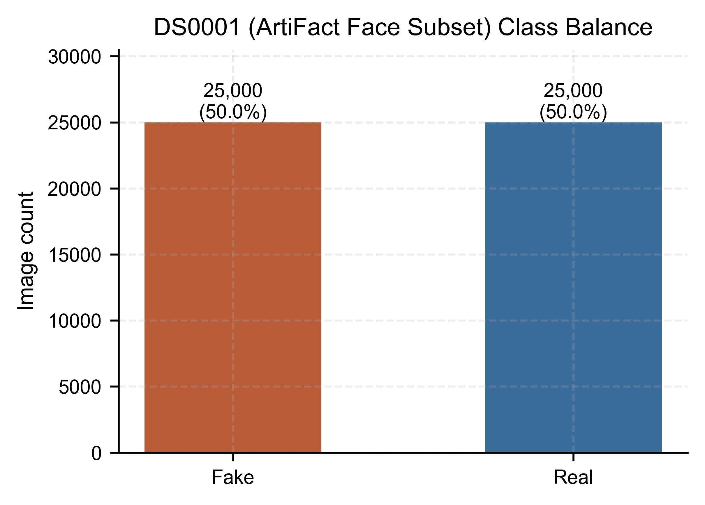

- **Caption:** Class distribution of ArtiFact (ArtiFact 50k face subset): balanced real/fake split used for primary training.
- **Specification:** `09_Figures/specs/FIG0001_spec.md`
- **Data / Diagram Source:** `03_Datasets/reports/eda_class_distribution.csv` (filter `Dataset ID=ArtiFact).
- **Responsible Script / Source:** `04_Preprocessing/notebooks/STEP023_KAGGLE_EDA.md` / `17_Automation/dataset_eda`.

## Figure 2

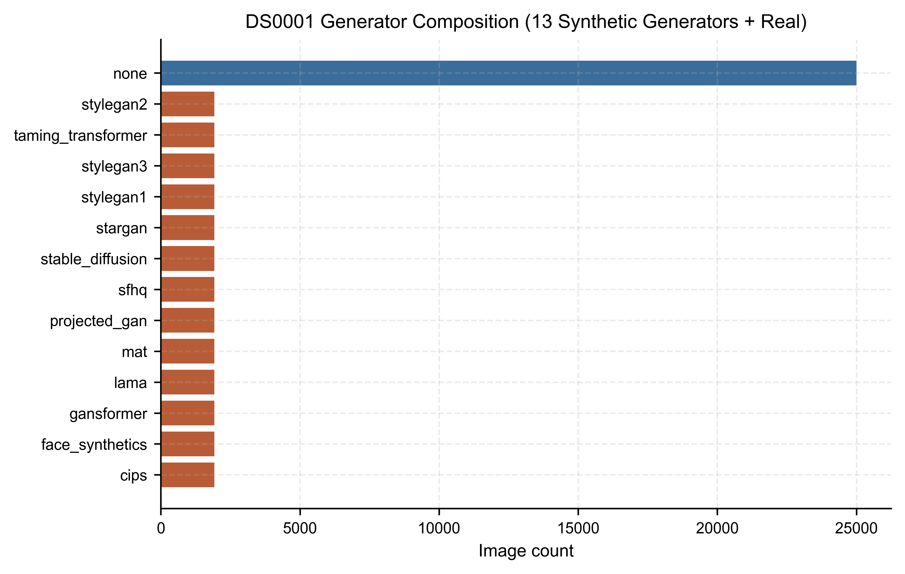

- **Caption:** Generator distribution in ArtiFact: real images labeled `none`; synthetic faces span 13 generators at near-equal counts.
- **Specification:** `09_Figures/specs/FIG0002_spec.md`
- **Data / Diagram Source:** `03_Datasets/reports/eda_generator_distribution.csv` (filter `Dataset ID=ArtiFact).
- **Responsible Script / Source:** `04_Preprocessing/notebooks/STEP023_KAGGLE_EDA.md` / `17_Automation/dataset_eda`.

## Figure 3

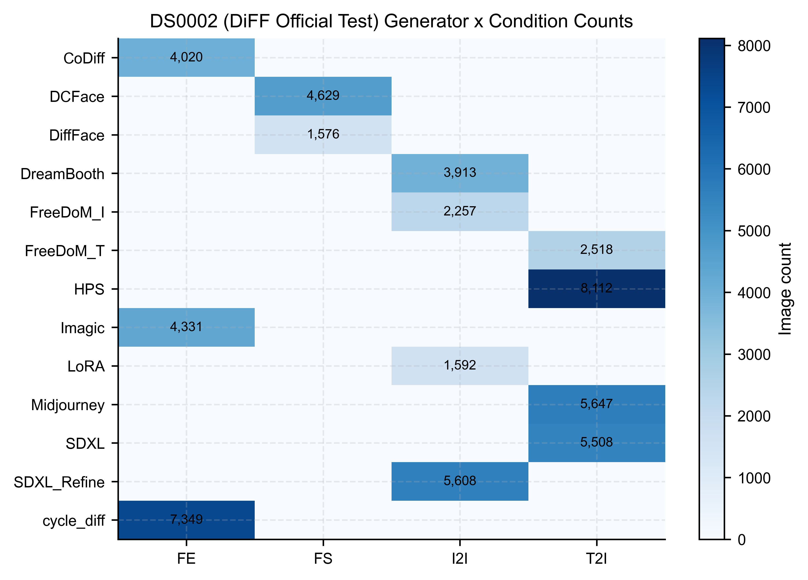

- **Caption:** DiFF DiFF official TEST composition across 13 generators and four synthesis conditions (all synthetic; pristine excluded).
- **Specification:** `09_Figures/specs/FIG0003_spec.md`
- **Data / Diagram Source:** `03_Datasets/reports/eda_generator_distribution.csv` (filter `Dataset ID=DiFF).
- **Responsible Script / Source:** `04_Preprocessing/notebooks/STEP023_KAGGLE_EDA.md` / `17_Automation/dataset_eda`.

## Figure 4

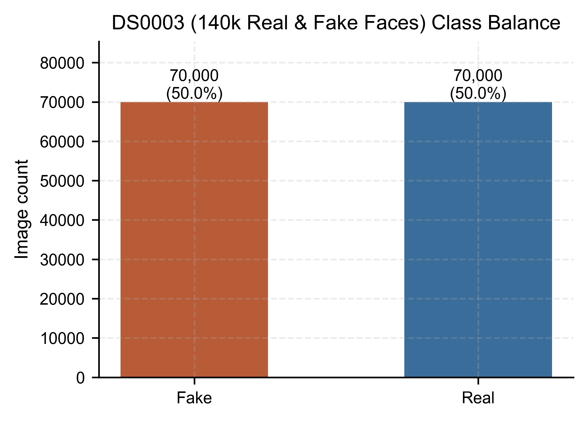

- **Caption:** 140k Real and Fake Faces class distribution (StyleGAN fakes vs real faces) used for rapid baseline training on Kaggle.
- **Specification:** `09_Figures/specs/FIG0004_spec.md`
- **Data / Diagram Source:** `03_Datasets/reports/eda_class_distribution.csv` (filter `Dataset ID=140k Real and Fake Faces).
- **Responsible Script / Source:** `04_Preprocessing/notebooks/STEP023_KAGGLE_EDA.md` / `17_Automation/dataset_eda`.

## Figure 5

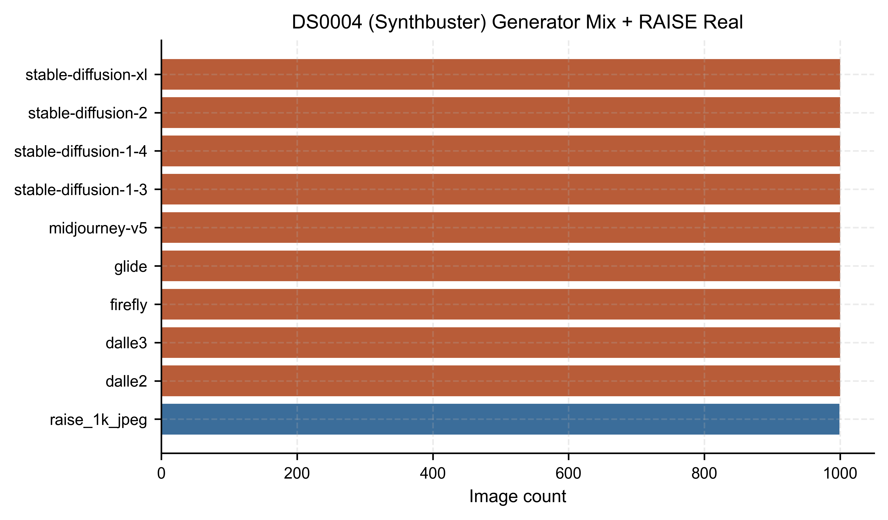

- **Caption:** Synthbuster Synthbuster composition: ~1k RAISE JPEG reals and 1k images per synthetic generator.
- **Specification:** `09_Figures/specs/FIG0005_spec.md`
- **Data / Diagram Source:** `03_Datasets/reports/eda_generator_distribution.csv` (filter `Dataset ID=Synthbuster).
- **Responsible Script / Source:** `04_Preprocessing/notebooks/STEP023_KAGGLE_EDA.md` / `17_Automation/dataset_eda`.

## Figure 6

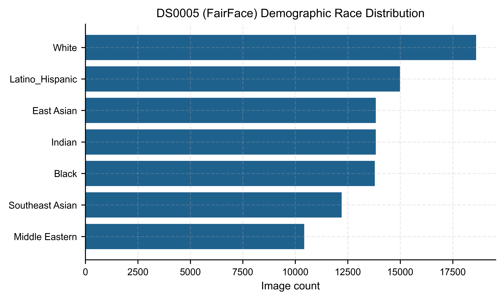

- **Caption:** FairFace FairFace race distribution (padding 0.25) used for demographic fairness checks of the forensic analyst.
- **Specification:** `09_Figures/specs/FIG0006_spec.md`
- **Data / Diagram Source:** `03_Datasets/reports/eda_demographic_distribution.csv` (filter `Dataset ID=FairFace, `Attribute=race`).
- **Responsible Script / Source:** `04_Preprocessing/notebooks/STEP023_KAGGLE_EDA.md` / `17_Automation/dataset_eda`.

## Figure 7

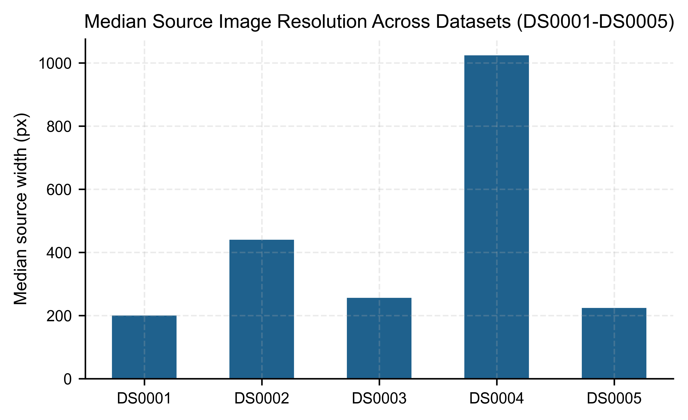

- **Caption:** Image resolution distributions from EDA pixel samples; ArtiFact/140k Real and Fake Faces/FairFace are fixed-size while DiFF/Synthbuster vary.
- **Specification:** `09_Figures/specs/FIG0007_spec.md`
- **Data / Diagram Source:** `03_Datasets/reports/eda_resolution_distribution.csv`.
- **Responsible Script / Source:** `04_Preprocessing/notebooks/STEP023_KAGGLE_EDA.md` / `17_Automation/dataset_eda`.

## Figure 8

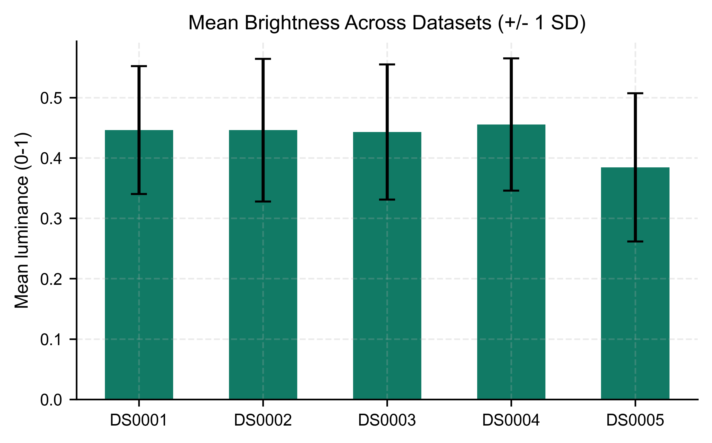

- **Caption:** Per-dataset brightness summary from stratified EDA pixel samples (thumbnail ≤256 px).
- **Specification:** `09_Figures/specs/FIG0008_spec.md`
- **Data / Diagram Source:** `03_Datasets/reports/eda_brightness_stats.csv` (filter `Stratum=ALL`).
- **Responsible Script / Source:** `04_Preprocessing/notebooks/STEP023_KAGGLE_EDA.md` / `17_Automation/dataset_eda`.

## Figure 9

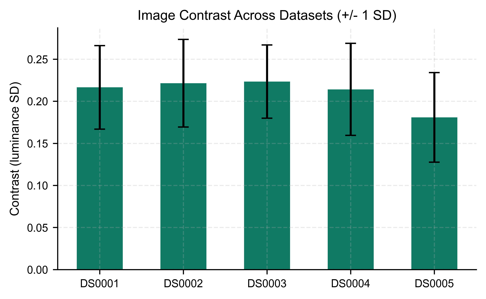

- **Caption:** Per-dataset contrast summary from stratified EDA pixel samples.
- **Specification:** `09_Figures/specs/FIG0009_spec.md`
- **Data / Diagram Source:** `03_Datasets/reports/eda_contrast_stats.csv` (filter `Stratum=ALL`).
- **Responsible Script / Source:** `04_Preprocessing/notebooks/STEP023_KAGGLE_EDA.md` / `17_Automation/dataset_eda`.

## Figure 10

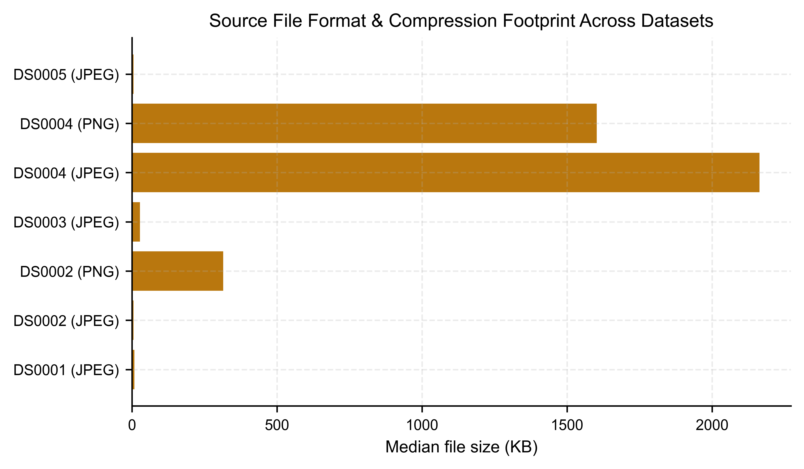

- **Caption:** Compression and container formats observed in EDA pixel samples.
- **Specification:** `09_Figures/specs/FIG0010_spec.md`
- **Data / Diagram Source:** `03_Datasets/reports/eda_compression_stats.csv`.
- **Responsible Script / Source:** `04_Preprocessing/notebooks/STEP023_KAGGLE_EDA.md` / `17_Automation/dataset_eda`.

## Figure 11

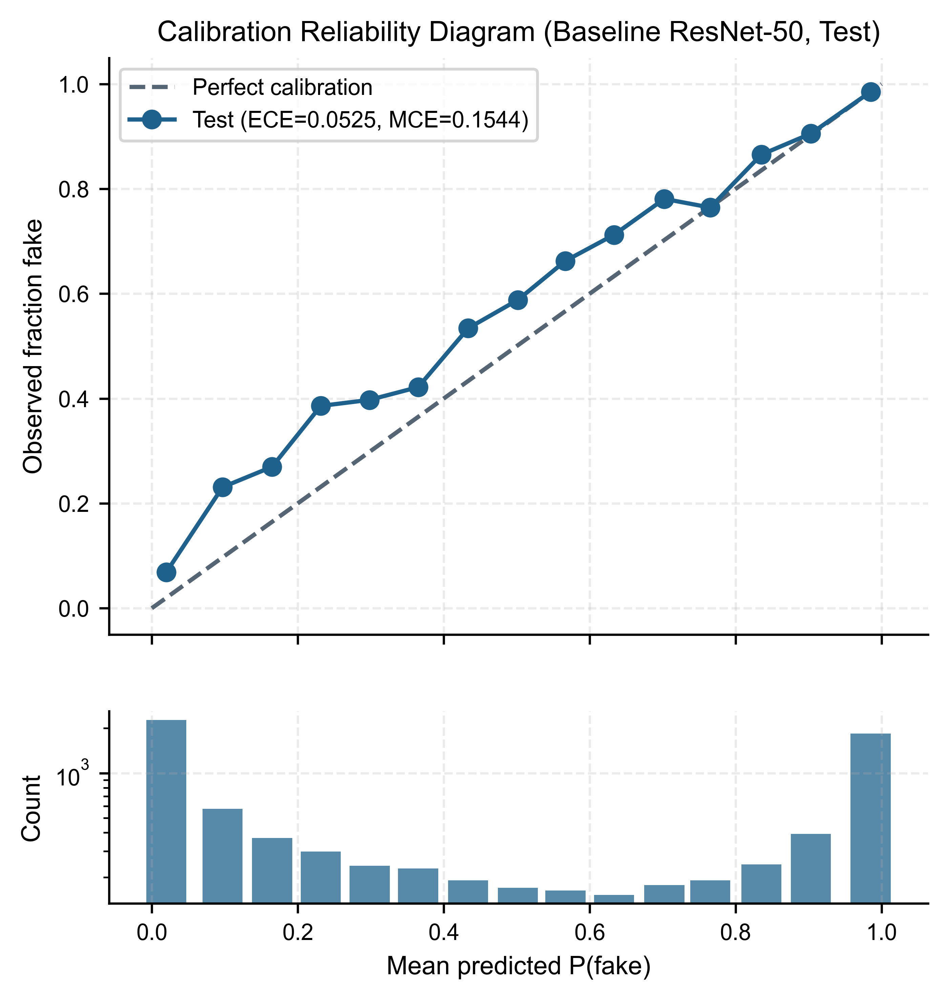

- **Caption:** Reliability of Baseline ResNet-50 P(fake) on the Baseline ResNet-50 test split, 15 equal-width bins. ECE and MCE in the caption come from `calibration_summary.csv`.
- **Specification:** `09_Figures/specs/FIG0011_spec.md`
- **Data / Diagram Source:** `08_Evaluation/evaluation suite/reliability.csv`; `08_Evaluation/evaluation suite/calibration_summary.csv`.
- **Responsible Script / Source:** `17_Automation/calibration_threshold` (`python -m calibration_threshold`).

## Figure 12

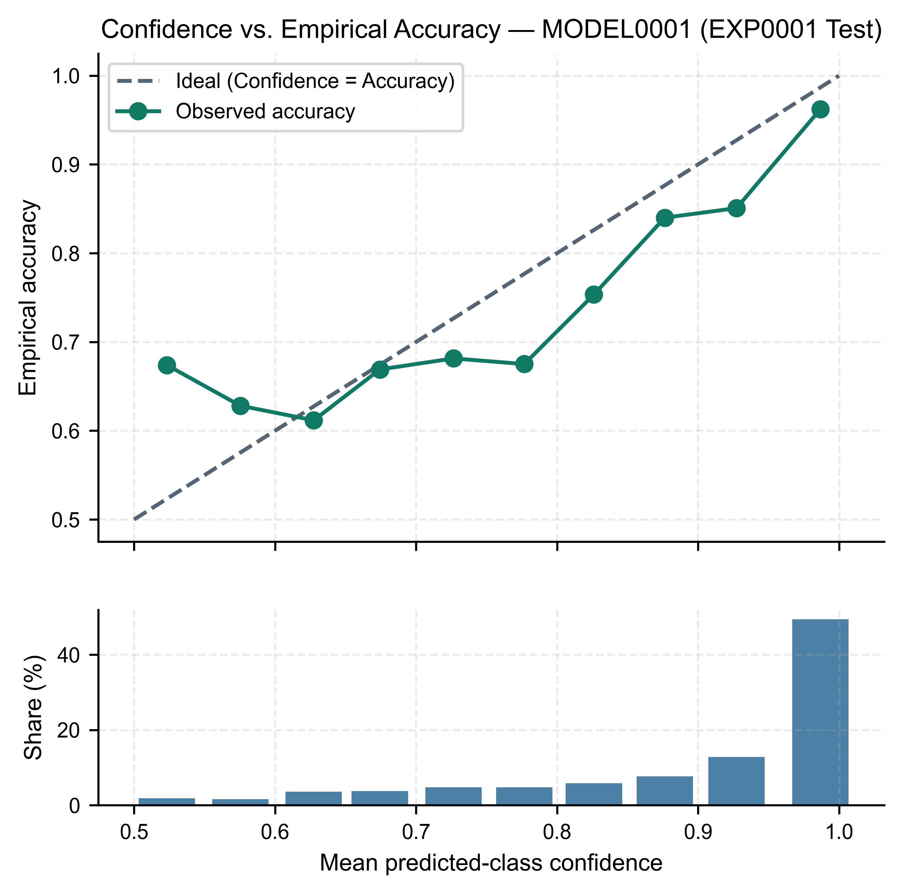

- **Caption:** Confidence is max(p, 1 − p) for the predicted class at threshold 0.395. Where accuracy sits below mean confidence, the model is overconfident.
- **Specification:** `09_Figures/specs/FIG0012_spec.md`
- **Data / Diagram Source:** `08_Evaluation/evaluation suite/confidence_distribution.csv`.
- **Responsible Script / Source:** `17_Automation/calibration_threshold` (`python -m calibration_threshold`).

## Figure 13

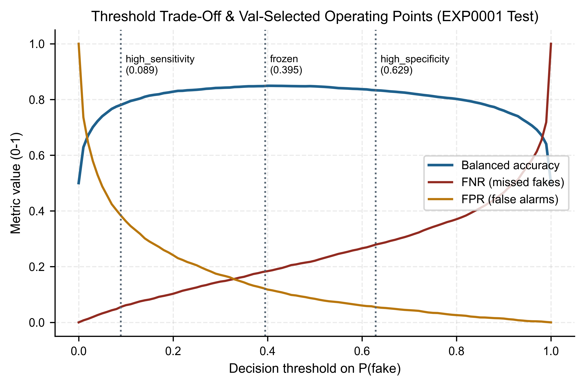

- **Caption:** Error rates and scores on the Baseline ResNet-50 test split across thresholds. Markers are thresholds chosen on val and applied to test unchanged.
- **Specification:** `09_Figures/specs/FIG0013_spec.md`
- **Data / Diagram Source:** `08_Evaluation/evaluation suite/threshold_sweep.csv`; `08_Evaluation/evaluation suite/operating_points.csv`.
- **Responsible Script / Source:** `17_Automation/calibration_threshold` (`python -m calibration_threshold`).

## Figure 14

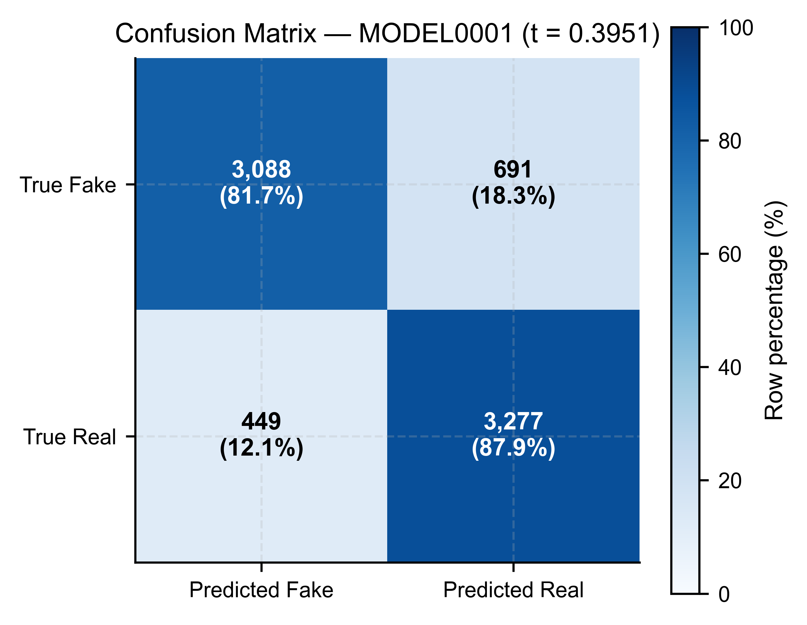

- **Caption:** Confusion matrix of Baseline ResNet-50 on the Baseline ResNet-50 test split (n = 7505) at threshold 0.395, chosen on val. Cells show count and share of the true class.
- **Specification:** `09_Figures/specs/FIG0014_spec.md`
- **Data / Diagram Source:** `08_Evaluation/evaluation suite/confusion_matrix.csv`.
- **Responsible Script / Source:** `17_Automation/failure_analysis` (`python -m failure_analysis`).

## Figure 15

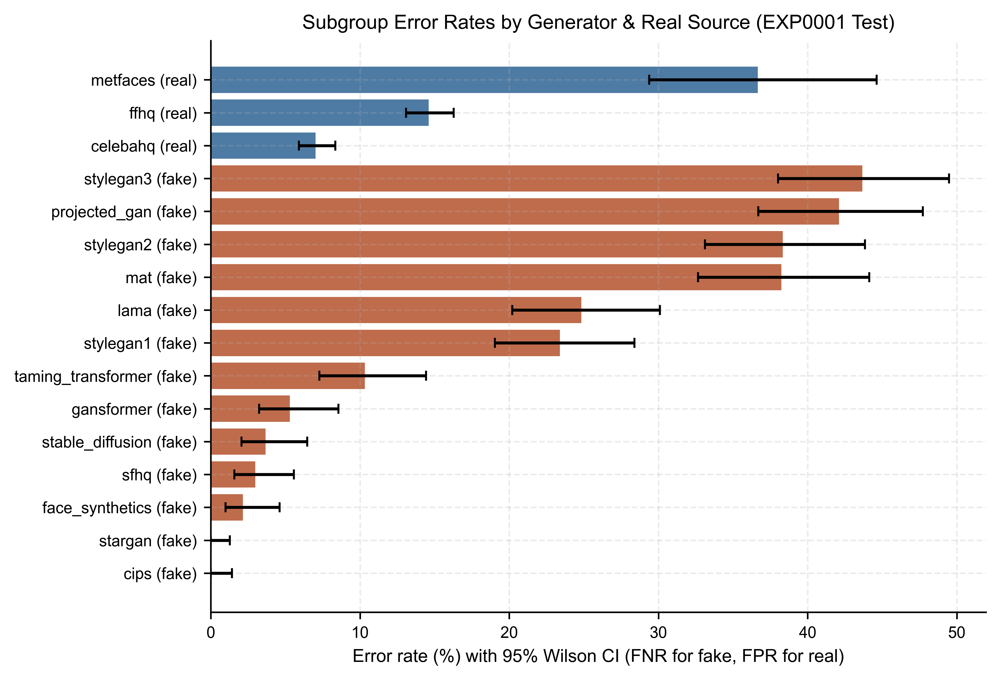

- **Caption:** Error rates by generator (false negatives) and real source (false positives) on the Baseline ResNet-50 test split at threshold 0.395. Intervals are per group, not corrected for multiple comparisons.
- **Specification:** `09_Figures/specs/FIG0015_spec.md`
- **Data / Diagram Source:** `08_Evaluation/evaluation suite/error_by_group.csv`; `08_Evaluation/evaluation suite/per_class_stats.csv`.
- **Responsible Script / Source:** `17_Automation/failure_analysis` (`python -m failure_analysis`).

## Figure 16

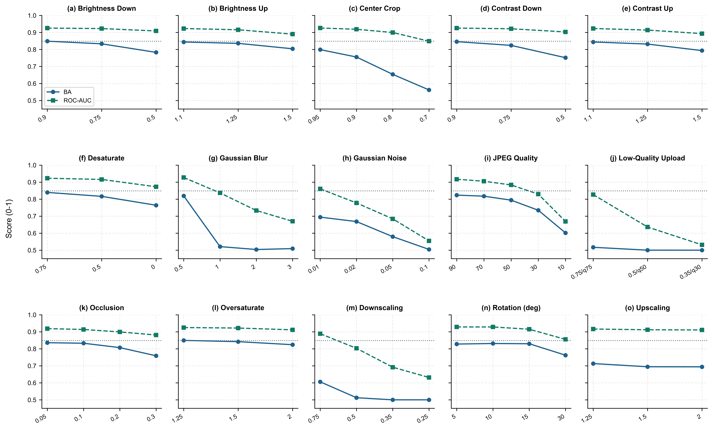

- **Caption:** Balanced accuracy (frozen threshold 0.395) and ROC-AUC of Baseline ResNet-50 under graded perturbations of the Baseline ResNet-50 test split (n = 7505 per condition). Where ROC-AUC holds while balanced accuracy falls, the probabilities shifted rather than the ranking.
- **Specification:** `09_Figures/specs/FIG0016_spec.md`
- **Data / Diagram Source:** `08_Evaluation/evaluation suite/robustness/robustness_metrics.csv`; tolerance in `08_Evaluation/evaluation suite/robustness/config.yaml`.
- **Responsible Script / Source:** `08_Evaluation/evaluation suite/robustness/STEP046_robustness.ipynb` → `python -m robustness analyze`.

## Figure 17

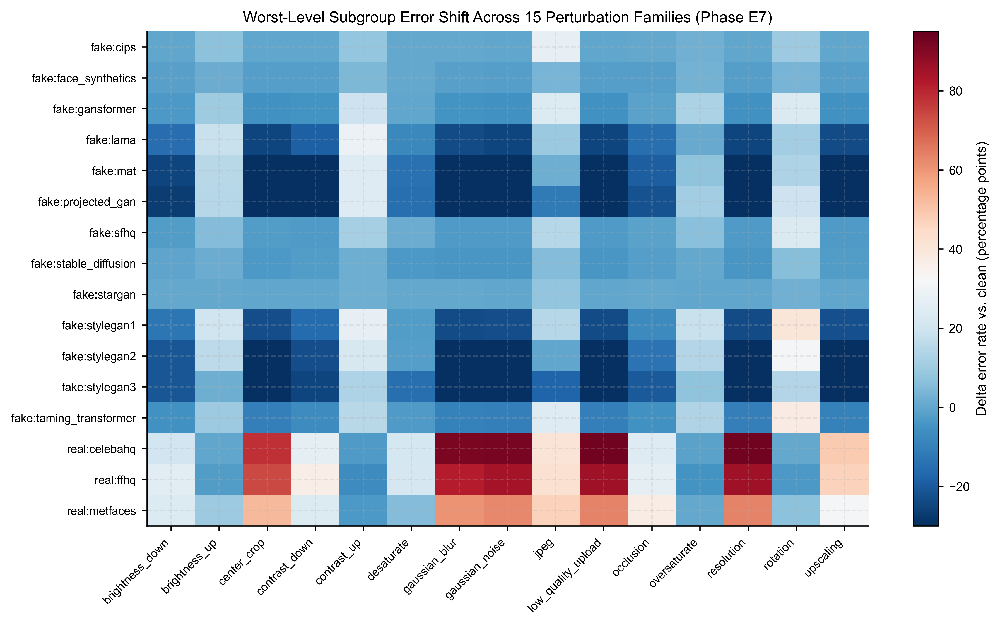

- **Caption:** Change in error rate per generator and real source at each perturbation's worst level, Baseline ResNet-50 test split, threshold 0.395. Clean rates are in Figure 15.
- **Specification:** `09_Figures/specs/FIG0017_spec.md`
- **Data / Diagram Source:** `08_Evaluation/evaluation suite/robustness/robustness_by_group.csv`; `08_Evaluation/evaluation suite/robustness/robustness_summary.csv`.
- **Responsible Script / Source:** `08_Evaluation/evaluation suite/robustness/STEP046_robustness.ipynb` → `python -m robustness analyze`.

## Figure 18

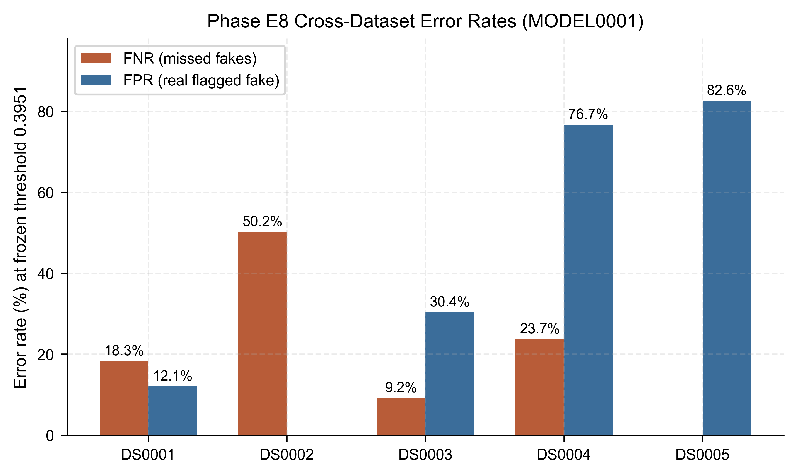

- **Caption:** Baseline ResNet-50 (trained on ArtiFact) at its frozen threshold 0.395 on ArtiFact test and four other datasets. Fake-only datasets have no FPR; real-only datasets have no FNR. FairFace is a fixed 10,000-image sample.
- **Specification:** `09_Figures/specs/FIG0018_spec.md`
- **Data / Diagram Source:** `08_Evaluation/evaluation suite/generalization/cross_dataset_metrics.csv`; `08_Evaluation/evaluation suite/generalization/cross_dataset_by_generator.csv`.
- **Responsible Script / Source:** `08_Evaluation/evaluation suite/generalization/STEP047_cross_dataset.ipynb` → `python -m generalization analyze`.

## Figure 19

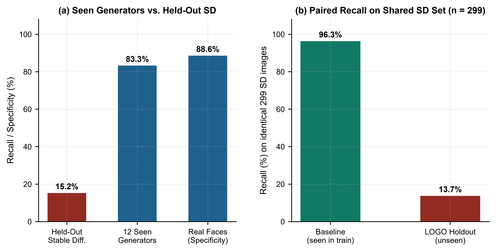

- **Caption:** LOGO Holdout ResNet-50 (LOGO Holdout) was trained without Stable Diffusion; recall on Stable Diffusion test images at its val-chosen threshold, against seen generators on val. Panel B compares Baseline ResNet-50 and LOGO Holdout ResNet-50 on the 299 Stable Diffusion images in the Baseline ResNet-50 test split.
- **Specification:** `09_Figures/specs/FIG0019_spec.md`
- **Data / Diagram Source:** `08_Evaluation/evaluation suite/unseen_generator/unseen_detection.csv`; `08_Evaluation/evaluation suite/unseen_generator/unseen_paired.csv`.
- **Responsible Script / Source:** `06_Experiments/LOGO Holdout/notebook/LOGO Holdout_train.ipynb` (training) → `python -m generalization unseen`.

## Figure 20

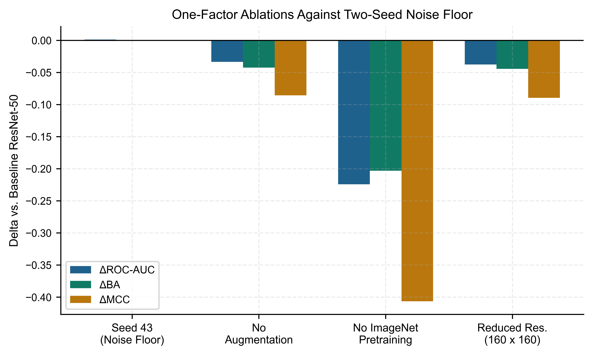

- **Caption:** One-factor ablations of the Baseline ResNet-50 ResNet-50 baseline on the grouped random split test split, each at its own val-chosen threshold. The band shows the change caused by the training seed alone (Seed-43 Replicate). Single runs; paired tests are in `08_Evaluation/statistics/statistics_report.md` and do not support a superiority claim.
- **Specification:** `09_Figures/specs/FIG0020_spec.md`
- **Data / Diagram Source:** `08_Evaluation/ablations/ablation_results.csv`.
- **Responsible Script / Source:** `06_Experiments/ablations/STEP048_ablations.ipynb` (training) → `python -m ablation evaluate`.

## Figure 21

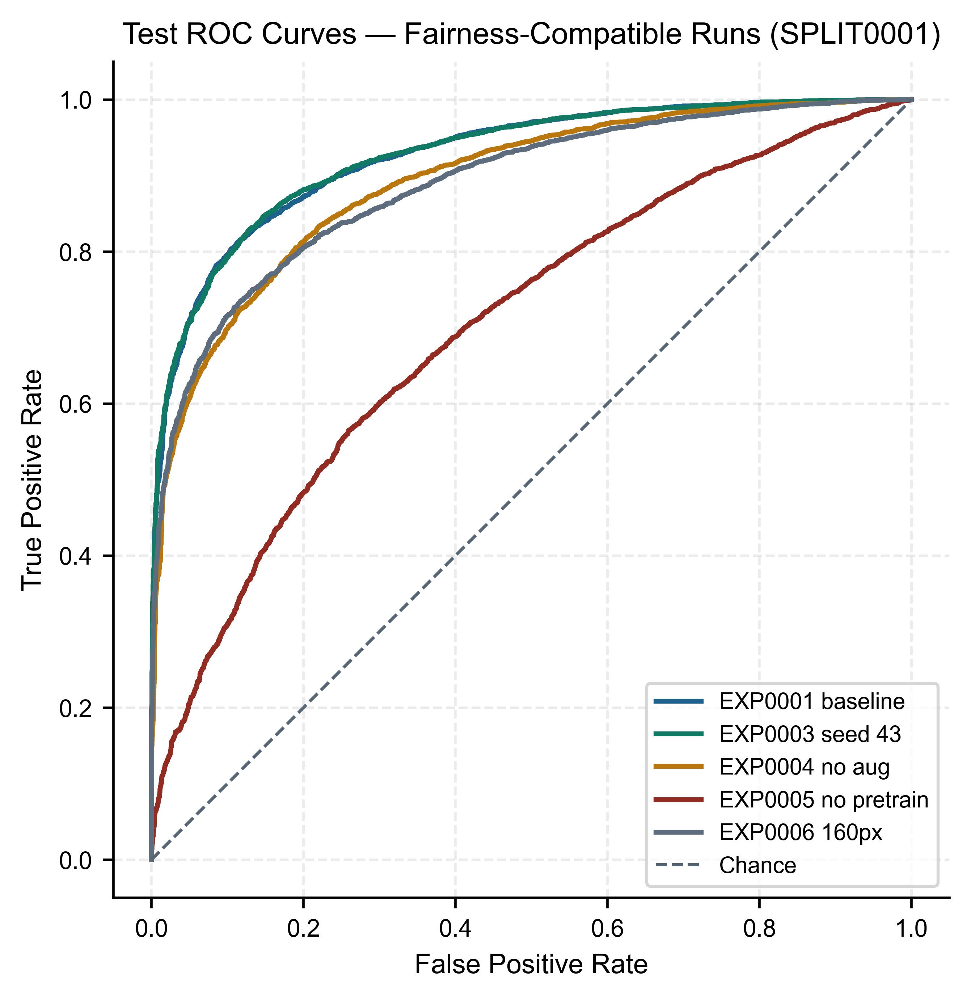

- **Caption:** Test ROC curves for Baseline ResNet-50 and the one-factor runs on the same split. Intervals and the decision to make no superiority claim are in the statistics report.
- **Specification:** `09_Figures/specs/FIG0021_spec.md`
- **Data / Diagram Source:** `08_Evaluation/Baseline ResNet-50/roc_curve.csv` and the same filename under Seed-43 Replicate … 160px Resolution Ablation.
- **Responsible Script / Source:** `python -m evaluation_trigger` wrote the curves; this spec does not recompute them.

## Figure 22

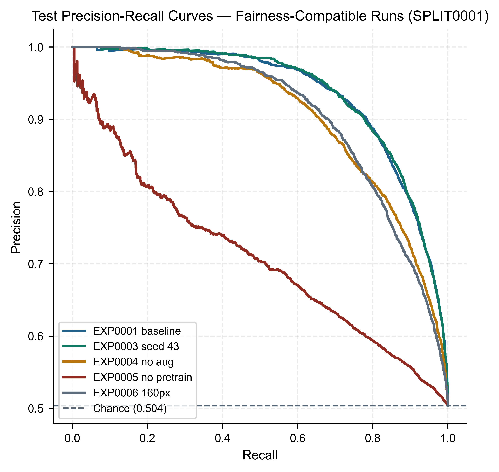

- **Caption:** Test precision-recall curves for Baseline ResNet-50 and the one-factor runs. Chance is the fake share of the grouped random split test split, not 0.5.
- **Specification:** `09_Figures/specs/FIG0022_spec.md`
- **Data / Diagram Source:** `08_Evaluation/Baseline ResNet-50/pr_curve.csv` and the same filename under Seed-43 Replicate … 160px Resolution Ablation.
- **Responsible Script / Source:** `python -m evaluation_trigger`.

## Figure 23

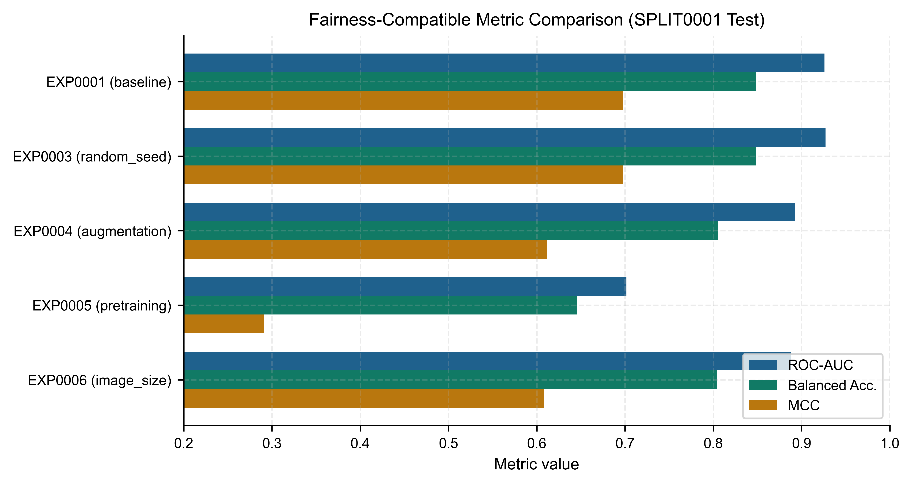

- **Caption:** grouped random split test metrics for experiments that share ArtiFact / v1.0 / preprocessing pipeline / grouped random split. No bar is marked as a winner. Statistical intervals are in `08_Evaluation/statistics/paired_tests.csv`.
- **Specification:** `09_Figures/specs/FIG0023_spec.md`
- **Data / Diagram Source:** `08_Evaluation/comparison_tables.csv`.
- **Responsible Script / Source:** `python -m comparison`.

## Figure 24

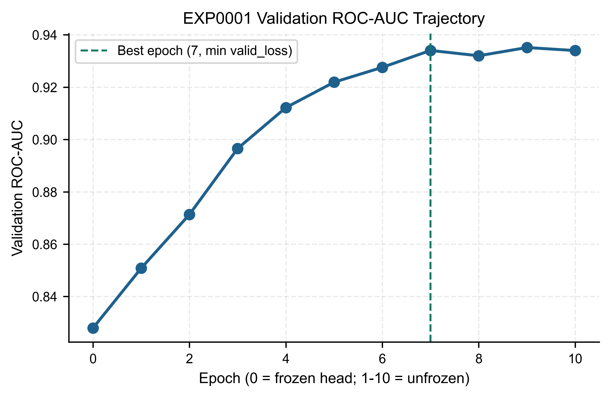

- **Caption:** Validation ROC-AUC during the completed Baseline ResNet-50 session. Earlier sessions in the same log file are abandoned runs and are not plotted.
- **Specification:** `09_Figures/specs/FIG0024_spec.md`
- **Data / Diagram Source:** `06_Experiments/Baseline ResNet-50/logs/Baseline ResNet-50_epochs.csv`; session id from `06_Experiments/Baseline ResNet-50/metrics/run_summary.json`.
- **Responsible Script / Source:** The Baseline ResNet-50 training log. This spec does not refit the model.

## Figure 25

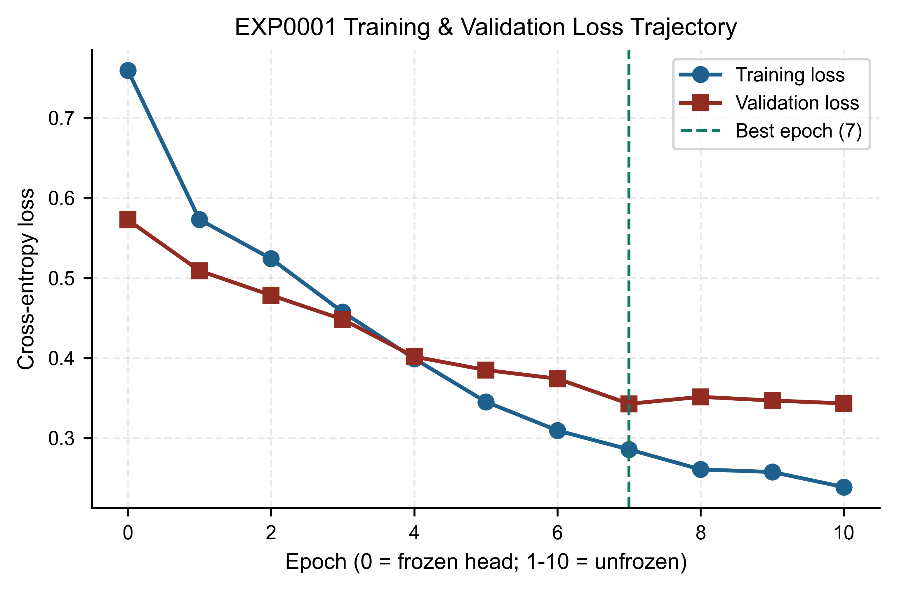

- **Caption:** Train and validation loss for the completed Baseline ResNet-50 session. The best epoch is chosen by validation ROC-AUC, not by the lowest validation loss.
- **Specification:** `09_Figures/specs/FIG0025_spec.md`
- **Data / Diagram Source:** `06_Experiments/Baseline ResNet-50/logs/Baseline ResNet-50_epochs.csv`; session id from `06_Experiments/Baseline ResNet-50/metrics/run_summary.json`.
- **Responsible Script / Source:** The Baseline ResNet-50 training log.

## Figure 26

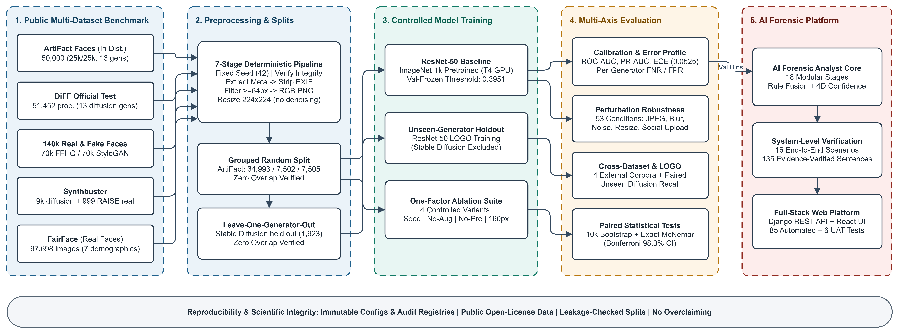

- **Caption:** End-to-end reproducible research and evaluation pipeline spanning public dataset curation (ArtiFact–FairFace), seven-stage preprocessing (deterministic preprocessing pipeline), leakage-checked grouped (grouped random split) and leave-one-generator-out (leave-one-generator-out split) splitting, six GPU experiments (Baseline ResNet-50–160px Resolution Ablation), Phases E1–E18 evaluation (evaluation suite), and whole-platform AI Forensic Analyst verification (whole-platform verification).
- **Specification:** `09_Figures/specs/FIG0026_spec.md`
- **Data / Diagram Source:** `03_Datasets/metadata/dataset_registry.csv`; `06_Experiments/experiment_registry.csv`; `08_Evaluation/evaluation_registry.csv`.
- **Responsible Script / Source:** Editable Draw.io source `09_Figures/diagrams/FIG0026.drawio`.

## Figure 27

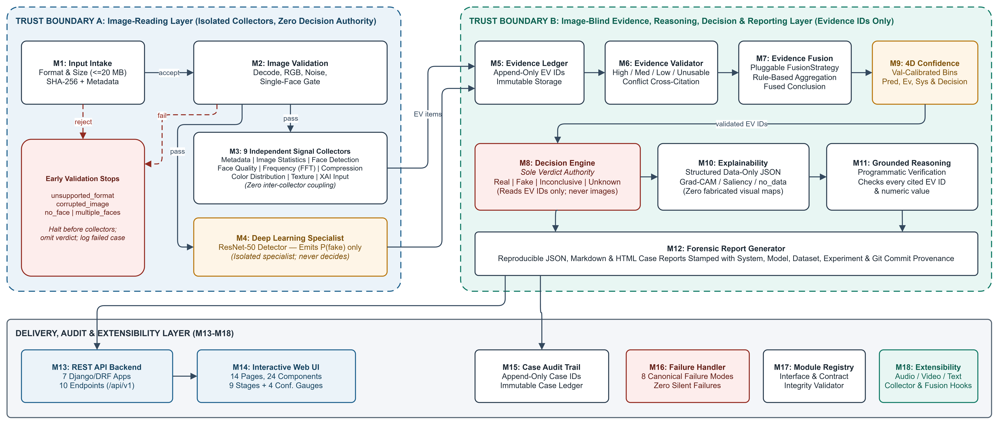

- **Caption:** Architecture and trust boundaries of the 18-module AI Forensic Analyst (M1–M18). Raw image bytes are accessible only to intake (M1), validation (M2), and isolated evidence collectors (M3, M4); the Decision Engine (M8) reads validated `EV` identifiers only, while M16 records all eight canonical failure modes without silent fallback.
- **Specification:** `09_Figures/specs/FIG0027_spec.md`
- **Data / Diagram Source:** `11_AI_Forensic_System/module_registry.csv`; `11_AI_Forensic_System/architecture.md`.
- **Responsible Script / Source:** Editable Draw.io source `09_Figures/diagrams/FIG0027.drawio`.

## Figure 28

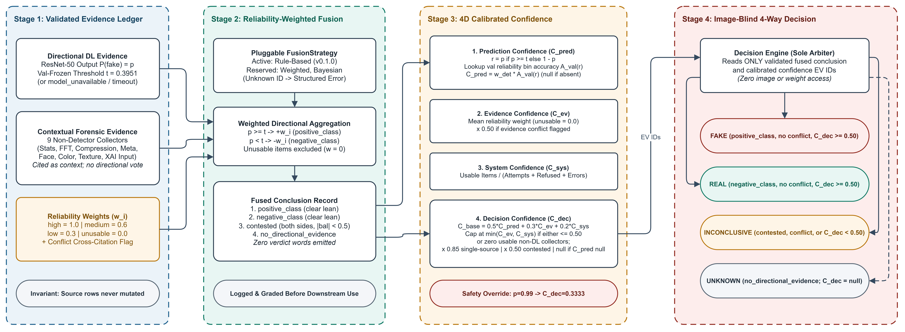

- **Caption:** Reliability-weighted evidence fusion (M7), four-dimensional validation-calibrated confidence estimation (M9), and image-blind four-way decision rules (M8). Unusable supporting evidence or specialist conflict caps `decision_confidence` below `0.50`, routing high raw detector scores to `Inconclusive` rather than forcing an unverified binary verdict; missing directional evidence yields `Unknown` with `null` prediction and decision confidence.
- **Specification:** `09_Figures/specs/FIG0028_spec.md`
- **Data / Diagram Source:** `01_Project_Management/decision_log/.md`; `01_Project_Management/decision_log/.md`; `11_AI_Forensic_System/fusion/fusion_config.json`; `11_AI_Forensic_System/confidence/confidence_config.json`; `11_AI_Forensic_System/decision/decision_config.json`.
- **Responsible Script / Source:** Editable Draw.io source `09_Figures/diagrams/FIG0028.drawio`.

## Figure 29

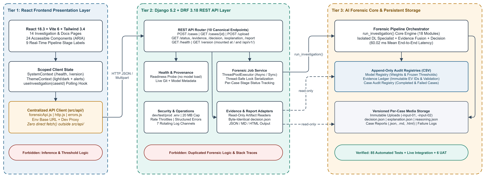

- **Caption:** Three-tier system architecture connecting the React 18 frontend (`12_Web`, M14, 14 pages, 24 accessible components), the seven-app Django/DRF REST API (`13_Backend`, M13, 10 endpoints, `_PIPELINE_LOCK` thread safety), and the 18-module AI Forensic Analyst core (`11_AI_Forensic_System`) with append-only CSV registries and versioned per-case media storage.
- **Specification:** `09_Figures/specs/FIG0029_spec.md`
- **Data / Diagram Source:** `16_Documentation/architecture.md`; `16_Documentation/workflow_diagrams/system_architecture.md`.
- **Responsible Script / Source:** Editable Draw.io source `09_Figures/diagrams/FIG0029.drawio`.

## Figure 30

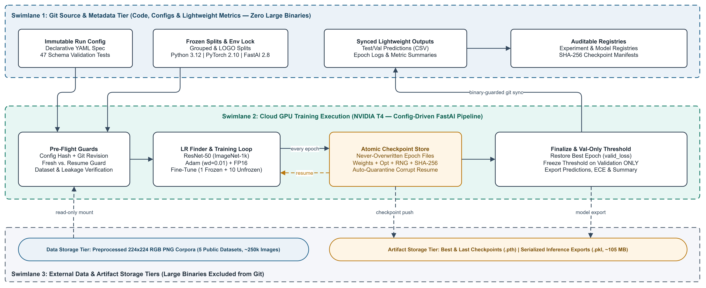

- **Caption:** Config-driven FastAI training and fault-tolerant checkpoint architecture (`17_Automation/training/`). Every run validates immutable YAML configs and dataset splits prior to GPU execution, writes never-overwritten SHA-256 recovery checkpoints (`EXPxxxx_epoch_NNN.pth`) with full RNG/optimizer restoration and automatic corrupt-file quarantine, freezes operating thresholds strictly on validation, and enforces binary separation between GitHub and Kaggle.
- **Specification:** `09_Figures/specs/FIG0030_spec.md`
- **Data / Diagram Source:** `17_Automation/training/README.md`; `06_Experiments/Baseline ResNet-50/config.yaml`.
- **Responsible Script / Source:** Editable Draw.io source `09_Figures/diagrams/FIG0030.drawio`.
