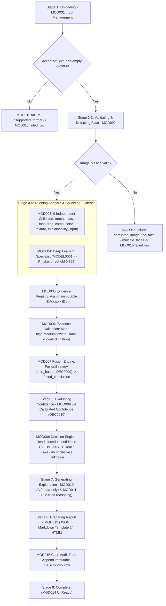

# AI Forensic Analyst Pipeline Workflow (`MOD001`–`MOD018`)

Companion to [architecture.md](../architecture.md) and [11_AI_Forensic_System/architecture.md](../../11_AI_Forensic_System/architecture.md).

## End-to-End Forensic Pipeline & Failure Gates

## Trust Boundaries (Who Reads Image Bytes vs. Who Decides)

- **Image bytes accessible:** `MOD001` (store), `MOD002` (validate), `MOD003`/`MOD004` collectors (per-collector isolation only).
- **Evidence IDs only (never image bytes):** `MOD005`–`MOD012`, `MOD015`.
- **Exclusive decision authority:** `MOD008` alone chooses `Real`, `Fake`, `Inconclusive`, or `Unknown` from validated `fused_conclusion` and `confidence` records.
- **Extensibility governance:** `MOD017` (module registry) & `MOD018` (new `EvidenceCollector` / `FusionStrategy` contract checks).
