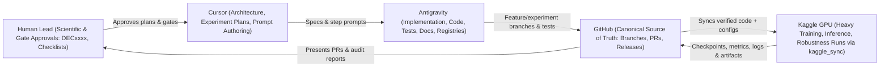
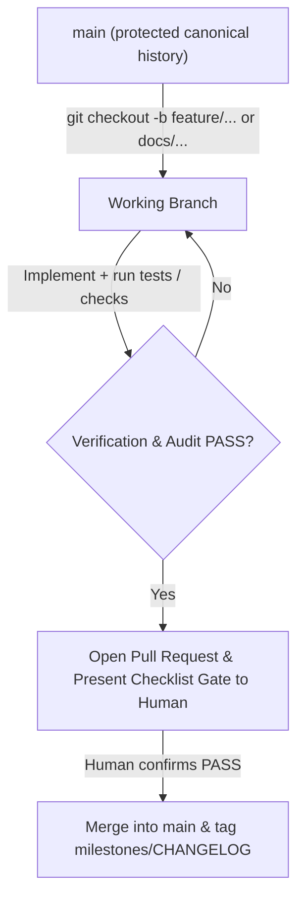

# Multi-Platform Research & Development Workflow

Companion to [developer_guide.md](../developer_guide.md) and [§10 Platform Workflow](../../MASTER_RESEARCH_OPERATING_SYSTEM.md#10-github--kaggle--antigravity-workflow).

## Branching & Promotion Flow

