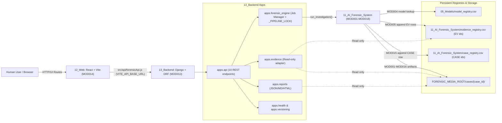
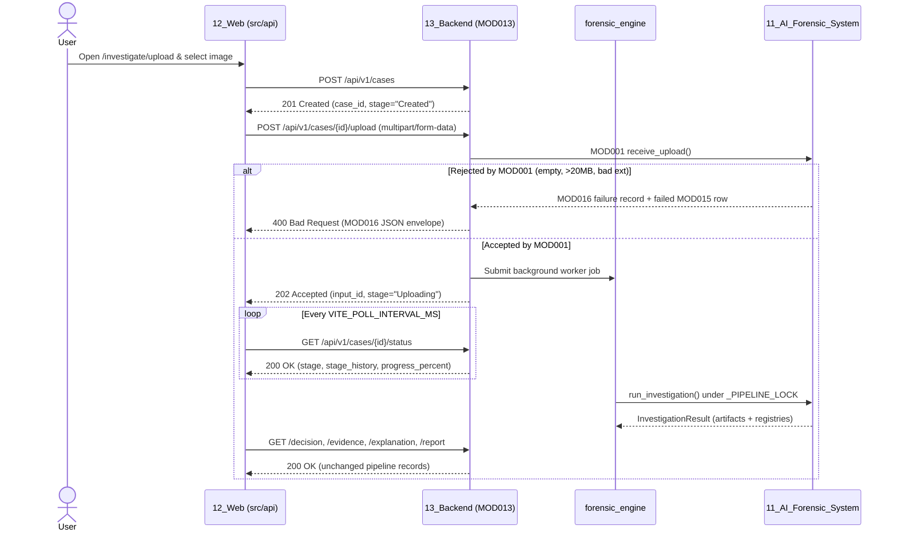

# Three-Tier System Architecture Diagram

Companion to [architecture.md](../architecture.md) and [integration_guide.md](../integration_guide.md).

## Component & Data-Flow Overview

## Asynchronous Investigation Sequence (`thread` mode)

